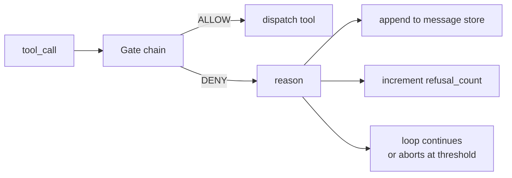
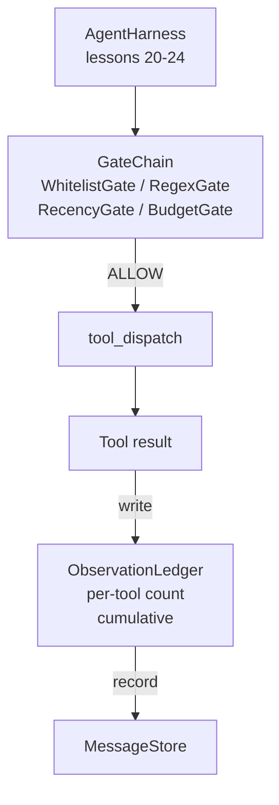

# 卡普斯通25课:验证门和观察预算

> 没有验证层的代理带是一个在子里的愿望. 这一课构建了确定性门链,决定工具调用是否允许开火,代理被允许看到多少输出,以及该循环必须停止什么时候,因为代理读了太多. 链接是小门的函数,加上一个观察账本,

**Type:** Build
**Languages:** Python (stdlib), TypeScript
**Prerequisites:** Phase 19 · 20-24 (Track A1: agent loop, tool registry, message store, prompt builder, model router), Phase 14 · 33 (instructions as constraints), Phase 14 · 36 (scope contracts), Phase 14 · 38 (verification gates)
**Time:** ~90 minutes

## 学习目标

- 建立一个`VerificationGate`具有确定性的协议`evaluate(call)`方法.
- 编译预算,最新,白名单和regex门,
- 通过一个 `ObservationLedger`按工具键键,然后转动.
- 拒绝在累计观察预算超过时进行工具调用.
- 表面结构`GateDecision`记录下下游可观测性可以摄入.

## 问题

当一个代理带允许模型自由地调用工具时,在实际使用的第一小时内出现三个类型的错误.

首先是无限的观察.一个200K线的回复投放了500万的输出代币.模型每千字节看到一个匹配,其余的文本是浪费的.代币账单很大,代理现在更糟糕,不是更好,在任务上.

第二个是过时的近期.一个长期运行的任务积累了五十个工具调用.模型从第三节重新读取了第一个读_文件,好像它是现实状态.第四十七节的编辑从来没有出现,因为提示构建器首先串行了最早的观察.

调查任务开始时,`web_search`后来,他最终就跑了.`shell`随着任何读取痕迹,一个垃圾文件已经坐在 /tmp,一个卷轴与一个私人API.

验证门是说不的带件.它不是模型.它不是法官.它是确定性函数.`(call, history, ledger)`结果是,如果我们不需要一个模型,我们就会发现一个模型,然后我们会看到一个模型.

## 概念



一个门是任何有一个`evaluate(call, ctx) -> GateDecision`链条是一个有序的列表. 评估在第一个否定时短路. 秩序问题:廉价的结构门运行在昂贵的代币计数门之前.

这一课有四个门:

- `WhitelistGate`允许的工具名称是明确的集合.任何外面的东西都被拒绝了.这是最便宜的门,是第一.
- `RegexGate`工具参数与regex相匹配. 对于拒绝 shell 电话使用有用`rm -rf`它们或 HTTP 调用到内部IP.
- `RecencyGate`模型只能看到从最后的N转折的观测. 较早的观测被掩盖. 门拒绝使用工具调用,结果将延长已经过时的观测窗口.
- `BudgetGate`模型在整个会议中读到的累计代币有限量. 当账本说到达了限量时,将拒绝每次进一步的工具调用.

观察账本是会计.每次成功的工具调用都会写一个行:工具名称,轮回,发行的代币,累计.账本回答两个问题:模型已经看到多少的工具,以及它已经看到多少的工具X.预算门读了第一.每工具的预算门,你将写作练习,读了第二个.

```figure
cg-gate-chain
```

## 建筑



链接要求链接.链接要么点点点点点点点点点点点点点点点点点点,工具运行,账本点点点点,结果被添加到消息存储中.如果拒绝,模型将被交给拒绝作为系统消息,循环决定是否重新尝试或中止.

## 你会建造什么

实施是单一的`main.py`另外还有一些检查.

1. `Observation`其他`ToolCall`电线形状的定义是数据类.
2. `ObservationLedger`记录`(turn, tool, tokens)`排列和答案`cumulative()`其他`per_tool(name)`现在,我们要去.
3. `GateDecision`运载`(allow, reason, gate_name)`现在,我们要去.
4. `VerificationGate`每个门都执行了`evaluate(call, ctx)`现在,我们要去.
5. `GateChain`打电话给每一个门,返回第一个拒绝,或者返回允许如果每个门通过.
6. 演示程序运行一个小的合成代理循环. 三轮. 第三轮开启预算门,循环报告一个清洁的拒绝,

代币计量器是故意的愚蠢`len(text) // 4`课程的重点是管道,而不是代币器.

## 为什么链条有所重要

否认比允许便宜.`WhitelistGate`运行$O(1)$查看了.`RegexGate`运行$O(\text{pattern} \cdot \text{argv})$现在,我们要去.`RecencyGate`读到一个小片的消息商店.`BudgetGate`您将通过成本上升来订购,所以拒绝通话之前,就会做昂贵的工作.

现在,我们需要一个新的方法来解决问题,我们需要一个新的方法来解决问题,我们需要一个新的方法来解决问题,我们需要一个新的方法来解决问题.

## 如何与A轨道的其他部分相结合

在前几堂课程中,你得到了循环,工具注册表,消息存储器,提示构建器和模型路由器. 这一课增加了模型和工具之间的层次. 课26将把工具调用到导航器的沙箱上,一旦门链说"允许". 课27将记录拒绝的评价带作为质量信号. 课程28将门决策导向OpenTelemetry范围. 课29将所有东西入一个工作的编码代理中.

## 运行它

```bash
cd phases/19-capstone-projects/25-verification-gates-observation-budget
python3 code/main.py
npx tsx code/main.ts
python3 -m pytest code/tests/ -v
```

测试将包括每一个门的决定,并从零出发.测试覆盖本书,每个门的隔离,链路短路,和合成循环端到端.
