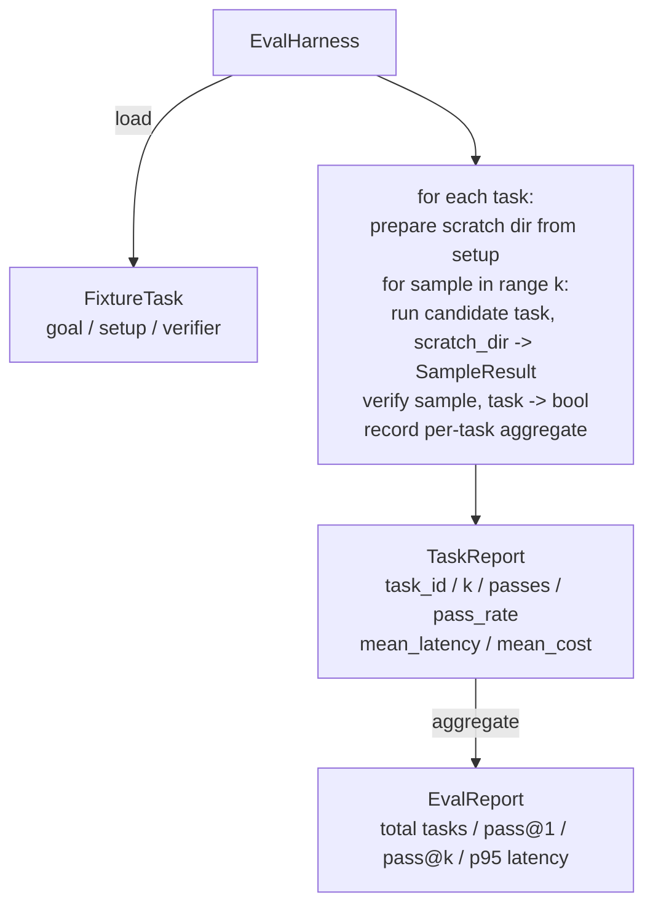

# 石头27课:同等地使用杆

> 编码代理只能像你测量它的任务一样好. 这一课构建了一个评估链,它采用了一个固定任务文件,通过候选代理运行每个任务,通过确定性验证器通过分数或失败,并将结果汇集成pass@1,pass@k,平均延迟和平均成本. 连接是真理的来源,让你能从一个反因子中辨别回归.

**Type:** Build
**Languages:** Python (stdlib), TypeScript
**Prerequisites:** Phase 19 · 25 (verification gates), Phase 19 · 26 (sandbox runner), Phase 14 · 30 (eval-driven agent development), Phase 14 · 19 (SWE-bench and GAIA benchmarks)
**Time:** ~90 minutes

## 学习目标

- 定义一个固定任务为目标,设置和验证器的三倍.
- 按任务进行多个样本运行,并计算pass@1和pass@k.
- 总结延迟和成本成平均和95%的指标.
- 转换为可重复使用函数的电线定制验证器 (文件差,出口代码,regex匹配).
- 发出一个结构化的JSON报告,可以吸收的回归跟踪脚本.

## 问题

没有评估带的3种失败模式.

首先是未经验证的通过. 代理说它修复了错误,人类看着差异,套件标记为绿色,三周后回归测试显示了相同的错误. 代理认为可以合理的推理,但实际上没有修复任何东西.

另一个是未被检测到的回归. 调整提示模板使代理在高声任务上提高4%和安静任务上降低14%. 没有黄金集和每任务分数,回归只会进入主页,只有当客户抱怨时才会出现.

周一,我们做了100项任务,周五做了95,因为有人改名了五项任务. 合格率看起来像5%的改善.

连接器是把这些失败变成事实的程序. 它运行每一个固定,每一次,以可复制的顺序,

## 概念

```mermaid
flowchart LR
  F1[fixtures/task_001/<br/>task.json + expected/] --> Harness
  F2[fixtures/task_002/<br/>...] --> Harness
  Harness[Harness<br/>for each task:<br/>setup / run agent k samples /<br/>verify each sample /<br/>record latency, cost]
  Harness --> Report[EvalReport<br/>pass@1 / pass@k<br/>mean ms / p95 ms<br/>mean cost]
```

`FixtureTask`是一个小的 JSON 文件加上一个可选的 `expected/`文件目录.JSON声明一个`id`其他`goal`报警人员的通知,`setup`文件将落入""中,`verifier`验证器块在使用器的验证器登记册中命名一个函数,并提供其参数.

验证器的三个形状涵盖了大多数有用任务.

第一个是`file_equals`经过代理运行后,将命名的文件与预期内容进行比较.

第二个是`regex_match`文件的内容与regex相匹配. 这捕捉到"函数必须存在并返回X"任务,其中有许多可接受的解决方案.

第三个是`shell_exit_zero`带运行一个器命令 (从第26课中的沙箱中通过),只有命令出于零时才能通过任务. 这可以捕获"测试必须通过"任务.

连接器可以完成每一个任务`k`通过@k是`1 - (1 - p)^k`在此,p是经验性通过率; 带还报告原数,以便您可以发现变异.这是插件估计:它使用测量率p,好像是真实率. 第72课使用无偏见估计器`1 - C(n - c, k) / C(n, k)`为了`n`含有`c`通过. 插件估计偏低.`n = k`通过任何样本,无偏见的估计器是1和0的,所以它只显示任何样本是否通过.`n > k`延迟是每样品的墙钟.成本是代理自报 (代币计数,美元或两者都); 带将其汇总在样本中并呈现每任务和总数.

```figure
pass-at-k
```

## 建筑



候选人可以:`Callable[[FixtureTask, str], SampleResult]`带通过 创建了"划痕目录"`tempfile.mkdtemp()`带不关心候选人如何工作.候选人可能是一个确定性补丁申请人 (有用的带自测),一个真正的LLM代理,一个.合同是SampleResult.

## 你会建造什么

`main.py`船舶:

1. `FixtureTask`数据类.
2. `SampleResult`数据类:成功_自报,延迟_ms,成本_单位,编辑.
3. `TaskReport`现在`EvalReport`数据类与`to_dict()`现在,我们要去.
4. `VerifierRegistry`输入文件_equals,regex_match,shell_exit_zero.
5. `EvalHarness`运行一个任务目录对候选人. 返回EvalReport.
6. 五个固定任务集成`tasks/`其他:
   - 单独的`fizzbuzz`
   - 失去了回报`factorial`
   - 错误信息的打字错误
   - 空函数体
   - 连接列表的单次通行
7. 确定性参考候选人 (`apply_known_fixes`) 带用于证明 1.0 的清洁通过@1 .
8. 测试打印了EvalReport JSON,然后输出到零.

固定任务将作为JSON文件捆绑在 `tasks/`加上对源文件`tasks/<id>/buggy/`其他`tasks/<id>/expected/`带将 buggy 复制成一块脏,交给候选人,并对预期进行验证.

## 为什么要通过@k而不是仅仅通过@1

实际的LLM代理是断性的. 0.6的pass@1看起来像失败. 0.95的pass@5表示代理大部分时间都得到了正确的答案,但在早期样本上选择错误.解决方案是采样和排名,而不是总是更多的训练.

通过@k与pass@1一起报告,因为pass@k文件显示了真正的失败:如果模型每20次尝试一次得到正确的答案,你就没有有用的代理.

## 如何与A轨道的其他部分相结合

课25产生了门链.课26产生了沙箱.`shell_exit_zero`验证器. 第28课将每个运行的带带包装成OTel痕迹. 第29课将端到端的演示程序运行到捆绑的装置之一,并确定pass@1 = 1.0对于参考候选人.

## 运行它

```bash
cd phases/19-capstone-projects/27-eval-harness-fixture-tasks
python3 code/main.py
npx tsx code/main.ts
python3 -m pytest code/tests/ -v
```

演示程序将EvalReport在JSON中打印,包括pass@1,pass@5,平均延迟和每任务分类.出口代码为零.测试涵盖验证函数,pass@k数学,固定装载和对捆绑的参考候选人的端到端使用.
