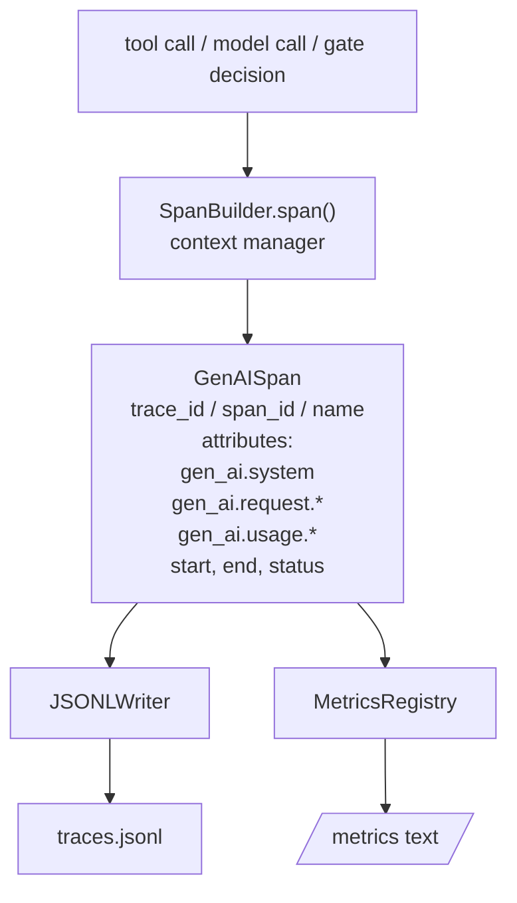
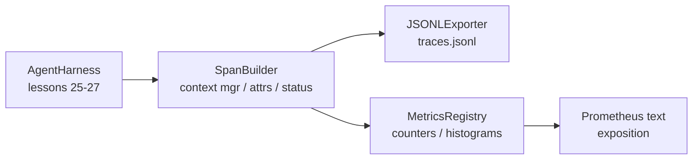

# 石28课:使用OTel GenAI跨度和普罗梅斯指标可观察性

> 无可观察的代理带是花钱的黑盒子.本课程手动滚动一个跨度构造器,它发出符合OpenTelemetry GenAI语义公约的记录,将它们写入一个JSON-Lines文件,每行一个跨度,并暴露了Prometheus文本格式的计数器和历史图.整个东西是Stdlib Python,并运行离线.

**Type:** Build
**Languages:** Python (stdlib), TypeScript
**Prerequisites:** Phase 19 · 25 (verification gates), Phase 19 · 26 (sandbox), Phase 19 · 27 (eval harness), Phase 13 · 20 (OpenTelemetry GenAI), Phase 14 · 23 (OTel GenAI conventions)
**Time:** ~90 minutes

## 学习目标

- 建立一个以OpenTelemetry GenAI语义公约为形状的跨度数据类.
- 实现一个JSONL出口程序,每行写出一个独立的跨度.
- 建立标签和Prometheus文本格式曝光的计数器和历史图.
- 包装任何调用器在一个记录时间,状态和例外的跨度环境管理器中.
- 检查发射的跨度是否回路通过`json.loads`并且与规格的形状相匹配.

## 问题

在生产中,编码代理每次生产三类文物:模型调用,工具执行和验证门决策.

首先是失败模式是缺失的痕迹.周二发生了一些错误,但唯一记录是500行聊天日志.没有记录哪个工具运行,需要多长时间,多少代币进入提示,或者门是否拒绝任何东西.代理作者必须猜测.

其他方法是: 子写了跨度,但使用了自己的专用字段名称.Grafana,Honeycomb,Jaeger或本地CLI中没有任何东西能读取它们.团队堆中存在的任何工具都会浪费,因为跨度是不标准的.

第三种故障模式是未聚合的指标.你可以看到一个缓慢的工具调用在追踪中,但你不能回答"在上个小时内读_文件调用的p95延迟是什么?"因为没有指标,只有痕迹.

开放Telemetry GenAI语义公约是为了这个.它们定义了一个小组标准属性,在LLM框架中跨度发射者共享.如果你的带写这些属性,每个与OTel兼容的后端都可以读取它们.

## 概念



跨度具有一个追踪ID (整个代理调用),一个跨度ID (这个操作),一个名称 (例如 `gen_ai.chat`现在`gen_ai.tool.execution`), 基因AI公约的属性,开始和结束时间以及状态.

基因AI公约标准化了这些属性密钥: `gen_ai.system`(哪个提供商,例如`anthropic`现在`openai`), `gen_ai.request.model`(模型标识),`gen_ai.request.max_tokens`现在`gen_ai.usage.input_tokens`现在`gen_ai.usage.output_tokens`现在`gen_ai.response.model`现在`gen_ai.response.id`现在`gen_ai.operation.name`另外,工具特定的钥匙`gen_ai.tool.name`其他`gen_ai.tool.call.id`现在,我们要去.

导出者写JSONL.每行一个JSON对象.这是下游工具可以流媒体,抓取和进口的最简单的格式.一个真正的OTel导出者会说OTLP gRPC;课程的JSONL导出者是离线相当的,并且在每个工作站上出发为零.

工具的每次调用中,一个反增量:`tools_called_total{tool="read_file"}`历史图记录观察到的延迟:`tool_latency_ms{tool="read_file"}`它们都将串行成Prometheus文本曝光格式,这是基于拉力的指标的实际标准.

```figure
trace-spans
```

## 建筑



跨度构造商是一个小类的`span(name, attrs)`文本管理器记录入口开始时间,记录出口结束时间,将一个例外添加,如果一个被提升,并将最终的跨度推向出口商.

计数是两个指数.`{(name, frozen_labels): int}`异谱记录原料样本,并将其在暴露时串行到Prometheus异谱桶中.

## 你会建造什么

`main.py`船舶:

1. `GenAISpan`数据类: trace_id, span_id, parent_span_id,名称,属性, start_unix_nano, end_unix_nano,状态, status_message,事件.
2. `SpanBuilder`课程`span(name, attrs, parent=None)`环境管理者.
3. `JSONLExporter`课程`export(span)`它们的位置是
4. `Counter`其他`Histogram`课程加上`MetricsRegistry`现在,我们要去.
5. `prometheus_exposition(registry)`输出文本格式.
6. `wrap_tool_call(name)`装饰器发射跨度,并更新数据.
7. 演示:合成一个完整的代理调用 (gen_ai.chat跨度在工具跨度周围),写 traces.jsonl,打印Prometheus曝光,退出零.

追踪 id 是16字节值 (32个六字符) 和跨度 id 是8字节值 (16个六字符),这两者都从随机中剪切`uuid4`导出者从来没有扔过, IO 错误被发现,但带仍然运行.

历史图表设置了固定的缓存时间为毫秒: 5, 10, 25, 50, 100, 250, 500, 1000, 2500, 5000, 10000, +Inf. 它是OTel SDK默认界限的剪辑版本,其中还包括 0, 75, 750, 和 7500. 样本是存储成列表; 曝光量按要求计算每桶数量.

## 为什么用手动滚动而不是开放式仪表sdk

托特尔 Python SDK 是一个真正的依赖性.它还包括几千行代码,为OTLP出口商提供了背景出口线程,并且耗费了大量的课程预算.手动滚动版本教导了线程格式.在生产中,您将相同的属性线程输入到真正的SDK中,并获得OTLP出口商,批量和资源检测免费.

基因AI公约仍然标记为规格中的发展,并且它们以前已经更名为属性: `gen_ai.usage.prompt_tokens`成为了`gen_ai.usage.input_tokens`按下你发射的语义协议版本,然后在升级SDK时检查它.

## 如何与A轨道的其他部分相结合

第25课产生了门链. 第26课产生了沙箱. 第27课产生了评估带. 第28课使所有三个都可观看. 第29课将端到端演示的每个步骤包裹成跨度,并在最后打印了普罗梅蒂乌斯文本.

## 运行它

```bash
cd phases/19-capstone-projects/28-observability-otel-traces
python3 code/main.py
npx tsx code/main.ts
python3 -m pytest code/tests/ -v
```

演示显示一个`traces.jsonl`在课程工作的 dir (在结束时清洁),然后打印一个三个跨度的样本,然后打印了计数和历史图的普罗梅泰斯曝光.测试验验证,跨度连续回路,可нони性GenAI属性存在,数量正确增加,以及历史图的曝光包含预期的桶数量.
