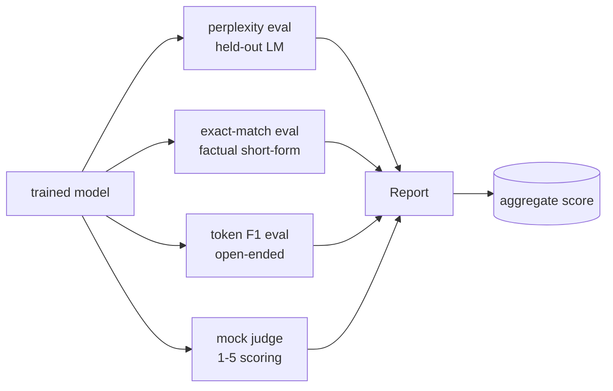
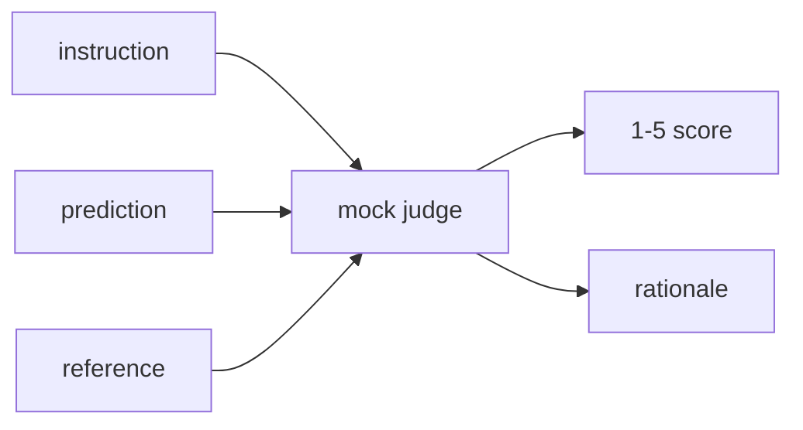
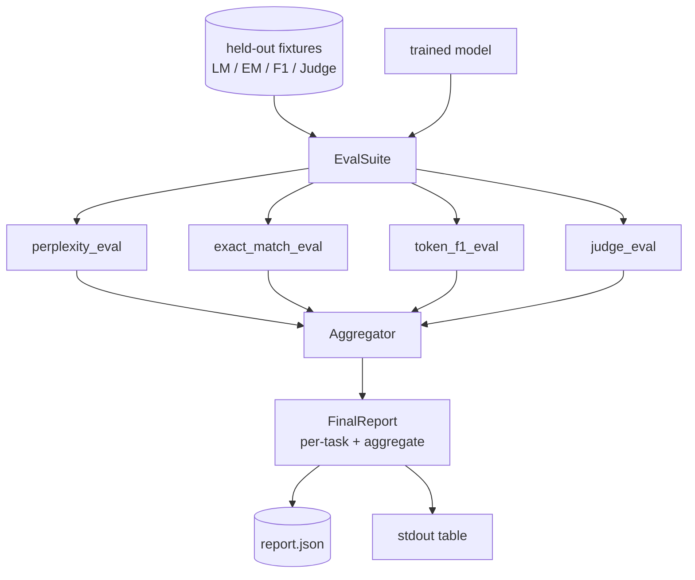

# 石课41:全面评估管道

> 训练是你可以通过损失曲线监测的部分. 评估是你必须设计的部分. 这一课构建了一个统一的评估管道,采用任何训练有素的语言模型,运行四种异质的评估,将结果汇集成每项任务报告, 四项评估涵盖了每个运输模型所需的尺寸:语言建模 (困难),短形正确性 (准确匹配),开放形式相似性 (F1标志),以及质量评分 (评判).

**Type:** Build
**Languages:** Python (torch, numpy)
**Prerequisites:** Phase 19 lessons 30-37 (NLP LLM track: tokenizer, embedding table, attention block, transformer body, pre-training loop, checkpointing, generation, perplexity)
**Time:** ~90 minutes

## 学习目标

- 计算一个微小的变压器上的隐形代币计算.
- 执行一个准确的匹配评估,
- 计算预测和参考字符串之间的代币级 F1 标准化.
- 建立一个地方的假法师作为法官,以1-5的比例评分模型的结果.
- 总结四项评估成一个重量化报告,每项任务分类.

## 问题

一个单一的指标从来没有描述语言模型. 困惑表明模型是如何适合语言分布的,但没有说明它是否回答问题. 精确匹配显示模型是否产生金弦,但惩罚正确的句子. 符号F1允许抛词,但被词汇重叠与错误的内容所欺骗. 法律法官的法学法学具有质量维度,但成本高昂,

实际上你想要的管道有四个.每个评估涵盖一个其他缺失的维度.每个测量都运行在一个不同的数据小组上,以该指标的形状.最终报告显示每个任务的数字并肩和总数,这样一个评论者可以一眼看看模型正在做什么交易.

这一课将这条管道,从头到尾,建立在一个文件中.

## 概念



每个 eval 是从 `(model, dataset) -> EvalResult`结果包含了测量值,每例的检查细节,以及集体名称. 管道组合它们,并设置一个配置,说明哪些评估要运行以及如何权重它们.

## 困惑,正确计算

困惑是`exp(mean negative log-likelihood per token)`实施有两个陷:

- 平均值必须是实际的代币位置,而不是批量 * 序列.
- 模型预测下一个代币,所以在位置上.`i`预测标志在位置`i+1`失败仍然是流动的,但指标变得毫无意义.

评估计算每批量的总量`-log p(token)`通过不pad 位置和每批代币计数,然后在最后分开. 这比平均每批复杂性 (给每批相同重量,因此短批中的每个代币比长批中的代币更重要) 更加安全,并且符合教科书的定义.

## 完全匹配,与规范化

带在比较之前将预测和参考都正常化:

- 简字母.
- 周围的白色空间.
- 内部白空的崩将运行到一个空间.
- 落后终端分分 (`.`现在`!`现在`?`) 如果双方仅因分别.

规范化使得精确匹配在实践中有用.`"Paris"`确实是对的,一个说`"Paris."`们也在说`"  paris  "`标准化后,答案仍然需要相同的字符串.

## 标志 F1,正确的方向

代币F1是通过代币袋计算的精度和召回的和平均值.

1. 规范预测和参考 (与精确匹配相同的规则).
2. 分成每个代币列表 (白色空间代币化).
3. 计算多组交叉点.
4. 精度 = `intersection_count / len(pred_tokens)`提醒 = `intersection_count / len(ref_tokens)`1=和平均值.

如果预测和参考都是空的,F1是1 (空格匹配).如果只有一个空的,F1是0.这个模式匹配SQuAD评估参考,并产生稳定的数字跨句子.

## 地方假法师作为法官

实际法官是一个API背后的边界模型.对于这个课程,法官必须在线运行.假法官是一个确定性得分符,接收指令,模型的预测和参考,并返回一个分数.`{1, 2, 3, 4, 5}`评分规则是明确的:

- 如果正常预测等于正常参考.
- 4,如果预测和参考之间的F1符号至少为0.8.
- 如果F1标志是3`[0.5, 0.8)`现在,我们要去.
- 如果F1标志是`[0.2, 0.5)`现在,我们要去.
- 否则,

这不是一个真正的判断者,但它有正确的接口. 通过更改一个函数来更换一个真正的模型. 管道不关心.



## 总结

总体是标准化评估分数的权重平均值.`[0, 1]`其他:

- 乱:正常化`1 / (1 + log(perplexity))`图为1的复杂性,图为1的复杂性,图为0的无限性.
- 已有.`[0, 1]`现在,我们要去.
- 标志 F1: 已经进入了`[0, 1]`现在,我们要去.
- 评委:分为5.

权重可以配置.默认混合是0.2的困难度,0.3的精确匹配,0.3的代币F1,0.2的评判.权重的选择是产品的决定;课程暴露了按,所以你可以实验.

```figure
cg-eval-quadrant
```

## 建筑



其他`EvalSuite`每个个评估是一个自由函数,`(model, tokenizer, dataset, config)`返回一个`EvalResult`现在,我们要去.`Aggregator`测试程序打印表,写出一个JSON副本,下游CI可以摄入.

## 你会建造什么

实施是一个`main.py`另外还有一些检查.

1. `TinyGPT`课程包括了38-40课程中的相同的解码器架构,因此课程独立.
2. `InstructionTokenizer`通过 INST/ RESP/ PAD 专项的字节标记器.
3. 设置四个装置:一个LM体,一个EM组,一个F1组,一个评审组.
4. `perplexity_eval`收益`EvalResult`具有杂性值和每代币损失的历史图.
5. `exact_match_eval`报告中,每例的 EM 记录均值.
6. `token_f1_eval`:返回F1代号平均值和每例记录.
7. `mock_judge`其他`judge_eval`平均分数在整个集中.
8. `Aggregator.normalise`标准化规则:
9. `Aggregator.aggregate`:重量平均和汇总报告.
10. `run_demo`简单地训练一个小模型,运行四个评估,打印报告表,写JSON,成功的结果是零.

## 阅读报告

报告有三个层.顶部是总分数.下面是每期的四个数字.下面是诊断的每例分数.一个失败的CI运行通常需要总分,但一个追逐回归的评论家希望每例分数,以查看模型错了哪些输入.

 JSON 排放器使用稳定键,以便一个CI仪表板可以绘制版本中的趋势线. 漂亮的打印表是为了训练运行后观察终端的人.

## 实现目标

- 添加校准评估:模型的软max概率是否与其准确性相匹配?
- 添加强度评估:每例标记一个扰乱 (typo, paraphrase, distractor) 并报告每次扰乱的度量下降.
- 替换一个HTTP调用背后的假定法官用一个真实模型.函数签名不会改变.
- 增加每任务的体重学习:不要固定体重,而是将体重调整到目标优先顺序.

实际的评估管道上层了更多的维度;模式保持不变:每个评估一个函数,一个集成器,一个报告.
