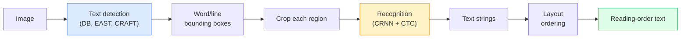

# 光學字元辨識（OCR）與文件理解

> OCR 是一條三階段的流程 —— 偵測文字框、辨識字元，然後把它們排回版面。每一套現代 OCR 系統，做的都是重新安排這三個階段的順序，或者把它們合併起來。

**類型：** 學習 + 應用
**程式語言：** Python
**先修單元：** 階段 4 · 06（物件偵測）、階段 7 · 02（自注意力）
**時間：** 約 45 分鐘

## 學習目標

- 把傳統 OCR 流程（偵測 -> 辨識 -> 版面）走過一遍，並認識現代的端到端替代方案（Donut、Qwen-VL-OCR）
- 實作 CTC（Connectionist Temporal Classification）損失函式，用於序列到序列的 OCR 訓練
- 不用訓練，直接拿 PaddleOCR 或 EasyOCR 做上線級的文件解析
- 分清楚 OCR、版面分析與文件理解三件事 —— 並替每個任務挑對工具

## 問題所在

滿是文字的影像到處都是：收據、發票、身分證件、掃描書籍、表單、白板、招牌、螢幕截圖。從這些影像裡抽出結構化資料 —— 不只是字元，而是「這一個是總金額」—— 是應用視覺裡價值最高的問題之一。

這個領域分成三個能力層次：

1. **OCR 本身**：把像素變成文字。
2. **版面分析**：把 OCR 的輸出歸成一個個區域（標題、正文、表格、頁首）。
3. **文件理解**：從版面裡抽出結構化欄位（「invoice_total = $42.50」）。

每一層都有傳統做法和現代做法，而「我想從影像裡拿到文字」跟「我要這張收據上的總金額」之間的落差，比大多數團隊以為的都要大。

## 核心概念

### 傳統流程



- **文字偵測**產出逐行或逐字的四邊形。
- **文字辨識**把每個區域裁切成固定高度，跑一個 CNN + BiLSTM + CTC 產出一串字元。
- **版面**重建閱讀順序（拉丁文是上到下、左到右；阿拉伯文與日文不一樣）。

### 一段話講完 CTC

OCR 的辨識階段要從一張固定長度的特徵圖產出一個長度可變的序列。CTC（Graves et al., 2006）讓你不需要字元層級的對齊也能訓練它。模型在每個時間步輸出一個在（詞彙表 + blank）上的機率分布；CTC 損失會對「合併重複字元、去掉 blank 之後會化簡成目標文字」的所有對齊方式做邊際化。

```
raw output: "h h h _ _ e e l l _ l l o _ _"
after merge repeats and remove blanks: "hello"
```

CTC 就是 CRNN 在 2015 年跑得起來的原因，而到了 2026 年，它仍然是大多數上線 OCR 模型的訓練方式。

### 現代端到端模型

- **Donut**（Kim et al., 2022）—— 一個 ViT 編碼器加一個文字解碼器；讀進一張影像，直接吐出 JSON。沒有文字偵測器，也沒有版面模組。
- **TrOCR** —— ViT 加 transformer 解碼器，做行層級的 OCR。
- **Qwen-VL-OCR / InternVL** —— 完整的視覺語言模型，針對 OCR 任務微調過；2026 年在複雜文件上準確率最好。
- **PaddleOCR** —— 傳統的 DB + CRNN 流程，包成一個成熟的上線套件；至今仍是開源界的主力。

端到端模型需要更多資料與算力，但省掉了多階段流程一路累積誤差的問題。

### 版面分析

面對結構化文件，跑一個版面模型（LayoutLMv3，或在 DocLayNet 資料集上訓練的偵測器），它會替每個區域標上類別：標題、段落、圖、表格、註腳。閱讀順序於是變成「照版面順序逐一走過區域，接起來就好」。

面對表單，用**鍵值對抽取**模型（視覺元素豐富的文件用 Donut，單純的掃描件用 LayoutLMv3）。它們吃進影像加上偵測到的文字與位置，預測出結構化的鍵值對。

### 評估指標

- **字元錯誤率（CER）** —— Levenshtein 距離除以參考文字長度。越低越好。上線目標：乾淨掃描件上 < 2%。
- **詞錯誤率（WER）** —— 同樣的算法，但以詞為單位。
- **結構化欄位的 F1** —— 用於鍵值對任務；衡量 `{invoice_total: 42.50}` 有沒有正確出現。
- **JSON 上的編輯距離** —— 用於端到端文件解析；Donut 論文提出的正規化樹編輯距離。

```figure
cv3-ctc-collapse
```

## 動手實作

### 步驟 1：CTC 損失函式加貪婪解碼器

```python
import torch
import torch.nn as nn
import torch.nn.functional as F


def ctc_loss(log_probs, targets, input_lengths, target_lengths, blank=0):
    """
    log_probs:      (T, N, C) log-softmax over vocab including blank at index 0
    targets:        (N, S) int targets (no blanks)
    input_lengths:  (N,) per-sample time steps used
    target_lengths: (N,) per-sample target length
    """
    return F.ctc_loss(log_probs, targets, input_lengths, target_lengths,
                      blank=blank, reduction="mean", zero_infinity=True)


def greedy_ctc_decode(log_probs, blank=0):
    """
    log_probs: (T, N, C) log-softmax
    returns: list of index sequences (blanks removed, repeats merged)
    """
    preds = log_probs.argmax(dim=-1).transpose(0, 1).cpu().tolist()
    out = []
    for seq in preds:
        decoded = []
        prev = None
        for idx in seq:
            if idx != prev and idx != blank:
                decoded.append(idx)
            prev = idx
        out.append(decoded)
    return out
```

`F.ctc_loss` 在可用的時候會走 CuDNN 那個高效實作。貪婪解碼器比 beam search 簡單，而 CER 通常跟它差在 1% 以內。

### 步驟 2：迷你 CRNN 辨識器

做行層級 OCR 的最小 CNN + BiLSTM。

```python
class TinyCRNN(nn.Module):
    def __init__(self, vocab_size=40, hidden=128, feat=32):
        super().__init__()
        self.cnn = nn.Sequential(
            nn.Conv2d(1, feat, 3, 1, 1), nn.BatchNorm2d(feat), nn.ReLU(inplace=True),
            nn.MaxPool2d(2),
            nn.Conv2d(feat, feat * 2, 3, 1, 1), nn.BatchNorm2d(feat * 2), nn.ReLU(inplace=True),
            nn.MaxPool2d(2),
            nn.Conv2d(feat * 2, feat * 4, 3, 1, 1), nn.BatchNorm2d(feat * 4), nn.ReLU(inplace=True),
            nn.MaxPool2d((2, 1)),
            nn.Conv2d(feat * 4, feat * 4, 3, 1, 1), nn.BatchNorm2d(feat * 4), nn.ReLU(inplace=True),
            nn.MaxPool2d((2, 1)),
        )
        self.rnn = nn.LSTM(feat * 4, hidden, bidirectional=True, batch_first=True)
        self.head = nn.Linear(hidden * 2, vocab_size)

    def forward(self, x):
        # x: (N, 1, H, W)
        f = self.cnn(x)                # (N, C, H', W')
        f = f.mean(dim=2).transpose(1, 2)  # (N, W', C)
        h, _ = self.rnn(f)
        return F.log_softmax(self.head(h).transpose(0, 1), dim=-1)  # (W', N, vocab)
```

輸入高度固定（CNN 會把高度 max-pool 到 1）。寬度就是 CTC 的時間維度。

### 步驟 3：合成 OCR 資料

產生白底黑字的字串，做一次端到端的煙霧測試。每個字元變成一欄六條橫槓，用二進位拼出它在詞彙表中的索引。影像必須帶有字元的身分：如果每個字元都是同一個空白方塊，模型就分不出 `a` 和 `x`，損失也會停滯不降。

```python
import numpy as np

GLYPHS = "0123456789abcdefghijklmnopqrstuvwxyz"

def synthetic_line(text, height=32, char_width=16):
    W = char_width * len(text)
    img = np.ones((height, W), dtype=np.float32)
    for i, c in enumerate(text):
        x = i * char_width
        code = GLYPHS.find(c) + 1
        for bit in range(6):
            if code >> bit & 1:
                y = 4 + 4 * bit
                img[y:y + 3, x + 2:x + char_width - 2] = 0.0
    return img


def build_batch(strings, vocab):
    H = 32
    W = 16 * max(len(s) for s in strings)
    imgs = np.ones((len(strings), 1, H, W), dtype=np.float32)
    target_lengths = []
    targets = []
    for i, s in enumerate(strings):
        imgs[i, 0, :, :16 * len(s)] = synthetic_line(s)
        ids = [vocab.index(c) for c in s]
        targets.extend(ids)
        target_lengths.append(len(ids))
    return torch.from_numpy(imgs), torch.tensor(targets), torch.tensor(target_lengths)


vocab = ["_"] + list("0123456789abcdefghijklmnopqrstuvwxyz")
imgs, targets, lengths = build_batch(["hello", "world"], vocab)
print(f"images: {imgs.shape}   targets: {targets.shape}   lengths: {lengths.tolist()}")
```

真實的 OCR 資料集會再加上字體、雜訊、旋轉、模糊與顏色。上面那條流程一模一樣。

### 步驟 4：訓練骨架

```python
model = TinyCRNN(vocab_size=len(vocab))
opt = torch.optim.Adam(model.parameters(), lr=1e-3)

for step in range(400):
    strings = ["abc" + str(step % 10)] * 4 + ["xyz" + str((step + 1) % 10)] * 4
    imgs, targets, target_lens = build_batch(strings, vocab)
    log_probs = model(imgs)  # (W', 8, vocab)
    input_lens = torch.full((8,), log_probs.size(0), dtype=torch.long)
    loss = ctc_loss(log_probs, targets, input_lens, target_lens, blank=0)
    opt.zero_grad(); loss.backward(); opt.step()
```

在這種極簡合成資料上，損失應該在 400 步內從兩位數掉到約 0.3。`code/main.py` 用它自己的字串集合跑同樣的迴圈，接著解碼三個測試字串。

## 框架應用

三條上線路徑：

- **PaddleOCR** —— 成熟、快、多語言。一行就能用：`paddleocr.PaddleOCR(lang="en").ocr(image_path)`。
- **EasyOCR** —— 原生 Python、多語言、PyTorch 骨幹。
- **Tesseract** —— 傳統派；碰到模型吃力的老掃描件時，它依然有用。

要做端到端的文件解析，用 Donut 或一個 VLM：

```python
from transformers import DonutProcessor, VisionEncoderDecoderModel

processor = DonutProcessor.from_pretrained("naver-clova-ix/donut-base-finetuned-cord-v2")
model = VisionEncoderDecoderModel.from_pretrained("naver-clova-ix/donut-base-finetuned-cord-v2")
```

收據、發票，以及結構會重複出現的表單，微調 Donut。任意文件，或是需要推論能力的 OCR，目前的預設答案是 Qwen-VL-OCR 這類 VLM。

## 產出交付

本單元會產出：

- `outputs/prompt-ocr-stack-picker.md` —— 一個提示詞，給它文件類型、語言與結構，它替你在 Tesseract／PaddleOCR／Donut／VLM-OCR 之間挑一個。
- `outputs/skill-ctc-decoder.md` —— 一個技能，從零寫出貪婪與 beam search 兩種 CTC 解碼器，含長度正規化。

## 練習

1. **（簡單）** 拿 5 位數的隨機數字字串訓練 TinyCRNN 500 步。在一組保留資料上回報 CER。
2. **（中等）** 把貪婪解碼換成 beam search（beam_width=5）。回報 CER 的變化量。beam search 在哪一類輸入上會贏？
3. **（困難）** 對 20 張收據跑 PaddleOCR，抽出品項明細，並針對 {item_name, price} 這組配對，跟手工標註的標準答案算 F1。

## 關鍵術語

| 術語 | 大家怎麼說 | 實際上是什麼 |
|------|----------------|----------------------|
| OCR | 「從像素拿到文字」 | 把影像區域變成字元序列 |
| CTC | 「不用對齊的損失函式」 | 不需要逐時間步標籤就能訓練序列模型的損失函式；它對所有對齊方式做邊際化 |
| CRNN | 「經典 OCR 模型」 | 卷積特徵萃取器 + BiLSTM + CTC；2015 年的基準線，至今仍在生產環境裡跑 |
| Donut | 「端到端 OCR」 | ViT 編碼器 + 文字解碼器；從影像直接吐出 JSON |
| 版面分析 | 「找出區域」 | 在一份文件裡偵測並標記標題／表格／圖／段落等區域 |
| 閱讀順序 | 「文字的先後」 | 把辨識出來的區域排成通順文句的順序；拉丁文很簡單，混合版面就不簡單 |
| CER／WER | 「錯誤率」 | Levenshtein 距離除以參考文字長度，以字元或以詞為單位計算 |
| VLM-OCR | 「會讀字的 LLM」 | 針對 OCR 任務訓練或提示的視覺語言模型；複雜文件上目前的 SOTA |

## 延伸閱讀

- [CRNN (Shi et al., 2015)](https://arxiv.org/abs/1507.05717) —— 最原始的 CNN+RNN+CTC 架構
- [CTC (Graves et al., 2006)](https://www.cs.toronto.edu/~graves/icml_2006.pdf) —— CTC 的原始論文；演算法上的想法密度極高
- [Donut (Kim et al., 2022)](https://arxiv.org/abs/2111.15664) —— 免 OCR 的文件理解 transformer
- [PaddleOCR](https://github.com/PaddlePaddle/PaddleOCR) —— 開源的上線級 OCR 技術堆疊
