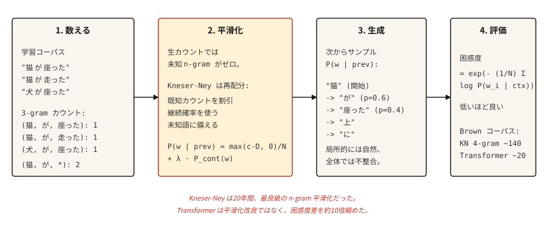

# Transformer 之前的文字生成 —— n-gram 語言模型

> 一個詞讓模型意外，就代表模型不好。困惑度把「意外」變成一個數字，平滑則讓這個數字不會變成無限大。

**類型：** 實作
**程式語言：** Python
**先修單元：** 階段 5 · 01（文字處理）、階段 2 · 14（單純貝氏）
**時間：** 約 45 分鐘

## 問題所在

在 Transformer 之前，在 RNN 之前，在詞嵌入之前，語言模型預測下一個詞的方式，是數它跟在前面 `n-1` 個詞後面的次數。數出「the cat」→「sat」47 次、「the cat」→「jumped」12 次、「the cat」→「refrigerator」0 次。正規化之後就得到一個機率分布。

這就是 n-gram 語言模型。從 1980 到 2015 年，每一套語音辨識器、每一套拼字檢查器、每一套基於片語的機器翻譯系統，跑的都是它。當你需要便宜的裝置端語言模型時，它現在還在跑。

有趣的問題是：沒見過的 n-gram 該怎麼辦。純粹靠計數的模型，會把零機率分配給任何它沒見過的東西，而這是災難性的——句子很長，而幾乎每個長句都至少含有一段沒見過的序列。五十年的平滑（smoothing）研究解決了這件事。Kneser-Ney 平滑就是它的成果，而現代深度學習繼承了它那套重視實證的傳統。

## 核心概念



### 預測遊戲

在這些機制存在之前，有一個實驗定義了語言模型是什麼。把一個英文句子的下一個字母遮起來。請人一次猜一個，直到猜對為止。把猜的次數記下來。對幾百個字母重複這件事。

這些猜測次數不只是趣聞。它們是這段文字的一種無損重新編碼：把這串次數交給第二個一模一樣的猜測者，他就能還原出每一個字母，因為在每個位置上他都確切知道哪些猜測會先出現。一段能用更少符號重新編碼的訊息，每個符號攜帶的資訊就更少，所以猜測次數的統計，為英文的熵設下了一個上限。

Shannon 在 1951 年做了這個實驗，得到一個至今仍支配整個領域的數字。一個 27 個符號的字母表（26 個字母加空白）每個字母最多能攜帶 `log2(27) ≈ 4.75` 位元。有 100 個字母上下文的人類猜測者，落在每個字母 0.6 到 1.3 位元之間。英文大約有四分之三是被迫的走法。模型必須學會的那些結構，在任何模型有能力學它之前就已經被量出來了。

自此之後的每一個語言模型，都是這場遊戲的機械玩家，而這個單元裡每一個評估數字，都是這場遊戲的計分：

- **交叉熵損失**是模型每個符號平均需要的位元數。訓練一個語言模型，字面上就是在把它在這場猜謎遊戲裡的分數壓到最低。
- **困惑度**是 `2^bits`（或 `e^nats`）：模型猜完之後仍要面對的分支因子。在 27 個符號上均勻亂猜，困惑度就是 27；每個字母 1 位元的玩家，困惑度是 2。
- **上下文長度就是玩家的記憶。** trigram 模型帶著兩個詞元的記憶在玩。Transformer 帶著 100K 個詞元玩同一場遊戲。規則從來沒變；是玩家變強了。

有一個單位切換要留意：這場遊戲是以位元（`log2`）為單位、按字母計分，而下面的 n-gram 公式則以 nat（自然對數）為單位、按詞元計分——而既然以 nat 計的困惑度 `e^H` 等於以位元計的 `2^H`，這兩種觀點就是同一個量測，只是單位不同。

```figure
prediction-game
```

**n-gram 機率：** `P(w_i | w_{i-n+1}, ..., w_{i-1})`。固定 `n`（trigram 通常取 3，4-gram 取 4）。從計數算出來：

```math
P(w \mid \text{context}) = \frac{\mathop{\mathrm{count}}(\text{context}, w)}{\mathop{\mathrm{count}}(\text{context})}
```

**零計數問題。** 任何在訓練裡沒出現過的 n-gram，機率都是零。2007 年一份在 Brown 語料庫上的研究發現，即使是 4-gram 模型，保留集裡也有 30% 的 4-gram 在訓練中沒見過。不做平滑，你沒辦法在任何真實文本上做評估。

**平滑方法，依精巧程度排序：**

1. **Laplace（加一）。** 每個計數都加 1。簡單，但在稀有事件上糟得可以。
2. **Good-Turing。** 依「頻率的頻率」，把機率質量從高頻事件重新分配給沒見過的事件。
3. **內插。** 用可調的權重，把 n-gram、(n-1)-gram 等等的估計組合起來。
4. **回退（backoff）。** 如果 n-gram 的計數是零，就退回 (n-1)-gram。Katz backoff 把這件事正規化。
5. **絕對折扣。** 從所有計數減去一個固定的折扣 `D`，再把省下來的重新分配給沒見過的事件。
6. **Kneser-Ney。** 絕對折扣，加上對低階模型的一個巧妙選擇：用*延續機率*（一個詞出現在多少種上下文裡）取代原始頻率。

Kneser-Ney 的洞見很深。「San Francisco」是常見的 bigram。unigram「Francisco」大多出現在「San」之後。天真的絕對折扣會給「Francisco」很高的 unigram 機率（因為計數很高）。Kneser-Ney 注意到「Francisco」只出現在一種上下文裡，於是相應地壓低它的延續機率。結果是：一個以「Francisco」結尾的新 bigram，會拿到恰當的低機率。

**評估：困惑度。** 在保留測試集上，每個詞的平均負對數似然的指數。越低越好。困惑度 100 代表模型的困惑程度，相當於在 100 個詞裡均勻亂挑。

```math
\text{perplexity} = \exp\left(-\frac{1}{N} \sum_i \log P(w_i \mid \text{context}_i)\right)
```

```figure
ngram-backoff
```

## 動手實作

### 步驟 1：trigram 計數

```python
from collections import Counter, defaultdict


def train_ngram(corpus_tokens, n=3):
    ngrams = Counter()
    contexts = Counter()
    for sentence in corpus_tokens:
        padded = ["<s>"] * (n - 1) + sentence + ["</s>"]
        for i in range(len(padded) - n + 1):
            ctx = tuple(padded[i:i + n - 1])
            word = padded[i + n - 1]
            ngrams[ctx + (word,)] += 1
            contexts[ctx] += 1
    return ngrams, contexts


def raw_probability(ngrams, contexts, context, word):
    ctx = tuple(context)
    if contexts.get(ctx, 0) == 0:
        return 0.0
    return ngrams.get(ctx + (word,), 0) / contexts[ctx]
```

輸入是一串已分詞的句子。輸出是 n-gram 計數與上下文計數。`<s>` 與 `</s>` 是句子邊界。

### 步驟 2：Laplace 平滑

```python
def laplace_probability(ngrams, contexts, vocab_size, context, word):
    ctx = tuple(context)
    numerator = ngrams.get(ctx + (word,), 0) + 1
    denominator = contexts.get(ctx, 0) + vocab_size
    return numerator / denominator
```

每個計數都加 1。有平滑效果，但會分配過多質量給沒見過的事件，連罕見但見過的事件也一起受害。

### 步驟 3：Kneser-Ney（bigram，內插版）

```python
def kneser_ney_bigram_model(corpus_tokens, discount=0.75):
    unigrams = Counter()
    bigrams = Counter()
    unigram_contexts = defaultdict(set)

    for sentence in corpus_tokens:
        padded = ["<s>"] + sentence + ["</s>"]
        for i, w in enumerate(padded):
            unigrams[w] += 1
            if i > 0:
                prev = padded[i - 1]
                bigrams[(prev, w)] += 1
                unigram_contexts[w].add(prev)

    total_unique_bigrams = sum(len(ctx_set) for ctx_set in unigram_contexts.values())
    continuation_prob = {
        w: len(ctx_set) / total_unique_bigrams for w, ctx_set in unigram_contexts.items()
    }

    context_totals = Counter()
    for (prev, w), count in bigrams.items():
        context_totals[prev] += count

    unique_follow = defaultdict(set)
    for (prev, w) in bigrams:
        unique_follow[prev].add(w)

    def prob(prev, w):
        count = bigrams.get((prev, w), 0)
        denom = context_totals.get(prev, 0)
        if denom == 0:
            return continuation_prob.get(w, 1e-9)
        first_term = max(count - discount, 0) / denom
        lambda_prev = discount * len(unique_follow[prev]) / denom
        return first_term + lambda_prev * continuation_prob.get(w, 1e-9)

    return prob
```

三個活動零件。`continuation_prob` 捕捉的是「這個詞出現在多少種不同的上下文裡？」（Kneser-Ney 的創新之處）。`lambda_prev` 是折扣釋放出來的質量，用來給回退項加權。最終機率就是打過折的主項，加上加權後的延續項。

### 步驟 4：用取樣生成文字

```python
import random


def generate(prob_fn, vocab, prefix, max_len=30, seed=0):
    rng = random.Random(seed)
    tokens = list(prefix)
    for _ in range(max_len):
        candidates = [(w, prob_fn(tokens[-1], w)) for w in vocab]
        total = sum(p for _, p in candidates)
        r = rng.random() * total
        acc = 0.0
        for w, p in candidates:
            acc += p
            if r <= acc:
                tokens.append(w)
                break
        if tokens[-1] == "</s>":
            break
    return tokens
```

按機率比例取樣。每個 seed 都會給出不同的輸出。想要類似 beam search 的輸出，就在每一步挑 argmax（貪婪解碼），再加上一個小的隨機性旋鈕（溫度）。

### 步驟 5：困惑度

```python
import math


def perplexity(prob_fn, sentences):
    total_log_prob = 0.0
    total_tokens = 0
    for sentence in sentences:
        padded = ["<s>"] + sentence + ["</s>"]
        for i in range(1, len(padded)):
            p = prob_fn(padded[i - 1], padded[i])
            total_log_prob += math.log(max(p, 1e-12))
            total_tokens += 1
    return math.exp(-total_log_prob / total_tokens)
```

越低越好。在 Brown 語料庫上，一個調校良好的 4-gram KN 模型困惑度大約落在 140。同一個測試集上，Transformer 語言模型是 15-30。差距大約 10 倍。就是這個差距讓整個領域往前走了。

## 框架應用

- **經典 NLP 教學。** 這是你能找到最清楚的平滑、MLE 與困惑度入門。
- **KenLM。** 正式環境用的 n-gram 函式庫。在低延遲要緊的語音與機器翻譯系統裡，當作重新評分器（rescorer）使用。
- **裝置端自動補完。** 鍵盤裡的 trigram 模型。至今依然。
- **基線。** 在宣稱你的神經語言模型很好之前，一定先算一個 n-gram 語言模型的困惑度。如果你的 Transformer 沒有大幅贏過 KN，那就有東西不對。

## 產出交付

存成 `outputs/prompt-lm-baseline.md`：

```markdown
---
name: lm-baseline
description: Build a reproducible n-gram language model baseline before training a neural LM.
phase: 5
lesson: 16
---

Given a corpus and target use (next-word prediction, rescoring, perplexity baseline), output:

1. N-gram order. Trigram for general English, 4-gram if corpus is large, 5-gram for speech rescoring.
2. Smoothing. Modified Kneser-Ney is the default; Laplace only for teaching.
3. Library. `kenlm` for production, `nltk.lm` for teaching, roll your own only to learn.
4. Evaluation. Held-out perplexity with consistent tokenization between train and test sets.

Refuse to report perplexity computed with different tokenization between systems being compared — perplexity numbers are comparable only under identical tokenization. Flag OOV rate in test set; KN handles OOV poorly unless you reserve a special <UNK> token during training.
```

## 練習

1. **簡單。** 在一個 1,000 句的莎士比亞語料庫上訓練一個 trigram 語言模型。生成 20 個句子。它們在局部說得通，但整體不連貫。這是最經典的示範。
2. **中等。** 為你的 KN 模型在保留的莎士比亞切分上實作困惑度。跟 Laplace 比一比。你應該會看到 KN 把困惑度降低 30-50%。
3. **困難。** 打造一個 trigram 拼字校正器：給定一個拼錯的詞及其上下文，產生候選修正，並依語言模型下的上下文機率排序。在 Birkbeck 拼字語料庫（公開）上評估。

## 關鍵術語

| 術語 | 大家怎麼說 | 實際上是什麼 |
|------|-----------------|-----------------------|
| n-gram | 詞序列 | `n` 個連續詞元組成的序列。 |
| 平滑（smoothing） | 避免出現零 | 重新分配機率質量，讓沒見過的事件也拿到非零機率。 |
| 困惑度（perplexity） | 語言模型的品質指標 | 保留資料上的 `exp(-平均對數機率)`。越低越好。 |
| 回退（backoff） | 退回較短的上下文 | 如果 trigram 計數是零，就用 bigram。Katz backoff 把這件事形式化。 |
| Kneser-Ney | n-gram 最好的平滑法 | 絕對折扣 + 給低階模型用的延續機率。 |
| 延續機率 | KN 專屬 | `P(w)` 依 `w` 出現過的上下文數量加權，而不是依原始計數。 |
| 文本的熵 | 每個符號的資訊量 | 給定上下文時，編碼下一個符號平均需要的位元數。Shannon 1951 年對印刷體英文（上下文最多 100 個字母）的估計：每個字母 0.6-1.3 位元，是在任何模型存在之前量出來的。 |

## 延伸閱讀

- [Shannon (1951). Prediction and Entropy of Printed English](https://www.princeton.edu/~wbialek/rome/refs/shannon_51.pdf) —— 那個猜謎實驗，定義了每個語言模型至今仍在最佳化的目標。
- [Jurafsky and Martin — Speech and Language Processing, Chapter 3 (2026 draft)](https://web.stanford.edu/~jurafsky/slp3/3.pdf) —— n-gram 語言模型與平滑的經典論述。
- [Chen and Goodman (1998). An Empirical Study of Smoothing Techniques for Language Modeling](https://dash.harvard.edu/handle/1/25104739) —— 確立了 Kneser-Ney 是最好的 n-gram 平滑法的那篇論文。
- [Kneser and Ney (1995). Improved Backing-off for M-gram Language Modeling](https://ieeexplore.ieee.org/document/479394) —— KN 的原始論文。
- [KenLM](https://kheafield.com/code/kenlm/) —— 快速的正式環境 n-gram 語言模型，2026 年在對延遲敏感的應用上仍在使用。
