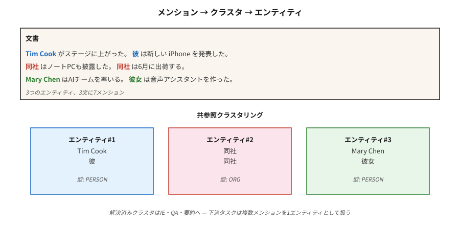

# 指代消解

> "She called him. He did not answer. The doctor was at lunch." 三個指稱、兩個人，而且沒有一個人被指名。指代消解負責搞清楚誰是誰。

**類型：** 學習
**程式語言：** Python
**先修單元：** 階段 5 · 06（NER）、階段 5 · 07（詞性標註與句法剖析）
**時間：** 約 60 分鐘

## 問題所在

把一篇 300 字文章裡提到 Apple Inc. 的每一處都抽出來。文章寫 "Apple" 的時候很容易。寫 "the company"、"they"、"Cupertino's technology giant" 或 "Jobs's firm" 的時候就難了。不把這些提及歸到同一個實體上，你的 NER 管線會漏掉 60-80% 的提及。

指代消解把所有指向同一個真實世界實體的表達，連成一個叢集。它是表層 NLP（NER、句法剖析）與下游語意任務（資訊抽取、問答、摘要、知識圖譜）之間的黏著劑。

為什麼它在 2026 年很重要：

- 摘要：「The CEO announced...」跟「Tim Cook announced...」不一樣——摘要應該把這位執行長指名出來。
- 問答：要回答 "Who did she call?"，得先解出 "she" 是誰。
- 資訊抽取：一張知識圖譜裡同時有 "PER1 founded Apple" 和 "Jobs founded Apple" 兩筆分開的條目，那就是錯的。
- 跨文件資訊抽取：把數篇報導同一事件的文章裡的提及合併起來，就是跨文件指代消解。

## 核心概念



**這個任務。** 輸入：一份文件。輸出：提及（區段）的一種分群，每一群指向同一個實體。

**提及的類型。**

- **命名實體。** "Tim Cook"
- **名詞性（nominal）。** "the CEO"、"the company"
- **代詞性（pronominal）。** "he"、"she"、"they"、"it"
- **同位語（appositive）。** "Tim Cook, Apple's CEO,"

**架構。**

1. **規則式（Hobbs, 1978）。** 以句法樹為基礎、用文法規則做代詞消解。基線相當不錯。在代詞上要贏過它，難度出乎意料地高。
2. **提及配對分類器。** 對每一對提及 $(m_i, m_j)$ 預測它們是否互為指代。再用遞移閉包分群。2016 年之前的標準做法。
3. **提及排序。** 對每個提及，把候選的前行語（包含「沒有前行語」這個選項）排序，取第一名。
4. **以區段為單位的端到端模型（Lee et al., 2017）。** transformer 編碼器。列舉長度上限內的所有候選區段，預測提及分數，再為每個區段預測前行語機率，最後貪婪分群。現代的預設做法。
5. **生成式（2024 年起）。** 直接對 LLM 下提示詞：「List every pronoun in this text and its antecedent.」在容易的案例上表現不錯，碰到長文件和罕見指稱物就吃力。

**評估指標。** 有五個標準指標（MUC、B³、CEAF、BLANC、LEA），因為沒有任何單一指標能完整刻畫分群品質。慣例是把前三個的平均值當作 CoNLL F1 回報。2026 年在 CoNLL-2012 上的最佳成績約為 83 F1。

**已知的困難案例。**

- 指向數頁之前才引入的實體的定指描述。
- 橋接照應（"the wheels" → 前文提過的某輛車）。
- 中文、日文這類語言裡的零照應。
- 後指，也就是代詞出現在指稱物之前："When **she** walked in, Mary smiled."

```figure
coref-links
```

## 動手實作

### 步驟 1：預訓練的神經指代模型（AllenNLP／spaCy-experimental）

```python
import spacy
nlp = spacy.load("en_coreference_web_trf")   # experimental model
doc = nlp("Apple announced new products. The company said it would ship them soon.")
for cluster in doc._.coref_clusters:
    print(cluster, "->", [m.text for m in cluster])
```

換成長一點的文件，你會拿到類似這樣的結果：
- 叢集 1：[Apple, The company, it]
- 叢集 2：[new products, them]

### 步驟 2：規則式代詞消解器（教學用）

`code/main.py` 是一份只用標準函式庫的實作：

1. 抽取提及：命名實體（首字母大寫的區段）、代詞（查字典）、定指描述（"the X"）。
2. 對每個代詞，往前看 K 個提及，並依下列項目給分：
   - 性別／單複數一致（啟發式規則）
   - 就近程度（越近越優先）
   - 句法角色（偏好主語）
3. 連到分數最高的那個前行語。

它比不上神經模型。但它讓你看清搜尋空間，以及一個端到端模型必須做出的那些判斷。

### 步驟 3：用 LLM 做指代消解

```python
prompt = f"""Text: {text}

List every pronoun and noun phrase that refers to a person or company.
Cluster them by what they refer to. Output JSON:
[{{"entity": "Apple", "mentions": ["Apple", "the company", "it"]}}, ...]
"""
```

有兩種失效模式要留意。第一，LLM 會過度合併（把指向兩個不同人的 "him" 和 "her" 併成一群）。第二，LLM 在長文件裡會默默漏掉提及。永遠用區段偏移量檢查來驗證。

### 步驟 4：評估

標準的 conll-2012 腳本會計算 MUC、B³、CEAF-φ4 並回報平均值。如果是自家的評估，先從標註測試集上的區段層級精確率與召回率開始，再加上提及連結的 F1。

## 常見陷阱

- **單例爆量。** 有些系統把每個提及都當成獨立的一群回報。B³ 對此很寬容，MUC 則會重罰。三個指標永遠都要一起看。
- **長脈絡裡的代詞。** 文件超過 2,000 詞元時，表現大約掉 15 F1。分塊要小心。
- **性別假設。** 寫死的性別規則碰到非二元指稱物、組織、動物就崩掉。請改用學習出來的模型，或改用中性的評分方式。
- **LLM 在長文件上的漂移。** 單次 API 呼叫沒辦法可靠地跨 50 段以上做提及分群。請用滑動視窗加合併。

## 框架應用

2026 年的技術選擇：

| 情境 | 選什麼 |
|-----------|------|
| 英文、單一文件 | `en_coreference_web_trf`（spaCy-experimental）或 AllenNLP 的神經指代模型 |
| 多語言 | 在 OntoNotes 或 Multilingual CoNLL 上訓練的 SpanBERT／XLM-R |
| 跨文件事件指代 | 專用的端到端模型（2025–26 年 SOTA） |
| 快速的 LLM 基線 | GPT-4o／Claude 搭配結構化輸出的指代提示詞 |
| 生產環境的對話系統 | 規則式當後備 + 神經模型當主力 + 關鍵欄位人工覆核 |

2026 年真正上線的整合模式是：先跑 NER，再跑指代消解，然後把指代叢集併回 NER 實體。下游任務看到的是每個叢集一個實體，而不是每個提及一個實體。

## 產出交付

存成 `outputs/skill-coref-picker.md`：

```markdown
---
name: coref-picker
description: Pick a coreference approach, evaluation plan, and integration strategy.
version: 1.0.0
phase: 5
lesson: 24
tags: [nlp, coref, information-extraction]
---

Given a use case (single-doc / multi-doc, domain, language), output:

1. Approach. Rule-based / neural span-based / LLM-prompted / hybrid. One-sentence reason.
2. Model. Named checkpoint if neural.
3. Integration. Order of operations: tokenize → NER → coref → downstream task.
4. Evaluation. CoNLL F1 (MUC + B³ + CEAF-φ4 average) on held-out set + manual cluster review on 20 documents.

Refuse LLM-only coref for documents over 2,000 tokens without sliding-window merge. Refuse any pipeline that runs coref without a mention-level precision-recall report. Flag gender-heuristic systems deployed in demographically diverse text.
```

## 練習

1. **簡單。** 把 `code/main.py` 裡的規則式消解器跑在 5 段自己寫的段落上。對照正確答案量測提及連結的準確率。
2. **中等。** 拿一個預訓練的神經指代模型跑一篇新聞報導。把它產生的叢集跟你自己的人工標註比對。它在哪裡失手了？
3. **困難。** 做一條指代增強的 NER 管線：先跑 NER，再依指代叢集合併。在 100 篇文章上量測相較於純 NER 的實體覆蓋率提升。

## 關鍵術語

| 術語 | 大家怎麼說 | 實際上是什麼 |
|------|-----------------|-----------------------|
| 提及 | 「一個指稱」 | 一段指向某個實體的文字區段（名字、代詞、名詞片語）。 |
| 前行語 | 「"it" 指的那個東西」 | 較晚出現的提及所指代的、較早出現的那個提及。 |
| 叢集 | 「這個實體的所有提及」 | 全都指向同一個真實世界實體的提及集合。 |
| 回指（anaphora） | 「往回指」 | 較晚的提及指向較早的（"he" → "John"）。 |
| 後指（cataphora） | 「往後指」 | 較早的提及指向較晚的（"When he arrived, John..."）。 |
| 橋接（bridging） | 「隱含的指稱」 | "I bought a car. The wheels were bad."（是「那輛車」的輪子。） |
| CoNLL F1 | 「排行榜上的那個數字」 | MUC、B³、CEAF-φ4 三個 F1 分數的平均值。 |

## 延伸閱讀

- [Jurafsky & Martin, SLP3 Ch. 26 — Coreference Resolution and Entity Linking](https://web.stanford.edu/~jurafsky/slp3/26.pdf) —— 教科書等級的正典章節。
- [Lee et al. (2017). End-to-end Neural Coreference Resolution](https://arxiv.org/abs/1707.07045) —— 以區段為單位的端到端模型。
- [Joshi et al. (2020). SpanBERT](https://arxiv.org/abs/1907.10529) —— 讓指代消解變好的預訓練方法。
- [Pradhan et al. (2012). CoNLL-2012 Shared Task](https://aclanthology.org/W12-4501/) —— 那個基準測試。
- [Hobbs (1978). Resolving Pronoun References](https://www.sciencedirect.com/science/article/pii/0024384178900064) —— 規則式的經典之作。
