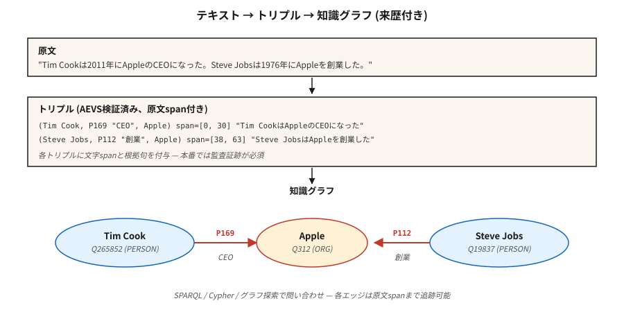

# 關係抽取與知識圖譜建構

> NER 找到了實體。實體連結把它們錨定下來。關係抽取要找的是它們之間的邊。一個知識圖譜就是節點、邊，以及它們來源出處的總和。

**類型：** 實作
**程式語言：** Python
**先修單元：** 階段 5 · 06（NER）、階段 5 · 25（實體連結）
**時間：** 約 60 分鐘

## 問題所在

一位分析師讀到："Tim Cook became CEO of Apple in 2011." 這裡有四筆事實：

- `(Tim Cook, role, CEO)`
- `(Tim Cook, employer, Apple)`
- `(Tim Cook, start_date, 2011)`
- `(Apple, type, Organization)`

關係抽取（RE）把自由文本變成結構化的三元組 `(subject, relation, object)`。在整個語料庫上彙總起來，你就有了一個知識圖譜。彙總之後再拿來查詢，你就有了一個給 RAG、分析或法遵稽核用的推論基底。

2026 年的問題是：LLM 抽關係抽得很起勁。太起勁了。它們會生出原始文本根本支持不了的三元組。少了來源出處，你就分不出哪些三元組是真的、哪些只是看起來合理的虛構。2026 年的答案是 AEVS 式的「錨定並驗證」管線。

## 核心概念



**三元組形式。** `(subject_entity, relation_type, object_entity)`。關係要嘛來自一個封閉本體（Wikidata 屬性、FIBO、UMLS），要嘛來自一個開放集合（OpenIE 式，什麼都算）。

**三種抽取做法。**

1. **規則／模式匹配。** Hearst 模式："X such as Y" → `(Y, isA, X)`。再加上手工寫的 regex。脆弱、精確、可解釋。
2. **監督式分類器。** 給定一個句子裡的兩個實體提及（也就是一組實體對），從一個固定集合裡預測關係。在 TACRED、ACE、KBP 上訓練。2015–2022 年的標準做法。
3. **生成式 LLM。** 提示模型直接吐出三元組。開箱就能用。需要來源出處，否則會生出看起來很像樣的垃圾。

**AEVS（Anchor-Extraction-Verification-Supplement，2026）。** 目前的幻覺緩解框架：

- **錨定（Anchor）。** 標出每一個實體區段與關係詞組區段的精確位置。
- **抽取（Extract）。** 產生綁定到錨定區段的三元組。
- **驗證（Verify）。** 把每個三元組的元素比對回原始文本；沒有依據的一律拒絕。
- **補齊（Supplement）。** 用一道覆蓋率檢查確保沒有任何被錨定的區段被丟掉。

幻覺會大幅下降。代價是更多算力，但整條管線可稽核。

**開放與封閉之間的取捨。**

- **封閉本體。** 固定的屬性清單（例如 Wikidata 的 11,000+ 個屬性）。可預測。可以做圖結構查詢。很難亂造。
- **Open IE。** 任何動詞詞組都能變成一個關係。召回率高。精確率低。查詢起來很亂。

生產環境的知識圖譜通常兩者混用：用開放式資訊抽取（OpenIE）做發現，再把關係正規化到封閉本體上，然後才併進主圖。

```figure
relation-triples
```

## 動手實作

### 步驟 1：基於模式匹配的抽取

```python
PATTERNS = [
    (r"(?P<s>[A-Z]\w+) (?:is|was) (?:a|an|the) (?P<o>[A-Z]?\w+)", "isA"),
    (r"(?P<s>[A-Z]\w+) (?:is|was) born in (?P<o>\w+)", "bornIn"),
    (r"(?P<s>[A-Z]\w+) works? (?:at|for) (?P<o>[A-Z]\w+)", "worksAt"),
    (r"(?P<s>[A-Z]\w+) founded (?P<o>[A-Z]\w+)", "founded"),
]
```

完整的玩具版抽取器見 `code/main.py`。Hearst 模式至今仍活在特定領域的管線裡，因為它們可以除錯。

### 步驟 2：監督式 seq2seq 關係抽取

```python
from transformers import AutoTokenizer, AutoModelForSeq2SeqLM

tok = AutoTokenizer.from_pretrained("Babelscape/rebel-large")
model = AutoModelForSeq2SeqLM.from_pretrained("Babelscape/rebel-large")

text = "Tim Cook was born in Alabama. He later became CEO of Apple."
encoded = tok(text, return_tensors="pt", truncation=True)
output = model.generate(**encoded, max_length=200)
decoded = tok.batch_decode(output, skip_special_tokens=False)
```

REBEL 是一個以 BART 為基礎的 seq2seq 關係抽取器：它直接生成三元組，而不是對實體配對做分類。文本進，三元組出，關係名稱取自 Wikidata 的屬性。解碼出來的字串仍帶著 REBEL 的 `<triplet>`、`<subj>` 與 `<obj>` 標記，所以要依這些標記切開（就像模型卡裡的解析器那樣），才能得到 `(subject, relation, object)` 紀錄。它是用遠距監督的資料微調出來的。開放權重的標準基線。

### 步驟 3：帶錨定的 LLM 提示式抽取

```python
prompt = f"""Extract (subject, relation, object) triples from the text.
For each triple, include the exact character span in the source text.

Text: {text}

Output JSON:
[{{"subject": {{"text": "...", "span": [start, end]}},
   "relation": "...",
   "object": {{"text": "...", "span": [start, end]}}}}, ...]

Only include triples fully supported by the text. No inference beyond what is stated.
"""
```

把每一個回傳的區段都拿去跟原始文本核對。只要 `text[start:end] != triple_entity` 就拒絕。這就是最精簡形式的 AEVS「驗證」步驟。

### 步驟 4：正規化到封閉本體

```python
RELATION_MAP = {
    "is the CEO of": "P169",       # "chief executive officer"
    "was born in":   "P19",         # "place of birth"
    "founded":        "P112",       # "founded by" (inverted subject/object)
    "works at":       "P108",       # "employer"
}


def canonicalize(relation):
    rel_low = relation.lower().strip()
    if rel_low in RELATION_MAP:
        return RELATION_MAP[rel_low]
    return None   # drop unmapped open relations or route to manual review
```

正規化常常佔掉 60-80% 的工程量。編預算時要算進去。

### 步驟 5：建一個小圖並查詢

```python
triples = extract(text)
graph = {}
for s, r, o in triples:
    graph.setdefault(s, []).append((r, o))


def neighbors(node, relation=None):
    return [(r, o) for r, o in graph.get(node, []) if relation is None or r == relation]


print(neighbors("Tim Cook", relation="P108"))    # -> [(P108, Apple)]
```

這是每個 RAG-over-KG 系統的原子。要擴大規模，就換成 RDF 三元組儲存（Blazegraph、Virtuoso）、屬性圖（Neo4j），或向量增強的圖儲存。

## 常見陷阱

- **RE 之前先做指代消解。** "He founded Apple" —— RE 得先知道 "he" 是誰。先跑指代消解（單元 24）。
- **實體正規化。** "Apple Inc" 和 "Apple" 必須解到同一個節點。先做實體連結（單元 25）。
- **幻覺三元組。** LLM 會吐出文本並不支持的三元組。強制做區段驗證。
- **關係正規化的飄移。** 開放式資訊抽取抽出來的關係並不一致（"was born in,"、"came from,"、"is a native of"）。要收斂成正規 id，否則這個圖根本沒辦法查。
- **時間性錯誤。** "Tim Cook is CEO of Apple" —— 現在為真，在 2005 年為假。很多關係是有時效範圍的。用限定詞（Wikidata 裡的 `P580` 起始時間、`P582` 結束時間）。
- **領域不匹配。** REBEL 是在 Wikipedia 上訓練的。法律、醫療與科學文本通常需要在該領域上微調過的 RE 模型。

## 框架應用

2026 年的技術堆疊：

| 情境 | 選什麼 |
|-----------|------|
| 快速上線、通用領域 | REBEL 或 LlamaPred，搭配 Wikidata 正規化 |
| 特定領域（生醫、法律） | SciREX 式的領域微調 + 自訂本體 |
| LLM 提示式、輸出需可稽核 | AEVS 管線：錨定 → 抽取 → 驗證 → 補齊 |
| 大量新聞資訊抽取 | 模式匹配 + 監督式混合 |
| 從零建一個知識圖譜 | 開放式資訊抽取 + 一道手工正規化 |
| 時間性知識圖譜 | 抽取時帶上限定詞（起始／結束時間、時間點） |

整合模式是這樣：NER → 指代消解 → 實體連結 → 關係抽取 → 本體對應 → 載入圖。每一段都可以是一道品質關卡。

## 產出交付

存成 `outputs/skill-re-designer.md`：

```markdown
---
name: re-designer
description: Design a relation extraction pipeline with provenance and canonicalization.
version: 1.0.0
phase: 5
lesson: 26
tags: [nlp, relation-extraction, knowledge-graph]
---

Given a corpus (domain, language, volume) and downstream use (KG-RAG, analytics, compliance), output:

1. Extractor. Pattern-based / supervised / LLM / AEVS hybrid. Reason tied to precision vs recall target.
2. Ontology. Closed property list (Wikidata / domain) or open IE with canonicalization pass.
3. Provenance. Every triple carries source char-span + doc id. Non-negotiable for audit.
4. Merge strategy. Canonical entity id + relation id + temporal qualifiers; dedup policy.
5. Evaluation. Precision / recall on 200 hand-labelled triples + hallucination-rate on LLM-extracted sample.

Refuse any LLM-based RE pipeline without span verification (source provenance). Refuse open-IE output flowing into a production graph without canonicalization. Flag pipelines with no temporal qualifier on time-bounded relations (employer, spouse, position).
```

## 練習

1. **簡單。** 拿 `code/main.py` 裡的模式匹配抽取器跑 5 個新聞句子。手工核對精確率。
2. **中等。** 對同樣的句子用 REBEL（或一個小型 LLM）。比較兩邊的三元組。哪個抽取器精確率較高？召回率較高？
3. **困難。** 把 AEVS 管線建起來：用 LLM 抽取 + 把區段驗證回原始文本。在 50 個 Wikipedia 風格的句子上量測驗證步驟前後的幻覺率。

## 關鍵術語

| 術語 | 大家怎麼說 | 實際上是什麼 |
|------|-----------------|-----------------------|
| 三元組 | 「主語-關係-賓語」 | `(s, r, o)` 元組，知識圖譜的原子單位。 |
| 開放式資訊抽取（Open IE） | 「什麼都抽」 | 開放詞彙的關係詞組；召回率高、精確率低。 |
| 封閉本體 | 「固定的 schema」 | 有界的關係類型集合（Wikidata、UMLS、FIBO）。 |
| 正規化 | 「全部標準化就對了」 | 把表面名稱／關係對應到正規 id。 |
| AEVS | 「有依據的抽取」 | Anchor-Extraction-Verification-Supplement 管線（2026）。 |
| 來源出處 | 「回溯到來源的連結」 | 每個三元組都帶著一個 doc id + 字元區段指回它的出處。 |
| 遠距監督 | 「便宜的標註」 | 把文本跟現有的知識圖譜對齊，藉此造出訓練資料。 |

## 延伸閱讀

- [Mintz et al. (2009). Distant supervision for relation extraction without labeled data](https://www.aclweb.org/anthology/P09-1113.pdf) —— 遠距監督的那篇論文。
- [Huguet Cabot, Navigli (2021). REBEL: Relation Extraction By End-to-end Language generation](https://aclanthology.org/2021.findings-emnlp.204.pdf) —— seq2seq 關係抽取的主力。
- [Wadden et al. (2019). Entity, Relation, and Event Extraction with Contextualized Span Representations (DyGIE++)](https://arxiv.org/abs/1909.03546) —— 聯合式資訊抽取。
- [AEVS — Anchor-Extraction-Verification-Supplement framework](https://www.mdpi.com/2073-431X/15/3/178) —— 2026 年的幻覺緩解設計。
- [Wikidata SPARQL tutorial](https://www.wikidata.org/wiki/Wikidata:SPARQL_tutorial) —— 正規的圖結構查詢。
