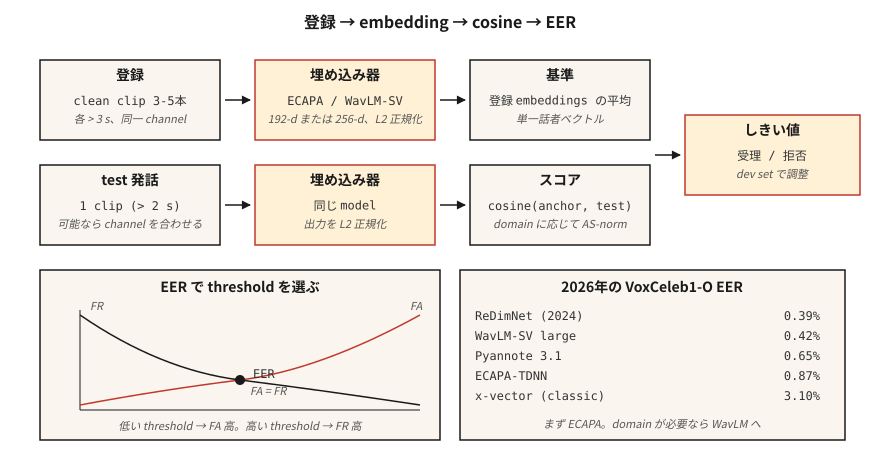

# 說話人辨識與說話人驗證

> 語音辨識問的是「他們說了什麼？」說話人辨識問的是「是誰說的？」數學看起來一樣 —— 嵌入加上餘弦相似度 —— 但正式環境裡每個決策都懸在一個 EER 數字上。

**類型：** 實作
**程式語言：** Python
**先修單元：** 階段 6 · 02（頻譜圖與梅爾）、階段 5 · 22（嵌入模型）
**時間：** 約 45 分鐘

## 問題所在

一位使用者說了一句通關密語。你想知道：這是不是他聲稱的那個人（*說話人驗證*，1:1），還是他是你註冊庫裡的第幾號人物（*辨識*，1:N）？或者兩者都不是 —— 這是不是一個未知的說話人（*開放集*）？

2018 年之前：GMM-UBM + i-vector。EER 還算合理，但對通道偏移（電話 vs 筆電）與情緒很脆弱。2018–2022 年：x-vector（以角度邊界訓練的 TDNN 骨幹）。2022 年之後：ECAPA-TDNN 與 WavLM-large 的聲紋嵌入。到 2026 年，這個領域由三個模型與一個指標主宰。

那個指標就是 **EER** —— 等錯誤率。把你的判定門檻設在誤接受率 = 誤拒絕率的位置。那個交叉點就是 EER。每篇論文、每個排行榜、每次採購會議都在用它。

## 核心概念



**這條管線。** 註冊：錄下目標說話人 5–30 秒的音訊；算出一個固定維度的嵌入（ECAPA-TDNN 是 192 維，WavLM-large 是 256 維）。說話人驗證：取得測試語句的嵌入；做聲紋比對算出餘弦相似度；跟門檻比較。

**ECAPA-TDNN（2020 年提出，2026 年仍佔主導）。** Emphasized Channel Attention, Propagation and Aggregation - Time-Delay Neural Network。帶 squeeze-excitation 的 1D 卷積區塊、多頭注意力池化，後面接一個線性層降到 192 維。在 VoxCeleb 1+2（2,700 位說話人、110 萬句語句）上以加性角度邊界損失（AAM-softmax）訓練。

**WavLM-SV（2022 年之後）。** 用 AAM 損失微調一個預訓練的 WavLM-large SSL 骨幹。品質更高但更慢 —— 300+ MB 對上 15 MB。

**x-vector（基準線）。** TDNN + 統計量池化。經典款；在 CPU／邊緣裝置上還是有用。

**AAM-softmax。** 標準 softmax，在角度空間裡對正確類別加上一個邊界 `m`：`cos(θ + m)`。強迫類別之間在角度上分開。典型值 `m=0.2`、尺度 `s=30`。

### 計分

- 註冊嵌入與測試嵌入之間的 **餘弦相似度**。基於門檻做判定。
- **PLDA（機率式 LDA）。** 把嵌入投影到一個潛在空間，在那裡「同一位說話人 vs 不同說話人」有封閉形式的似然比。疊在餘弦相似度之上，可以讓 EER 再降 10–20%。2020 年之前的標準做法；現在只用在封閉集的設定裡。
- **分數正規化。** `S-norm` 或 `AS-norm`：拿每個分數對照一群冒充者的平均值與標準差做正規化。跨領域評估時不可或缺。

### 你該知道的數字（2026 年）

| 模型 | VoxCeleb1-O EER | 參數量 | 吞吐量（A100） |
|-------|-----------------|--------|-------------------|
| x-vector（經典款） | 3.10% | 5 M | 400× RT |
| ECAPA-TDNN | 0.87% | 15 M | 200× RT |
| WavLM-SV large | 0.42% | 316 M | 20× RT |
| Pyannote 3.1 分段 + 嵌入 | 0.65% | 6 M | 100× RT |
| ReDimNet（2024） | 0.39% | 24 M | 100× RT |

### 語者分段標記

在一段多人的片段裡回答「誰在什麼時候說話」。管線：VAD → 切段 → 為每一段算嵌入 → 分群（凝聚式或譜分群）→ 平滑邊界。現代的那一套：`pyannote.audio` 3.1，它把說話人分段、嵌入與分群包在一次呼叫後面。2026 年在 AMI 上的 SOTA DER 約為 15%（2022 年是 23%）。

```figure
sp-eer-crossover
```

## 動手實作

### 步驟 1：用 MFCC 統計量做的玩具嵌入

```python
def embed_mfcc_stats(signal, sr):
    frames = featurize_mfcc(signal, sr, n_mfcc=13)
    mean = [sum(f[i] for f in frames) / len(frames) for i in range(13)]
    std = [
        math.sqrt(sum((f[i] - mean[i]) ** 2 for f in frames) / len(frames))
        for i in range(13)
    ]
    return mean + std  # 26-d
```

離 SOTA 遠得很 —— 純粹用來教學。`code/main.py` 拿它在合成的說話人資料上做概念驗證。

### 步驟 2：餘弦相似度 + 門檻

```python
def cosine(a, b):
    dot = sum(x * y for x, y in zip(a, b))
    na = math.sqrt(sum(x * x for x in a))
    nb = math.sqrt(sum(x * x for x in b))
    return dot / (na * nb) if na and nb else 0.0

def verify(enroll, test, threshold=0.75):
    return cosine(enroll, test) >= threshold
```

### 步驟 3：從相似度配對算 EER

```python
def eer(same_scores, diff_scores):
    thresholds = sorted(set(same_scores + diff_scores))
    best = (1.0, 1.0, 0.0)  # (fa, fr, threshold)
    for t in thresholds:
        fr = sum(1 for s in same_scores if s < t) / len(same_scores)
        fa = sum(1 for s in diff_scores if s >= t) / len(diff_scores)
        if abs(fa - fr) < abs(best[0] - best[1]):
            best = (fa, fr, t)
    return (best[0] + best[1]) / 2, best[2]
```

回傳 (eer, threshold_at_eer)。兩個都要回報。

### 步驟 4：用 SpeechBrain 上正式環境

```python
from speechbrain.pretrained import EncoderClassifier

clf = EncoderClassifier.from_hparams(source="speechbrain/spkrec-ecapa-voxceleb")

# enroll: average the embeddings of 3-5 clean samples
enroll = torch.stack([clf.encode_batch(load(x)) for x in enrollment_clips]).mean(0)
# verify
score = clf.similarity(enroll, clf.encode_batch(load("test.wav"))).item()
verdict = score > 0.25   # ECAPA typical threshold; tune on your data
```

### 步驟 5：用 pyannote 做語者分段標記

```python
from pyannote.audio import Pipeline

pipe = Pipeline.from_pretrained("pyannote/speaker-diarization-3.1")
diarization = pipe("meeting.wav", num_speakers=None)
for turn, _, speaker in diarization.itertracks(yield_label=True):
    print(f"{turn.start:.1f}–{turn.end:.1f}  {speaker}")
```

## 框架應用

2026 年的那一套：

| 情境 | 選什麼 |
|-----------|------|
| 封閉集 1:1 說話人驗證、邊緣裝置 | ECAPA-TDNN + 餘弦門檻 |
| 開放集說話人驗證、雲端 | WavLM-SV + AS-norm |
| 語者分段標記（會議、podcast） | `pyannote/speaker-diarization-3.1` |
| 反偽冒（重播／深偽偵測） | AASIST 或 RawNet2 |
| 超小型嵌入式（KWS + 註冊） | Titanet-Small（NeMo） |

## 常見陷阱

- **通道不匹配。** 在 VoxCeleb（網路影片）上訓練的模型 ≠ 電話通話的音訊。一定要在目標通道上評估。
- **語句太短。** 測試音訊短於 3 秒時，EER 會急遽惡化。
- **帶噪音的註冊。** 一筆吵雜的註冊就會毒害整個錨點。用 3 筆以上乾淨的樣本取平均。
- **跨情境用固定門檻。** 一定要用目標領域的保留開發集去調門檻。
- **對沒有正規化的嵌入算餘弦相似度。** 先做 L2 正規化；否則向量長度會主宰結果。

## 產出交付

存成 `outputs/skill-speaker-verifier.md`。挑選模型、註冊協定、門檻調校計畫，以及防詐的保護措施。

## 練習

1. **簡單。** 跑 `code/main.py`。它會建出合成的「說話人」（不同的音色輪廓）、做註冊，並在一份 100 組配對的試驗清單上算 EER。
2. **中等。** 在 30 句 VoxCeleb1 語句（5 位說話人 × 每人 6 句）上使用 SpeechBrain 的 ECAPA。用餘弦相似度與 PLDA 分別算 EER。
3. **困難。** 用 `pyannote.audio` 打造完整的註冊 → 語者分段標記 → 說話人驗證管線。在 AMI 開發集上評估 DER。

## 關鍵術語

| 術語 | 大家怎麼說 | 實際上是什麼 |
|------|-----------------|-----------------------|
| EER | 那個頭條指標 | 誤接受 = 誤拒絕時的門檻。 |
| 說話人驗證 | 1:1 | 「這是 Alice 嗎？」 |
| 辨識 | 1:N | 「現在是誰在說話？」 |
| 開放集 | 可能是未知的人 | 測試集裡可能有沒註冊過的說話人。 |
| 註冊 | 登錄 | 算出一位說話人的參考嵌入。 |
| AAM-softmax | 那個損失函式 | 帶加性角度邊界的 softmax；強迫各群分開。 |
| PLDA | 經典的計分法 | 機率式 LDA；疊在嵌入之上的似然比計分。 |
| DER | 語者分段標記的指標 | Diarization Error Rate —— 漏判 + 誤警 + 混淆。 |

## 延伸閱讀

- [Snyder et al. (2018). X-Vectors: Robust DNN Embeddings for Speaker Recognition](https://www.danielpovey.com/files/2018_icassp_xvectors.pdf) —— 深度嵌入的經典論文。
- [Desplanques et al. (2020). ECAPA-TDNN](https://arxiv.org/abs/2005.07143) —— 2020–2026 年的主導架構。
- [Chen et al. (2022). WavLM: Large-Scale Self-Supervised Pre-Training for Full Stack Speech Processing](https://arxiv.org/abs/2110.13900) —— 用於說話人驗證與語者分段標記的 SSL 骨幹。
- [Bredin et al. (2023). pyannote.audio 3.1](https://github.com/pyannote/pyannote-audio) —— 正式環境的語者分段標記 + 嵌入那一套。
- [VoxCeleb leaderboard (updated 2026)](https://www.robots.ox.ac.uk/~vgg/data/voxceleb/) —— 各模型當前的 EER 排名。
