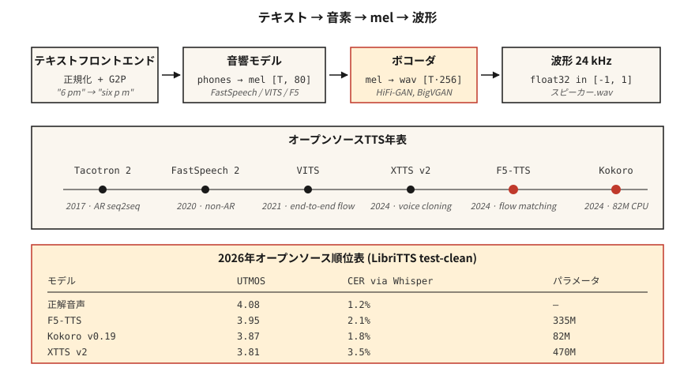

# 文字轉語音（TTS）—— 從 Tacotron 到 F5 與 Kokoro

> 語音辨識把語音反轉成文字；TTS 把文字反轉成語音。2026 年的那一套有三個部分：文字 → 詞元、詞元 → 梅爾、梅爾 → 波形。每個部分都有一個塞得進筆電的預設模型。

**類型：** 實作
**程式語言：** Python
**先修單元：** 階段 6 · 02（頻譜圖與梅爾）、階段 5 · 09（Seq2Seq）、階段 7 · 05（完整的 Transformer）
**時間：** 約 75 分鐘

## 問題所在

你有一個字串：「Please remind me to water the plants at 6 pm.」你需要一段 3 秒的音訊，聽起來自然、韻律（停頓、重音）正確、把「plants」的母音唸對，而且為了做即時語音助理，要在 CPU 上 300 ms 內跑完。你還需要能換聲音、能處理夾雜語言的輸入（「remind me at 6 pm, daijoubu?」），並且唸人名時不要出洋相。

現代的 TTS 管線長這樣：

1. **文字前端。** 正規化文字（日期、數字、電子郵件），轉成音素或子詞詞元，預測韻律特徵。
2. **聲學模型。** 文字 → 梅爾頻譜圖。Tacotron 2（2017）、FastSpeech 2（2020）、VITS（2021）、F5-TTS（2024）、Kokoro（2024）。
3. **聲碼器。** 梅爾 → 波形。WaveNet（2016）、WaveRNN、HiFi-GAN（2020）、BigVGAN（2022），2024 年之後則是神經編解碼器聲碼器。

到 2026 年，端到端的擴散與流匹配模型讓聲學模型與聲碼器的分界變模糊了。但拆成三部分的心智模型在除錯時依然成立。

## 核心概念



**Tacotron 2（2017）。** Seq2seq：字元嵌入 → BiLSTM 編碼器 → 位置敏感注意力 → 自迴歸 LSTM 解碼器吐出梅爾幀。慢（自迴歸），長文字時會搖搖晃晃。至今仍常被當基準線引用。

**FastSpeech 2（2020）。** 非自迴歸。時長預測器輸出每個音素該分到幾個梅爾幀。單趟完成，比 Tacotron 快 10 倍。犧牲了一些自然度（單調對齊），但到處都在用。

**VITS（2021）。** 用變分推論把編碼器 + 基於流的時長模型 + HiFi-GAN 聲碼器端到端一起訓練。品質高，單一模型。2022–2024 年主導開源 TTS。衍生版本：YourTTS（多說話人零樣本）、XTTS v2（2024，Coqui）。

**F5-TTS（2024）。** 建立在流匹配上的擴散 transformer。韻律自然，用 5 秒參考音訊就能零樣本複製聲音。2026 年開源 TTS 排行榜的榜首。3.35 億參數。

**Kokoro（2024）。** 小（8200 萬參數）、CPU 跑得動，即時應用場合最強的英文 TTS。封閉詞彙、僅支援英文，apache-2.0。

**OpenAI TTS-1-HD、ElevenLabs v2.5、Google Chirp-3。** 商業界的最強水準。ElevenLabs v2.5 的情緒標籤（「[whispered]」、「[laughing]」）與角色聲音在 2026 年主宰有聲書製作。

### 聲碼器的演進

| 年代 | 聲碼器 | 延遲 | 品質 |
|-----|---------|---------|---------|
| 2016 | WaveNet | 只能離線 | 發表時是 SOTA |
| 2018 | WaveRNN | 約即時 | 好 |
| 2020 | HiFi-GAN | 100× 即時 | 接近真人 |
| 2022 | BigVGAN | 50× 即時 | 能跨說話人／語言泛化 |
| 2024 | SNAC、DAC（神經編解碼器） | 與自迴歸模型整合 | 離散詞元，位元效率高 |

到 2026 年，多數「TTS」模型都是從文字到波形的端到端；梅爾頻譜圖成了內部表示。

### 評估

- **MOS（自然度評分，Mean Opinion Score）。** 1–5 分，群眾外包評分。仍是黃金標準；但慢得令人痛苦。
- **CMOS（比較式 MOS）。** A 對 B 的偏好。每份標註的信賴區間更緊。
- **UTMOS、DNSMOS。** 不需參考音訊的神經 MOS 預測器。排行榜在用。
- **透過 ASR 算 CER（字元錯誤率）。** 把 TTS 的輸出丟進 Whisper，對照輸入文字算 CER。可理解度的替代指標。
- **SECS（聲紋嵌入餘弦相似度）。** 聲音複製的品質。

2026 年在 LibriTTS test-clean 上的數字：

| 模型 | UTMOS | CER（透過 Whisper） | 大小 |
|-------|-------|-------------------|------|
| 真實錄音 | 4.08 | 1.2% | — |
| F5-TTS | 3.95 | 2.1% | 335M |
| XTTS v2 | 3.81 | 3.5% | 470M |
| VITS | 3.62 | 3.1% | 25M |
| Kokoro v0.19 | 3.87 | 1.8% | 82M |
| Parler-TTS Large | 3.76 | 2.8% | 2.3B |

```figure
sp-tts-stack
```

## 動手實作

### 步驟 1：把輸入轉成音素

```python
from phonemizer import phonemize
ph = phonemize("Hello world", language="en-us", backend="espeak")
# 'həloʊ wɜːld'
```

音素是通用的橋梁。品質在 VITS 等級以下的東西，都不要餵它原始文字。

### 步驟 2：跑 Kokoro（2026 年的 CPU 預設選擇）

```python
from kokoro import KPipeline
tts = KPipeline(lang_code="a")  # "a" = American English
audio, sr = tts("Please remind me to water the plants at 6 pm.", voice="af_bella")
# audio: float32 tensor, sr=24000
```

離線跑、單一檔案、8200 萬參數。

### 步驟 3：用 F5-TTS 做聲音複製

```python
from f5_tts.api import F5TTS
tts = F5TTS()
wav = tts.infer(
    ref_file="my_voice_5s.wav",
    ref_text="The quick brown fox jumps over the lazy dog.",
    gen_text="Please remind me to water the plants.",
)
```

傳一段 5 秒的參考片段 + 它的轉錄稿；F5 會複製韻律與音色。

### 步驟 4：從零打造 HiFi-GAN 聲碼器

放進教學腳本裡太大了，但形狀是這樣：

```python
class HiFiGAN(nn.Module):
    def __init__(self, mel_channels=80, upsample_rates=[8, 8, 2, 2]):
        super().__init__()
        # 4 upsample blocks, total 256x to go from mel-rate to audio-rate
        ...
    def forward(self, mel):
        return self.blocks(mel)  # -> waveform
```

訓練：對抗式（在短視窗上做判別器）+ 梅爾頻譜圖重建損失 + 特徵匹配損失。已經日用品化了 —— 直接用 `hifi-gan` 儲存庫或 nvidia-NeMo 的預訓練檢查點。

### 步驟 5：完整管線（偽程式碼）

```python
text = "Please remind me at 6 pm."
phones = phonemize(text)
mel = acoustic_model(phones, speaker=alice)      # [T, 80]
wav = vocoder(mel)                                # [T * 256]
soundfile.write("out.wav", wav, 24000)
```

## 框架應用

2026 年的那一套：

| 情境 | 選什麼 |
|-----------|------|
| 即時英文語音助理 | Kokoro（CPU）或 XTTS v2（GPU） |
| 用 5 秒參考音訊複製聲音 | F5-TTS |
| 商業角色配音 | ElevenLabs v2.5 |
| 有聲書朗讀 | ElevenLabs v2.5 或 XTTS v2 + 微調 |
| 低資源語言 | 用 5–20 小時目標語言資料訓練 VITS |
| 富表現力／情緒標籤 | ElevenLabs v2.5 或微調 StyleTTS 2 |

2026 年的開源領先者：**品質看 F5-TTS，效率看 Kokoro**。除非你是歷史學家，別去碰 Tacotron。

## 常見陷阱

- **沒有文字正規化器。** 「Dr. Smith」要唸成「Doctor」還是「Drive」？「2026」要唸成「twenty twenty six」還是「two zero two six」？在進音素轉換器*之前*就要正規化。
- **詞彙表外的專有名詞。** 「Ghumare」→「ghyu-mair」？替未知詞元準備一個後備的字母轉音素模型。
- **削峰失真。** 聲碼器的輸出很少削峰，但推論時梅爾尺度不匹配會衝過 ±1.0。永遠記得 `np.clip(wav, -1, 1)`。
- **取樣率不匹配。** Kokoro 輸出 24 kHz；你的下游管線預期 16 kHz → 重新取樣，否則會有頻疊失真。

## 產出交付

存成 `outputs/skill-tts-designer.md`。針對指定的聲音、延遲與語言目標，設計一條 TTS 管線。

## 練習

1. **簡單。** 跑 `code/main.py`。它會從一個玩具詞彙表建出音素字典、估算每個音素的時長，並印出一份假的「梅爾」排程。
2. **中等。** 安裝 Kokoro，用 `af_bella` 與 `am_adam` 兩種聲音合成同一個句子。比較音訊時長與主觀品質。
3. **困難。** 錄一段自己 5 秒的參考片段。用 F5-TTS 複製它。回報參考音訊與複製輸出之間的 SECS。

## 關鍵術語

| 術語 | 大家怎麼說 | 實際上是什麼 |
|------|-----------------|-----------------------|
| 音素 | 發音單位 | 抽象的發音類別；英文有 39 個（ARPABet）。 |
| 時長預測器 | 每個音素持續多久 | 非自迴歸模型的輸出；每個音素對應的整數幀數。 |
| 聲碼器 | 梅爾 → 波形 | 把梅爾頻譜圖映射到原始取樣點的神經網路。 |
| HiFi-GAN | 標準聲碼器 | 基於 GAN；2020–2024 年的主導者。 |
| MOS | 主觀品質 | 由真人評分者給出的 1–5 分自然度評分。 |
| SECS | 聲音複製的指標 | 目標與輸出的聲紋嵌入之間的餘弦相似度。 |
| F5-TTS | 2024 年的開源 SOTA | 流匹配擴散；零樣本聲音複製。 |
| Kokoro | CPU 英文的領先者 | 8200 萬參數的模型，Apache 2.0。 |

## 延伸閱讀

- [Shen et al. (2017). Tacotron 2](https://arxiv.org/abs/1712.05884) —— seq2seq 的基準線。
- [Kim, Kong, Son (2021). VITS](https://arxiv.org/abs/2106.06103) —— 端到端、基於流。
- [Chen et al. (2024). F5-TTS](https://arxiv.org/abs/2410.06885) —— 當前的開源 SOTA。
- [Kong, Kim, Bae (2020). HiFi-GAN](https://arxiv.org/abs/2010.05646) —— 到 2026 年還在交付的那個聲碼器。
- [Kokoro-82M on HuggingFace](https://huggingface.co/hexgrad/Kokoro-82M) —— 2024 年對 CPU 友善的英文 TTS。
