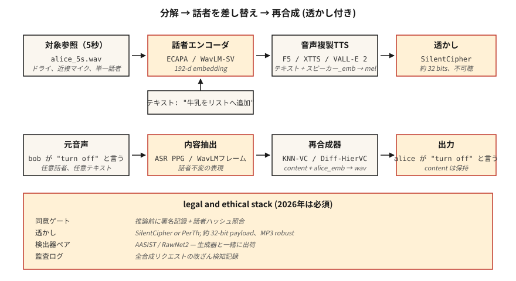

# 聲音複製與語音轉換

> 聲音複製是用別人的聲音唸出你的文字。語音轉換是把你的聲音改寫成別人的聲音，但保留你說了什麼。兩者都靠同一種拆解：把說話人身分和內容分開。

**類型：** 實作
**程式語言：** Python
**先修單元：** 階段 6 · 06（說話人辨識）、階段 6 · 07（TTS）
**時間：** 約 75 分鐘

## 問題所在

在 2026 年，用一張消費級 GPU、5 秒的音訊片段就足以做出任何人聲音的高品質複製。ElevenLabs、F5-TTS、OpenVoice v2、VoiceBox 全都提供零樣本或少樣本複製。這項技術既是恩賜（無障礙 TTS、配音、輔助發聲），也是武器（詐騙電話、政治深偽、智慧財產竊取）。

兩個關係很近的任務：

- **聲音複製（TTS 那一側）：** 文字 + 5 秒參考聲音 → 用那個聲音唸出來的音訊。
- **語音轉換（語音那一側）：** 來源音訊（甲說了 X）+ 乙的參考聲音 → 乙說 X 的音訊。

兩者都把波形分解成（內容、說話人、韻律），再把一個來源的內容和另一個來源的說話人重新組合起來。

2026 年你交付時要面對的關鍵限制：**浮水印與同意檢核在歐盟（AI Act，2026 年 8 月起可強制執行）以及加州（AB 2905，2025 年生效）都是法律要求**。你的管線必須嵌入聽不見的浮水印，並拒絕未經同意的複製。

## 核心概念



**零樣本複製。** 把一段 5 秒的片段餵給一個已經用數千位說話人訓練過的模型。說話人編碼器把片段映射成聲紋嵌入；TTS 解碼器則以該嵌入加上文字為條件。

使用者：F5-TTS（2024）、YourTTS（2022）、XTTS v2（2024）、OpenVoice v2（2024）。

**少樣本微調。** 錄 5–30 分鐘的目標聲音。對基礎模型做一小時的 LoRA 微調。品質會從「還行」躍升到「分不出來」。Coqui 與 ElevenLabs 都支援這種做法；社群則拿它搭配 F5-TTS 用。

**語音轉換（VC）。** 兩大家族：

- **辨識－合成。** 跑一個類似 ASR 的模型抽出內容表示（例如軟性音素後驗機率、PPG），再用目標聲紋嵌入重新合成。對語言和口音很穩健。KNN-VC（2023）、Diff-HierVC（2023）採用這條路。
- **解耦。** 訓練一個自編碼器，在瓶頸處的潛在空間裡把內容、說話人與韻律分開。推論時換掉聲紋嵌入。品質較低但比較快。AutoVC（2019）、VITS-VC 的各種衍生版採用這條路。

**基於神經編解碼器的複製（2024 年之後）。** VALL-E、VALL-E 2、NaturalSpeech 3、VoiceBox —— 把音訊當成來自 SoundStream／EnCodec 的離散詞元，在這些編解碼器詞元上訓練一個大型自迴歸或流匹配模型。短提示上的品質可與 ElevenLabs 相比。

### 倫理這一段不是外掛

**浮水印。** PerTh（Perth）與 SilentCipher（2024）會在音訊裡不可感知地嵌入約 16–32 位元的 ID。能撐過重新編碼、串流以及常見的編輯。開源、可上生產環境。

**同意檢核。** 每一份複製出來的輸出都必須配上一筆可驗證的同意紀錄。「我，Rohit，於 2026-04-22，授權此聲音用於 X 目的。」存進一份可察覺被竄改的日誌裡。

**偵測。** AASIST、RawNet2 與 Wav2Vec2-AASIST 都以偵測器形式發布。ASVspoof 2025 挑戰賽公布的數字顯示，最新的偵測器對 ElevenLabs、VALL-E 2 與 Bark 的輸出可達 0.8–2.3% 的 EER。

### 數字（2026）

| 模型 | 零樣本？ | SECS（與目標相似度） | WER（可理解度） | 參數量 |
|-------|-----------|--------------------|--------------|--------|
| F5-TTS | Yes | 0.72 | 2.1% | 335M |
| XTTS v2 | Yes | 0.65 | 3.5% | 470M |
| OpenVoice v2 | Yes | 0.70 | 2.8% | 220M |
| VALL-E 2 | Yes | 0.77 | 2.4% | 370M |
| VoiceBox | Yes | 0.78 | 2.1% | 330M |

對大多數聽眾來說，SECS > 0.70 通常就已經和目標分不出來了。

```figure
sp-voice-factorize
```

## 動手實作

### 步驟 1：用辨識－合成做分解（main.py 裡是純程式碼示範）

```python
def clone_pipeline(ref_audio, text, target_embedder, tts_model):
    speaker_emb = target_embedder.encode(ref_audio)
    mel = tts_model(text, speaker=speaker_emb)
    return vocoder(mel)
```

概念上很簡單；實作的重量都在 `tts_model` 和說話人編碼器裡。

### 步驟 2：用 F5-TTS 做零樣本複製

```python
from f5_tts.api import F5TTS
tts = F5TTS()
wav = tts.infer(
    ref_file="rohit_5s.wav",
    ref_text="The quick brown fox jumps over the lazy dog.",
    gen_text="Please add milk and bread to my list.",
)
```

參考轉錄稿必須和音訊完全一致；不一致會弄壞對齊。

### 步驟 3：用 KNN-VC 做語音轉換

```python
import torch
from knnvc import KNNVC  # 2023 model, https://github.com/bshall/knn-vc
vc = KNNVC.load("wavlm-base-plus")
out_wav = vc.convert(source="my_voice.wav", target_pool=["alice_1.wav", "alice_2.wav"])
```

KNN-VC 會跑 WavLM，為來源與目標池抽出每一幀的嵌入，然後把每一個來源幀換成池中距離最近的那一幀。非參數式，只要一分鐘的目標語音就能用。

### 步驟 4：嵌入浮水印

```python
from silentcipher import SilentCipher
sc = SilentCipher(model="2024-06-01")
payload = b"consent_id:abc123;ts:1745353200"
watermarked = sc.embed(wav, sr=24000, message=payload)
detected = sc.detect(watermarked, sr=24000)   # returns payload bytes
```

約 32 位元的酬載，經過 MP3 重新編碼與輕微雜訊之後仍可偵測。

### 步驟 5：同意檢核

```python
def cloned_inference(text, ref_audio, consent_record):
    assert verify_signature(consent_record), "Signed consent required"
    assert consent_record["speaker_id"] == hash_speaker(ref_audio)
    wav = tts.infer(ref_file=ref_audio, gen_text=text)
    wav = watermark(wav, payload=consent_record["id"])
    return wav
```

## 框架應用

2026 年的那一套：

| 情境 | 選什麼 |
|-----------|------|
| 5 秒零樣本複製、開源 | F5-TTS 或 OpenVoice v2 |
| 商業製作等級的複製 | ElevenLabs Instant Voice Clone v2.5 |
| 語音轉換（改寫） | KNN-VC 或 Diff-HierVC |
| 多說話人微調 | StyleTTS 2 + 說話人適配器 |
| 跨語言複製 | XTTS v2 或 VALL-E X |
| 深偽偵測 | Wav2Vec2-AASIST |

## 常見陷阱

- **參考轉錄稿沒對齊。** F5-TTS 這類模型要求參考文字和參考音訊完全一致，標點也算。
- **參考音訊有殘響。** 回音會毀掉複製效果。要錄乾聲、近距離收音。
- **情緒不匹配。** 訓練用的參考是「歡快」的，複製出來的所有東西就都是歡快的。讓參考的情緒符合目標用途。
- **語言洩漏。** 複製一位英語者的聲音，再叫模型講法文，通常還是會帶著那個口音；請用跨語言模型（XTTS、VALL-E X）。
- **沒有浮水印。** 從 2026 年 8 月起，在歐盟這是法律上無法交付的。

## 產出交付

存成 `outputs/skill-voice-cloner.md`。設計一條複製或轉換管線，包含同意檢核 + 浮水印 + 品質目標。

## 練習

1. **簡單。** 跑 `code/main.py`。它會計算兩個「說話人」在交換前後的餘弦相似度，藉此示範聲紋嵌入的交換。
2. **中等。** 用 OpenVoice v2 複製你自己的聲音。量測參考音訊與複製結果之間的 SECS。再透過 Whisper 量測 CER。
3. **困難。** 對 20 份複製結果套用 SilentCipher 浮水印，把它們送進 128 kbps 的 MP3 編碼＋解碼，然後偵測酬載。回報位元正確率。

## 關鍵術語

| 術語 | 大家怎麼說 | 實際上是什麼 |
|------|-----------------|-----------------------|
| 零樣本複製 | 5 秒就夠了 | 預訓練模型 + 聲紋嵌入；不用訓練。 |
| PPG | 音素後驗圖 | 每幀的 ASR 後驗機率，當作與語言無關的內容表示。 |
| KNN-VC | 最近鄰轉換 | 把每個來源幀換成目標池中最近的那一幀。 |
| 神經編解碼器 TTS | VALL-E 那一路 | 在 EnCodec／SoundStream 詞元上跑的自迴歸模型。 |
| 浮水印 | 聽不見的簽章 | 嵌在音訊裡的位元，撐得過重新編碼。 |
| SECS | 複製的逼真度 | 目標與複製結果的聲紋嵌入之間的餘弦相似度。 |
| AASIST | 深偽偵測器 | 反欺騙模型；偵測合成語音。 |

## 延伸閱讀

- [Chen et al. (2024). F5-TTS](https://arxiv.org/abs/2410.06885) —— 開源的零樣本複製 SOTA。
- [Baevski et al. / Microsoft (2023). VALL-E](https://arxiv.org/abs/2301.02111) 與 [VALL-E 2 (2024)](https://arxiv.org/abs/2406.05370) —— 神經編解碼器 TTS。
- [Qian et al. (2019). AutoVC](https://arxiv.org/abs/1905.05879) —— 基於解耦的語音轉換。
- [Baas, Waubert de Puiseau, Kamper (2023). KNN-VC](https://arxiv.org/abs/2305.18975) —— 基於檢索的 VC。
- [SilentCipher (2024) — Audio Watermarking](https://github.com/sony/silentcipher) —— 可上生產環境的 32 位元音訊浮水印。
- [ASVspoof 2025 results](https://www.asvspoof.org/) —— 偵測器與合成器的軍備競賽，2026 年更新。
