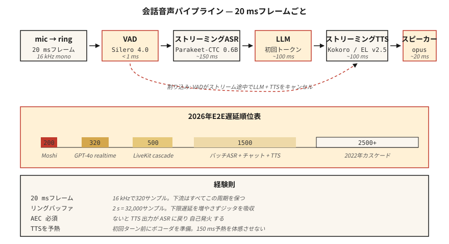

# 即時音訊處理

> 批次管線處理的是一個檔案。即時管線要在下一個 20 毫秒到來之前處理完當前的 20 毫秒。每一套對話式 AI、廣播控制室與電話機器人，都靠這份延遲預算存活或倒下。

**類型：** 實作
**程式語言：** Python
**先修單元：** 階段 6 · 02（頻譜圖）、階段 6 · 04（ASR）、階段 6 · 07（TTS）
**時間：** 約 75 分鐘

## 問題所在

你想要一個感覺是活的語音助理。人類對話輪替的延遲大約是 230 ms（從靜音到回應）。超過 500 ms 就開始像機器人；超過 1500 ms 就像壞掉了。2026 年一個完整的 **聽見 → 理解 → 回應 → 說出** 迴圈，預算是這樣分配的：

| 階段 | 預算 |
|-------|--------|
| 麥克風 → 緩衝區 | 20 ms |
| VAD | 10 ms |
| ASR（串流） | 150 ms |
| LLM（首個詞元） | 100 ms |
| TTS（首個區塊） | 100 ms |
| 算繪 → 喇叭 | 20 ms |
| **總計** | **約 400 ms** |

Moshi（Kyutai，2024）在全雙工下量到 200 ms。GPT-4o-realtime（2024）約 320 ms。2022 年出貨的串接式管線是 2500 ms。這 10 倍的進步來自三個技巧：（1）處處都用串流，（2）用部分結果做非同步流水線，（3）生成可被打斷。

## 核心概念



**幀／區塊／窗。** 即時音訊以固定大小的區塊流動。常見選擇：20 ms（16 kHz 下是 320 個樣本）。下游所有環節都必須跟上這個節奏。

**環形緩衝區。** 固定大小的循環緩衝區。生產者執行緒寫入新的幀，消費者執行緒讀取。避免在熱路徑上做記憶體配置。大小 ≈ 最大延遲 × 取樣率；2 秒的 16 kHz 環形緩衝區 = 32,000 個樣本。

**VAD（語音活動偵測）。** 沒人在說話時就把下游工作擋掉。Silero VAD 4.0（2024）在 CPU 上處理每個 30 ms 的幀只要 <1 ms。`webrtcvad` 是較舊的替代方案。

**串流 ASR。** 音訊一邊進來就一邊吐出部分轉錄的模型。Parakeet-CTC-0.6B 在串流模式（NeMo，2024）下，延遲 320 ms、WER 2–5%。Whisper-Streaming（Macháček 等人，2023）把 Whisper 切成區塊，做到約 2 秒延遲的近串流。

**打斷。** 助理正在說話時使用者開口，你必須（a）偵測到打斷（barge-in），（b）停掉 TTS，（c）丟棄剩下的 LLM 輸出。全部要在 100 ms 內完成，否則使用者會覺得助理是聾的。

**WebRTC Opus 傳輸。** 20 ms 的幀、48 kHz、8–128 kbps 的自適應位元率。瀏覽器與行動端的標準。LiveKit、Daily.co、Pion 是 2026 年打造語音應用的技術堆疊。

**抖動緩衝區。** 網路封包會亂序或遲到。抖動緩衝區負責重排與平滑；太小 → 聽得出破音空隙，太大 → 延遲上升。一般是 60–80 ms。

### 常見陷阱

- **執行緒競爭。** Python 的 GIL 加上笨重的模型會讓音訊執行緒餓死。改用以 C 回呼為基礎的音訊函式庫（sounddevice、PortAudio），並讓 Python 遠離熱路徑。
- **取樣率轉換的延遲。** 在管線內做重新取樣會多出 5–20 ms。要嘛一開始就轉好，要嘛用零延遲的重新取樣器（PolyPhase、`soxr_hq`）。
- **TTS 的暖機。** 就算是像 Kokoro 這種快的 TTS，第一次請求也有 100–200 ms 的暖機。把模型快取住，並在第一次真正的對話輪之前用一次假請求把它熱起來。
- **回音消除。** 沒有 AEC，TTS 的輸出會從麥克風再繞回來，讓 ASR 對機器人自己的聲音起反應。WebRTC AEC3 是開源的預設選擇。

```figure
nyquist-aliasing
```

## 動手實作

### 步驟 1：環形緩衝區

```python
import collections

class RingBuffer:
    def __init__(self, capacity):
        self.buf = collections.deque(maxlen=capacity)
    def write(self, frame):
        self.buf.extend(frame)
    def read(self, n):
        return [self.buf.popleft() for _ in range(min(n, len(self.buf)))]
    def level(self):
        return len(self.buf)
```

容量決定了最大的緩衝延遲。16 kHz 下 32,000 個樣本 = 2 秒。

### 步驟 2：VAD 閘門

```python
def simple_energy_vad(frame, threshold=0.01):
    return sum(x * x for x in frame) / len(frame) > threshold ** 2
```

正式環境請換成 Silero VAD：

```python
import torch
vad, _ = torch.hub.load("snakers4/silero-vad", "silero_vad")
is_speech = vad(torch.tensor(frame), 16000).item() > 0.5
```

### 步驟 3：串流 ASR

```python
# Parakeet-CTC-0.6B streaming via NeMo
from nemo.collections.asr.models import EncDecCTCModelBPE
asr = EncDecCTCModelBPE.from_pretrained("nvidia/parakeet-ctc-0.6b")
# chunk_ms=320 ms, look_ahead_ms=80 ms
for chunk in audio_stream():
    partial_text = asr.transcribe_streaming(chunk)
    print(partial_text, end="\r")
```

### 步驟 4：打斷處理器

```python
class Dialog:
    def __init__(self):
        self.tts_task = None

    def on_user_speech(self, frame):
        if self.tts_task and not self.tts_task.done():
            self.tts_task.cancel()   # barge-in
        # then feed to streaming ASR

    def on_final_user_utterance(self, text):
        self.tts_task = asyncio.create_task(self.reply(text))

    async def reply(self, text):
        async for tts_chunk in llm_then_tts(text):
            speaker.write(tts_chunk)
```

關鍵在非同步 I/O 與可取消的 TTS 串流。對音訊軌呼叫 WebRTC 的 `peerconnection.stop()` 是標準做法。

## 框架應用

2026 年的技術堆疊：

| 層 | 選擇 |
|-------|------|
| 傳輸 | LiveKit（WebRTC）或 Pion（Go） |
| VAD | Silero VAD 4.0 |
| 串流 ASR | Parakeet-CTC-0.6B 或 Whisper-Streaming |
| LLM 首字延遲 | Groq、Cerebras、vLLM-streaming |
| 串流 TTS | Kokoro 或 ElevenLabs Turbo v2.5 |
| 回音消除 | WebRTC AEC3 |
| 端到端原生 | OpenAI Realtime API 或 Moshi |

## 常見陷阱

- **為了保險先緩衝 500 ms。** 緩衝區*就是*你的延遲下限。把它縮小。
- **沒有固定執行緒優先權。** 音訊回呼跑在比 UI 更低優先權的執行緒上 = 負載一上來就爆音。
- **TTS 區塊太小。** 小於 200 ms 的區塊會讓聲碼器的雜訊聽得出來。320 ms 的區塊大小是甜蜜點。
- **沒有抖動緩衝區。** 真實網路本來就會抖；不做平滑就會出現爆音。
- **只處理一次錯誤就算了。** 音訊管線必須撞不壞。一個例外就會殺掉整個工作階段。

## 產出交付

存成 `outputs/skill-realtime-designer.md`。設計一條即時音訊管線，並為每個階段訂出具體的延遲預算。

## 練習

1. **簡單。** 跑 `code/main.py`。它會模擬環形緩衝區 + 能量 VAD；對一段假的 10 秒串流印出各階段的延遲。
2. **中等。** 用 `sounddevice` 做一個直通迴圈，以 20 ms 的幀處理你的麥克風，並在每一幀印出 VAD 狀態。
3. **困難。** 用 `aiortc` 做一個完整的全雙工回音測試：瀏覽器 → WebRTC → Python → WebRTC → 瀏覽器。用 1 kHz 的脈衝量測 glass-to-glass 延遲。

## 關鍵術語

| 術語 | 大家怎麼說 | 實際上是什麼 |
|------|-----------------|-----------------------|
| 環形緩衝區 | 那個循環佇列 | 給音訊幀用的固定大小、無鎖（或單生產者單消費者加鎖）FIFO。 |
| VAD | 靜音閘門 | 標記語音與非語音的模型或啟發式規則。 |
| 串流 ASR | 即時 STT | 音訊一邊進來就吐出部分文字；預看範圍有上限。 |
| 抖動緩衝區 | 網路平滑器 | 把亂序封包重排的佇列；一般是 60–80 ms。 |
| AEC | 回音消除 | 減掉喇叭到麥克風的回饋路徑。 |
| 打斷（barge-in） | 使用者插話 | 系統在 TTS 播放中偵測到使用者說話；必須取消播放。 |
| 全雙工 | 兩邊可以同時來 | 使用者與機器人可以同時說話；Moshi 就是全雙工。 |

## 延伸閱讀

- [Macháček et al. (2023). Whisper-Streaming](https://arxiv.org/abs/2307.14743) —— 以區塊切分實現近串流的 Whisper。
- [Kyutai (2024). Moshi](https://kyutai.org/Moshi.pdf) —— 全雙工、200 ms 延遲。
- [LiveKit Agents framework (2024)](https://docs.livekit.io/agents/) —— 正式環境等級的音訊代理程式編排。
- [Silero VAD repo](https://github.com/snakers4/silero-vad) —— 小於 1 ms 的 VAD，Apache 2.0。
- [WebRTC AEC3 paper](https://webrtc.googlesource.com/src/+/main/modules/audio_processing/aec3/) —— 開源的回音消除實作。
