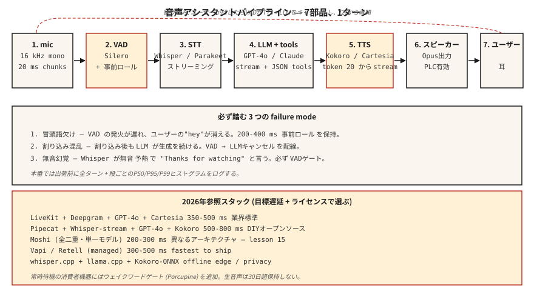

# 打造語音助理管線 —— 階段 6 的總結專案

> 把單元 01-11 的所有東西縫在一起。做一個會聽、會想、會回話的語音助理。2026 年這已經是解決過的工程問題，不是研究問題了 —— 但整合的細節才決定它能不能上線。

**類型：** 實作
**程式語言：** Python
**先修單元：** 階段 6 · 04、05、06、07、11；階段 11 · 09（函式呼叫）；階段 14 · 01（代理程式迴圈）
**時間：** 約 120 分鐘

## 問題所在

做一個端到端的助理：

1. 擷取麥克風輸入（16 kHz 單聲道）。
2. 偵測使用者說話的起點與終點。
3. 以串流方式轉錄。
4. 把逐字稿交給一個能呼叫工具（計時器、天氣、行事曆）的 LLM。
5. 把 LLM 的文字串流餵給 TTS。
6. 把音訊播回給使用者。
7. 使用者在回應中途打斷時就停下來。

延遲目標：在筆電 CPU 上，使用者講完話後 800 ms 內要送出第一個 TTS 音訊位元組。品質目標：不漏字、靜音處不出現幻覺字幕、沒有聲音複製的資料外洩、提示詞注入一次都不能成功。

## 核心概念



### 七個元件

1. **音訊擷取。** 麥克風 → 16 kHz 單聲道 → 20 ms 的區塊。Python 裡通常用 `sounddevice`，正式環境則用原生的 AudioUnit/ALSA/WASAPI。
2. **VAD（單元 11）。** Silero VAD，門檻 0.5、最短語音 250 ms、靜音餘留 500 ms。負責發出「開始」與「結束」訊號。
3. **串流 STT（單元 4-5）。** Whisper-streaming、Parakeet-TDT，或 Deepgram Nova-3（API）。會有部分與最終兩種逐字稿。
4. **具工具呼叫的 LLM。** GPT-4o／Claude 3.5／Gemini 2.5 Flash。工具用 JSON schema 描述。詞元用串流輸出。
5. **串流 TTS（單元 7）。** Kokoro-82M（開源中最快）或 Cartesia Sonic（商用）。LLM 產出 20 個詞元後就啟動 TTS。
6. **播放。** 輸出到喇叭；低頻寬網路下先用 opus 編碼。
7. **打斷處理器。** 如果 TTS 播放期間 VAD 觸發，就停止播放、取消 LLM、重新啟動 STT。

### 你一定會遇到的三種失效模式

1. **第一個字被切掉。** VAD 慢了一拍才啟動，使用者的「hey」不見了。啟動門檻用 0.3，不要用 0.5。
2. **回應中途打斷造成混亂。** 使用者打斷後 LLM 還在繼續生成，助理跟使用者搶話。要把 VAD 接到「取消 LLM」上。
3. **靜音幻覺。** Whisper 會在暖機的靜音幀上輸出「Thanks for watching」。永遠都要用 VAD 擋。

### 2026 年的正式環境參考堆疊

| 堆疊 | 延遲 | 授權 | 備註 |
|-------|---------|---------|-------|
| LiveKit + Deepgram + GPT-4o + Cartesia | 350-500 ms | 商用 API | 2026 年的業界預設 |
| Pipecat + Whisper-streaming + GPT-4o + Kokoro | 500-800 ms | 大致上開源 | 適合自己動手做 |
| Moshi（全雙工） | 200-300 ms | CC-BY 4.0 | 單一模型；架構不同，見單元 15 |
| Vapi／Retell（代管） | 300-500 ms | 商用 | 上線最快；客製化受限 |
| Whisper.cpp + llama.cpp + Kokoro-ONNX | 離線 | 開源 | 隱私／邊緣裝置 |

```figure
v4-voice-latency
```

## 動手實作

### 步驟 1：麥克風擷取與切區塊（偽程式碼）

```python
import sounddevice as sd

def mic_stream(chunk_ms=20, sr=16000):
    q = queue.Queue()
    def cb(indata, frames, time, status):
        q.put(indata.copy().flatten())
    with sd.InputStream(channels=1, samplerate=sr, blocksize=int(sr * chunk_ms/1000), callback=cb):
        while True:
            yield q.get()
```

### 步驟 2：由 VAD 把關的對話輪擷取

```python
def capture_turn(stream, vad, pre_roll_ms=300, silence_ms=500):
    buf, pre, triggered = [], collections.deque(maxlen=pre_roll_ms // 20), False
    silent = 0
    for chunk in stream:
        pre.append(chunk)
        if vad(chunk):
            if not triggered:
                buf = list(pre)
                triggered = True
            buf.append(chunk)
            silent = 0
        elif triggered:
            silent += 20
            buf.append(chunk)
            if silent >= silence_ms:
                return b"".join(buf)
```

### 步驟 3：串流 STT → LLM → TTS

```python
async def turn(audio_bytes):
    transcript = await stt.transcribe(audio_bytes)
    async for token in llm.stream(transcript):
        async for audio in tts.stream(token):
            await speaker.play(audio)
```

### 步驟 4：在 LLM 迴圈裡呼叫工具

```python
tools = [
    {"name": "get_weather", "parameters": {"location": "string"}},
    {"name": "set_timer", "parameters": {"seconds": "int"}},
]

async for chunk in llm.stream(user_text, tools=tools):
    if chunk.type == "tool_call":
        result = dispatch(chunk.name, chunk.args)
        continue_streaming(result)
    if chunk.type == "text":
        await tts.stream(chunk.text)
```

### 步驟 5：打斷處理

```python
tts_task = asyncio.create_task(tts_loop())
while True:
    chunk = await mic.get()
    if vad(chunk):
        tts_task.cancel()
        await speaker.stop()
        await new_turn()
        break
```

## 框架應用

`code/main.py` 是一份可以跑的模擬，用替身模型把七個元件全部接起來，所以就算沒有硬體你也看得到整條管線的形狀。要做真正的實作，就把替身換成：

- `silero-vad`（`pip install silero-vad`）
- `deepgram-sdk` 或 `openai-whisper`
- `openai`（`gpt-4o`）或 `anthropic`
- `kokoro` 或 `cartesia`
- I/O 用 `sounddevice`

## 常見陷阱

- **把個資永久留存。** 完整對話輪的音訊在多數司法管轄區都屬個資。保留 30 天，靜態加密。
- **沒有打斷機制。** 使用者一定會插話。你的助理必須停止說話。
- **會阻塞的 TTS。** 同步 TTS 會卡住事件迴圈。用非同步或另開一條執行緒。
- **沒有處理工具呼叫的錯誤。** 工具會失敗。LLM 必須拿回錯誤訊息並重試一次，然後優雅降級。
- **幻覺過濾器太激進。** 濾太多，助理就一直重複「我沒辦法幫你處理這個」；濾太少，它什麼都敢說。用一組保留資料集來校準。
- **沒有喚醒詞選項。** 永遠在聽是隱私上的風險。加一道喚醒詞閘門（Porcupine 或 openWakeWord）。

## 產出交付

存成 `outputs/skill-voice-assistant-architect.md`。給定預算、規模、語言與法規遵循的限制，產出一份完整的技術堆疊規格。

## 練習

1. **簡單。** 跑 `code/main.py`。它會用替身模組端到端模擬一次完整的對話輪，並印出每個階段的延遲。
2. **中等。** 把 STT 替身換成真的 Whisper 模型，跑在一段預錄的 `.wav` 上。量測 WER 與端到端延遲。
3. **困難。** 加上工具呼叫：實作 `get_weather`（任何 API 都行）與 `set_timer`。把 LLM 接到工具上，並驗證使用者說「設一個 5 分鐘的計時器」時，正確的函式會被觸發，而且說出來的回覆會確認這件事。

## 關鍵術語

| 術語 | 大家怎麼說 | 實際上是什麼 |
|------|-----------------|-----------------------|
| 對話輪 | 使用者加助理的一來一回 | 一段由 VAD 界定的使用者語音，加上一次 LLM-TTS 回應。 |
| 打斷（barge-in） | 插話 | 助理在說話時使用者開口；助理要停下來。 |
| 喚醒詞 | 「Hey assistant」 | 短關鍵詞偵測器；Porcupine、Snowboy、openWakeWord。 |
| 端點判定 | 對話輪結束 | 由 VAD 加上最短靜音長度判斷使用者說完了。 |
| 前置緩衝（pre-roll） | 語音前的緩衝區 | 在 VAD 觸發前保留 200-400 ms 的音訊，避免第一個字被切掉。 |
| 工具呼叫 | 函式呼叫 | LLM 吐出 JSON；執行環境派送；結果在迴圈內回饋進去。 |

## 延伸閱讀

- [LiveKit — voice agent quickstart](https://docs.livekit.io/agents/) —— 正式環境等級的參考實作。
- [Pipecat — voice agent examples](https://github.com/pipecat-ai/pipecat) —— 適合自己動手做的框架。
- [OpenAI Realtime API](https://platform.openai.com/docs/guides/realtime) —— 代管的語音原生路線。
- [Kyutai Moshi](https://github.com/kyutai-labs/moshi) —— 全雙工的參考實作（單元 15）。
- [Porcupine wake-word](https://picovoice.ai/products/porcupine/) —— 喚醒詞把關。
- [Anthropic — tool use guide](https://docs.anthropic.com/en/docs/build-with-claude/tool-use) —— LLM 的函式呼叫。
