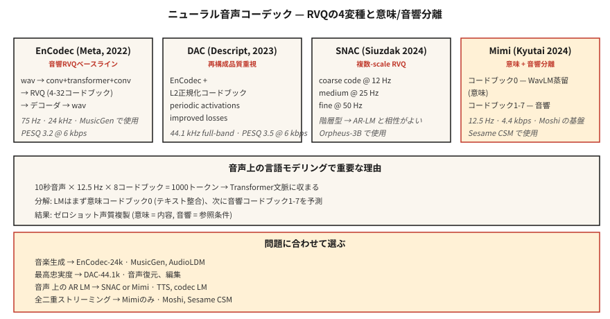

# 神經音訊編碼器 —— EnCodec、SNAC、Mimi、DAC 與語意／聲學的分工

> 2026 年的音訊生成幾乎全都是詞元。EnCodec、SNAC、Mimi 與 DAC 把連續的波形變成 transformer 能預測的離散序列。語意詞元與聲學詞元的分工 —— 第一個碼本當語意，其餘當聲學 —— 是 Transformer 之後音訊領域最重要的架構轉向。

**類型：** 學習
**程式語言：** Python
**先修單元：** 階段 6 · 02（頻譜圖）、階段 10 · 11（量化）、階段 5 · 19（子詞分詞）
**時間：** 約 60 分鐘

## 問題所在

語言模型吃的是離散詞元。音訊是連續的。如果你想為語音／音樂做一個 LLM 風格的模型 —— MusicGen、Moshi、Sesame CSM、VibeVoice、Orpheus —— 你首先需要一個**神經音訊編碼器**：一個學出來的編碼器，把音訊離散化成一小組詞元詞彙表，再配一個對應的解碼器把波形重建回來。

目前分出了兩個家族：

1. **重建優先的編解碼器** —— EnCodec、DAC。最佳化的是感知上的音訊品質。詞元是「聲學的」—— 它們把一切都收進去了，包括說話者身分、音色與背景噪音。
2. **語意優先的編解碼器** —— Mimi（Kyutai）、SpeechTokenizer。強迫第一個碼本去編碼語言／音韻內容（常見做法是從 WavLM 蒸餾）。後續的碼本則負責聲學細節。

2024-2026 年的洞見：**純重建型的編解碼器，在你想從文字生成時只會給你模糊的語音。** 蓋在編解碼器詞元之上的 LLM，必須在同一個碼本裡同時學會語言結構*和*聲學結構，這種做法無法規模化。把它們分開 —— 碼本 0 管語意、碼本 1-N 管聲學 —— 才是 Moshi 與 Sesame CSM 能成立的原因。

## 核心概念



### 核心技巧：殘差向量量化（RVQ）

與其用一個大碼本（要有好品質就得有數百萬個碼），所有現代音訊編解碼器都採用 **RVQ**：一串串接起來的小碼本。第一個碼本量化編碼器的輸出；第二個量化殘差；以此類推。每個碼本有 1024 個碼。8 個碼本 = 等效詞彙表 1024^8 = 10^24。

推論時，解碼器把每一幀所選中的碼全部加總起來做重建。

### 2026 年重要的四個編解碼器

**EnCodec（Meta，2022）。** 基準線。在波形上做編碼器-解碼器，瓶頸處放 RVQ。24 kHz，最多可用 32 個碼本，預設 4 個碼本 @ 1.5 kbps。架構是 `1D conv + transformer + 1D conv`。MusicGen 用的就是它。

**DAC（Descript，2023）。** RVQ 搭配 L2 正規化的碼本、週期性激活函數與改良的損失函式。所有開源編解碼器中重建保真度最高的 —— 用 12 個碼本時有時已經跟原始語音分不出來。44.1 kHz 全頻帶。

**SNAC（Hubert Siuzdak，2024）。** 多尺度 RVQ —— 粗粒度的碼本運作在比細粒度更低的幀率上。實際上是把音訊階層化建模：約 12 Hz 的粗略「草圖」加上 50 Hz 的細節。Orpheus-3B 採用它，因為這種階層結構很適合對應到以 LM 為基礎的生成。

**Mimi（Kyutai，2024）。** 2026 年的規則改變者。12.5 Hz 的幀率（極低），8 個碼本 @ 4.4 kbps。碼本 0 是**從 WavLM 蒸餾出來的** —— 訓練它去預測 WavLM 的語音內容特徵。碼本 1-7 是聲學殘差。這種分工撐起了 Moshi（單元 15）與 Sesame CSM。

### 幀率對語言建模很重要

幀率越低 = 序列越短 = LM 越快。

| 編解碼器 | 幀率 | 1 秒 = N 幀 | 適合 |
|-------|-----------|----------------|---------|
| EnCodec-24k | 75 Hz | 75 | 音樂、一般音訊 |
| DAC-44.1k | 86 Hz | 86 | 高保真音樂 |
| SNAC-24k（粗粒度） | ~12 Hz | 12 | AR-LM 效率高 |
| Mimi | 12.5 Hz | 12.5 | 串流語音 |

在 12.5 Hz 下，一段 10 秒的話語只有 125 個編解碼器幀 —— transformer 可以輕鬆預測。

### 語意詞元與聲學詞元

```
frame_t → [semantic_token_t, acoustic_token_0_t, acoustic_token_1_t, ..., acoustic_token_6_t]
```

- **語意詞元（Mimi 裡的碼本 0）。** 編碼「說了什麼」—— 音素、詞、內容。透過一個輔助預測損失從 WavLM 蒸餾而來。
- **聲學詞元（碼本 1-7）。** 編碼音色、說話者身分、韻律、背景噪音與細節。

一個自迴歸 LM 先預測語意詞元（以文字為條件），再預測聲學詞元（以語意加上說話者參考音為條件）。這種分解正是現代 TTS 能做到零樣本聲音複製的原因：語意模型負責內容，聲學模型負責音色。

### 2026 年的重建品質（每秒位元數，位元率越低越好）

| 編解碼器 | 位元率 | PESQ | ViSQOL |
|-------|---------|------|--------|
| Opus-20kbps | 20 kbps | 4.0 | 4.3 |
| EnCodec-6kbps | 6 kbps | 3.2 | 3.8 |
| DAC-6kbps | 6 kbps | 3.5 | 4.0 |
| SNAC-3kbps | 3 kbps | 3.3 | 3.8 |
| Mimi-4.4kbps | 4.4 kbps | 3.1 | 3.7 |

在感知品質的每位元表現上，Opus 這類傳統編解碼器還是贏。神經編解碼器贏的地方是**離散詞元**（Opus 產不出來）以及**生成模型的品質**（LM 拿這些詞元能做到什麼）。

```figure
rvq-codec-cascade
```

## 動手實作

### 步驟 1：用 EnCodec 編碼

```python
from encodec import EncodecModel
import torch

model = EncodecModel.encodec_model_24khz()
model.set_target_bandwidth(6.0)  # kbps

wav = torch.randn(1, 1, 24000)
with torch.no_grad():
    encoded = model.encode(wav)
codes, scale = encoded[0]
# codes: (1, n_codebooks, n_frames), dtype=int64
```

6 kbps 時 `n_codebooks=8`。每個碼的範圍是 0-1023（10-bit）。

### 步驟 2：解碼並量測重建品質

```python
with torch.no_grad():
    wav_recon = model.decode([(codes, scale)])

from torchaudio.functional import compute_deltas
import torch.nn.functional as F

mse = F.mse_loss(wav_recon[:, :, :wav.shape[-1]], wav).item()
```

### 步驟 3：語意／聲學的分工（Mimi 風格）

```python
from moshi.models import loaders
mimi = loaders.get_mimi()

with torch.no_grad():
    codes = mimi.encode(wav)  # shape (1, 8, frames@12.5Hz)

semantic = codes[:, 0]
acoustic = codes[:, 1:]
```

語意碼本 0 與 WavLM 對齊。你可以訓練一個文字轉語意的 transformer —— 詞彙表比直接對音訊做小得多。接著再由一個獨立的聲學轉波形解碼器，以說話者參考音為條件。

### 步驟 4：為什麼在編解碼器詞元上做自迴歸 LM 有效

以 Mimi 的 12.5 Hz × 8 個碼本、一段 10 秒的語音片段來算：

```math
N_{\text{tokens}} = 10 \times 12.5 \times 8 = 1000 \text{ tokens}
```

1000 個詞元對 transformer 來說是微不足道的上下文長度。一個 256M 參數的 transformer，在現代 GPU 上能以毫秒等級生成 10 秒的語音。

## 框架應用

問題對應到編解碼器：

| 任務 | 編解碼器 |
|------|-------|
| 一般音樂生成 | EnCodec-24k |
| 最高保真度的重建 | DAC-44.1k |
| 在語音上做自迴歸 LM（TTS） | SNAC 或 Mimi |
| 串流全雙工語音 | Mimi（12.5 Hz） |
| 帶文字條件的音效素材庫 | EnCodec + T5 條件 |
| 細緻的音訊編輯 | DAC + inpainting |

決策原則：**如果你在做生成模型，從 Mimi 或 SNAC 開始。如果你在做壓縮管線，用 Opus。**

## 陷阱

- **碼本太多。** 加碼本能線性提升保真度，但 LM 的序列長度也線性上升。停在 8-12 個。
- **幀率不一致。** 用 12.5 Hz 的 Mimi 訓練 LM，之後改用 50 Hz 的 EnCodec 微調，會無聲地失敗。
- **以為所有碼本都一樣。** 在 Mimi 裡，碼本 0 承載內容；弄掉它就毀掉可理解度。弄掉碼本 7 幾乎察覺不到。
- **只用重建品質當唯一指標。** 一個編解碼器可能重建得很好，但如果語意結構很差，對以 LM 為基礎的生成毫無用處。

## 產出交付

存成 `outputs/skill-codec-picker.md`。為指定的生成或壓縮任務挑一個編解碼器。

## 練習

1. **簡單。** 跑 `code/main.py`。它實作了一個玩具級的純量量化器加殘差量化器，並在你逐步加入碼本時量測重建誤差。
2. **中等。** 安裝 `encodec`，在一段保留的語音片段上比較 1、4、8、32 個碼本。畫出 PESQ 或 MSE 對位元率的關係圖。
3. **困難。** 載入 Mimi。編碼一段片段。把碼本 0 換成隨機整數後解碼。再對碼本 7 做一樣的事。比較這兩種破壞 —— 破壞碼本 0 應該會毀掉可理解度；破壞碼本 7 應該幾乎沒有變化。

## 關鍵術語

| 術語 | 大家怎麼說 | 實際上是什麼 |
|------|-----------------|-----------------------|
| RVQ | 殘差量化 | 一串串接的小碼本；每一個量化前一個的殘差。 |
| 幀率 | 編解碼器的速度 | 每秒有幾個詞元幀。越低 = LM 越快。 |
| 語意碼本 | 碼本 0（Mimi） | 從自監督學習特徵蒸餾出來的碼本；編碼內容。 |
| 聲學碼本 | 其他全部 | 音色、韻律、噪音、細節。 |
| PESQ／ViSQOL | 感知品質 | 與 MOS 相關的客觀指標。 |
| EnCodec | Meta 的編解碼器 | RVQ 的基準線；MusicGen 用的就是它。 |
| Mimi | Kyutai 的編解碼器 | 12.5 Hz 幀率；語意／聲學分工；撐起 Moshi。 |

## 延伸閱讀

- [Défossez et al. (2023). EnCodec](https://arxiv.org/abs/2210.13438) —— RVQ 的基準線。
- [Kumar et al. (2023). Descript Audio Codec (DAC)](https://arxiv.org/abs/2306.06546) —— 開源中保真度最高的。
- [Siuzdak (2024). SNAC](https://arxiv.org/abs/2410.14411) —— 多尺度 RVQ。
- [Kyutai (2024). Mimi codec](https://kyutai.org/codec-explainer) —— 語意／聲學分工、WavLM 蒸餾。
- [Borsos et al. (2023). AudioLM](https://arxiv.org/abs/2209.03143) —— 語意／聲學兩階段的範式。
- [Zeghidour et al. (2021). SoundStream](https://arxiv.org/abs/2107.03312) —— 最早可串流的 RVQ 編解碼器。
