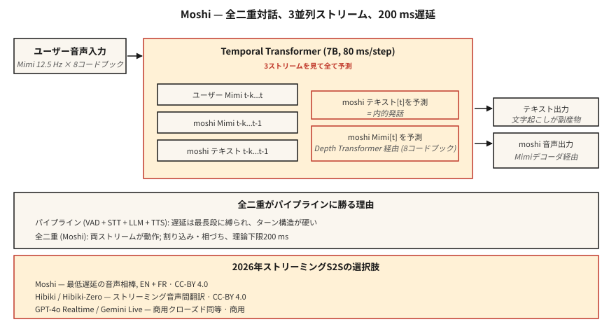

# 串流語音對語音 —— Moshi、Hibiki 與全雙工對話

> 2024-2026 年重新定義了語音 AI。Moshi 用單一模型就能同時聽與說，延遲 200 ms。Hibiki 則是一個音訊塊接一個音訊塊地做語音對語音翻譯。兩者都拋棄了 ASR → LLM → TTS 的管線，改用一個蓋在 Mimi 編解碼器詞元上的統一全雙工架構。這就是新的參考設計。

**類型：** 學習
**程式語言：** Python
**先修單元：** 階段 6 · 13（神經音訊編解碼器）、階段 6 · 11（即時音訊）、階段 7 · 05（完整的 Transformer）
**時間：** 約 75 分鐘

## 問題所在

用單元 11 ＋ 12 蓋出來的語音代理程式，都有一個約 300-500 ms 的根本延遲下限：VAD 觸發、STT 處理、LLM 推論、TTS 生成。每一級都有自己的最低延遲。你可以調參、可以平行化，但管線的形狀本身就把你封頂了。

Moshi（Kyutai，2024-2026）問了另一個問題：如果根本沒有管線呢？如果有一個模型直接吃音訊、直接吐音訊，連續不斷，而文字只是中間的「內心獨白」而不是必經的一級呢？

答案是**全雙工語音對語音**。理論延遲 160 ms（80 ms 的 Mimi 幀 ＋ 80 ms 的聲學延遲）。在單張 L4 GPU 上的實際延遲是 200 ms。這是同級最佳的管線式語音代理程式的一半。

## 核心概念



### Moshi 架構

**輸入。** 兩條 Mimi 編解碼器串流，都是 12.5 Hz × 8 個碼本：

- 串流 1：使用者音訊（Mimi 編碼過，持續進來）
- 串流 2：Moshi 自己的音訊（由 Moshi 生成）

**Transformer。** 一個 70 億參數的時間 Transformer（Temporal Transformer）同時處理這兩條串流，以及一條文字「內心獨白」串流。在每一個 80 ms 的步驟裡，它會：

1. 吃進最新的使用者 Mimi 詞元（8 個碼本）。
2. 吃進最近產出的 Moshi Mimi 詞元（8 個碼本）。
3. 生成下一個 Moshi 文字詞元（內心獨白）。
4. 生成下一批 Moshi Mimi 詞元（8 個碼本，透過一個小型的深度 Transformer）。

三條串流 —— 使用者音訊、Moshi 音訊、Moshi 文字 —— 全都並行跑。Moshi 可以邊講邊聽使用者；使用者插話時它可以打斷自己；它也能在不中斷主要話語的情況下回應「嗯哼」這類附和語。

**深度 transformer。** 在一幀之內，那 8 個碼本並不是並行預測的 —— 它們之間有相互依賴。一個小型的 2 層「深度 transformer」在 80 ms 內依序把它們預測出來。這是自迴歸編解碼器 LM 的標準分解方式（VALL-E、VibeVoice 也是這麼做的）。

### 為什麼內心獨白文字有幫助

沒有明確的文字流，模型就必須在聲學串流裡隱式地把語言建模出來。Moshi 的洞見是：強迫它在吐音訊的同時吐出文字詞元。這條文字流本質上就是 Moshi 正在說的話的逐字稿。這能提升語意連貫性、讓語言模型頭更容易替換，而且轉錄稿免費附贈。

### Hibiki：串流語音對語音翻譯

同樣的架構，但拿翻譯對訓練。來源音訊進去，目標語言的音訊出來，連續不斷。Hibiki-Zero（2026 年 2 月）不再需要詞級對齊的訓練資料 —— 改用句級資料 ＋ GRPO 強化學習來最佳化延遲。

一開始支援四個語言對；用約 1000 小時的資料就能適配到一個新語言。

### 更完整的 Kyutai 技術堆疊（2026）

- **Moshi** —— 全雙工對話（法語優先，英語支援得也很好）
- **Hibiki / Hibiki-Zero** —— 同步語音翻譯
- **Kyutai STT** —— 串流 ASR（500 ms 或 2.5 秒前瞻）
- **Kyutai Pocket TTS** —— 1 億參數的 TTS，可在 CPU 上跑（2026 年 1 月）
- **Unmute** —— 把上面這些組成完整管線，跑在公開伺服器上

在 L40S GPU 上的吞吐量：64 個並行工作階段，速度是即時的 3 倍。

### Sesame CSM —— 表親

Sesame CSM（2025）用了類似的想法 —— 一個 Llama-3 骨幹配上 Mimi 編解碼器頭。但 CSM 是單向的（吃脈絡 ＋ 文字，產出語音），而不是全雙工。它是市面上「聲音臨場感」最好的 TTS；跟 Moshi 的全雙工能力不太是一回事。

### 2026 年的效能數字

| 模型 | 延遲 | 使用情境 | 授權 |
|-------|---------|----------|---------|
| Moshi | 200 ms（L4） | 全雙工英語／法語對話 | CC-BY 4.0 |
| Hibiki | 12.5 Hz 幀率 | 法語 ↔ 英語串流翻譯 | CC-BY 4.0 |
| Hibiki-Zero | 同上 | 5 個語言對，不需對齊資料 | CC-BY 4.0 |
| Sesame CSM-1B | 200 ms TTFA | 以脈絡為條件的 TTS | Apache-2.0 |
| GPT-4o Realtime | ~300 ms | 閉源，OpenAI API | 商業 |
| Gemini 2.5 Live | ~350 ms | 閉源，Google API | 商業 |

```figure
sp-fullduplex
```

## 動手實作

### 步驟 1：介面

Moshi 提供一個 WebSocket 伺服器，吃 80 ms 一塊的 Mimi 編碼音訊，回傳 80 ms 一塊的 Mimi 編碼音訊。雙向都是。持續不斷。

```python
import asyncio
import websockets
from moshi.client_utils import encode_audio_mimi, decode_audio_mimi

async def moshi_chat():
    async with websockets.connect("ws://localhost:8998/api/chat") as ws:
        mic_task = asyncio.create_task(stream_mic_to(ws))
        spk_task = asyncio.create_task(stream_from_to_speaker(ws))
        await asyncio.gather(mic_task, spk_task)
```

### 步驟 2：全雙工迴圈

```python
async def stream_mic_to(ws):
    async for chunk_80ms in mic_stream_at_12_5_hz():
        mimi_tokens = encode_audio_mimi(chunk_80ms)
        await ws.send(serialize(mimi_tokens))

async def stream_from_to_speaker(ws):
    async for msg in ws:
        mimi_tokens, text_token = deserialize(msg)
        audio = decode_audio_mimi(mimi_tokens)
        await play(audio)
```

兩個方向同時跑。標準的傳輸做法是 Python asyncio 或 Rust futures。

### 步驟 3：訓練目標（概念上）

對每一個 80 ms 的幀 `t`：

- 輸入：`user_mimi[0..t]`、`moshi_mimi[0..t-1]`、`moshi_text[0..t-1]`
- 預測：`moshi_text[t]`，然後 `moshi_mimi[t, codebook_0..7]`

文字先於音訊被預測（內心獨白）；音訊則在深度 transformer 裡逐碼本依序預測。

### 步驟 4：Moshi 贏在哪、又輸在哪

Moshi 贏的地方：

- 在便宜硬體上做到端到端 250 ms 以下。
- 自然的附和與插話。
- 不用寫管線的黏合程式碼。

Moshi 沒贏的地方：

- 工具呼叫（沒為此訓練；你需要另外一條 LLM 路徑）。
- 長鏈推論（Moshi 是個 80 億參數量級的對話模型，不是 Claude／GPT-4）。
- 冷門主題的事實正確性。
- 大多數正式的企業使用情境（2026 年還是用管線）。

## 框架應用

| 情境 | 選擇 |
|-----------|------|
| 延遲最低的語音夥伴 | Moshi |
| 即時翻譯通話 | Hibiki |
| 語音示範／研究 | Moshi、CSM |
| 帶工具的企業代理程式 | 管線（單元 12），不是 Moshi |
| 帶脈絡的自訂音色 TTS | Sesame CSM |
| 任意語言的語音對語音 | GPT-4o Realtime 或 Gemini 2.5 Live（商業） |

## 常見陷阱

- **工具呼叫能力有限。** Moshi 是對話模型，不是代理程式框架。要用工具就跟管線搭配。
- **特定音色的條件控制。** Moshi 用的是單一訓練好的人格；聲音複製要另外跑一次訓練。
- **語言覆蓋率。** 法語 ＋ 英語很出色；其他就有限。Hibiki-Zero 有幫助，但你還是需要訓練資料。
- **資源成本。** 一個完整的 Moshi 工作階段會佔住一個 GPU 名額；這不是便宜的多租戶共享部署模式。

## 產出交付

存成 `outputs/skill-duplex-pipeline.md`。為某個語音代理程式的工作負載選擇管線式或全雙工架構，並說明理由。

## 練習

1. **簡單。** 跑 `code/main.py`。它以符號方式模擬雙串流 ＋ 內心獨白的架構。
2. **中等。** 從 HuggingFace 拉下 Moshi，把伺服器跑起來，測一段對話。量測從使用者說完到 Moshi 開始回應之間的實際牆鐘延遲。
3. **困難。** 拿你在單元 12 做的管線式代理程式，在 20 組配對好的測試話語上比較它與 Moshi 的 P50 延遲。寫下在哪些情況下管線架構仍然會勝出。

## 關鍵術語

| 術語 | 大家怎麼說 | 實際上是什麼 |
|------|-----------------|-----------------------|
| 全雙工 | 同時聽與說 | 同一個模型上同時有兩條音訊串流在運作。 |
| 內心獨白 | 模型的文字流 | Moshi 在輸出音訊的同時吐出文字詞元。 |
| 深度 transformer | 碼本間的預測器 | 在一個 80 ms 幀內預測 8 個碼本的小型 transformer。 |
| Mimi | Kyutai 的編解碼器 | 12.5 Hz × 8 個碼本；語意＋聲學；撐起 Moshi。 |
| 串流語音對語音 | 音訊 → 音訊即時 | 一塊一塊做翻譯／對話，沒有管線分級。 |
| 附和（back-channeling） | 「嗯哼」之類的反應 | Moshi 能在不中斷自己輪次的情況下發出簡短的認可聲。 |

## 延伸閱讀

- [Défossez et al. (2024). Moshi — speech-text foundation model](https://arxiv.org/html/2410.00037v2) —— 論文本體。
- [Kyutai Labs (2026). Hibiki-Zero](https://arxiv.org/abs/2602.12345) —— 不需對齊資料的串流翻譯。
- [Sesame (2025). Crossing the uncanny valley of voice](https://www.sesame.com/research/crossing_the_uncanny_valley_of_voice) —— CSM 的規格說明。
- [Kyutai — Moshi repo](https://github.com/kyutai-labs/moshi) —— 安裝 ＋ 伺服器。
- [OpenAI — Realtime API](https://platform.openai.com/docs/guides/realtime) —— 閉源的商業同儕。
- [Kyutai — Delayed Streams Modeling](https://github.com/kyutai-labs/delayed-streams-modeling) —— 背後撐著 STT／TTS 的框架。
