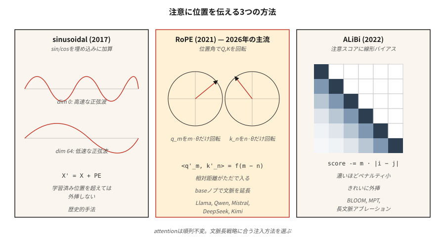

# 位置編碼 —— 正弦、RoPE、ALiBi

> 注意力對排列是不變的。沒有位置訊號時，「The cat sat on the mat」和「mat the on sat cat the」會產生相同的輸出。三種演算法解決了這件事 —— 每一種對「位置」是什麼下了不同的賭注。

**類型：** 實作
**程式語言：** Python
**先修單元：** 階段 7 · 02（自注意力）、階段 7 · 03（多頭注意力）
**時間：** 約 45 分鐘

## 問題所在

縮放點積注意力對順序是盲的。注意力矩陣 `softmax(Q K^T / √d) V` 是由兩兩之間的相似度算出來的。把 `X` 的列打亂，輸出的列就以同樣的方式被打亂。注意力內部沒有任何東西在乎位置。

在一個詞袋模型裡，這不算 bug。但對語言、程式碼、音訊、影片 —— 任何順序承載意義的東西 —— 這是致命的。

解法是設法把位置注入嵌入。答案分成三個時代：

1. **絕對正弦位置編碼**（Vaswani 2017）。把位置的 `sin/cos` 加到嵌入上。簡單、無需學習參數，但超出訓練長度後外推能力很差。
2. **RoPE —— 旋轉位置嵌入**（Su 2021）。依位置成比例的角度旋轉 Q 與 K 向量。直接把*相對位置*編碼進點積裡。2026 年的主流。
3. **ALiBi —— 帶線性偏差的注意力**（Press 2022）。完全跳過嵌入；依距離對注意力分數加上一個每個頭各自的線性懲罰。長度外推能力極佳。

到了 2026 年，幾乎每一個前沿開源模型都用 RoPE：Llama 2/3/4、Qwen 2/3、Mistral、Mixtral、DeepSeek-V3、Kimi。少數長脈絡模型用 ALiBi 或它的現代變體。絕對正弦位置編碼已經是歷史了。

## 核心概念



### 絕對正弦位置編碼

預先算出一個形狀為 `(max_len, d_model)` 的固定矩陣 `PE`：

```math
\begin{aligned}
PE_{(pos, 2i)} &= \sin\left(pos / 10000^{2i / d_{\text{model}}}\right) \\
PE_{(pos, 2i+1)} &= \cos\left(pos / 10000^{2i / d_{\text{model}}}\right)
\end{aligned}
```

然後在進注意力之前做 `X' = X + PE[:N]`。每個維度是一條頻率不同的正弦波。模型學會從相位模式裡讀出位置。超出 `max_len` 就失效：模型只見過位置 0 到 2047，沒有人告訴它位置 2048 會發生什麼事。

### RoPE

旋轉 Q 與 K 向量（不是嵌入）。對一對維度 `(2i, 2i+1)`：

```math
\begin{bmatrix} q'_{2i} \\ q'_{2i+1} \end{bmatrix} = \begin{bmatrix} \cos(pos \cdot \theta_i) & -\sin(pos \cdot \theta_i) \\ \sin(pos \cdot \theta_i) & \cos(pos \cdot \theta_i) \end{bmatrix} \begin{bmatrix} q_{2i} \\ q_{2i+1} \end{bmatrix}
\qquad \theta_i = \text{base}^{-2i / d_{\text{head}}}, \quad \text{base} = 10000 \text{ by default}
```

對位置為 `pos_k` 的 key 施加同樣的旋轉。點積 `q'_m · k'_n` 於是變成只與 `(m - n)` 有關的函式。也就是說：**注意力分數只取決於相對距離**，即使旋轉是依絕對位置算出來的。漂亮的把戲。

擴展 RoPE：`base` 可以被縮放（NTK-aware、YaRN、LongRoPE），從而在不重新訓練的情況下外推到更長的脈絡。Llama 3 就是這樣把脈絡從 8K 擴到 128K。

### ALiBi

跳過嵌入那一招，直接對注意力分數加偏差：

```math
\text{attn\_score}[i, j] = \frac{q_i \cdot k_j}{\sqrt{d}} - m_h \cdot |i - j|
```

其中 `m_h` 是每個頭專屬的斜率（例如 `1 / 2^(8·h/H)`）。越近的詞元被加分；越遠的詞元被扣分。訓練期不花額外成本。論文顯示它的長度外推勝過正弦位置編碼，而在其原始訓練長度上與 RoPE 打平。

### 2026 年該選哪個

| 變體 | 外推能力 | 訓練成本 | 使用者 |
|---------|---------------|---------------|---------|
| 絕對正弦 | 差 | 免費 | 最初的 Transformer、早期 BERT |
| 學習式絕對 | 無 | 極小 | GPT-2、GPT-3 |
| RoPE | 搭配縮放後良好 | 免費 | Llama 2/3/4、Qwen 2/3、Mistral、DeepSeek-V3、Kimi |
| RoPE + YaRN | 極佳 | 微調階段 | Qwen2-1M、Llama 3.1 128K |
| ALiBi | 極佳 | 免費 | BLOOM、MPT、Baichuan |

RoPE 之所以勝出，是因為它能塞進注意力而不必改動架構，能編碼相對位置，而且它的 `base` 超參數為長脈絡微調提供了一個乾淨的旋鈕。

```figure
rope-explorer
```

## 動手實作

### 步驟 1：正弦位置編碼

請看 `code/main.py`。四行就算完：

```python
def sinusoidal(N, d):
    pe = [[0.0] * d for _ in range(N)]
    for pos in range(N):
        for i in range(d // 2):
            theta = pos / (10000 ** (2 * i / d))
            pe[pos][2 * i]     = math.sin(theta)
            pe[pos][2 * i + 1] = math.cos(theta)
    return pe
```

在第一層注意力之前，把它加到嵌入矩陣上。

### 步驟 2：把 RoPE 施加到 Q、K 上

RoPE 是就地作用在 Q 與 K 上的。對每一對維度：

```python
def apply_rope(x, pos, base=10000):
    d = len(x)
    out = list(x)
    for i in range(d // 2):
        theta = pos / (base ** (2 * i / d))
        c, s = math.cos(theta), math.sin(theta)
        a, b = x[2 * i], x[2 * i + 1]
        out[2 * i]     = a * c - b * s
        out[2 * i + 1] = a * s + b * c
    return out
```

關鍵：對位置 `m` 的 Q 與位置 `n` 的 K 施加同一個函式。它們的點積會在每一組座標對上帶出一個 `cos((m-n)·θ_i)` 因子。注意力於是免費學到了相對位置。

### 步驟 3：ALiBi 的斜率與偏差

```python
def alibi_bias(n_heads, seq_len):
    # slope_h = 2 ** (-8 * h / n_heads) for h = 1..n_heads
    slopes = [2 ** (-8 * (h + 1) / n_heads) for h in range(n_heads)]
    bias = []
    for m in slopes:
        row = [[-m * abs(i - j) for j in range(seq_len)] for i in range(seq_len)]
        bias.append(row)
    return bias  # add to attention scores before softmax
```

把 `bias[h]` 加到第 `h` 個頭那個 `(seq_len, seq_len)` 的注意力分數矩陣上，然後做 softmax。

### 步驟 4：驗證 RoPE 的相對距離性質

挑兩個隨機向量 `a, b`。先用 `(pos_a, pos_b)` 旋轉，再用 `(pos_a + k, pos_b + k)` 旋轉。兩次的點積必須在浮點誤差內相同。這個性質就是 RoPE 的全部要點 —— 它對絕對偏移量不變，只有相對間距要緊。

## 框架應用

PyTorch 2.5+ 在 `torch.nn.functional` 裡提供了 RoPE 的工具函式。多數生產程式碼使用 `flash_attn` 或 `xformers`，RoPE 在那裡是在注意力核心內部施加的。

```python
from transformers import AutoModel
model = AutoModel.from_pretrained("meta-llama/Llama-3.2-3B")
# model.config.rope_scaling → {"type": "yarn", "factor": 32.0, "original_max_position_embeddings": 8192}
```

**2026 年的長脈絡招數：**

- **NTK-aware 插值。** 從 4K 擴到 16K 以上時，把 `base` 重新縮放為 `base * (scale_factor)^(d/(d-2))`。
- **YaRN。** 更聰明的插值，能在長脈絡上保住注意力的熵。Llama 3.1 128K 用的就是它。
- **LongRoPE。** 微軟 2024 年的方法，用演化式搜尋挑出每個維度各自的縮放因子。Phi-3-Long 用它。
- **位置插值 + 微調。** 就把位置按擴展倍數縮小，然後拿 10 到 50 億詞元微調。效果出乎意料地好。

## 產出交付

請看 `outputs/skill-positional-encoding-picker.md`。這項技能會在給定目標脈絡長度、外推需求與訓練預算的條件下，為一個新模型挑選編碼策略。

## 練習

1. **簡單。** 用 `max_len=512, d=128` 把正弦 `PE` 矩陣畫成熱圖。確認「條紋隨維度索引變大而變寬」的模式。
2. **中等。** 實作 NTK-aware 的 RoPE 縮放。用長度 256 的序列訓練一個迷你語言模型，然後在長度 1024 上分別以有縮放與無縮放測試。量測困惑度。
3. **困難。** 在同一個注意力模組裡同時實作 ALiBi 與 RoPE。用長度 512 的序列在複製任務上訓練一個 4 層 Transformer。測試時外推到 2048。比較退化的程度。

## 關鍵術語

| 術語 | 大家怎麼說 | 實際上是什麼 |
|------|-----------------|-----------------------|
| 位置編碼 | 「告訴注意力順序是什麼」 | 任何加進嵌入或注意力、用來編碼位置的訊號。 |
| 正弦位置編碼 | 「最原始那個」 | 以幾何頻率排列的 `sin/cos`，加到嵌入上；無法外推。 |
| RoPE | 「旋轉式嵌入」 | 依位置決定角度來旋轉 Q、K；點積便編碼了相對距離。 |
| ALiBi | 「線性偏差的把戲」 | 對注意力分數加上 `-m·\|i-j\|`；不需要嵌入，外推能力極好。 |
| base | 「RoPE 的旋鈕」 | RoPE 裡的頻率縮放係數；調大即可在推論時擴展脈絡。 |
| NTK-aware | 「一種 RoPE 縮放招數」 | 重新縮放 `base`，讓脈絡擴展時高頻維度不被壓縮。 |
| YaRN | 「花俏的那一個」 | 逐維度的插值加外推，能保住注意力的熵。 |
| 外推 | 「超出訓練長度也能用」 | 這套位置方案能不能在訓練時見過的 `max_len` 之外仍給出正確輸出？ |

## 延伸閱讀

- [Vaswani et al. (2017). Attention Is All You Need §3.5](https://arxiv.org/abs/1706.03762) —— 最初的正弦位置編碼。
- [Su et al. (2021). RoFormer: Enhanced Transformer with Rotary Position Embedding](https://arxiv.org/abs/2104.09864) —— RoPE 論文。
- [Press, Smith, Lewis (2021). Train Short, Test Long: Attention with Linear Biases Enables Input Length Extrapolation](https://arxiv.org/abs/2108.12409) —— ALiBi。
- [Peng et al. (2023). YaRN: Efficient Context Window Extension of Large Language Models](https://arxiv.org/abs/2309.00071) —— 最先進的 RoPE 縮放。
- [Chen et al. (2023). Extending Context Window of Large Language Models via Positional Interpolation](https://arxiv.org/abs/2306.15595) —— Meta 的 Llama 2 長脈絡論文。
- [Ding et al. (2024). LongRoPE: Extending LLM Context Window Beyond 2 Million Tokens](https://arxiv.org/abs/2402.13753) —— 微軟的方法，Phi-3-Long 採用，也是「框架應用」一節引用的來源。
- [HuggingFace Transformers — `modeling_rope_utils.py`](https://github.com/huggingface/transformers/blob/main/src/transformers/modeling_rope_utils.py) —— 每一種 RoPE 縮放方案的生產級實作（default、linear、dynamic、YaRN、LongRoPE、Llama-3）。
