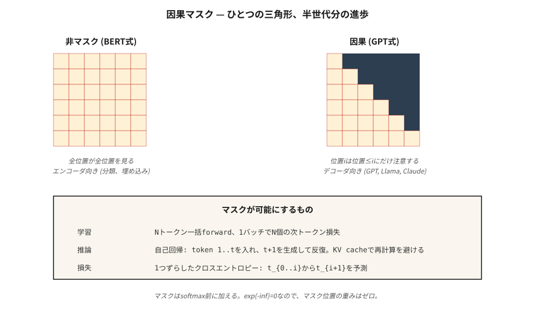

# GPT —— 因果語言建模

> BERT 兩側都看得到。GPT 只看得到過去。那個三角遮罩，是現代 AI 裡影響最深遠的一行程式碼。

**類型：** 實作
**程式語言：** Python
**先修單元：** 階段 7 · 02（自注意力）、階段 7 · 05（完整的 Transformer）、階段 7 · 06（BERT）
**時間：** 約 75 分鐘

## 問題所在

語言模型回答一個問題：給定前 `t-1` 個詞元，第 `t` 個詞元的機率分布是什麼？用這個訊號 —— 下一個詞元預測 —— 訓練，你就得到一個能一個詞元一個詞元生成任意文字的模型。

要在整個序列上平行地端到端訓練它，每個位置的預測都只能依賴更早的位置。否則模型會直接偷看答案作弊。

因果遮罩做的就是這件事。它就是一個上三角的 `-inf` 矩陣，在 softmax 之前加到注意力分數上。經過 softmax 後，那些位置變成 0。每個位置只能關注自己與更早的位置。而因為你一次就把它套用到整個序列，一趟前向傳播就能得到 N 個平行的下一個詞元預測。

GPT-1（2018）、GPT-2（2019）、GPT-3（2020）、GPT-4（2023）、GPT-5（2025）、Claude、Llama、Qwen、Mistral、DeepSeek、Kimi —— 它們全都是只有解碼器的因果 Transformer，核心迴圈一模一樣。真正把它們區分開來的是資料品質、規模與架構上的改良，以及後訓練（SFT、RLHF、DPO 及其後繼者）。

## 核心概念



### 遮罩

給定一個長度為 `N` 的序列，建一個 `N × N` 矩陣：

```math
M_{ij} = \begin{cases} 0 & \text{if } j \le i \\ -\infty & \text{if } j > i \end{cases}
```

在 softmax 之前把 `M` 加到原始注意力分數上。`exp(-inf) = 0`，所以被遮的位置貢獻的權重為零。注意力矩陣的每一列都是一個只覆蓋先前位置的機率分布。

實作成本：一次 `torch.tril()` 呼叫。計算時間：奈秒級。對整個領域的影響：一切。

### 三角形是從哪來的

遮罩通常被講成一塊硬拴在注意力上的補丁。把推導反過來走一遍，它就不再神秘了：注意力是前綴平均的第三次改良，而那個三角形就是這個平均的迴圈邊界，寫成矩陣的樣子。

**階段 1 —— 前綴平均。** 對一個序列最笨的因果摘要方式：位置 `i` 變成位置 `0…i` 的平均。寫成迴圈就是 `out[i] = X[:i+1].mean(0)`。同樣的計算就是一次矩陣乘法。取一個全為 1 的下三角矩陣，每一列除以它的計數，然後相乘：

```python
import numpy as np

A = np.tril(np.ones((n, n)))
A = A / A.sum(axis=1, keepdims=True)
out = A @ X
```

`A` 的第 `i` 列是 `[1/(i+1), …, 1/(i+1), 0, …, 0]`。對角線之上那些零就是因果性。這裡沒有任何「未來被遮掉」的動作；未來從來就不在這個總和裡。

**階段 2 —— 學習得到的權重。** 均勻平均把每個過去的詞元都當成一樣相關。把那些 1 換成一個學習得到的分數矩陣 `S`。現在每一列不再天生就加總為一，所以改用 softmax 對每一列做正規化，而不是除以計數。softmax 永遠不會輸出精確的零，這會破壞因果性 —— 除非未來位置的分數以 `-inf` 進去，因為 `exp(-inf) = 0`：

```python
def softmax(x, axis):
    e = np.exp(x - np.max(x, axis=axis, keepdims=True))
    return e / e.sum(axis=axis, keepdims=True)

S = S + np.triu(np.full((n, n), -np.inf), k=1)
A = softmax(S, axis=1)
out = A @ X
```

同一個三角形、同一個列隨機矩陣、同樣一次矩陣乘法。`-inf` 遮罩不是新機制。它就是階段 1 那些零元素，換算到 softmax 的輸入域裡。

**階段 3 —— 依內容而定的權重。** 在階段 2 裡，`S` 訓練完就固定了：不管詞元說什麼，位置 7 對位置 3 的權重永遠一樣。讓分數取決於詞元本身：`S = Q @ K.T / sqrt(d_k)`。其他都不變。遮罩、softmax、矩陣乘法 —— 完全相同。

三個階段，一個不變量：一個列隨機的下三角矩陣乘上序列。均勻平均、學習得到的靜態權重、依內容而定的權重。遮罩從來就不是被加到注意力上的。它是從那個平均一路存活下來的。

```figure
mask-derivation
```

### 訓練平行，推論串行

訓練：把整個 `(N, d_model)` 序列前向傳播一次，算出 N 個交叉熵損失（每個位置一個），加總，反向傳播。沿序列方向是平行的。這就是 GPT 訓練能擴展的原因 —— 你可以在一趟 GPU 傳遞裡處理一批 100 萬個詞元。

推論：你得一個詞元一個詞元生成。餵進 `[t1, t2, t3]`，得到 `t4`。餵進 `[t1, t2, t3, t4]`，得到 `t5`。餵進 `[t1, t2, t3, t4, t5]`，得到 `t6`。KV 快取（單元 12）會保存 `t1…tn` 的隱藏狀態，讓你不必每一步重算。但推論時的串行深度 = 輸出長度。這就是自迴歸的稅金，也是為什麼解碼是每個 LLM 的延遲瓶頸。

### 損失函式 —— 位移一格

給定詞元 `[t1, t2, t3, t4]`：

- 輸入：`[t1, t2, t3]`
- 目標：`[t2, t3, t4]`

對每個位置 `i`，計算 `-log P(target_i | inputs[:i+1])`。加總。這就是整個序列的交叉熵。

你聽過的每一個 Transformer 語言模型都在這個損失函式上訓練。預訓練、微調、SFT —— 同一個損失函式，不同的資料。

### 解碼策略

訓練完之後，取樣的選擇比大家以為的更重要。

| 方法 | 做什麼 | 何時使用 |
|--------|--------------|-------------|
| 貪婪 | 每一步取 argmax | 確定性任務、程式碼補全 |
| 溫度 | 把 logits 除以 T 再取樣 | 創意類任務，T 越高多樣性越高 |
| Top-k | 只從前 k 個詞元中取樣 | 砍掉低機率的長尾 |
| Top-p（nucleus） | 從累積機率 ≥ p 的最小集合中取樣 | 2020 年後的預設；會依分布形狀自適應 |
| Min-p | 保留 `p > min_p * max_p` 的詞元 | 2024 年後；比 top-p 更擅長排除長尾 |
| 推測解碼 | 草稿模型提出 N 個詞元，大模型驗證 | 同品質下延遲降低 2–3 倍 |

在 2026 年，min-p 搭配溫度 0.7 對開放權重模型是個合理的預設。推測解碼則是任何生產級推論堆疊的基本門檻。

### 是什麼讓「GPT 配方」成功

1. **只有解碼器。** 沒有編碼器的額外開銷。每層一次注意力 + 前饋網路。
2. **規模擴展。** 124M → 1.5B → 175B → 兆級。Chinchilla 擴展律（單元 13）告訴你運算量該怎麼花。
3. **脈絡內學習。** 大約在 6B–13B 規模浮現。模型能跟著少量範例走，不必微調。
4. **RLHF。** 在人類偏好上做後訓練，把原始的預訓練文字模型轉成聊天助理。
5. **pre-norm + RoPE + SwiGLU。** 大規模下訓練穩定。

核心架構從 GPT-2 以來變動不大。所有有趣的事情都發生在資料、規模與後訓練上。

```figure
causal-mask
```

## 動手實作

### 步驟 1：因果遮罩

請看 `code/main.py`。一行就寫完：

```python
def causal_mask(n):
    return [[0.0 if j <= i else float("-inf") for j in range(n)] for i in range(n)]
```

在 softmax 之前把它加到注意力分數上。整個機制就這樣。

### 步驟 2：一個 2 層的類 GPT 模型

疊兩個解碼器區塊（遮罩自注意力 + 前饋網路，不要交叉注意力）。加上詞元嵌入、位置編碼，以及一個反嵌入層（與詞元嵌入矩陣共享權重 —— 這是 GPT-2 以來的標準技巧）。

### 步驟 3：端到端的下一個詞元預測

在一個 20 個詞元的玩具詞彙表上，在每個位置產出 logits。對照位移一格的目標計算交叉熵損失。不算梯度 —— 這是一次前向傳播的健全性檢查。

### 步驟 4：取樣

實作貪婪、溫度、top-k、top-p、min-p。用一個固定的提示詞各跑一次並比較輸出。一個取樣函式 10 行就夠。

## 框架應用

PyTorch，2026 年的慣用寫法：

```python
from transformers import AutoModelForCausalLM, AutoTokenizer
model = AutoModelForCausalLM.from_pretrained("meta-llama/Llama-3.2-3B-Instruct")
tok = AutoTokenizer.from_pretrained("meta-llama/Llama-3.2-3B-Instruct")

prompt = "Attention is all you need because"
inputs = tok(prompt, return_tensors="pt")
out = model.generate(
    **inputs,
    max_new_tokens=64,
    temperature=0.7,
    top_p=0.9,
    do_sample=True,
)
print(tok.decode(out[0]))
```

在底層，`generate()` 跑一趟前向傳播，取出最後一個位置的 logits，取樣出下一個詞元，接到後面，然後重複。每一套生產級 LLM 推論堆疊（vLLM、TensorRT-LLM、llama.cpp、Ollama、MLX）都實作同一個迴圈，只是重度最佳化過 —— 批次化 prefill、連續批次處理、KV 快取分頁、推測解碼。

**GPT 與 BERT，各一句話：** GPT 預測 `P(x_t | x_{<t})`。BERT 預測 `P(x_masked | x_unmasked)`。是損失函式決定了模型能不能生成。

## 產出交付

請看 `outputs/skill-sampling-tuner.md`。這項技能會為一個新的生成任務挑選取樣參數，並在需要確定性解碼時提出提醒。

## 練習

1. **簡單。** 執行 `code/main.py`，驗證經過 softmax 後因果注意力矩陣是下三角的。抽查一下：第 3 列應該只在第 0–3 欄有權重。
2. **中等。** 實作寬度為 4 的 beam search。在 10 個短提示詞上比較 beam-4 與貪婪的困惑度。beam 總是贏嗎？（提示：翻譯通常是，開放式聊天則不是。）
3. **困難。** 實作推測解碼：用一個極小的 2 層模型當草稿模型，一個 6 層模型當驗證模型。在 100 次長度 64 的補全上量測實際時間的加速比。確認輸出與驗證模型的貪婪解碼一致。

## 關鍵術語

| 術語 | 大家怎麼說 | 實際上是什麼 |
|------|-----------------|-----------------------|
| 因果遮罩 | 「那個三角形」 | 加到注意力分數上的上三角 `-inf` 矩陣，讓位置 `i` 只看得到 `≤ i` 的位置。 |
| 下一個詞元預測 | 「那個損失函式」 | 在每個位置，模型分布對真實下一個詞元的交叉熵。 |
| 自迴歸 | 「一次生成一個」 | 把輸出接回輸入；只有訓練時能平行，生成時不行。 |
| Logits | 「softmax 前的分數」 | 語言模型輸出頭在 softmax 之前的原始輸出；取樣就發生在這上面。 |
| 溫度 | 「創意旋鈕」 | 把 logits 除以 T；T→0 等於貪婪，T→∞ 等於均勻分布。 |
| Top-p | 「nucleus 取樣」 | 把分布截斷成加總 ≥p 的最小集合；從剩下的部分取樣。 |
| Min-p | 「比 top-p 更好」 | 保留 `p ≥ min_p × max_p` 的詞元；截斷點會隨分布的尖銳程度自適應。 |
| 推測解碼 | 「草稿 + 驗證」 | 便宜的模型提出 N 個詞元；大模型平行驗證。 |
| Teacher forcing | 「訓練時的小技巧」 | 訓練期間餵入真正的前一個詞元，而不是模型自己的預測。每個 seq2seq 語言模型的標準做法。 |

## 延伸閱讀

- [Radford et al. (2018). Improving Language Understanding by Generative Pre-Training](https://cdn.openai.com/research-covers/language-unsupervised/language_understanding_paper.pdf) —— GPT-1。
- [Radford et al. (2019). Language Models are Unsupervised Multitask Learners](https://cdn.openai.com/better-language-models/language_models_are_unsupervised_multitask_learners.pdf) —— GPT-2。
- [Brown et al. (2020). Language Models are Few-Shot Learners](https://arxiv.org/abs/2005.14165) —— GPT-3 與脈絡內學習。
- [Leviathan, Kalman, Matias (2023). Fast Inference from Transformers via Speculative Decoding](https://arxiv.org/abs/2211.17192) —— 推測解碼論文。
- [HuggingFace `modeling_llama.py`](https://github.com/huggingface/transformers/blob/main/src/transformers/models/llama/modeling_llama.py) —— 典範的因果語言模型參考程式碼。
