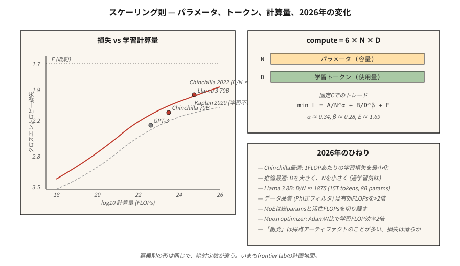

# 縮放律

> 2020 年的 Kaplan 論文說：模型越大，損失越低。2022 年的 Hoffmann 論文說：你們的模型都訓練不足。運算預算會分進兩個桶子 —— 參數量與詞元量 —— 而怎麼分並不顯而易見。

**類型：** 學習
**程式語言：** Python
**先修單元：** 階段 7 · 05（完整的 Transformer）、階段 7 · 07（GPT）
**時間：** 約 45 分鐘

## 問題所在

當你手上有 C FLOPs 的訓練運算預算，想要換到最好的模型時，你面前有兩顆旋鈕：

1. **要多少參數（N）？** 模型越大，容量越高。
2. **要訓練多少詞元（D）？** 資料越多，容量被用得越充分。

FLOPs 大致隨 `6 × N × D` 增長。你可以把 N 推高、D 壓低，也可以把 D 推高、N 壓低。哪一種更好？

2022 年之前，答案是「用力把 N 推上去」。GPT-3（2020）有 1750 億參數，訓練在約 3000 億詞元上，每個參數大約配到 1.7 個詞元。Kaplan 的縮放律替這個做法背書。

Hoffmann 等人（2022）訓練了一個叫 Chinchilla 的小模型家族，得到了不一樣的結論：最佳比例更接近**每個參數 20 個詞元**。GPT-3 的訓練量少了 10 倍。Chinchilla（700 億參數、1.4 兆詞元）在每一項基準上都贏過 GPT-3（1750 億參數、3000 億詞元），而推論成本還低了 2.5 倍。

2026 年是 Chinchilla 的世界 —— 但有一個重要的轉折。Llama 3 8B 訓練在 15 兆詞元上，比例是每個參數 1,875 個詞元，是計算最佳點的 94 倍。對於將要大規模服務的模型來說，推論成本比訓練成本更要緊，所以為了換到更小的可部署體積而超量訓練（超過 Chinchilla 點），才是 2026 年的預設做法。

## 核心概念



### Hoffmann 定律

出自 Chinchilla 論文，損失遵循：

```math
L(N, D) = \frac{A}{N^\alpha} + \frac{B}{D^\beta} + E
```

- `N` = 參數量（不含嵌入層）。
- `D` = 訓練詞元數。
- `α ≈ 0.34`、`β ≈ 0.28`（大致對稱）。
- `E ≈ 1.69`，不可再降的損失下限。
- `A ≈ 406`、`B ≈ 411`。

隨著規模放大，這兩項會彼此拉扯。在固定運算量（C = 6ND）下對 `N` 微分並求解：

```math
\begin{aligned}
N_{\text{opt}} &\approx 0.22 \times (C/6)^{0.5} \\
D_{\text{opt}} &\approx 4.5 \times (C/6)^{0.5} \\
D_{\text{opt}} / N_{\text{opt}} &\approx 20
\end{aligned}
```

計算最佳：每個參數 20 個詞元。

### 那為什麼還要超量訓練

計算最佳點讓「每一次訓練 FLOP 換到的訓練損失下降」達到最大。但訓練成本只付一次，推論成本要付一輩子。

對一個每月服務一兆詞元的聊天機器人來說，推論才是總成本的主角。Llama 的路線是：訓練更小的模型、訓練更久。8B 配 15 兆詞元是徹底針對推論最佳化的結果：

- 塞得進消費級 GPU。
- 延遲只有計算最佳的 70B 的幾分之一。
- 對大多數任務來說，品質已經夠接近。

DeepMind 2024 年的論文（〈超量訓練才是新的最佳解〉）把這件事形式化了。對推論主導的工作負載，正確的比例視服務量而定，更接近每個參數 100 到 500 個詞元。

### 湧現還是平滑

有一種說法是：某些能力（算術、多步推理、跟著思維鏈走）會在某個規模突然「湧現」。

Schaeffer 等人（2023）主張這是量測造成的假象：湧現指標用的是不連續的計分方式（完全比對、過門檻才算對），把底層 logits 上平滑的進步藏了起來。換成連續指標（交叉熵），曲線就是平滑的。

2026 年的共識是：用連續損失做的預測是可靠的；基準分數的跳躍常常是計分器的假象。編列預算時請對著連續指標規劃。

### 2026 年的全貌

縮放律依然管用，但是：

| 因素 | 改變了什麼 |
|--------|-------------|
| 資料品質 | 精挑「好」詞元（Phi 那一路）能讓曲線平移超過 2 倍的有效運算量 |
| MoE | 總參數量與活躍 FLOPs 脫鉤；縮放律要按活躍 FLOP 來算 |
| 後訓練 | 有些能力（指令跟隨、程式碼）受 SFT+RLHF 影響大於預訓練 |
| 多模態 | 影像與文字詞元一起放大；每種模態各有自己的曲線 |
| 合成資料 | 模型自己生成訓練資料；有效運算量可以複利累積 |

Muon 最佳化器（Kimi Moonlight，2024）在同樣的資料量下，展現出約 2 倍於 AdamW 的有效運算量增益。2026 年有些訓練直接預設用 Muon。它改變的是縮放律裡的絕對常數，不是它的形狀。

```figure
scaling-laws
```

## 動手實作

請看 `code/main.py`。我們會實作 Chinchilla 的損失方程式，並在數個運算預算下解出計算最佳的 `(N, D)`。

### 步驟 1：Chinchilla 損失

```python
def chinchilla_loss(N, D, A=406.4, B=410.7, alpha=0.34, beta=0.28, E=1.69):
    return A / N ** alpha + B / D ** beta + E
```

在固定 `C = 6ND` 之下，把 `L` 畫成 `(N, D)` 上的等高線，找出最小值。

### 步驟 2：計算最佳前沿

對從 `1e17` 到 `1e25` FLOPs 的運算預算，在 `6ND = C` 的約束下找出讓損失最小的 `(N, D)`。驗證比例 `D/N ≈ 20`。

### 步驟 3：超量訓練的代價

算出訓練一個小 10 倍的模型（最佳 N 的 1/10、最佳 D 的 10 倍）要多付多少損失，並回報換到的推論 FLOP 節省量（與 N 成正比）。

### 步驟 4：與真實模型比對

把 GPT-3、Chinchilla、Llama 3 8B、DeepSeek-V3（活躍參數）已知的 `(N, D)` 代進去，比較預測損失與公布損失。

## 框架應用

你大概不會自己去訓練一個前沿模型。但縮放律能告訴你：

1. **你的微調資料夠不夠。** 如果你的任務資料量低於基礎模型每個參數 20 個詞元，就要預期它會在某個損失下限飽和。
2. **要不要換更大的基礎模型。** 如果預算全花在推論上，就偏好較小、訓練較久的模型。
3. **報酬從哪裡開始遞減。** 超過計算最佳點 1000 倍之後，對數損失的變化已經是雜訊了。

**2026 年的研究走向：**

- **資料受限的處境。** 網路上高品質詞元的數量是有限的（過濾後約 5 到 10 兆個英文詞元）。前沿預訓練正在逼近這個天花板。合成資料、多語言、多模態，以及規模化的 RLHF 微調，是下一批槓桿。
- **運算乘數的招數。** Muon 最佳化器、MoE、更好的資料篩選 —— 每一項改變的都是絕對常數，不是漸近線。
- **RL 的縮放律。** 尚未有定論。早期證據顯示 RL 樣本數上也是冪次律，但指數與預訓練差得很多。

## 產出交付

請看 `outputs/skill-training-budget-estimator.md`。這項技能會依運算預算、部署限制與目標損失，為一次新的訓練挑選 `(N, D, hours, GPU)`。

## 練習

1. **簡單。** 執行 `code/main.py`。印出運算預算 `1e20`、`1e22`、`1e24` 下計算最佳的 `(N, D)`，並與真實模型表格比對。
2. **中等。** 實作 Hoffmann 的「損失對運算量」曲線。在計算最佳前沿上畫出損失對 `log10(C)` 的關係。找出定律預測我們得花 `>10^28` FLOPs 才能讓交叉熵再降 0.1 的位置。
3. **困難。** 用 5 個在同一份資料集上訓練的極小模型（10 萬到 1000 萬參數）擬合你自己的縮放律。估出 `α` 與 `E`。你的指數和已發表的數值有多接近？

## 關鍵術語

| 術語 | 大家怎麼說 | 實際上是什麼 |
|------|-----------------|-----------------------|
| 參數量（N） | 「模型大小」 | 不含嵌入層的權重數量；決定容量。 |
| 詞元量（D） | 「訓練資料」 | 訓練時看過的詞元數；決定參數被用得多好。 |
| 運算量（C） | 「花掉的 FLOPs」 | 標準 transformer 上約為 `6 × N × D`。 |
| 計算最佳（Chinchilla） | 「D/N ≈ 20」 | 讓預訓練每一 FLOP 的損失最小的比例。 |
| 超量訓練 | 「超過 Chinchilla 點」 | 多花訓練 FLOPs 去省推論 FLOPs；D/N >> 20。 |
| 不可再降的損失 | 「地板」 | 縮放律裡的 `E` 項；資料本身的熵。 |
| 湧現能力 | 「規模一到就突然跳升」 | 常常是計分器的假象；連續損失是平滑的。 |
| 有效運算量 | 「訓練效率的乘數」 | 更好的資料／最佳化器／架構，會放大一個 FLOP 能走多遠。 |

## 延伸閱讀

- [Kaplan et al. (2020). Scaling Laws for Neural Language Models](https://arxiv.org/abs/2001.08361) —— 第一篇縮放律論文；訓練不足。
- [Hoffmann et al. (2022). Training Compute-Optimal Large Language Models](https://arxiv.org/abs/2203.15556) —— Chinchilla。
- [Schaeffer et al. (2023). Are Emergent Abilities of Large Language Models a Mirage?](https://arxiv.org/abs/2304.15004) —— 把湧現視為量測假象。
- [Sardana, Frankle (2024). Beyond Chinchilla-Optimal: Accounting for Inference in Language Model Scaling Laws](https://arxiv.org/abs/2401.00448) —— 為什麼 Llama 的超量訓練對它的工作負載是對的。
- [Jordan et al. (2024). Muon: An optimizer for hidden layers in neural networks](https://kellerjordan.github.io/posts/muon/) —— 2 倍的運算乘數。
