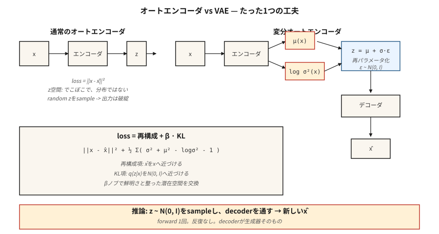

# 自編碼器與變分自編碼器（VAE）

> 一般的自編碼器先壓縮再重建。它會死記，不會生成。加上一個技巧 —— 逼迫那段編碼看起來像高斯分布 —— 你就得到一個取樣器。那個技巧，也就是 `z = μ + σ·ε` 的重參數化，正是你在 2026 年用的每一個潛在擴散與流匹配影像模型，輸入端都掛著一個 VAE 的原因。

**類型：** 實作
**程式語言：** Python
**先修單元：** 階段 3 · 02（反向傳播）、階段 3 · 07（CNN）、階段 8 · 01（分類）
**時間：** 約 75 分鐘

## 問題所在

把一張 784 像素的 MNIST 數字壓成 16 個數字的編碼，然後重建回來。一般的自編碼器可以把重建 MSE 壓得很漂亮，但編碼空間是一團坑坑窪窪的爛泥。在編碼空間裡隨手挑一個點解碼，得到的是雜訊。它沒有取樣器。它只是一個穿上生成模型外衣的壓縮模型。

你真正想要的是：(a) 編碼空間是一個乾淨平滑、可以取樣的分布 —— 比如一個各向同性的高斯 `N(0, I)`、(b) 解碼任何一個樣本都能得到看起來合理的數字，以及 (c) 編碼器與解碼器的壓縮效果依然要好。三個目標、一個架構、一個損失。

Kingma 在 2013 年的 VAE 這樣解：訓練編碼器輸出一個*分布* `q(z|x) = N(μ(x), σ(x)²)`，用一個 KL 懲罰項把這個分布拉向先驗 `N(0, I)`，然後在解碼前從 `q(z|x)` 取樣出 `z`。推論時把編碼器丟掉，直接取樣 `z ~ N(0, I)` 再解碼。編碼空間之所以會有結構，就是那個 KL 懲罰項逼出來的。

到了 2026 年，VAE 很少單獨出貨 —— 論原始影像品質它早被擴散模型比下去了 —— 但它是每一個潛在擴散模型（SD 1/2/XL/3、Flux、AudioCraft）首選的編碼器。學會 VAE，你就學會了你在用的每一條影像管線那看不見的第一層。

## 核心概念



**自編碼器。** `z = encoder(x)`、`x̂ = decoder(z)`，損失 = `||x - x̂||²`。編碼空間沒有結構。

**VAE 編碼器。** 輸出兩個向量：`μ(x)` 與 `log σ²(x)`。它們定義出 `q(z|x) = N(μ, diag(σ²))`。

**重參數化技巧。** 從 `q(z|x)` 取樣是不可微的。把這個樣本改寫成 `z = μ + σ·ε`，其中 `ε ~ N(0, I)`。現在 `z` 是 `(μ, σ)` 的確定性函式，再加上一個不含參數的雜訊 —— 梯度可以流過 `μ` 與 `σ`。

**損失。** 證據下界（Evidence Lower BOund，ELBO），兩項：

```math
\begin{aligned}
\text{loss} &= \text{reconstruction} + \beta \cdot \mathrm{KL}[q(z \mid x) \,\Vert\, \mathcal{N}(0, I)] \\
&= \lVert x - \hat{x} \rVert^2 + \beta \cdot \sum_i \frac{\sigma_i^2 + \mu_i^2 - \log \sigma_i^2 - 1}{2}
\end{aligned}
```

重建項把 `x̂` 推向 `x`。KL 項把 `q(z|x)` 推向先驗。兩者互相拉扯。β 小（<1）＝樣本更銳利、編碼空間比較不高斯。β 大（>1）＝編碼空間更乾淨、樣本更模糊。β-VAE（Higgins，2017）讓這個旋鈕出了名，也開啟了解耦表示的研究。

**取樣。** 推論時：抽 `z ~ N(0, I)`，往前跑一次解碼器。一次前向傳播 —— 不像擴散那樣要迭代取樣。

```figure
vae-latent-grid
```

## 動手實作

`code/main.py` 不用 numpy 也不用 torch，實作一個極小的 VAE。輸入是 8 維的合成資料，從 8 維空間中的一個雙成分高斯混合抽出。編碼器與解碼器都是單一隱藏層的 MLP。我們會實作 tanh 激活、前向傳播、損失，以及一份手寫的反向傳遞。這不是生產程式碼 —— 是教學用的。

### 步驟 1：編碼器前向傳播

```python
def encode(x, enc):
    h = tanh(add(matmul(enc["W1"], x), enc["b1"]))
    mu = add(matmul(enc["W_mu"], h), enc["b_mu"])
    log_sigma2 = add(matmul(enc["W_sig"], h), enc["b_sig"])
    return mu, log_sigma2
```

輸出 `log σ²` 而不是 `σ`，這樣網路的輸出就不受限制（對 σ 套 softplus 是個坑 —— 在 σ ≈ 0 附近梯度會死掉）。

### 步驟 2：重參數化並解碼

```python
def reparameterize(mu, log_sigma2, rng):
    eps = [rng.gauss(0, 1) for _ in mu]
    sigma = [math.exp(0.5 * lv) for lv in log_sigma2]
    return [m + s * e for m, s, e in zip(mu, sigma, eps)]

def decode(z, dec):
    h = tanh(add(matmul(dec["W1"], z), dec["b1"]))
    return add(matmul(dec["W_out"], h), dec["b_out"])
```

### 步驟 3：ELBO

```python
def elbo(x, x_hat, mu, log_sigma2, beta=1.0):
    recon = sum((a - b) ** 2 for a, b in zip(x, x_hat))
    kl = 0.5 * sum(math.exp(lv) + m * m - lv - 1 for m, lv in zip(mu, log_sigma2))
    return recon + beta * kl, recon, kl
```

因為兩個分布都是高斯，KL 有精確的閉式解。不要用數值積分。到 2026 年還是有人在出貨的程式碼裡用蒙地卡羅估 KL —— 白白慢了 3 倍。

### 步驟 4：生成

```python
def sample(dec, z_dim, rng):
    z = [rng.gauss(0, 1) for _ in range(z_dim)]
    return decode(z, dec)
```

這就是生成模型本身。五行。

## 常見陷阱

- **後驗崩潰。** KL 項把 `q(z|x) → N(0, I)` 推得太狠，`z` 完全不帶 `x` 的資訊。解法：β 退火（從 β=0 起，慢慢升到 1）、free bits，或對不活躍的維度略過 KL。
- **樣本模糊。** 高斯的解碼器似然等於 MSE 重建，而 MSE 對 L2 來說是貝氏最佳的（也就是取平均）—— 一堆看起來都合理的數字，平均起來就是一個模糊的數字。解法：改用離散解碼器（VQ-VAE、NVAE），或者只把 VAE 當編碼器用，在潛在向量上疊擴散模型（Stable Diffusion 就是這麼做的）。
- **β 太大、上得太早。** 見後驗崩潰。從 β≈0.01 開始慢慢升。
- **潛在維度太小。** MNIST 用 16 維就夠，ImageNet 256² 要 256 維，ImageNet 1024² 要 2048 維。Stable Diffusion 的 VAE 把 512×512×3 壓成 64×64×4（空間面積上 32 倍下採樣，通道上 32 倍）。

## 框架應用

2026 年的 VAE 選用清單：

| 情境 | 選什麼 |
|-----------|------|
| 給擴散用的影像潛在編碼器 | Stable Diffusion VAE（`sd-vae-ft-ema`）或 Flux VAE |
| 音訊潛在編碼器 | Encodec（Meta）、SoundStream 或 DAC（Descript） |
| 影片潛在向量 | Sora 的時空 patch、Latte VAE、WAN VAE |
| 解耦表示學習 | β-VAE、FactorVAE、TCVAE |
| 離散潛在向量（給 transformer 建模用） | VQ-VAE、RVQ（ResidualVQ） |
| 生成用的連續潛在向量 | 一般的 VAE，然後在那個潛在空間裡條件化一個流／擴散模型 |

潛在擴散模型就是一個 VAE，在它的編碼器與解碼器之間住著一個擴散模型。VAE 做粗粒度的壓縮，擴散模型幹重活。影片（VAE + 影片擴散 DiT）與音訊（Encodec + MusicGen transformer）也是同一個套路。

## 產出交付

存 `outputs/skill-vae-trainer.md`。

這項技能吃：資料集輪廓 + 目標潛在維度 + 下游用途（重建、取樣，或當潛在擴散的輸入），輸出：架構選擇（一般／β／VQ／RVQ）、β 排程、潛在維度、解碼器似然（高斯 vs 類別），以及評估計畫（重建 MSE、每維 KL、`q(z|x)` 與 `N(0, I)` 之間的 Fréchet 距離）。

## 練習

1. **簡單。** 把 `code/main.py` 裡的 `β` 改成 `0.01`、`0.1`、`1.0`、`5.0`。記下最終的重建 MSE 與 KL。對你的合成資料來說，哪個 β 是柏拉圖最佳？
2. **中等。** 把高斯的解碼器似然換成白努利似然（交叉熵損失）。在同一份合成資料的二值化版本上比較樣本品質。
3. **困難。** 把 `code/main.py` 擴充成一個迷你 VQ-VAE：把連續的 `z` 換成在一本 K=32 條目的碼書裡做最近鄰查找。比較重建 MSE，並報告有多少碼書條目真的被用到（碼書崩潰是真的會發生）。

## 關鍵術語

| 術語 | 大家怎麼說 | 實際上是什麼 |
|------|-----------------|-----------------------|
| 自編碼器 | 編碼─解碼網路 | `x → z → x̂`，學 MSE。不是生成模型。 |
| VAE | 有取樣器的 AE | 編碼器輸出一個分布，KL 懲罰項塑形編碼空間。 |
| ELBO | 證據下界 | `log p(x) ≥ recon - KL[q(z\|x) \|\| p(z)]`；當 `q = p(z\|x)` 時最緊。 |
| 重參數化 | `z = μ + σ·ε` | 把隨機節點改寫成確定性部分 + 純雜訊。讓梯度能穿過取樣做反向傳播。 |
| 先驗 | `p(z)` | 潛在向量的目標分布，通常是 `N(0, I)`。 |
| 後驗崩潰 | 「KL 項贏了」 | 編碼器忽略 `x`，直接輸出先驗；解碼器只能自己瞎掰。 |
| β-VAE | 可調的 KL 權重 | `loss = recon + β·KL`。β 越大越解耦，但也越模糊。 |
| VQ-VAE | 離散潛在向量 | 把連續的 `z` 換成最近的碼書向量；讓 transformer 建模成為可能。 |

## 生產環境註記：VAE 是擴散伺服器裡最熱的一條路徑

在一條 Stable Diffusion／Flux／SD3 管線裡，VAE 每個請求會被呼叫兩次 —— 一次編碼（如果在做 img2img／inpainting），一次解碼。在 1024² 下，解碼那一趟往往是整條管線裡激活記憶體的最高峰，因為它要把 `128×128×16` 的潛在向量上採樣回 `1024×1024×3`。這帶來兩個實務後果：

- **把解碼切片或分塊。** `diffusers` 提供 `pipe.vae.enable_slicing()` 與 `pipe.vae.enable_tiling()`。分塊用一點接縫瑕疵，換到 `O(tile²)` 而不是 `O(H·W)` 的記憶體。在消費級 GPU 上要跑 1024² 以上，這是必需品。
- **解碼器用 bf16，最後一次縮放用 fp32 數值。** SD 1.x 的 VAE 是以 fp32 釋出的，在 1024² 以上被轉成 fp16 時會*無聲無息地產出 NaN*。SDXL 附了 `madebyollin/sdxl-vae-fp16-fix` —— 永遠優先選 fp16-fix 那個版本，或者改用 bf16。

## 延伸閱讀

- [Kingma & Welling (2013). Auto-Encoding Variational Bayes](https://arxiv.org/abs/1312.6114) —— VAE 那篇論文。
- [Higgins et al. (2017). β-VAE: Learning Basic Visual Concepts with a Constrained Variational Framework](https://openreview.net/forum?id=Sy2fzU9gl) —— 解耦的 β-VAE。
- [van den Oord et al. (2017). Neural Discrete Representation Learning](https://arxiv.org/abs/1711.00937) —— VQ-VAE。
- [Vahdat & Kautz (2021). NVAE: A Deep Hierarchical Variational Autoencoder](https://arxiv.org/abs/2007.03898) —— 最先進的影像 VAE。
- [Rombach et al. (2022). High-Resolution Image Synthesis with Latent Diffusion Models](https://arxiv.org/abs/2112.10752) —— Stable Diffusion；把 VAE 當編碼器用。
- [Défossez et al. (2022). High Fidelity Neural Audio Compression](https://arxiv.org/abs/2210.13438) —— Encodec，音訊 VAE 的標準。
