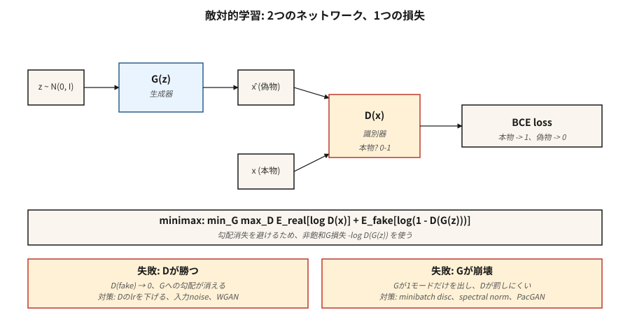

# GAN —— 生成器對判別器

> Goodfellow 在 2014 年的招數是把密度整個跳過。兩個網路。一個做假貨，一個抓假貨。它們一直打，直到假貨跟真的分不出來。這件事理論上不該成功。它常常也真的不成功。但當它成功時，在窄領域上這些樣本至今仍是文獻裡最銳利的。

**類型：** 實作
**程式語言：** Python
**先修單元：** 階段 3 · 02（反向傳播）、階段 3 · 08（最佳化器）、階段 8 · 02（VAE）
**時間：** 約 75 分鐘

## 問題所在

VAE 產出的樣本模糊，因為它的 MSE 解碼器損失對*平均*影像來說才是貝氏最佳的 —— 而一堆看起來都合理的數字，平均起來就是一個模糊的數字。你要的是一個獎勵*合理性*的損失，而不是逐像素貼近某一個特定目標。合理性沒有閉式解。你只能把它學出來。

Goodfellow 的想法：訓練一個分類器 `D(x)` 去分辨真實影像與假影像。訓練一個生成器 `G(z)` 去騙過 `D`。`G` 的損失訊號，就是 `D` 當下認為「看起來像真的」是什麼樣子。這個訊號會隨著 `G` 變強而更新，所以 `G` 追的是一個會動的目標。如果兩個網路都收斂了，`G` 就在從沒寫下 `log p(x)` 的情況下學到了資料分布。

這就是對抗訓練。數學上是一場極小極大賽局：

```math
\min_G \max_D \; \mathbb{E}_{\text{real}}[\log D(x)] + \mathbb{E}_{\text{fake}}[\log(1 - D(G(z)))]
```

到了 2026 年，GAN 已經不是最先進的生成器了（那頂王冠被擴散與流匹配吃掉了）。但 StyleGAN 2/3 仍是史上出貨過最銳利的人臉模型，GAN 判別器被拿來當擴散訓練裡的*感知損失*，而對抗訓練也撐起了那些快速的單步蒸餾（SDXL-Turbo、SD3-Turbo、LCM），讓你能出貨即時的擴散模型。

## 核心概念



**生成器 `G(z)`。** 把一個雜訊向量 `z ~ N(0, I)` 映射成一個樣本 `x̂`。是個解碼器形狀的網路（全連接或轉置卷積）。

**判別器 `D(x)`。** 把一個樣本映射成單一純量機率（或分數）。真的 → 1，假的 → 0。

**損失。** 兩個交替進行的更新：

- **訓練 `D`：** `loss_D = -[ log D(x) + log(1 - D(G(z))) ]`。以 real=1、fake=0 做二元交叉熵。
- **訓練 `G`：** `loss_G = -log D(G(z))`。這是 Goodfellow 用的*非飽和*形式（原始的 `log(1 - D(G(z)))` 在 `D` 很有把握時會飽和，把梯度殺掉）。

**訓練迴圈。** `D` 走一步，`G` 走一步。重複。

**為什麼它會成功。** 如果 `G` 完美對上了 `p_data`，`D` 就不可能比亂猜更好，處處輸出 0.5；`G` 也就再也拿不到梯度。這就是均衡。

**為什麼它會壞掉。** 模式崩潰（`G` 找到一個 `D` 分類不出來的模式，然後永遠只印那一個）、梯度消失（`D` 學得太快，`log D` 飽和）、訓練不穩定（學習率、批次大小，什麼都算）。

## 讓 GAN 真的跑得動的那些變體

| 年份 | 創新 | 修掉了什麼 |
|------|------------|-----|
| 2015 | DCGAN | 卷積／反卷積、批次正規化、LeakyReLU —— 第一個穩定的架構。 |
| 2017 | WGAN、WGAN-GP | 用 Wasserstein 距離 + 梯度懲罰取代 BCE。修掉梯度消失。 |
| 2017 | 譜正規化 | 把判別器限制成 Lipschitz 有界。2026 年的判別器裡還在用。 |
| 2018 | Progressive GAN | 先訓練低解析度，再逐層加上去。第一次做出百萬像素的結果。 |
| 2019 | StyleGAN／StyleGAN2 | 映射網路 + 自適應實例正規化。固定領域照片級真實感的最先進做法。 |
| 2021 | StyleGAN3 | 無別名、平移等變 —— 到 2026 年仍是人臉的黃金標準。 |
| 2022 | StyleGAN-XL | 條件化、類別感知、更大規模。 |
| 2024 | R3GAN | 換上更強的正則化重新包裝；不用什麼小技巧就能在 1024² 上運作。 |

```figure
gan-minimax
```

## 動手實作

`code/main.py` 在 1 維資料上訓練一個極小的 GAN：一個雙成分的高斯混合。生成器與判別器都是單一隱藏層的 MLP。我們會手寫前向、反向與極小極大迴圈。目標是親眼看到那兩個關鍵失效模式（模式崩潰 + 梯度消失）發生的過程。

### 步驟 1：非飽和損失

原味的 Goodfellow 損失 `log(1 - D(G(z)))`，在 D 很有把握地把 G 的假貨判成假貨時會趨近 0。到那個時候 G 的梯度基本上是零 —— G 沒辦法再進步。非飽和形式 `-log D(G(z))` 的漸近行為剛好相反：D 越有把握它就越爆，給 G 一個很強的訊號。

```python
def g_loss(d_fake):
    # maximize log D(G(z))  <=>  minimize -log D(G(z))
    return -sum(math.log(max(p, 1e-8)) for p in d_fake) / len(d_fake)
```

### 步驟 2：生成器每走一步，判別器就走一步

```python
for step in range(steps):
    # train D
    real_batch = sample_real(batch_size)
    fake_batch = [G(z) for z in sample_noise(batch_size)]
    update_D(real_batch, fake_batch)

    # train G
    fake_batch = [G(z) for z in sample_noise(batch_size)]  # fresh fakes
    update_G(fake_batch)
```

給 G 用新鮮的假貨，不然梯度就過期了。

### 步驟 3：盯著模式崩潰

```python
if step % 200 == 0:
    samples = [G(z) for z in sample_noise(500)]
    mode_a = sum(1 for s in samples if s < 0)
    mode_b = 500 - mode_a
    if min(mode_a, mode_b) < 50:
        print("  [!] mode collapse: one mode is starved")
```

典型的徵狀：兩個真實模式中的一個不再被生成。判別器也不再去糾正它，因為它從來沒被當成假貨看見過。

## 常見陷阱

- **判別器太強。** 把 D 的學習率砍 2 到 5 倍，或加上實例／層級雜訊。如果 D 的準確率超過 95%，G 就死了。
- **生成器死記一個模式。** 對 D 的輸入加雜訊、用 minibatch-discriminator 層，或改用 WGAN-GP。
- **批次正規化洩漏統計量。** 真實批次與假批次流過同一個 BN 層，統計量會混在一起。改用實例正規化或譜正規化。
- **刷 Inception score。** 樣本數少的時候 FID 與 IS 都很吵。評估時用 ≥10k 個樣本。
- **對條件式任務來說「一次到底取樣」是個謊。** 你還是得靠 CFG 係數、截斷技巧與重新取樣才拿得到堪用的輸出。

## 框架應用

2026 年的 GAN 選用清單：

| 情境 | 選什麼 |
|-----------|------|
| 照片級人臉、姿態固定 | StyleGAN3（最銳利、最小） |
| 動漫／風格化人臉 | StyleGAN-XL 或 Stable Diffusion LoRA |
| 影像到影像轉換 | Pix2Pix／CycleGAN（階段 8 · 04）或 ControlNet（階段 8 · 08） |
| 快速的單步文字生成影像 | 擴散模型的對抗式蒸餾（SDXL-Turbo、SD3-Turbo） |
| 擴散訓練器裡的感知損失 | 一個吃影像裁切塊的小型 GAN 判別器 |
| 任何多模態、開放式的東西 | 別用 —— 改用擴散或流匹配 |

GAN 銳利，但窄。一旦你的領域打開了 —— 照片、任意文字提示詞、影片 —— 就換成擴散。對抗這個招數活了下來，但是以元件的身分（感知損失、蒸餾），不是以獨立生成器的身分。

## 產出交付

存 `outputs/skill-gan-debugger.md`。這項技能吃一次失敗的 GAN 訓練（損失曲線、樣本網格、資料集大小），輸出一份可能原因的排序清單、一行式的修法，以及一份重跑流程。

## 練習

1. **簡單。** 用預設設定執行 `code/main.py`。然後設 `D_LR = 5 * G_LR` 重跑。G 的損失多快就塌成一個常數？
2. **中等。** 把 Goodfellow 的 BCE 損失換成 WGAN 損失：`loss_D = E[D(fake)] - E[D(real)]`、`loss_G = -E[D(fake)]`，並把 D 的權重裁切到 `[-0.01, 0.01]`。訓練變穩定了嗎？比較實際耗時的收斂速度。
3. **困難。** 把這個 1 維範例擴充到 2 維資料（環上的 8 個高斯混合）。追蹤生成器在第 1k、5k、10k 步分別抓到 8 個模式中的幾個。實作 minibatch discrimination 後再量一次。

## 關鍵術語

| 術語 | 大家怎麼說 | 實際上是什麼 |
|------|-----------------|-----------------------|
| 生成器 | 「G」 | 雜訊到樣本的網路，`G: z → x̂`。 |
| 判別器 | 「D」 | 分類器 `D: x → [0, 1]`，判真假。 |
| 極小極大 | 「那場賽局」 | 對同一個目標函式做 `min_G max_D`。 |
| 非飽和損失 | 「那個修法」 | G 用 `-log D(G(z))` 而不是 `log(1 - D(G(z)))`。 |
| 模式崩潰 | 「G 死記了一種東西」 | 資料明明很多樣，生成器卻只產出少數幾種輸出。 |
| WGAN | 「Wasserstein」 | 用推土機距離 + 梯度懲罰取代 BCE；梯度更平滑。 |
| 譜正規化 | 「Lipschitz 那招」 | 限制 D 的權重範數以界住它的斜率；穩定訓練。 |
| StyleGAN | 「真的能用的那個」 | 映射網路 + AdaIN；人臉領域的同級最佳，2026 年依然是。 |

## 生產環境註記：一次到底的推論是 GAN 留下來的優勢

在開放領域生成上，GAN 已經不靠樣本品質取勝了，但它在推論成本上還是贏。用生產推論文獻的詞彙來說，一個 GAN 有：

- **沒有預填階段，也沒有解碼階段。** 就一次 `G(z)` 前向傳播。TTFT ≈ 總延遲。
- **沒有 KV 快取壓力。** 唯一的狀態就是權重。批次大小是被激活記憶體限住，不是被快取限住。
- **連續批次很簡單。** 既然每個請求都花掉一樣的固定 FLOP，把靜態批次開在伺服器的目標佔用率上通常就是最佳解。不需要 in-flight 排程器。

這就是為什麼 GAN 蒸餾（SDXL-Turbo、SD3-Turbo、ADD、LCM）在 2026 年是快速文字生成影像的主流技術：它把一條 20 到 50 步的擴散管線塌縮成 1 到 4 次 GAN 式的前向傳播，同時保留擴散基底模型的分布。對抗損失以「把慢的生成器變快」的訓練期旋鈕的形式活了下來。

## 延伸閱讀

- [Goodfellow et al. (2014). Generative Adversarial Nets](https://arxiv.org/abs/1406.2661) —— 原始的 GAN 論文。
- [Radford et al. (2015). Unsupervised Representation Learning with DCGAN](https://arxiv.org/abs/1511.06434) —— 第一個穩定的架構。
- [Arjovsky, Chintala, Bottou (2017). Wasserstein GAN](https://arxiv.org/abs/1701.07875) —— WGAN。
- [Miyato et al. (2018). Spectral Normalization for GANs](https://arxiv.org/abs/1802.05957) —— SN。
- [Karras et al. (2020). Analyzing and Improving the Image Quality of StyleGAN](https://arxiv.org/abs/1912.04958) —— StyleGAN2。
- [Karras et al. (2021). Alias-Free Generative Adversarial Networks](https://arxiv.org/abs/2106.12423) —— StyleGAN3。
- [Sauer et al. (2023). Adversarial Diffusion Distillation](https://arxiv.org/abs/2311.17042) —— SDXL-Turbo。
