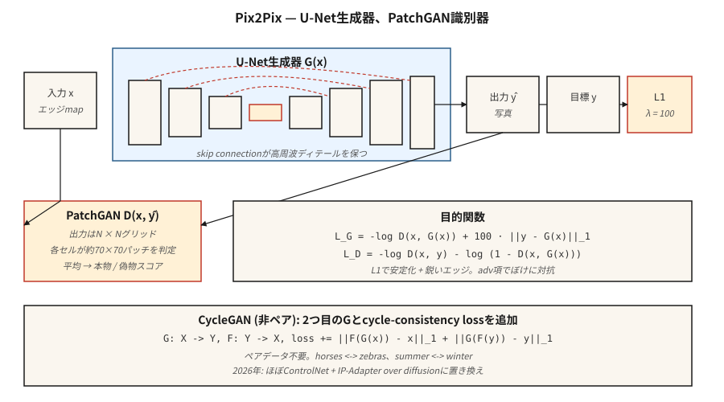

# 條件式 GAN 與 Pix2Pix

> 2014 到 2017 年間第一個大解鎖，是控制 GAN 要生成什麼。掛上一個標籤，或一張影像，或一句話。Pix2Pix 做了影像那個版本，而在窄範圍的影像到影像任務上，它至今仍打得贏每一個通用的文字生成影像模型。

**類型：** 實作
**程式語言：** Python
**先修單元：** 階段 8 · 03（GAN）、階段 4 · 06（U-Net）、階段 3 · 07（CNN）
**時間：** 約 75 分鐘

## 問題所在

無條件的 GAN 取樣出的是任意人臉。做 demo 有用，上生產環境沒用。你要的是：*把草圖映射成照片*、*把地圖映射成航照圖*、*把白天的場景映射成夜晚*、*把灰階影像上色*。這些全都是給你一張輸入影像 `x`，要你輸出一個帶有某種語義對應關係的 `y`。每個 `x` 都有很多個合理的 `y`。均方誤差會把它們壓成一團爛泥。對抗損失不會，因為「看起來像真的」是銳利的。

條件式 GAN（Mirza 與 Osindero，2014）把一個條件 `c` 同時加進 `G` 與 `D` 的輸入。Pix2Pix（Isola 等人，2017）把這件事特化了：條件是一整張輸入影像、生成器是一個 U-Net、判別器是一個*基於區塊*的分類器（PatchGAN），損失則是對抗損失 + L1。就算到了 2026 年，這套配方在窄範圍的影像到影像領域上仍勝過從頭訓練的文字生成影像模型，因為它是用*配對資料*訓練的 —— 你手上正好就是你需要的那個訊號。

## 核心概念



**條件式 G。** `G(x, z) → y`。在 Pix2Pix 裡，`z` 是 G 內部的 dropout（沒有輸入雜訊 —— Isola 發現明確給的雜訊會被忽略掉）。

**條件式 D。** `D(x, y) → [0, 1]`。輸入是那個*配對*（條件，輸出）。這是關鍵差別：D 必須判斷 `y` 跟 `x` 一不一致，而不只是判斷 `y` 看起來像不像真的。

**U-Net 生成器。** 跨過瓶頸帶有跳接的編碼器─解碼器。對於輸入與輸出共享低階結構（邊緣、輪廓）的任務來說，這是關鍵。少了跳接，高頻細節就消失了。

**PatchGAN 判別器。** D 不輸出單一的真假分數，而是輸出一個 `N×N` 的網格，每一格判斷一個大約 70×70 像素的感受野。再取平均。這是一個馬可夫隨機場假設：真實感是局部的。訓練快得多、參數更少、輸出更銳利。

**損失。**

```math
\begin{aligned}
\text{loss}_G &= -\log D(x, G(x)) + \lambda \cdot \lVert y - G(x) \rVert_1 \\
\text{loss}_D &= -\log D(x, y) - \log(1 - D(x, G(x)))
\end{aligned}
```

L1 那一項穩定訓練，並把 G 推向那個已知的目標。L1 給出的邊緣比 L2 更銳利（取的是中位數，不是平均數）。`λ = 100` 是 Pix2Pix 的預設值。

## CycleGAN —— 當你沒有配對資料

Pix2Pix 需要配對的 `(x, y)` 資料。CycleGAN（Zhu 等人，2017）拿掉了這個要求，代價是多一個損失：*循環一致性*損失。兩個生成器 `G: X → Y` 與 `F: Y → X`。訓練它們使得 `F(G(x)) ≈ x` 且 `G(F(y)) ≈ y`。這讓你能在沒有配對範例的情況下，把馬轉成斑馬、夏天轉成冬天。

到 2026 年，非配對的影像到影像轉換多半是靠擴散（ControlNet、IP-Adapter）而不是 CycleGAN 在做，但循環一致性這個想法幾乎活在每一篇非配對領域適應的論文裡。

```figure
gx-patchgan
```

## 動手實作

`code/main.py` 在 1 維資料上實作一個極小的條件式 GAN。條件 `c` 是一個類別標籤（0 或 1）。任務是：從給定類別的條件分布裡產出一個樣本。

### 步驟 1：把條件接到 G 與 D 的輸入上

```python
def G(z, c, params):
    return mlp(concat([z, one_hot(c)]), params)

def D(x, c, params):
    return mlp(concat([x, one_hot(c)]), params)
```

one-hot 編碼是最簡單的做法。更大的模型會用學出來的嵌入、FiLM 調變，或交叉注意力。

### 步驟 2：做條件式訓練

```python
for step in range(steps):
    x, c = sample_real_conditional()
    noise = sample_noise()
    update_D(x_real=x, x_fake=G(noise, c), c=c)
    update_G(noise, c)
```

生成器必須對上*給定條件下*的真實分布，而不是邊際分布。

### 步驟 3：逐類別驗證輸出

```python
for c in [0, 1]:
    samples = [G(noise, c) for noise in batch]
    mean_c = mean(samples)
    assert_near(mean_c, real_mean_for_class_c)
```

## 常見陷阱

- **條件被忽略。** G 學會了對條件取邊際，而 D 從不懲罰它，因為條件訊號太弱。解法：更用力地把條件餵給 D（餵到早期的層，不只餵到後面），或改用投影判別器（Miyato 與 Koyama，2018）。
- **L1 權重太低。** G 會漂到任意看起來很真、但並不忠於輸入的輸出。Pix2Pix 式的任務從 λ≈100 開始。
- **L1 權重太高。** G 產出模糊的輸出，因為 L1 畢竟還是一個 L_p 範數。訓練穩定之後就退火降下來。
- **D 那邊的真實答案洩漏。** D 的輸入要串接 `(x, y)`，不能只給 `y`。少了這件事，D 沒辦法檢查一致性。
- **逐類別的模式崩潰。** 每個類別都可能各自崩掉。做逐類別的多樣性檢查。

## 框架應用

2026 年影像到影像任務的現況：

| 任務 | 最佳做法 |
|------|---------------|
| 草圖 → 照片、同領域、有配對資料 | Pix2Pix／Pix2PixHD（依然快、依然銳利） |
| 草圖 → 照片、非配對 | ControlNet 搭配 Scribble 條件化模型 |
| 語義分割 → 照片 | SPADE／GauGAN2，或 SD + ControlNet-Seg |
| 風格轉換 | 用 IP-Adapter 或 LoRA 的擴散；GAN 做法已是舊物 |
| 深度 → 照片 | 跑在 Stable Diffusion 上的 ControlNet-Depth |
| 超解析度 | Real-ESRGAN（GAN）、ESRGAN-Plus，或 SD-Upscale（擴散） |
| 上色 | ColTran、基於擴散的上色器，或 Pix2Pix-color |
| 白天 → 夜晚、季節、天氣 | CycleGAN 或基於 ControlNet 的做法 |

當 (a) 你有數千組配對範例、(b) 任務窄而且會重複出現、(c) 你需要快速推論時，Pix2Pix 仍是對的工具。在通用的開放領域任務上，擴散勝出。

## 產出交付

存 `outputs/skill-img2img-chooser.md`。這項技能吃一段任務描述、資料可用性（配對還是非配對、樣本數 N）與延遲／品質預算，然後輸出：做法（Pix2Pix、CycleGAN、ControlNet 變體、SDXL + IP-Adapter）、訓練資料需求、推論成本，以及評估流程（LPIPS、FID、任務專屬指標）。

## 練習

1. **簡單。** 改 `code/main.py`，加上第三個類別。確認 G 仍然把每個類別的雜訊映射到正確的模式。
2. **中等。** 在這個 1 維設定裡，把 L1 換成一個感知損失風格的損失（例如拿一個小的凍結 D 當特徵抽取器）。它有改變條件分布的銳利度嗎？
3. **困難。** 在 1 維設定裡勾勒一個 CycleGAN：兩個分布、兩個生成器、循環損失。證明它在沒有配對資料的情況下學會了兩者之間的映射。

## 關鍵術語

| 術語 | 大家怎麼說 | 實際上是什麼 |
|------|-----------------|-----------------------|
| 條件式 GAN | 「帶標籤的 GAN」 | G(z, c)、D(x, c)。兩個網路都看得到條件。 |
| Pix2Pix | 「影像到影像的 GAN」 | 配對式 cGAN，用 U-Net 當 G、PatchGAN 當 D，加上 L1 損失。 |
| U-Net | 「帶跳接的編碼器─解碼器」 | 對稱的卷積網路；跳接保住高頻。 |
| PatchGAN | 「局部真實感分類器」 | D 輸出逐區塊的分數，而不是一個全域分數。 |
| CycleGAN | 「非配對的影像轉換」 | 兩個 G + 循環一致性損失；不需要配對資料。 |
| SPADE | 「GauGAN」 | 用語義圖去正規化中間的激活值；語義分割轉影像。 |
| FiLM | 「逐特徵的線性調變」 | 由條件算出的逐特徵仿射變換；很便宜的條件化手法。 |

## 生產環境註記：把 Pix2Pix 當成延遲受限下的基準線

當你有配對資料而且任務很窄（草圖 → 渲染圖、語義圖 → 照片、白天 → 夜晚），Pix2Pix 一次到底的推論在延遲上比擴散快一個數量級。生產環境上通常這樣比較：

| 路徑 | 步數 | 單張 L4 上 512² 的典型延遲 |
|------|-------|----------------------------------------|
| Pix2Pix（U-Net 前向傳播） | 1 | 約 30 ms |
| SD-Inpaint 或 SD-Img2Img | 20 | 約 1.2 s |
| SDXL-Turbo Img2Img | 1-4 | 約 0.15-0.35 s |
| ControlNet + SDXL base | 20-30 | 約 3-5 s |

在靜態批次下 Pix2Pix 的吞吐量勝出（每個請求都是同樣的 FLOP）。擴散則在品質與泛化上勝出。現代的打法通常是：針對那個窄任務出貨一個 Pix2Pix 式的蒸餾模型，再拿一個擴散模型當長尾輸入的後備。

## 延伸閱讀

- [Mirza & Osindero (2014). Conditional Generative Adversarial Nets](https://arxiv.org/abs/1411.1784) —— cGAN 那篇論文。
- [Isola et al. (2017). Image-to-Image Translation with Conditional Adversarial Networks](https://arxiv.org/abs/1611.07004) —— Pix2Pix。
- [Zhu et al. (2017). Unpaired Image-to-Image Translation using Cycle-Consistent Adversarial Networks](https://arxiv.org/abs/1703.10593) —— CycleGAN。
- [Wang et al. (2018). High-Resolution Image Synthesis with Conditional GANs](https://arxiv.org/abs/1711.11585) —— Pix2PixHD。
- [Park et al. (2019). Semantic Image Synthesis with Spatially-Adaptive Normalization](https://arxiv.org/abs/1903.07291) —— SPADE／GauGAN。
- [Miyato & Koyama (2018). cGANs with Projection Discriminator](https://arxiv.org/abs/1802.05637) —— 投影式 D。
