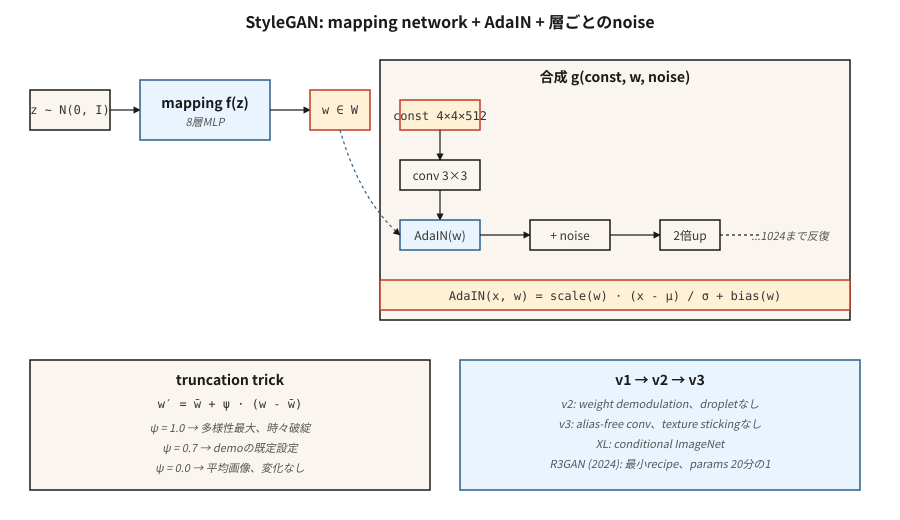

# StyleGAN

> 大多數生成器都是把 `z` 一次攪進每一層。StyleGAN 把它拆開了：先把 `z` 映射成中間表示 `w`，再透過 AdaIN 在每一個解析度層級上*注入* `w`。光是這一項改動就解開了潛在空間的糾纏，讓寫實人臉成為連續七年都算解決了的問題。

**類型：** 實作
**程式語言：** Python
**先修單元：** 階段 8 · 03（GAN）、階段 4 · 08（正規化）、階段 3 · 07（CNN）
**時間：** 約 45 分鐘

## 問題所在

DCGAN 用一疊轉置卷積把 `z` 映射成影像。問題在於：`z` 控制了一切 —— 姿態、光照、身分、背景 —— 全都糾纏在一起。沿著 `z` 的某一個軸移動，這四樣會一起變。你沒辦法要求模型「同一個人，換個姿態」，因為這個表示並不是照那樣分解的。

Karras 等人（2019, NVIDIA）提出：不要再把 `z` 直接餵進卷積層。改用一個常數 `4×4×512` 張量當作網路輸入。學一個 8 層的 MLP，把 `z ∈ Z → w ∈ W`。透過*自適應實例正規化*（AdaIN）在每一個解析度上注入 `w`：先把每張卷積特徵圖正規化，再用 `w` 的仿射投影去縮放與平移。另外在每一層加上雜訊，負責隨機細節（毛孔、髮絲）。

結果是：`W` 對「高階風格」（姿態、身分）與「細部風格」（光照、色彩）有大致正交的軸。你可以把兩張影像的風格互換 —— 低解析度層級用影像 A 的 `w`，高解析度層級用影像 B 的 `w`。這解鎖了影像編輯、跨領域風格化，以及整條「StyleGAN 反演」的研究路線。

## 核心概念



**映射網路。** `f: Z → W`，一個 8 層 MLP。`Z = N(0, I)^512`。`W` 不被強迫成為高斯分布 —— 它學出一個貼合資料的形狀。

**合成網路。** 從一個學出來的常數 `4×4×512` 開始。每個解析度區塊：`upsample → conv → AdaIN(w_i) → noise → conv → AdaIN(w_i) → noise`。解析度逐次加倍：4、8、16、32、64、128、256、512、1024。

**AdaIN。**

```math
\mathop{\mathrm{AdaIN}}(x, y) = y_{\text{scale}} \cdot \frac{x - \mathop{\mathrm{mean}}(x)}{\mathop{\mathrm{std}}(x)} + y_{\text{bias}}
```

其中 `y_scale` 與 `y_bias` 來自 `w` 的仿射投影。先對每張特徵圖正規化，再重新賦予風格。這裡的「風格」指的就是特徵圖的一階與二階統計量。

**逐層雜訊。** 加到每張特徵圖上的單通道高斯雜訊，再乘上一個學出來的逐通道係數。它掌控隨機細節，但不影響整體結構。

**截斷技巧。** 推論時先取樣 `z`，算出 `w = mapping(z)`，再取 `w' = ŵ + ψ·(w - ŵ)`，其中 `ŵ` 是大量樣本上 `w` 的平均。`ψ < 1` 是拿多樣性換品質。幾乎每一個 StyleGAN 展示都用 `ψ ≈ 0.7`。

## StyleGAN 1 → 2 → 3

| 版本 | 年份 | 創新之處 |
|---------|------|------------|
| StyleGAN | 2019 | 映射網路 + AdaIN + 雜訊 + 漸進式增長。 |
| StyleGAN2 | 2020 | 以權重解調取代 AdaIN（修掉水滴狀瑕疵）；跳接／殘差架構；路徑長度正則化。 |
| StyleGAN3 | 2021 | 無混疊卷積 + 等變核；消除紋理黏在像素網格上的問題。 |
| StyleGAN-XL | 2022 | 類別條件控制、1024²、ImageNet。 |
| R3GAN | 2024 | 換上更強的正則化重新包裝；在 FFHQ-1024 上用少 20 倍的參數逼近擴散模型。 |

到了 2026 年，StyleGAN3 在這幾件事上仍然是預設選擇：(a) 高 FPS 的窄領域寫實生成，(b) 少樣本領域適配（用 100 張影像在新資料集上訓練，凍結映射網路），(c) 以反演為基礎的編輯（找出能重建某張真實照片的 `w`，再編輯那個 `w`）。至於開放領域的文字生圖，它不是合適的工具 —— 那是擴散模型的地盤。

```figure
gx-stylegan-mapping
```

## 動手實作

`code/main.py` 在 1 維上實作了一個玩具版的「style-GAN lite」：一個映射 MLP、一個合成函式（取一個學出來的常數向量，再用 `w` 導出的縮放／平移去調變它），以及逐層雜訊。它示範了透過仿射調變注入 `w`，效果不輸甚至勝過把 `z` 串接進生成器輸入。

### 步驟 1：映射網路

```python
def mapping(z, M):
    h = z
    for i in range(num_layers):
        h = leaky_relu(add(matmul(M[f"W{i}"], h), M[f"b{i}"]))
    return h
```

### 步驟 2：自適應實例正規化

```python
def adain(x, w_scale, w_bias):
    mu = mean(x)
    sd = std(x)
    x_norm = [(xi - mu) / (sd + 1e-8) for xi in x]
    return [w_scale * xi + w_bias for xi in x_norm]
```

逐特徵圖的縮放與平移都是用線性投影從 `w` 得來的。

### 步驟 3：逐層雜訊

```python
def add_noise(x, sigma, rng):
    return [xi + sigma * rng.gauss(0, 1) for xi in x]
```

逐通道的 sigma 是可學習的。

## 常見陷阱

- **水滴狀瑕疵。** StyleGAN 1 會在特徵圖裡冒出一團水滴狀的斑塊，原因是 AdaIN 把平均值歸零了。StyleGAN 2 的權重解調改成縮放卷積權重，修掉了這個問題。
- **紋理黏著。** StyleGAN 1 和 2 的紋理跟著像素座標走，而不是跟著物件座標走（做插值時看得很清楚）。StyleGAN 3 的無混疊卷積用加窗 sinc 濾波器解決了它。
- **模式覆蓋率。** 截斷值 `ψ < 0.7` 看起來很乾淨，但取樣只落在一個很窄的錐形範圍裡；需要多樣性就用 `ψ = 1.0`。
- **反演是有損的。** 把一張真實照片反演到 `W` 通常靠最佳化或編碼器（e4e、ReStyle、HyperStyle）。迭代次數一多，結果就會飄。

## 框架應用

| 使用情境 | 做法 |
|----------|----------|
| 寫實人臉（動漫、商品、窄領域） | StyleGAN3 FFHQ／自訂微調 |
| 從照片做人臉編輯 | e4e 反演 + StyleSpace／InterFaceGAN 方向向量 |
| 換臉／表情重演 | StyleGAN + 編碼器 + 融合 |
| 虛擬形象流程 | StyleGAN3 搭配 ADA 做低資料量微調 |
| 用少量影像做領域適配 | 凍結映射網路，只微調合成網路 |
| 多模態或文字條件控制的生成 | 別用 —— 改用擴散模型 |

如果產品級展示的答案就是「一張人臉照片」，那 StyleGAN 在同樣品質水準下，於推論成本（單次前向傳播，4090 上不到 10 ms）與銳利度上都勝過擴散模型。

## 產出交付

存成 `outputs/skill-stylegan-inversion.md`。這項技能吃一張真實照片，輸出：反演方法（e4e／ReStyle／HyperStyle）、預期的潛在損失、編輯預算（在 `W` 裡能走多遠才會出現瑕疵），以及一份已知可用的編輯方向清單（年齡、表情、姿態）。

## 練習

1. **簡單。** 分別用 `adain_on=True` 與 `adain_on=False` 執行 `code/main.py`。比較固定潛在向量與擾動後潛在向量各自的輸出分散程度。
2. **中等。** 實作風格混合正則化：對一個訓練批次算出 `w_a` 與 `w_b`，合成的前半段用 `w_a`、後半段用 `w_b`。解碼器學到解耦的風格了嗎？
3. **困難。** 取一個預訓練的 StyleGAN3 FFHQ 模型（ffhq-1024.pkl）。用帶標籤的樣本訓練一個 SVM，找出控制「微笑」的 `w` 方向；回報在身分開始偏移之前，你能推多遠。

## 關鍵術語

| 術語 | 大家怎麼說 | 實際上是什麼 |
|------|-----------------|-----------------------|
| 映射網路 | 「那個 MLP」 | `f: Z → W`，8 層，把潛在空間的幾何和資料統計量解耦。 |
| W 空間 | 「風格空間」 | 映射網路的輸出；大致上是解耦的。 |
| AdaIN | 「自適應實例正規化」 | 先正規化特徵圖，再用 `w` 的投影做縮放 + 平移。 |
| 截斷技巧 | 「psi」 | `w = mean + ψ·(w - mean)`，ψ<1 拿多樣性換品質。 |
| 路徑長度正則化 | 「PL reg」 | 懲罰 `w` 每單位變動所造成的影像巨變；讓 `W` 更平滑。 |
| 權重解調 | 「StyleGAN2 的那個修法」 | 正規化卷積權重而不是激活值；消滅水滴狀瑕疵。 |
| 無混疊 | 「StyleGAN3 的訣竅」 | 加窗 sinc 濾波器；消除紋理黏在像素網格上的問題。 |
| 反演 | 「幫真實影像找出 w」 | 用最佳化或編碼器求 `x → w`，使得 `G(w) ≈ x`。 |

## 產品筆記：為什麼 StyleGAN 到 2026 年還在上線

StyleGAN3 在 4090 上生成一張 1024² 的 FFHQ 人臉不到 10 ms —— `num_steps = 1`，不用 VAE 解碼，不用跑交叉注意力。以產品角度看，這就是任何影像生成器的延遲下限。同解析度下，50 步的 SDXL + VAE 解碼流程大約要 3 秒。這是 **300 倍的差距**，對窄領域產品（虛擬形象服務、證件影像流程、圖庫人臉生成）來說，它在總體擁有成本上勝出。

由此帶出兩個維運上的結論：

- **不需要排程器，也不需要批次器。** 直接把靜態批次設在目標佔用率上就是最佳解。連續批次（對 LLM 和擴散模型是必備的）在這裡帶不來任何好處，因為每個請求耗費的 FLOPs 都一樣。
- **截斷值 `ψ` 就是那個安全旋鈕。** `ψ < 0.7` 只從映射網路值域裡一個很窄的錐形取樣。這是服務層唯一能控制樣本變異度的槓桿。尖峰負載時調低 `ψ`，付費使用者則調高。

## 延伸閱讀

- [Karras et al. (2019). A Style-Based Generator Architecture for GANs](https://arxiv.org/abs/1812.04948) —— StyleGAN。
- [Karras et al. (2020). Analyzing and Improving the Image Quality of StyleGAN](https://arxiv.org/abs/1912.04958) —— StyleGAN2。
- [Karras et al. (2021). Alias-Free Generative Adversarial Networks](https://arxiv.org/abs/2106.12423) —— StyleGAN3。
- [Tov et al. (2021). Designing an Encoder for StyleGAN Image Manipulation](https://arxiv.org/abs/2102.02766) —— e4e 反演。
- [Sauer et al. (2022). StyleGAN-XL: Scaling StyleGAN to Large Diverse Datasets](https://arxiv.org/abs/2202.00273) —— StyleGAN-XL。
- [Huang et al. (2024). R3GAN: The GAN is dead; long live the GAN!](https://arxiv.org/abs/2501.05441) —— 現代極簡 GAN 配方。
