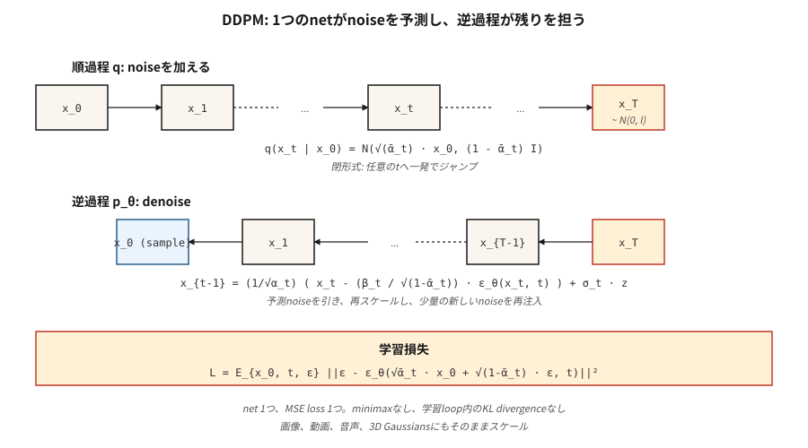

# 擴散模型 —— 從零打造 DDPM

> Ho、Jain、Abbeel（2020）給了這個領域一份戒不掉的配方。用一千個小步驟把資料用雜訊摧毀掉。訓練一個神經網路去預測雜訊。推論時把整個過程反過來走。今天每一個主流的影像、影片、3D 與音樂模型都跑在這個迴圈上，頂多再疊上 flow matching 或一致性模型的技巧。

**類型：** 實作
**程式語言：** Python
**先修單元：** 階段 3 · 02（反向傳播）、階段 8 · 02（VAE）
**時間：** 約 75 分鐘

## 問題所在

你想要一個能從 `p_data(x)` 取樣的取樣器。GAN 玩的是常常發散的極小極大博弈。VAE 從高斯解碼器產生的樣本很糊。你真正想要的訓練目標要滿足三點：(a) 單一而穩定的損失（沒有鞍點、沒有極小極大），(b) 是 `log p(x)` 的下界（所以你拿得到概似值），(c) 樣本品質達到最先進水準。

Sohl-Dickstein 等人（2015）給過一個理論上的答案：定義一條逐步加入高斯雜訊的馬可夫鏈 `q(x_t | x_{t-1})`，再訓練一條反向鏈 `p_θ(x_{t-1} | x_t)` 去做去噪。Ho、Jain、Abbeel（2020）證明這個損失可以化簡成一行 —— 預測雜訊 —— 並把數學整理乾淨。2020 年這還只是個新奇玩意。2021 年它做出了最先進的樣本。2022 年它變成了 Stable Diffusion。2026 年它是整個地基。

## 核心概念



**前向過程 `q`。** 分 `T` 個小步驟加入高斯雜訊。它的閉合形式 —— 也就是這套數學算得動的原因 —— 是累積之後那一步同樣是高斯的：

```math
q(x_t \mid x_0) = \mathcal{N}\left( \sqrt{\bar{\alpha}_t} \cdot x_0, (1 - \bar{\alpha}_t) \cdot I \right)
```

其中對某個 `β_t` 排程而言 `α̅_t = ∏_{s=1..t} (1 - β_s)`。在 T=1000 步之間把 `β_t` 從 1e-4 線性拉到 0.02，`x_T` 就近似於 `N(0, I)`。

**反向過程 `p_θ`。** 學一個神經網路 `ε_θ(x_t, t)`，讓它預測當初加進去的雜訊。給定 `x_t`，就這樣去噪：

```math
x_{t-1} = \frac{1}{\sqrt{\alpha_t}} \cdot \left( x_t - \frac{\beta_t}{\sqrt{1 - \bar{\alpha}_t}} \cdot \epsilon_\theta(x_t, t) \right) + \sigma_t \cdot z
```

其中 `σ_t` 不是 `sqrt(β_t)` 就是一個學出來的變異數。式子很醜，但它就只是代數 —— 從後驗 `q(x_{t-1} | x_t, x_0)` 解出 `x_{t-1}`，再把 `x_0` 換成用雜訊預測出來的估計值。

**訓練損失。**

```math
L_{\text{simple}} = \mathbb{E}_{x_0, t, \epsilon} \left[ \left\lVert \epsilon - \epsilon_\theta\left( \sqrt{\bar{\alpha}_t} \cdot x_0 + \sqrt{1 - \bar{\alpha}_t} \cdot \epsilon, t \right) \right\rVert^2 \right]
```

從資料裡取樣一個 `x_0`，挑一個隨機的 `t`，取樣 `ε ~ N(0, I)`，用閉合形式一步算出帶雜訊的 `x_t`，然後對雜訊做迴歸。一個損失，沒有極小極大，沒有 KL，沒有重參數化技巧。

**取樣。** 從 `x_T ~ N(0, I)` 出發。把反向步驟從 `t = T` 迭代到 `1`。結束。

## 為什麼有效

三個直覺：

1. **去噪很簡單，生成很難。** 在 `t=T` 時資料是純雜訊 —— 網路要解的是個平凡的問題。在 `t=0` 時網路只要清掉幾個像素。在中間的 `t` 問題很難，但網路有來自每一個雜訊層級、流經同一批權重的大量梯度。

2. **這是喬裝過的分數匹配。** Vincent（2011）證明了預測雜訊等價於估計 `∇_x log q(x_t | x_0)`，也就是*分數*。反向 SDE 用這個分數往密度梯度爬升 —— 一場朝著高機率區域走的引導式隨機漫步。

3. **ELBO 化簡成單純的 MSE。** 完整的變分下界每個時間步都有一個 KL 項。在 DDPM 的參數化之下，那些 KL 項會化簡成雜訊預測上的 MSE 再乘上特定係數；Ho 把係數丟掉（並稱之為「simple」損失），品質反而*變好*了。

```figure
diffusion-denoise
```

## 動手實作

`code/main.py` 實作了一個 1 維的 DDPM。資料是雙峰混合分布。「網路」是一個吃 `(x_t, t)`、輸出預測雜訊的迷你 MLP。訓練就是那一行損失。取樣則是迭代整條反向鏈。

### 步驟 1：前向排程（閉合形式）

```python
betas = [1e-4 + (0.02 - 1e-4) * t / (T - 1) for t in range(T)]
alphas = [1 - b for b in betas]
alpha_bars = []
cum = 1.0
for a in alphas:
    cum *= a
    alpha_bars.append(cum)
```

### 步驟 2：一步取樣出 `x_t`

```python
def forward_sample(x0, t, alpha_bars, rng):
    a_bar = alpha_bars[t]
    eps = rng.gauss(0, 1)
    x_t = math.sqrt(a_bar) * x0 + math.sqrt(1 - a_bar) * eps
    return x_t, eps
```

### 步驟 3：單一訓練步驟

```python
def train_step(x0, model, alpha_bars, rng):
    t = rng.randrange(T)
    x_t, eps = forward_sample(x0, t, alpha_bars, rng)
    eps_hat = model_forward(model, x_t, t)
    loss = (eps - eps_hat) ** 2
    return loss, gradient_step(model, ...)
```

### 步驟 4：反向取樣

```python
def sample(model, alpha_bars, T, rng):
    x = rng.gauss(0, 1)
    for t in range(T - 1, -1, -1):
        eps_hat = model_forward(model, x, t)
        beta_t = 1 - alphas[t]
        x = (x - beta_t / math.sqrt(1 - alpha_bars[t]) * eps_hat) / math.sqrt(alphas[t])
        if t > 0:
            x += math.sqrt(beta_t) * rng.gauss(0, 1)
    return x
```

對一個 40 個時間步、24 個單元 MLP 的 1 維問題來說，這大約 200 個 epoch 就能學會雙峰混合分布。

## 時間條件控制

網路得知道自己正在為哪一個時間步去噪。有兩種標準做法：

- **正弦嵌入。** 就像 Transformer 的位置編碼。`embed(t) = [sin(t/ω_0), cos(t/ω_0), sin(t/ω_1), ...]`。過一個 MLP，再廣播進網路裡。
- **FiLM／group-norm 條件控制。** 在每個區塊把嵌入投影成逐通道的縮放／平移（FiLM）。

我們的玩具程式碼用的是正弦嵌入 → 串接。生產級 U-Net 用的是 FiLM。

## 常見陷阱

- **排程影響很大。** 線性 `β` 是 DDPM 的預設，但餘弦排程（Nichol & Dhariwal, 2021）在同樣計算量下給出更好的 FID。品質卡住了就換排程。
- **時間步嵌入很脆弱。** 把原始的 `t` 當浮點數丟進去，在 1 維玩具上行得通，但在影像上會失敗；一律用像樣的嵌入。
- **v-prediction 與 ε-prediction。** 在極端區間（t 非常小或非常大）`ε` 的訊噪比很差。V-prediction（`v = α·ε - σ·x`）更穩定；SDXL、SD3 和 Flux 都用它。
- **無分類器引導。** 推論時同時算出有條件與無條件的 `ε`，再取 `ε_cfg = (1 + w) · ε_cond - w · ε_uncond`，其中 `w ≈ 3-7`。單元 08 會談。
- **1000 步很多。** 生產環境用的是 DDIM（20 到 50 步）、DPM-Solver（10 到 20 步）或蒸餾（1 到 4 步）。見單元 12。

## 框架應用

| 角色 | 2026 年的典型技術棧 |
|------|-----------------------|
| 像素空間影像擴散（小型、玩具） | DDPM + U-Net |
| 影像潛在擴散 | VAE 編碼器 + U-Net 或 DiT（單元 07） |
| 影片潛在擴散 | 時空 DiT（Sora、Veo、WAN） |
| 音訊潛在擴散 | Encodec + 擴散 Transformer |
| 科學（分子、蛋白質、物理） | 等變擴散（EDM、RFdiffusion、AlphaFold3） |

擴散是通用的生成骨幹。Flow matching（單元 13）是 2024 到 2026 年的競爭者，在同樣品質下通常在推論速度上勝出。

## 產出交付

存成 `outputs/skill-diffusion-trainer.md`。這項技能吃一份資料集加上計算預算，輸出：排程（線性／餘弦／sigmoid）、預測目標（ε／v／x）、步數、引導強度、取樣器家族，以及一套評測流程。

## 練習

1. **簡單。** 把 `code/main.py` 裡的 T 從 40 改成 10。樣本品質（輸出的視覺化直方圖）退化得如何？T 掉到多少時雙峰結構會塌掉？
2. **中等。** 從 ε-prediction 換成 v-prediction。重新推導反向步驟。比較最終的樣本品質。
3. **困難。** 加上無分類器引導。以類別標籤 `c ∈ {0, 1}` 做條件，訓練時有 10% 的機率把它丟掉，取樣時用 `ε = (1+w)·ε_cond - w·ε_uncond`。量測 `w = 0, 1, 3, 7` 時的條件模式命中率。

## 關鍵術語

| 術語 | 大家怎麼說 | 實際上是什麼 |
|------|-----------------|-----------------------|
| 前向過程 | 「加雜訊」 | 固定的馬可夫鏈 `q(x_t \| x_{t-1})`，把資料摧毀掉。 |
| 反向過程 | 「去噪」 | 學出來的鏈 `p_θ(x_{t-1} \| x_t)`，把資料重建回來。 |
| β 排程 | 「雜訊階梯」 | 逐步的變異數；線性、餘弦或 sigmoid。 |
| α̅ | 「alpha bar」 | 累積乘積 `∏(1 - β)`；讓你能從 `x_0` 用閉合形式得到 `x_t`。 |
| simple 損失 | 「對雜訊做 MSE」 | `\|\|ε - ε_θ(x_t, t)\|\|²`；所有變分推導最後都塌到這一式。 |
| ε-prediction | 「預測雜訊」 | 輸出就是當初加進去的雜訊；標準 DDPM。 |
| V-prediction | 「預測速度」 | 輸出是 `α·ε - σ·x`；跨 t 的條件數更好。 |
| DDPM | 「那篇論文」 | Ho et al. 2020；線性 β、1000 步、U-Net。 |
| DDIM | 「決定性取樣器」 | 非馬可夫取樣器，20 到 50 步，訓練目標不變。 |
| 無分類器引導 | 「CFG」 | 把有條件與無條件的雜訊預測混起來，放大條件控制的效果。 |

## 產品筆記：擴散推論是一個步數問題

DDPM 論文跑 T=1000 個反向步驟。沒有人會這樣上線。每一套真實的推論堆疊都會從三種策略裡挑一種 —— 而每一種都乾淨地對應到「延遲是從哪裡來的」這個產品層面的提問：

1. **換更快的取樣器，模型不變。** DDIM（20 到 50 步）、DPM-Solver++（10 到 20 步）、UniPC（8 到 16 步）。反向迴圈可以直接替換；訓練好的 `ε_θ` 權重完全不動。延遲砍掉 20 到 50 倍。
2. **蒸餾。** 訓練一個學生模型用更少步數逼近老師：漸進式蒸餾（2 → 1）、一致性模型（任意 → 1 到 4）、LCM、SDXL-Turbo、SD3-Turbo。延遲再砍 5 到 10 倍，代價是要重新訓練。
3. **快取與編譯。** `torch.compile(unet, mode="reduce-overhead")`、TensorRT-LLM 的擴散後端、`xformers`／SDPA 注意力、bf16 權重。每一步的延遲砍掉約一半。可以和 (1)、(2) 疊加。

對一台生產級擴散伺服器來說，預算的討論方式跟生產文獻在講 LLM 時是一樣的：延遲是 `num_steps × step_cost + VAE_decode`，吞吐量是 `batch_size × (num_steps × step_cost)^-1`。TTFT 很小（就一步）；對應 TPOT 的量其實是整段回應時間，因為從使用者的角度看，影像生成是「一次到位」的。

## 延伸閱讀

- [Sohl-Dickstein et al. (2015). Deep Unsupervised Learning using Nonequilibrium Thermodynamics](https://arxiv.org/abs/1503.03585) —— 擴散那篇論文，走得太前面了。
- [Ho, Jain, Abbeel (2020). Denoising Diffusion Probabilistic Models](https://arxiv.org/abs/2006.11239) —— DDPM。
- [Song, Meng, Ermon (2021). Denoising Diffusion Implicit Models](https://arxiv.org/abs/2010.02502) —— DDIM，更少步數。
- [Nichol & Dhariwal (2021). Improved DDPM](https://arxiv.org/abs/2102.09672) —— 餘弦排程、學出來的變異數。
- [Dhariwal & Nichol (2021). Diffusion Models Beat GANs on Image Synthesis](https://arxiv.org/abs/2105.05233) —— 分類器引導。
- [Ho & Salimans (2022). Classifier-Free Diffusion Guidance](https://arxiv.org/abs/2207.12598) —— CFG。
- [Karras et al. (2022). Elucidating the Design Space of Diffusion-Based Generative Models (EDM)](https://arxiv.org/abs/2206.00364) —— 統一的記號，最乾淨的配方。
