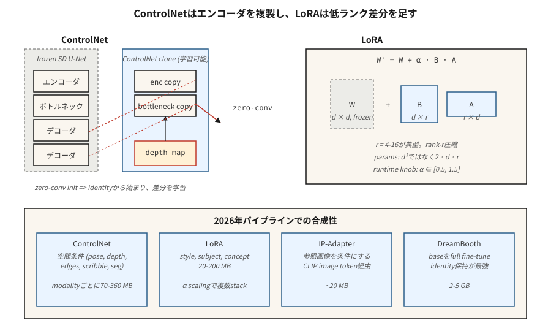

# ControlNet、LoRA 與條件控制

> 光靠文字是很笨拙的控制訊號。ControlNet 讓你複製一份預訓練擴散模型，再用深度圖、姿態骨架、塗鴉或邊緣圖去掌舵。LoRA 則讓你只訓練一千萬個參數，就微調得動一個 20 億參數的模型。兩者合起來，把 Stable Diffusion 從玩具變成 2026 年每間代理商都在出貨的影像流程。

**類型：** 實作
**程式語言：** Python
**先修單元：** 階段 8 · 07（潛在擴散）、階段 10（從零打造 LLM —— 作為 LoRA 的基礎）
**時間：** 約 75 分鐘

## 問題所在

像「一位穿紅洋裝的女子在繁忙街道上遛狗」這樣的提示詞，完全沒告訴模型狗*在哪裡*、女子是*什麼姿勢*、街道是*什麼視角*。文字大約只釘住了你要指定一張影像所需資訊的 10%。剩下的都是視覺性的，用文字沒辦法有效率地描述。

為了每一種訊號（姿態、深度、canny、分割）都從零訓練一個新的條件模型，代價高得不切實際。你想要的是：讓 26 億參數的 SDXL 骨幹維持凍結，掛上一個小型側網路去讀取條件訊號，讓它去輕推骨幹的中間特徵。這就是 ControlNet。

你同時也想在不重訓整個模型的前提下，教會模型新概念（你的臉、你的產品、你的風格）。你想要一個小 100 倍的差量。這就是 LoRA —— 插進既有注意力權重裡的低秩適配。

ControlNet + LoRA + 文字 = 2026 年實務工作者的工具箱。多數生產級影像流程會在 SDXL／SD3／Flux 基礎模型之上疊 2 到 5 個 LoRA、1 到 3 個 ControlNet，再加一個 IP-Adapter。

## 核心概念



### ControlNet（Zhang et al., 2023）

取一個預訓練好的 SD。*複製*一份 U-Net 的編碼器半邊。凍結原本那半。訓練這份複本，讓它接受一個額外的條件輸入（邊緣、深度、姿態）。再用*零卷積*跳接（初始化為零的 1×1 卷積 —— 一開始是空操作，之後學出一個差量），把複本接回原模型的解碼器半邊。

```
SD U-Net decoder:   ... ← orig_enc_features + zero_conv(controlnet_enc(condition))
```

零卷積的初始化意味著 ControlNet 一開始就是恆等映射 —— 訓練之前也不會造成傷害。用一百萬組（提示詞、條件、影像）三元組搭配標準擴散損失去訓練。

各種模態的 ControlNet 都以小型側模型的形式發布（SDXL 約 3.6 億參數，SD 1.5 約 7000 萬）。你可以在推論時把它們組合起來：

```
features += weight_a * control_a(depth) + weight_b * control_b(pose)
```

### LoRA（Hu et al., 2021）

對模型裡任何一個線性層 `W ∈ R^{d×d}`，凍結 `W`，再加上一個低秩差量：

```math
W' = W + \Delta W, \quad \Delta W = B A, \quad A \in \mathbb{R}^{r \times d}, \quad B \in \mathbb{R}^{d \times r}
```

其中 `r << d`。注意力層通常用 rank 4 到 16，重度微調則用 rank 64 到 128。新增的參數量是 `2 · d · r`，而不是 `d²`。以 SDXL 注意力層 `d=640`、`r=16` 為例：每個轉接層 2 萬個參數，而不是 41 萬 —— 少了 20 倍。放到整個模型上：一個 LoRA 通常是 20 到 200MB，而基礎模型是 5GB。

推論時你可以縮放 LoRA：`W' = W + α · B @ A`。`α = 0.5-1.5` 是常態。多個 LoRA 是相加疊起來的（照例要注意它們之間會以非線性的方式互相影響）。

### IP-Adapter（Ye et al., 2023）

一個很小的轉接層，接受一張*影像*當條件（和文字並存）。它用 CLIP 影像編碼器產生影像詞元，再把它們和文字詞元一起注入交叉注意力。每個基礎模型約 20MB。讓你不需要 LoRA 就能做到「照這張參考圖的風格生一張圖」。

## 可組合性對照表

| 工具 | 控制什麼 | 大小 | 什麼時候用 |
|------|------------------|------|-------------|
| ControlNet | 空間結構（姿態、深度、邊緣） | 70-360MB | 精確的版面、構圖 |
| LoRA | 風格、主體、概念 | 20-200MB | 個人化、風格 |
| IP-Adapter | 來自參考影像的風格或主體 | 20MB | 沒有文字描述得出那個樣子 |
| Textual Inversion | 用一個新詞元表示單一概念 | 10KB | 舊做法，大致被 LoRA 取代 |
| DreamBooth | 針對某個主體做完整微調 | 2-5GB | 身分特徵強，但算力吃重 |
| T2I-Adapter | 更輕量的 ControlNet 替代品 | 70MB | 邊緣裝置、推論預算吃緊 |

ControlNet ≈ 空間層面。LoRA ≈ 語意層面。兩個都用。

```figure
v4-controlnet-zero
```

## 動手實作

`code/main.py` 在 1 維上模擬這兩套機制：

1. **LoRA。** 一個預訓練好的線性層 `W`。凍結它。訓練一個低秩的 `B @ A`，讓 `W + BA` 逼近目標線性層。展示 `r = 1` 就足以完美學會一個秩為 1 的修正量。

2. **ControlNet-lite。** 一個「凍結的基礎」預測器，加上一個讀取額外訊號的「側網路」。側網路的輸出被一個初始化為零的可學習純量閘控（這是我們版本的零卷積）。訓練它，看著閘門一路升上來。

### 步驟 1：LoRA 的數學

```python
def lora(W, A, B, x, alpha=1.0):
    # W is frozen; A, B are the trainable low-rank factors.
    return [W[i][j] * x[j] for i, j in ...] + alpha * (B @ (A @ x))
```

### 步驟 2：零初始化的側網路

```python
side_out = control_net(x, condition)
gated = gate * side_out  # gate initialized to 0
h = base(x) + gated
```

在第 0 步，輸出和基礎模型完全相同。訓練初期 `gate` 更新得很慢 —— 不會有災難性的漂移。

## 常見陷阱

- **把 LoRA 放大過頭。** `α = 2` 或 `α = 3` 是常見的「弄強一點」土法，結果是過度風格化／壞掉的輸出。把 `α` 控制在 ≤ 1.5。
- **ControlNet 權重打架。** 姿態 ControlNet 開權重 1.0、深度 ControlNet 也開 1.0，通常會衝過頭。權重總和 ≈ 1.0 是安全的預設值。
- **LoRA 接錯基礎模型。** SDXL 的 LoRA 在 SD 1.5 上會安靜地變成空操作，因為注意力維度對不上。Diffusers 從 0.30+ 起會發出警告。
- **Textual Inversion 會飄。** 在某一份檢查點上訓練出來的詞元，換到另一份上會飄得很嚴重。LoRA 的可攜性比較好。
- **LoRA 的權重合併與儲存。** 你可以把 LoRA 烙進基礎模型權重裡換取更快的推論（執行期不必再做加法），但這樣就失去在執行期縮放 `α` 的能力。兩個版本都留著。

## 框架應用

| 目標 | 2026 年的流程 |
|------|---------------|
| 重現某個品牌的美術風格 | 用約 30 張精選影像、rank 32 訓練一個 LoRA |
| 把我的臉放進生成的影像裡 | DreamBooth，或 LoRA + IP-Adapter-FaceID |
| 指定姿態 + 提示詞 | ControlNet-Openpose + SDXL + 文字 |
| 感知深度的構圖 | ControlNet-Depth + SD3 |
| 參考圖 + 提示詞 | IP-Adapter + 文字 |
| 精確的版面 | ControlNet-Scribble 或 ControlNet-Canny |
| 替換背景 | ControlNet-Seg + 修補（單元 09） |
| 快速的一步風格化 | 在 SDXL-Turbo 上用 LCM-LoRA |

## 產出交付

存成 `outputs/skill-sd-toolkit-composer.md`。這項技能吃一個任務（輸入素材：提示詞、選用的參考影像、選用的姿態、選用的深度、選用的塗鴉），輸出工具堆疊、各自的權重，以及一套可重現的種子流程。

## 練習

1. **簡單。** 在 `code/main.py` 裡把 LoRA 的 rank `r` 從 1 變到 4。在哪個 rank 上，LoRA 能完全吻合一個秩為 2 的目標差量？
2. **中等。** 針對兩個目標轉換各訓練一個 LoRA。把它們一起載入，展示兩者相加的交互作用。這個交互作用在什麼時候會不再是線性的？
3. **困難。** 用 diffusers 疊出：SDXL-base + Canny-ControlNet（權重 0.8）+ 一個風格 LoRA（α 0.8）+ IP-Adapter（權重 0.6）。隨著堆疊權重變化，量測 FID 與提示詞遵循度之間的取捨。

## 關鍵術語

| 術語 | 大家怎麼說 | 實際上是什麼 |
|------|-----------------|-----------------------|
| ControlNet | 「空間控制」 | 複製一份編碼器 + 零卷積跳接；讀取一張條件影像。 |
| 零卷積 | 「一開始是恆等映射」 | 初始化為零的 1×1 卷積；ControlNet 起手是空操作。 |
| LoRA | 「低秩適配」 | `W + B @ A`，`r << d`；參數量比完整微調少 100 倍。 |
| rank r | 「那個旋鈕」 | LoRA 的壓縮程度；一般 4 到 16，重度個人化用 64 以上。 |
| α | 「LoRA 強度」 | 執行期對 LoRA 差量的縮放。 |
| IP-Adapter | 「參考影像」 | 透過 CLIP 影像詞元做影像條件控制的小型轉接層。 |
| DreamBooth | 「針對主體的完整微調」 | 用某個主體的約 30 張影像訓練整個模型。 |
| Textual Inversion | 「新詞元」 | 只學一個新的詞嵌入；舊做法，大致已被取代。 |

## 產品筆記：LoRA 熱插拔、ControlNet 車道、多租戶服務

一個真實的文字生圖 SaaS，會在同一份基礎檢查點上服務數百個 LoRA 和十幾個 ControlNet。這個服務問題很像 LLM 的多租戶（生產文獻在連續批次與 LoRAX／S-LoRA 底下談的就是 LLM 那一版）：

- **熱插拔 LoRA，不要合併。** 把 `W' = W + α·B·A` 合併進基礎模型，每一步推論大約快 3 到 5%，但會把 `α` 和基礎模型鎖死。把 LoRA 以 rank-r 差量的形式熱駐在 VRAM 裡；diffusers 提供 `pipe.load_lora_weights()` + `pipe.set_adapters([...], adapter_weights=[...])` 來做逐請求啟用。切換成本就是那 `2 · d · r · num_layers` 個權重 —— MB 等級，一秒以內。
- **ControlNet 是第二條注意力車道。** 複製出來的編碼器和基礎模型並行跑。兩個 ControlNet 各開權重 1.0 = 每一步多兩趟前向傳播，而不是合併成一趟。批次大小的餘裕會以平方速度下滑。每啟用一個 ControlNet，就要編列約 1.5 倍的單步成本。
- **LoRA 也要量化。** 如果你把基礎模型量化了（見單元 07，8GB 上跑 Flux），LoRA 差量同樣能乾淨地量化到 8-bit 或 4-bit。QLoRA 風格的載入方式讓你能在 4-bit 的 Flux 基礎模型上疊 5 到 10 個 LoRA 而不爆記憶體。

Flux 特有的一點：Niels 那份 Flux-on-8GB 的 notebook 把基礎模型量化到 4-bit；在那個量化後的基礎模型上、以 `weight_name="pytorch_lora_weights.safetensors"` 疊一個風格 LoRA（`pipe.load_lora_weights("user/style-lora")`）仍然可行。這就是 2026 年多數 SaaS 代理商在出貨的配方。

## 延伸閱讀

- [Zhang, Rao, Agrawala (2023). Adding Conditional Control to Text-to-Image Diffusion Models](https://arxiv.org/abs/2302.05543) —— ControlNet。
- [Hu et al. (2021). LoRA: Low-Rank Adaptation of Large Language Models](https://arxiv.org/abs/2106.09685) —— LoRA（原本是為 LLM 提出的；移植到擴散模型）。
- [Ye et al. (2023). IP-Adapter: Text Compatible Image Prompt Adapter](https://arxiv.org/abs/2308.06721) —— IP-Adapter。
- [Mou et al. (2023). T2I-Adapter: Learning Adapters to Dig Out More Controllable Ability](https://arxiv.org/abs/2302.08453) —— 比 ControlNet 更輕量的替代品。
- [Ruiz et al. (2023). DreamBooth: Fine Tuning Text-to-Image Diffusion Models for Subject-Driven Generation](https://arxiv.org/abs/2208.12242) —— DreamBooth。
- [HuggingFace Diffusers — ControlNet / LoRA / IP-Adapter docs](https://huggingface.co/docs/diffusers/training/controlnet) —— 參考流程。
