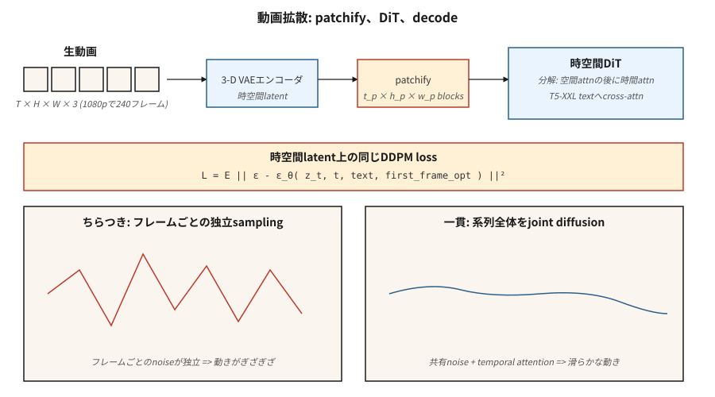

# 影片生成

> 一張影像是 2 維張量。一段影片是 3 維的。理論一模一樣；算力難上 10 到 100 倍。OpenAI 的 Sora（2024 年 2 月）證明了這條路走得通。到了 2026 年，Veo 2、Kling 1.5、Runway Gen-3、Pika 2.0 與 WAN 2.2 都能從文字產出 1080p 的生產級影片 —— 而開放權重那一側（CogVideoX、HunyuanVideo、Mochi-1、WAN 2.2）落後大約 12 個月。

**類型：** 實作
**程式語言：** Python
**先修單元：** 階段 8 · 07（潛在擴散）、階段 7 · 09（ViT）、階段 8 · 06（DDPM）
**時間：** 約 45 分鐘

## 問題所在

一段 10 秒、24fps 的 1080p 影片，是 240 個 1920×1080×3 像素的影格。每個片段約 1.5 GB 的原始資料。像素空間擴散根本行不通。你需要：

1. **時空壓縮。** 一個把整段影片（而不是單張影格）編碼成一串時空圖塊的 VAE。
2. **時間一致性。** 影格之間必須在數秒的尺度上共享內容、打光與物件身分。網路得把運動建模進去。
3. **算力預算。** 同樣的模型規模，影片訓練比影像貴上 10 到 100 倍。
4. **條件控制。** 文字、影像（首格）、音訊，或另一段影片。多數生產模型四種都吃。

解決這一切的架構，是把**擴散 Transformer（DiT）**套用到時空圖塊上，並在巨量的（提示詞、字幕、影片）資料集上訓練。損失函式和單元 06 的擴散損失完全一樣。

## 核心概念



### 切圖塊

用一個 3D VAE（學出來的時空壓縮）把影片編碼起來。潛在表示的形狀是 `[T_latent, H_latent, W_latent, C_latent]`。再切成大小為 `[t_p, h_p, w_p]` 的圖塊。Sora 這一類模型的 `t_p = 1`（每格一組圖塊）或 `t_p = 2`（每兩格一組）。一段 10 秒的 1080p 影片會壓成約 20,000 到 100,000 個圖塊。

### 時空 DiT

一個 Transformer 處理這串攤平的圖塊。每個圖塊都有 3 維的位置嵌入（時間 + y + x）。注意力通常會被分解：

- **空間注意力**在單一影格的圖塊之內。
- **時間注意力**跨影格、在相同空間位置之間。
- **完整 3D 注意力**貴上 16 到 100 倍；只在低解析度或研究場景下使用。

### 文字條件控制

用一個大型文字編碼器做交叉注意力（Sora 用 T5-XXL，CogVideoX-5B 也是 T5-XXL）。長提示詞很重要 —— Sora 的訓練集用 GPT 生成了密集的重新字幕，每個片段平均 200 個詞元。

### 訓練

在時空潛在表示上跑標準擴散損失（ε 或 v 預測）。資料：網路影片 + 約 1 億個精選片段 + 合成文字字幕。算力：就算只是小型研究實驗也要 10,000+ GPU 小時；Sora 那個量級是 100,000+。

## 2026 年的生產版圖

| 模型 | 日期 | 最長時長 | 最高解析度 | 開放權重？ | 值得一提之處 |
|-------|------|--------------|---------|---------------|---------|
| Sora (OpenAI) | 2024-02 | 60s | 1080p | No | 第一個在規模上展現世界模擬器特性的模型 |
| Sora Turbo | 2024-12 | 20s | 1080p | No | 生產版 Sora，推論快 5 倍 |
| Veo 2 (Google) | 2024-12 | 8s | 4K | No | 2025 年品質與物理最好 |
| Veo 3 | 2025 Q3 | 15s | 4K | No | 原生音訊，鏡頭控制更強 |
| Kling 1.5 / 2.1 (Kuaishou) | 2024-2025 | 10s | 1080p | No | 2025 Q1 人體運動最佳 |
| Runway Gen-3 Alpha | 2024-06 | 10s | 768p | No | 上層附帶專業影片工具 |
| Pika 2.0 | 2024-10 | 5s | 1080p | No | 角色一致性最強 |
| CogVideoX (THUDM) | 2024 | 10s | 720p | Yes (2B, 5B) | 第一個開放的 5B 級影片模型 |
| HunyuanVideo (Tencent) | 2024-12 | 5s | 720p | Yes (13B) | 2024 年底的開源 SOTA |
| Mochi-1 (Genmo) | 2024-10 | 5.4s | 480p | Yes (10B) | 授權最寬鬆 |
| WAN 2.2 (Alibaba) | 2025-07 | 5s | 720p | Yes | 2025 年中最強的開放模型 |

開放權重在影片這邊追趕的速度比影像那邊更快：到 2026 年中，HunyuanVideo + WAN 2.2 的 LoRA 已經撐起大多數開源工作流。

```figure
video-diffusion-denoise
```

## 動手實作

`code/main.py` 模擬時空 DiT 的核心想法：把一段小小的合成影片切成圖塊、為每個圖塊加上位置嵌入，再用 Transformer 風格的圖塊間注意力對整串序列去噪。不用 numpy；純 Python。我們會看到：就算在 1 維情境下，只要相鄰影格的圖塊共用同一個去噪器與位置嵌入，時間一致性就會浮現出來。

### 步驟 1：把合成的 1 維「影片」切成圖塊

```python
def make_video(T_frames=8, rng=None):
    # a "video" is a sequence of 1-D values following a smooth trajectory
    base = rng.gauss(0, 1)
    return [base + 0.3 * t + rng.gauss(0, 0.1) for t in range(T_frames)]
```

### 步驟 2：每格一個位置嵌入

```python
def pos_embed(t, dim):
    return sinusoidal(t, dim)
```

### 步驟 3：讓去噪器看見整串序列

我們的小網路不是各自獨立地為每格去噪，而是把所有影格的數值 + 它們的位置嵌入串接起來，一次聯合預測所有影格的雜訊。

### 步驟 4：時間一致性測試

訓練完之後取樣一段影片。量測相鄰影格之間的差值。如果模型真的學到了時間結構，這些差值會小於逐格獨立取樣的情況。

## 常見陷阱

- **逐格獨立取樣＝閃爍。** 如果你對每一格分別跑影像擴散，輸出會閃爍，因為每格的雜訊互相獨立。影片擴散靠注意力或共用雜訊把影格耦合起來，就是為了解決這件事。
- **天真的 3D 注意力＝OOM。** 對一段 10 秒 1080p 的潛在表示做完整 3D 注意力，是好幾千億次運算。要分解成空間 + 時間。
- **資料的字幕品質比資料量更重要。** Sora 相對於前人的主要升級，是拿詳細程度高約 10 倍的字幕來訓練（用 GPT-4 重新標註片段）。OpenAI 的技術報告對此講得很明白。
- **首格條件控制。** 多數生產模型也接受一張影像當成第一格。這就是「影像生影片」模式；訓練時就涵蓋了這個變體。
- **物理漂移。** 長片段（>10s）會累積細微的不一致。滑動視窗生成 + 關鍵影格錨定會有幫助。

## 框架應用

| 使用情境 | 2026 年的選擇 |
|----------|-----------|
| 品質最高的文字生影片、託管服務 | Veo 3 或 Sora |
| 帶鏡頭控制的電影感 | Runway Gen-3 搭配 motion brush |
| 跨片段的角色一致性 | Pika 2.0 或 Kling 2.1 |
| 開放權重、微調要快 | WAN 2.2 + LoRA |
| 影像生影片 | WAN 2.2-I2V、Kling 2.1 I2V，或 Runway |
| 音訊驅動的對嘴 | Veo 3（原生音訊）或專門的對嘴模型 |
| 影片編輯 | Runway Act-Two、Kling Motion Brush、Flux-Kontext（靜態影格） |

在品質相當的前提下，每秒影片的成本在 2024 到 2026 年間降了 20 倍。

## 產出交付

存成 `outputs/skill-video-brief.md`。這項技能吃一份影片需求（時長、長寬比、風格、鏡頭規劃、主體一致性、音訊），輸出：模型 + 託管方式、提示詞骨架（鏡頭語彙、主體描述、運動描述詞）、種子 + 可重現性協定，以及一份影格層級的 QA 檢查清單。

## 練習

1. **簡單。** 在 `code/main.py` 裡，比較 (a) 逐格獨立取樣、(b) 整串序列聯合取樣兩者的相鄰影格差值。回報差值的平均數與變異數。
2. **中等。** 加上首格條件：把第 0 格釘在指定的數值上，再取樣其餘影格。量測這個被釘住的值如何往後傳播。
3. **困難。** 用 HuggingFace diffusers 在本機 GPU 上跑 CogVideoX-2B。為一段 6 秒的片段在 720p 下計時 20 個推論步驟。剖析時空注意力，找出瓶頸在哪裡。

## 關鍵術語

| 術語 | 大家怎麼說 | 實際上是什麼 |
|------|-----------------|-----------------------|
| 影片 VAE | 「3 維 VAE」 | 把 `(T, H, W, C)` 壓成時空潛在表示的編碼器。 |
| 圖塊 | 「那些詞元」 | 潛在表示裡固定大小的 3 維區塊；DiT 的輸入。 |
| 分解式注意力 | 「空間 + 時間」 | 先在空間上跑注意力、再在時間上跑；跳過完整 3 維注意力。 |
| 影像生影片（I2V） | 「讓這張照片動起來」 | 模型吃一張影像 + 文字，輸出一段以它為起點的影片。 |
| 關鍵影格條件控制 | 「錨定影格」 | 釘住特定影格，藉此控制影片的走向。 |
| Motion brush | 「方向提示」 | 一種 UI 輸入，使用者直接在影像上塗出運動向量。 |
| 重新字幕 | 「密集字幕」 | 用 LLM 為訓練片段重新標上詳細的提示詞。 |
| 閃爍 | 「時間維度的瑕疵」 | 影格之間不一致；用耦合去噪來修。 |

## 產品筆記：影片潛在表示是記憶體頻寬問題

一段 10 秒、24 fps 的 1080p 片段是 240 影格 × 1920 × 1080 × 3 ≈ 1.5 GB 的原始像素。經過 4× 的影片 VAE 壓縮（`2 × spatial × 2 × temporal`）後，每個請求的潛在表示約 100 MB。把它以批次 1 送進時空 DiT 跑 30 步，你每一步都要搬約 3 GB 通過 HBM —— 瓶頸是記憶體頻寬，不是 FLOPs。

三個生產環境的旋鈕，全都直接來自生產推論文獻的推論章節：

- **在 DiT 上做 TP。** 文字生影片模型動輒 ≥10B 參數。跨 4 張 H100 做 TP=4 是標準做法；405B 級的模型則用 PP=2 × TP=2。在撞上 all-reduce 那道牆之前，每步延遲大致隨 TP 線性下降。
- **影格批次＝連續批次。** 生成時，影片在概念上就是一批用注意力串起來的影格。連續批次（in-flight 排程）同樣適用：只要模型架構允許滑動視窗生成，就可以在回傳第 `t-1` 格的同時開始算第 `t+1` 格。
- **片段層級的 prefill 快取。** 對影像生影片來說，首格條件就類比於 LLM 的提示詞 prefill：算一次，之後在整條時間解碼路徑上重複使用。這實質上就是影片版的 KV 快取。

## 延伸閱讀

- [Brooks et al. (2024). Video generation models as world simulators](https://openai.com/index/video-generation-models-as-world-simulators/) —— Sora 技術報告。
- [Yang et al. (2024). CogVideoX: Text-to-Video Diffusion Models with An Expert Transformer](https://arxiv.org/abs/2408.06072) —— CogVideoX。
- [Kong et al. (2024). HunyuanVideo: A Systematic Framework for Large Video Generative Models](https://arxiv.org/abs/2412.03603) —— HunyuanVideo。
- [Genmo (2024). Mochi 1 preview model card](https://huggingface.co/genmo/mochi-1-preview) —— Mochi-1。
- [Alibaba (2025). WAN 2.2](https://wanvideo.io/) —— 2025 年中的開源 SOTA。
- [Ho, Salimans, Gritsenko et al. (2022). Video Diffusion Models](https://arxiv.org/abs/2204.03458) —— 影片擴散的開山之作。
- [Blattmann et al. (2023). Align your Latents (Video LDM)](https://arxiv.org/abs/2304.08818) —— Stable Video Diffusion 的前身。
