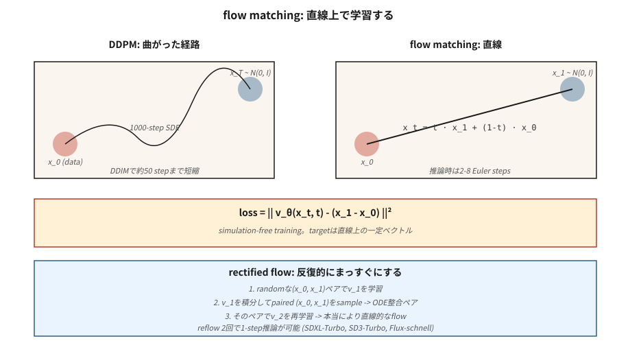

# 流匹配與修正流

> 擴散模型要 20 到 50 個取樣步數，因為它們走的是一條從雜訊通往資料的彎曲路徑。流匹配（Lipman 等人，2023）與修正流（Liu 等人，2022）訓練的是直線路徑。路徑越直，步數越少，推論就越快。Stable Diffusion 3、Flux.1 與 AudioCraft 2 都在 2024 年換成了流匹配。

**類型：** 實作
**程式語言：** Python
**先修單元：** 階段 8 · 06（DDPM）、階段 1 · 微積分
**時間：** 約 45 分鐘

## 問題所在

DDPM 的反向過程是一段從 `N(0, I)` 走回資料分布的 1000 步隨機漫步。DDIM 把它壓縮成 20 到 50 個決定性步驟。你想要更少的步數 —— 最好是一步。卡住的地方在於，解反向過程的那條 ODE 是僵硬的（stiff）；路徑是彎的。

如果你能訓練出一個模型，讓從雜訊到資料的路徑是一條*直線*，那麼從 `t=1` 到 `t=0` 的單一 Euler 步就夠用了。流匹配直接照這個想法建構：定義一條從 `x_1 ∼ N(0, I)` 到 `x_0 ∼ data` 的直線內插，訓練一個向量場 `v_θ(x, t)` 去匹配它對時間的導數，推論時再積分回來。

修正流（Liu 2022）又更進一步：用一道 reflow 程序反覆把路徑拉直，得到一條越來越接近線性的 ODE。跑完兩輪 reflow 之後，一個 2 步取樣器就能媲美 50 步 DDPM 的品質。

## 核心概念



### 直線流

定義：

```math
x_t = t \cdot x_1 + (1 - t) \cdot x_0, \quad t \in [0, 1]
```

其中 `x_0 ~ data`、`x_1 ~ N(0, I)`。沿著這條直線的時間導數是常數：

```math
\frac{dx_t}{dt} = x_1 - x_0
```

定義一個神經向量場 `v_θ(x_t, t)`，訓練它去匹配這個導數：

```math
L = \mathbb{E}_{x_0, x_1, t} \left\lVert v_\theta(x_t, t) - (x_1 - x_0) \right\rVert^2
```

這就是**條件流匹配**（conditional flow matching）損失（Lipman 2023）。訓練是免模擬的：你從來不用把 ODE 展開來跑。只要取樣 `(x_0, x_1, t)` 然後做迴歸就好。

### 取樣

推論時，把學到的向量場沿時間*往回*積分：

```math
x_{t-\Delta t} = x_t - \Delta t \cdot v_\theta(x_t, t)
```

從 `x_1 ~ N(0, I)` 出發，一路 Euler 步進到 `t=0`。

### 修正流（Liu 2022）

直線流行得通，但學出來的路徑*其實並不直* —— 它們會彎，因為很多個 `x_0` 可以對應到同一個 `x_1`。修正流的 reflow 步驟是這樣：

1. 用隨機配對訓練一個流模型 v_1。
2. 從 `x_1` 積分 v_1 到它落腳的 `x_0`，取樣出 N 組 `(x_1, x_0)` 配對。
3. 在這些成對的樣本上訓練 v_2。因為這些配對現在是「ODE 對齊」的，它們之間的直線內插確實更平坦。
4. 重複。

實務上 2 輪 reflow 就能把路徑拉到接近線性，讓 2 到 4 步推論成為可能。SDXL-Turbo、SD3-Turbo、LCM 全都是從流匹配蒸餾出來的模型。

### 為什麼它在 2024 年拿下了影像

三個原因：

1. **免模擬訓練** —— 訓練時不用展開 ODE，實作起來毫無難度。
2. **更好的損失幾何** —— 直線路徑的訊噪比一致，而 DDPM 的 ε 損失在排程兩端的訊噪比很糟。
3. **更快的推論** —— 4 到 8 步就有 SDXL-Turbo 的品質；搭配一致性蒸餾則是 1 步。

## 流匹配與 DDPM —— 精確的對應關係

採用高斯條件路徑的流匹配，就是*搭配特定雜訊排程*的擴散。挑 `x_t = α(t) x_0 + σ(t) x_1` 這個排程，流匹配就還原成以 Stratonovich 形式改寫的擴散，其中 `v = α'·x_0 - σ'·x_1`。對高斯路徑而言，兩者在代數上等價。

流匹配多帶來的是：目標的*清晰度*（就是一個單純的速度）、更乾淨的損失，以及去嘗試非高斯內插的自由。

```figure
normalizing-flow
```

## 動手實作

`code/main.py` 在一個雙峰高斯混合分布上實作 1 維流匹配。向量場 `v_θ(x, t)` 是一個用直線目標訓練的迷你 MLP。推論時分別積分 1、2、4 與 20 個 Euler 步，並比較樣本品質。

### 步驟 1：訓練損失

```python
def train_step(x0, net, rng, lr):
    x1 = rng.gauss(0, 1)
    t = rng.random()
    x_t = t * x1 + (1 - t) * x0
    target = x1 - x0
    pred = net_forward(x_t, t)
    loss = (pred - target) ** 2
    # backprop + update
```

### 步驟 2：多步推論

```python
def sample(net, num_steps):
    x = rng.gauss(0, 1)
    for i in range(num_steps):
        t = 1.0 - i / num_steps
        dt = 1.0 / num_steps
        x -= dt * net_forward(x, t)
    return x
```

### 步驟 3：比較取樣步數

預期 4 步的取樣器就已經追平 20 步的品質 —— 這對延遲是一件大事。

## 常見陷阱

- **時間參數化。** 流匹配用 `t ∈ [0, 1]`，`t=0` 是資料、`t=1` 是雜訊。DDPM 用 `t ∈ [0, T]`，`t=0` 是資料、`t=T` 是雜訊。方向相同，尺度不同。論文一天到晚搞錯這件事。
- **排程的選擇。** 修正流的直線是「那個」標準流匹配排程，但你也可以用餘弦或 logit-normal 的 t 取樣（SD3 就是這樣做）來換取更好的尺度覆蓋。
- **reflow 的成本。** 為 reflow 產生配對資料集，每個樣本都要跑一次完整的推論。真的需要 1 到 2 步推論時才做 reflow。
- **無分類器引導依然適用。** 只要把線性組合裡的 ε 換成 v 就好：`v_cfg = (1+w) v_cond - w v_uncond`。

## 框架應用

| 使用情境 | 2026 年的技術棧 |
|----------|-----------|
| 文字生圖，最佳品質 | 流匹配：SD3、Flux.1-dev |
| 文字生圖，1 到 4 步 | 蒸餾過的流匹配：Flux.1-schnell、SD3-Turbo、SDXL-Turbo |
| 即時推論 | 從流匹配基礎模型做一致性蒸餾（LCM、PCM） |
| 音訊生成 | 流匹配：Stable Audio 2.5、AudioCraft 2 |
| 影片生成 | 流匹配混搭擴散（Sora、Veo、Stable Video） |
| 科學／物理（粒子軌跡、分子） | 流匹配 + 等變向量場 |

2025 到 2026 年只要有論文說自己「比擴散更快」，答案幾乎一定是流匹配 + 蒸餾。

## 產出交付

存成 `outputs/skill-fm-tuner.md`。這項技能吃一份擴散風格的模型規格，把它轉成一套流匹配訓練設定：排程選擇、時間取樣分布（均勻／logit-normal）、最佳化器、reflow 計畫、目標步數、評測流程。

## 練習

1. **簡單。** 跑 `code/main.py`，比較 1 步與 20 步相對於真實資料分布的 MSE。
2. **中等。** 把均勻的 `t` 取樣換成 logit-normal（把取樣集中在中段的 t）。模型品質有變好嗎？
3. **困難。** 實作一輪 reflow：積分第一個模型產生配對的 (x_0, x_1)，在這些配對上訓練第二個模型，再比較 1 步樣本的品質。

## 關鍵術語

| 術語 | 大家怎麼說 | 實際上是什麼 |
|------|-----------------|-----------------------|
| 流匹配 | 「走直線的擴散」 | 訓練 `v_θ(x, t)` 沿著內插路徑去匹配 `x_1 - x_0`。 |
| 修正流 | 「reflow」 | 把學出來的流反覆拉直的迭代程序。 |
| 速度場 | 「v_θ」 | 模型的輸出 —— `x_t` 該往哪個方向移動。 |
| 直線內插 | 「那條路徑」 | `x_t = (1-t)·x_0 + t·x_1`；目標導數平凡得不能再平凡。 |
| Euler 取樣器 | 「一階常微分方程求解器」 | 最簡單的積分器；路徑夠直時表現很好。 |
| logit-normal t | 「SD3 的取樣法」 | 把 `t` 的取樣集中到梯度最強的中段值。 |
| 一致性蒸餾 | 「1 步取樣器」 | 訓練一個學生模型，把任意 `x_t` 直接映射到 `x_0`。 |
| 速度版 CFG | 「v-CFG」 | `v_cfg = (1+w) v_cond - w v_uncond`；同一招，換個變數。 |

## 產品筆記：Flux.1-schnell 是流匹配跑到最快的樣子

流匹配在生產環境的代表作是 Flux.1-schnell —— 一個蒸餾到 1 到 4 個推論步數、卻仍保有 Flux-dev 級品質的流匹配 DiT。Niels 那份「在 8GB 機器上跑 Flux」的 notebook 是標準的部署配方：T5 + CLIP 編碼、量化過的 MMDiT 去噪（schnell 走 4 步，dev 走 50 步）、VAE 解碼。成本帳是這樣：

| 變體 | 步數 | L4 上 1024² 的延遲 | 總 FLOPs（相對值） |
|---------|-------|------------------------|------------------------|
| Flux.1-dev（原生） | 50 | 約 15 秒 | 1.0× |
| Flux.1-schnell | 4 | 約 1.2 秒 | 0.08×（快 12 倍） |
| SDXL-base | 30 | 約 4 秒 | 0.25× |
| SDXL-Lightning 2 步 | 2 | 約 0.3 秒 | 0.03× |

生產環境的規則是：**流匹配基礎模型 + 蒸餾 = 2026 年快速文字生圖的預設答案。** 每一家主要廠商都出這個組合：SD3-Turbo（SD3 + 流 + 蒸餾）、Flux-schnell（Flux-dev + 修正流拉直）、CogView-4-Flash。純擴散的基礎模型只剩在舊檢查點上還看得到。

## 延伸閱讀

- [Liu, Gong, Liu (2022). Flow Straight and Fast: Learning to Generate and Transfer Data with Rectified Flow](https://arxiv.org/abs/2209.03003) —— 修正流。
- [Lipman et al. (2023). Flow Matching for Generative Modeling](https://arxiv.org/abs/2210.02747) —— 流匹配。
- [Esser et al. (2024). Scaling Rectified Flow Transformers for High-Resolution Image Synthesis](https://arxiv.org/abs/2403.03206) —— SD3，大規模下的修正流。
- [Albergo, Vanden-Eijnden (2023). Stochastic Interpolants](https://arxiv.org/abs/2303.08797) —— 涵蓋流匹配與擴散的通用框架。
- [Song et al. (2023). Consistency Models](https://arxiv.org/abs/2303.01469) —— 擴散／流的 1 步蒸餾。
- [Sauer et al. (2023). Adversarial Diffusion Distillation (SDXL-Turbo)](https://arxiv.org/abs/2311.17042) —— turbo 變體。
- [Black Forest Labs (2024). Flux.1 models](https://blackforestlabs.ai/announcing-black-forest-labs/) —— 生產環境裡的流匹配。
