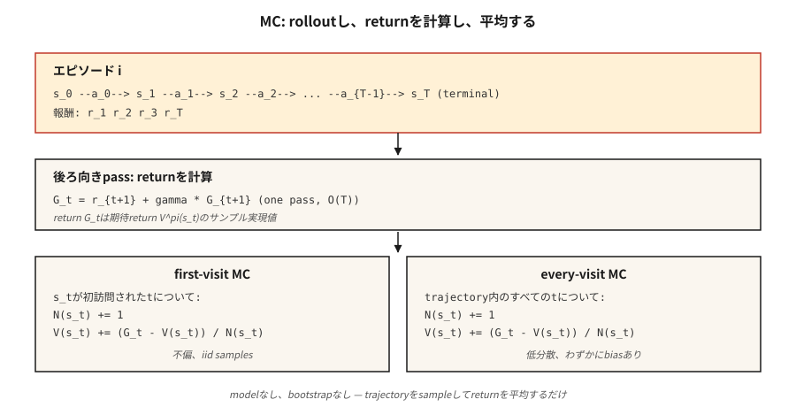

# 蒙地卡羅方法 —— 從完整回合中學習

> 動態規劃需要模型。蒙地卡羅什麼都不需要，只要回合。跑一次策略，看看回報，把它們平均起來。這是強化學習裡最簡單的想法——也是解鎖後面一切的那個想法。

**類型：** 實作
**程式語言：** Python
**先修單元：** 階段 9 · 01（MDP）、階段 9 · 02（動態規劃）
**時間：** 約 75 分鐘

## 問題所在

動態規劃很優雅，但它假設你能對每一個狀態與動作查詢 $P(s' \mid s, a)$。真實世界裡幾乎沒有東西是這樣運作的。機器人沒辦法解析地算出施加關節力矩之後相機像素的分布。定價演算法沒辦法把每一種可能的顧客反應都積分起來。LLM 也沒辦法枚舉某個詞元之後所有可能的續寫。

你需要一種只需要「能從環境*取樣*」的方法。跑一次策略。拿到一條軌跡 `s_0, a_0, r_1, s_1, a_1, r_2, …, s_T`。用它來估計價值。這就是蒙地卡羅。

從動態規劃轉到蒙地卡羅，在哲學上很重要：我們從*已知模型 + 精確備份*，走到了*取樣軌跡 + 平均回報*。變異數大幅上升，但適用範圍大爆炸。這一單元之後的每一個強化學習演算法——TD、Q-learning、REINFORCE、PPO、GRPO——骨子裡都是蒙地卡羅估計量，有時候再往上疊一層自助（bootstrapping）。

## 核心概念



**核心想法，一行講完：** $V^\pi(s) = \mathbb E_\pi[G_t \mid s_t = s] \approx (1/N) \sum_i G^{(i)}(s)$，其中 $G^{(i)}(s)$ 是在策略 $\pi$ 之下、每次訪問 $s$ 之後所觀察到的回報。

**首次訪問與每次訪問 MC。** 給定一個多次訪問狀態 $s$ 的回合，首次訪問 MC 只計入第一次訪問之後的回報；每次訪問 MC 則把所有訪問都算進去。首次訪問 MC 是不偏的。每次訪問 MC 在有限回合數之後可能會有些微偏差，因為它每個回合平均的回報數量是隨機的，而這個數量可能與回報本身相關；但當訪問次數趨近無限時，兩者都會收斂到 $V^\pi(s)$。首次訪問比較好分析（樣本獨立同分布）。每次訪問每回合用到的資料更多，實務上通常收斂得更快。

**增量式平均。** 與其把所有回報都存起來，不如更新滾動平均：

```math
V_n(s) = V_{n-1}(s) + (1/n) [G_n - V_{n-1}(s)]
```

重新整理一下：$V_{\text{new}} = V_{\text{old}} + \alpha \cdot (\text{target} - V_{\text{old}})$，其中 $\alpha = 1/n$。把 $1/n$ 換成固定的步長 $\alpha \in (0, 1)$，你就得到一個能追蹤 $\pi$ 變化的非穩態 MC 估計量。這一步就是從 MC 到 TD、再到每一個現代強化學習演算法的全部跨越。

**探索現在變成問題了。** 動態規劃靠枚舉碰到每一個狀態。蒙地卡羅只看得到策略會造訪的狀態。如果 $\pi$ 是決定性的，狀態空間裡整片區域永遠不會被取樣到，它們的價值估計就會永遠停在零。三種解法，依歷史順序排列：

1. **探索性起始。** 每個回合都從隨機的 (s, a) 配對開始。保證覆蓋率；但實務上不切實際（你沒辦法把一台機器人「重置」到任意狀態）。
2. **ε-貪婪。** 對當前的 Q 採取貪婪動作，但有 $\epsilon$ 的機率挑一個隨機動作。所有狀態—動作配對在漸近上都會被取樣到。
3. **異策略 MC。** 在行為策略 $\mu$ 之下收集資料，透過重要性取樣去學目標策略 $\pi$。變異數高，但它是通往 DQN 這類重播緩衝區方法的橋樑。

**蒙地卡羅控制。** 評估 → 改進 → 評估，跟策略迭代一樣，只是評估改成基於取樣：

1. 跑 $\pi$，拿到一個回合。
2. 用觀察到的回報更新 $Q(s, a)$。
3. 把 $\pi$ 改成對 $Q$ ε-貪婪。
4. 重複。

在一些溫和的條件下（每個配對都被無限多次造訪、$\alpha$ 滿足 Robbins-Monro 條件），它會以機率 1 收斂到 $Q^{\ast}$ 與 $\pi^{\ast}$。

```figure
epsilon-greedy
```

## 動手實作

### 步驟 1：跑軌跡 → 一串 (s, a, r)

```python
def rollout(env, policy, max_steps=200):
    trajectory = []
    s = env.reset()
    for _ in range(max_steps):
        a = policy(s)
        s_next, r, done = env.step(s, a)
        trajectory.append((s, a, r))
        s = s_next
        if done:
            break
    return trajectory
```

沒有模型，只有 `env.reset()` 跟 `env.step(s, a)`。跟 gym 環境一樣的介面，只是精簡過。

### 步驟 2：計算回報（反向掃描）

```python
def returns_from(trajectory, gamma):
    returns = []
    G = 0.0
    for _, _, r in reversed(trajectory):
        G = r + gamma * G
        returns.append(G)
    return list(reversed(returns))
```

一趟走完，$O(T)$。反向遞迴式 $G_t = r_{t+1} + \gamma G_{t+1}$ 讓你不用重複加總。

### 步驟 3：首次訪問 MC 評估

```python
def mc_policy_evaluation(env, policy, episodes, gamma=0.99):
    V = defaultdict(float)
    counts = defaultdict(int)
    for _ in range(episodes):
        trajectory = rollout(env, policy)
        returns = returns_from(trajectory, gamma)
        seen = set()
        for t, ((s, _, _), G) in enumerate(zip(trajectory, returns)):
            if s in seen:
                continue
            seen.add(s)
            counts[s] += 1
            V[s] += (G - V[s]) / counts[s]
    return V
```

真正在做事的就三行：首次訪問時把狀態標記成看過、計數加一、更新滾動平均。

### 步驟 4：ε-貪婪 MC 控制（同策略）

```python
def mc_control(env, episodes, gamma=0.99, epsilon=0.1):
    Q = defaultdict(lambda: {a: 0.0 for a in ACTIONS})
    counts = defaultdict(lambda: {a: 0 for a in ACTIONS})

    def policy(s):
        if random() < epsilon:
            return choice(ACTIONS)
        return max(Q[s], key=Q[s].get)

    for _ in range(episodes):
        trajectory = rollout(env, policy)
        returns = returns_from(trajectory, gamma)
        seen = set()
        for (s, a, _), G in zip(trajectory, returns):
            if (s, a) in seen:
                continue
            seen.add((s, a))
            counts[s][a] += 1
            Q[s][a] += (G - Q[s][a]) / counts[s][a]
    return Q, policy
```

### 步驟 5：跟動態規劃的黃金標準比對

當回合數 → ∞ 時，你用 MC 估出來的 $V^\pi$ 應該要跟單元 02 的動態規劃結果一致。實務上：在 4×4 GridWorld 上跑 50,000 個回合，可以逼近到跟動態規劃答案差 `~0.1` 以內。

## 常見陷阱

- **無限長的回合。** 蒙地卡羅要求回合會*終止*。如果你的策略可能永遠繞圈，就給 `max_steps` 設上限，並把觸頂視為隱含的失敗。GridWorld 配隨機策略經常會逾時——這很正常，只要確定你有正確地計入就好。
- **變異數。** 蒙地卡羅用的是完整回報。回合一長，變異數就大得嚇人——結尾處一個運氣不好的獎勵，就會把 $V(s_0)$ 整個往同樣的幅度挪動。TD 方法（單元 04）用自助法把這個砍掉。
- **狀態覆蓋率。** 對一個剛初始化、到處平手的 Q 採取貪婪，永遠只會試同一個動作。你*一定*要探索（ε-貪婪、探索性起始、UCB）。
- **非穩態的策略。** 如果 $\pi$ 會變（蒙地卡羅控制就是這樣），舊的回報就是另一個策略產生的。固定 α 的 MC 處理得了這件事；樣本平均式的 MC 處理不了。
- **異策略的重要性取樣。** 權重 $\pi(a \mid s)/\mu(a \mid s)$ 會沿著整條軌跡連乘。變異數隨視野長度爆炸。用逐決策的加權重要性取樣壓住它，或乾脆改用 TD。

## 框架應用

蒙地卡羅方法在 2026 年扮演的角色：

| 使用情境 | 為什麼用 MC |
|----------|--------|
| 短視野的遊戲（21 點、撲克） | 回合自然會終止；回報很乾淨。 |
| 對已記錄策略做離線評估 | 在儲存下來的軌跡上平均折扣回報。 |
| 蒙地卡羅樹搜尋（AlphaZero） | 從樹葉節點跑 MC 軌跡來引導選擇。 |
| LLM 的強化學習評估 | 對給定策略，計算取樣出來的續寫的平均獎勵。 |
| PPO 裡的基線估計 | 優勢目標 $A_t = G_t - V(s_t)$ 用的就是 MC 的 $G_t$。 |
| 教強化學習 | 真的能動的演算法裡最簡單的一個——把自助法拿掉，就能看到核心。 |

現代的深度強化學習演算法（PPO、SAC）透過 $n$-step 回報或 GAE，在純 MC（完整回報）與純 TD（單步自助）之間做內插。兩個端點都是同一個估計量的實例。

## 產出交付

存成 `outputs/skill-mc-evaluator.md`：

```markdown
---
name: mc-evaluator
description: Evaluate a policy via Monte Carlo rollouts and produce a convergence report with DP-comparison if available.
version: 1.0.0
phase: 9
lesson: 3
tags: [rl, monte-carlo, evaluation]
---

Given an environment (episodic, with reset+step API) and a policy, output:

1. Method. First-visit vs every-visit MC. Reason.
2. Episode budget. Target number, variance diagnostic, expected standard error.
3. Exploration plan. ε schedule (if needed) or exploring starts.
4. Gold-standard comparison. DP-optimal V* if tabular; otherwise a bound from a Q-learning / PPO baseline.
5. Termination check. Max-step cap, timeouts, handling of non-terminating trajectories.

Refuse to run MC on non-episodic tasks without a finite horizon cap. Refuse to report V^π estimates from fewer than 100 episodes per state for tabular tasks. Flag any policy with zero-variance actions as an exploration risk.
```

## 練習

1. **簡單。** 在 4×4 GridWorld 上實作對均勻隨機策略的首次訪問 MC 評估。跑 10,000 個回合。把 $V(0,0)$ 對回合數的曲線畫出來，跟動態規劃的答案對照。
2. **中等。** 實作 ε-貪婪的 MC 控制，取 $\epsilon \in \lbrace 0.01, 0.1, 0.3 \rbrace$。比較跑 20,000 個回合之後的平均回報。曲線長什麼樣子？偏差—變異數的取捨落在哪裡？
3. **困難。** 實作帶重要性取樣的*異策略* MC：在均勻隨機策略 $\mu$ 之下收集資料，估計決定性最優策略 $\pi$ 的 $V^\pi$。比較普通 IS、逐決策 IS 與加權 IS。哪一個變異數最低？

## 關鍵術語

| 術語 | 大家怎麼說 | 實際上是什麼 |
|------|-----------------|-----------------------|
| 蒙地卡羅 | 「隨機取樣」 | 用來自該分布的獨立同分布樣本取平均，來估計期望值。 |
| 回報 $G_t$ | 「未來的獎勵」 | 從步驟 $t$ 到回合結束的折扣獎勵總和：$\sum_{k\ge 0} \gamma^k r_{t+k+1}$。 |
| 首次訪問 MC | 「每個狀態只算一次」 | 一個回合裡只有第一次訪問會貢獻到價值估計。 |
| 每次訪問 MC | 「所有訪問都用」 | 每次訪問都有貢獻；在有限樣本下略帶偏差，在極限下具一致性，而且樣本效率比較好。 |
| ε-貪婪 | 「探索雜訊」 | 以 $1-\epsilon$ 的機率選貪婪動作；以 $\epsilon$ 的機率選隨機動作。 |
| 重要性取樣 | 「修正從錯誤分布取樣這件事」 | 用 $\pi(a \mid s)/\mu(a \mid s)$ 的連乘重新加權回報，從 $\mu$ 的資料估計 $V^\pi$。 |
| 同策略 | 「用自己的資料學」 | 目標策略 = 行為策略。原味 MC、PPO、SARSA。 |
| 異策略 | 「用別人的資料學」 | 目標策略 ≠ 行為策略。重要性取樣的 MC、Q-learning、DQN。 |

## 延伸閱讀

- [Sutton & Barto (2018). Ch. 5 — Monte Carlo Methods](http://incompleteideas.net/book/RLbook2020.pdf) —— 最經典的處理。
- [Singh & Sutton (1996). Reinforcement Learning with Replacing Eligibility Traces](https://link.springer.com/article/10.1007/BF00114726) —— 首次訪問與每次訪問的分析。
- [Precup, Sutton, Singh (2000). Eligibility Traces for Off-Policy Policy Evaluation](http://incompleteideas.net/papers/PSS-00.pdf) —— 異策略 MC 與變異數控制。
- [Mahmood et al. (2014). Weighted Importance Sampling for Off-Policy Learning](https://arxiv.org/abs/1404.6362) —— 現代的低變異數 IS 估計量。
- [Tesauro (1995). TD-Gammon, A Self-Teaching Backgammon Program](https://dl.acm.org/doi/10.1145/203330.203343) —— 第一個大規模實證展示 MC/TD 自我對弈可以收斂到超越人類水準的案例；本階段後半每一單元在概念上的先驅。
