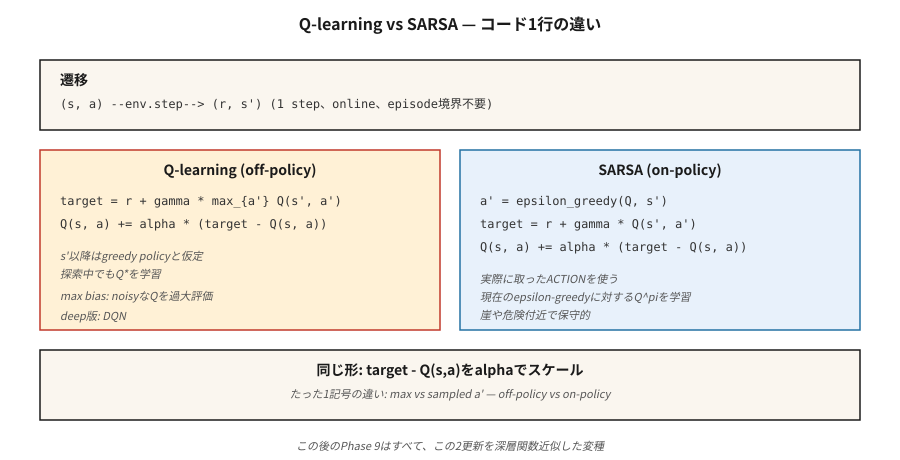

# 時序差分 —— Q-Learning 與 SARSA

> 蒙地卡羅要等到回合結束。TD 則是每走一步就用下一個價值估計來自助（bootstrapping），馬上更新。Q-learning 是異策略而且樂觀的；SARSA 是同策略而且謹慎的。兩者都只有一行程式碼。兩者都撐起了本階段每一個深度強化學習方法。

**類型：** 實作
**程式語言：** Python
**先修單元：** 階段 9 · 01（MDP）、階段 9 · 02（動態規劃）、階段 9 · 03（蒙地卡羅）
**時間：** 約 75 分鐘

## 問題所在

蒙地卡羅行得通，但它有兩個很貴的要求。它需要會終止的回合，而且要等最終回報進來才更新。如果你的回合有 1,000 步，蒙地卡羅就得等 1,000 步才更新任何東西。它高變異數、低偏差，而且實務上很慢。

動態規劃的側寫剛好相反——零變異數的自助式備份——但它要求模型已知。

時序差分（TD）學習在兩者之間取得折衷。從單一筆轉移 $(s, a, r, s')$，構造一個單步目標 $r + \gamma V(s')$，然後把 $V(s)$ 往它推一點。不需要模型。不需要完整回合。因為等號右邊用的是近似的 $V$，所以會有偏差，但變異數比蒙地卡羅低得多，而且從第一步就能線上更新。

這就是整個現代強化學習——DQN、A2C、PPO、SAC——轉動的軸心。階段 9 剩下的內容，都是疊在你這一單元將寫出的那條單步 TD 更新之上的函數近似與各種技巧。

## 核心概念



**V 的 TD(0) 更新：**

```math
V(s) \leftarrow V(s) + \alpha [r + \gamma V(s') - V(s)]
```

中括號裡的量就是 TD 誤差 $\delta = r + \gamma V(s') - V(s)$。它是蒙地卡羅裡 $G_t - V(s_t)$ 的線上版本。要收斂，$\alpha$ 必須滿足 Robbins-Monro 條件（$\sum \alpha = \infty$、$\sum \alpha^2 < \infty$），而且所有狀態都要被無限多次造訪。

**Q-learning。** 一種用於控制的異策略 TD 方法：

```math
Q(s, a) \leftarrow Q(s, a) + \alpha [r + \gamma \max_{a'} Q(s', a') - Q(s, a)]
```

那個 `max` 假設從 $s'$ 開始會遵循*貪婪*策略，不管代理程式實際上採取了什麼動作。這種解耦讓 Q-learning 能在代理程式用 ε-貪婪探索的同時去學 $Q^{\ast}$。Mnih et al.（2015）把它變成了 Atari 上的深度 Q-learning（單元 05）。

**SARSA。** 一種同策略的 TD 方法：

```math
Q(s, a) \leftarrow Q(s, a) + \alpha [r + \gamma Q(s', a') - Q(s, a)]
```

這個名字就是那個五元組 $(s, a, r, s', a')$。SARSA 用的是代理程式接下來*真正*採取的動作 $a'$，而不是貪婪的 `argmax`。它會收斂到當前執行的那個 ε-貪婪 $\pi$ 所對應的 $Q^\pi$，而在 $\epsilon \to 0$ 的極限下就變成 $Q^{\ast}$。

**懸崖行走上的差別。** 在經典的懸崖行走任務裡（掉下懸崖 = 獎勵 -100），Q-learning 學到的是沿著懸崖邊緣走的最優路徑，但在探索過程中偶爾會吃到那個懲罰。SARSA 學到的則是離懸崖一步之遙的比較安全路徑，因為它把探索雜訊算進了自己的 Q 值裡。訓練下去，兩者在 $\epsilon \to 0$ 時都會達到最優。實務上這個差別有意義：當部署時仍然真的在探索，SARSA 的行為會比較保守。

**Expected SARSA。** 把 $Q(s', a')$ 換成它在 $\pi$ 之下的期望值：

```math
Q(s, a) \leftarrow Q(s, a) + \alpha [r + \gamma \sum_{a'} \pi(a' \mid s') Q(s', a') - Q(s, a)]
```

變異數比 SARSA 低（不用取樣 $a'$），同策略的目標則一樣。在現代教科書裡常常是預設選項。

**n-step TD 與 TD(λ)。** 等 $n$ 步再自助，就能在 TD(0) 與蒙地卡羅之間做內插。$n=1$ 是 TD，$n=\infty$ 是蒙地卡羅。TD(λ) 則用幾何權重 $(1-\lambda)\lambda^{n-1}$ 對所有 $n$ 取平均。多數深度強化學習用的 $n$ 落在 3 到 20 之間。

```figure
qlearning-gridworld
```

## 動手實作

### 步驟 1：在 ε-貪婪策略上跑 SARSA

```python
def sarsa(env, episodes, alpha=0.1, gamma=0.99, epsilon=0.1):
    Q = defaultdict(lambda: {a: 0.0 for a in ACTIONS})

    def choose(s):
        if random() < epsilon:
            return choice(ACTIONS)
        return max(Q[s], key=Q[s].get)

    for _ in range(episodes):
        s = env.reset()
        a = choose(s)
        while True:
            s_next, r, done = env.step(s, a)
            a_next = choose(s_next) if not done else None
            target = r + (gamma * Q[s_next][a_next] if not done else 0.0)
            Q[s][a] += alpha * (target - Q[s][a])
            if done:
                break
            s, a = s_next, a_next
    return Q
```

八行。跟 Q-learning*唯一*的差別就是那行 target。

### 步驟 2：Q-learning

```python
def q_learning(env, episodes, alpha=0.1, gamma=0.99, epsilon=0.1):
    Q = defaultdict(lambda: {a: 0.0 for a in ACTIONS})
    for _ in range(episodes):
        s = env.reset()
        while True:
            a = choose(s, Q, epsilon)
            s_next, r, done = env.step(s, a)
            target = r + (gamma * max(Q[s_next].values()) if not done else 0.0)
            Q[s][a] += alpha * (target - Q[s][a])
            if done:
                break
            s = s_next
    return Q
```

那個 `max` 把目標跟行為解耦開來。就這一個符號，區分了同策略與異策略。

### 步驟 3：學習曲線

追蹤每 100 個回合的平均回報。在簡單的決定性 GridWorld 上，Q-learning 收斂比較快；在懸崖行走上，SARSA 比較保守。在 `code/main.py` 的 4×4 GridWorld 上，用 $\alpha=0.1, \epsilon=0.1$，兩者跑約 2,000 個回合之後都接近最優。

### 步驟 4：跟動態規劃的真值比對

跑價值迭代（單元 02）拿到 $Q^{\ast}$。檢查 $\max_{s,a} \lvert Q_{\text{learned}}(s,a) - Q^{\ast}(s,a) \rvert$。一個健康的表格式 TD 代理程式，在 4×4 GridWorld 上跑 10,000 個回合之後應該落在 `~0.5` 以內。

## 常見陷阱

- **Q 的初始值很重要。** 樂觀初始化（在獎勵為負的任務上取 $Q = 0$）會鼓勵探索。悲觀初始化則可能讓貪婪策略永遠困在原地。
- **α 的排程。** 對非穩態問題，固定的 $\alpha$ 就夠了。衰減式的 $\alpha_n = 1/n$ 理論上保證收斂，但實務上太慢——把 $\alpha$ 釘在 `[0.05, 0.3]`，然後盯著學習曲線。
- **ε 的排程。** 從高處開始（$\epsilon=1.0$），衰減到 $\epsilon=0.05$。「GLIE」（無限探索下的極限貪婪）就是那個收斂條件。
- **Q-learning 的最大化偏差。** 當 $Q$ 有雜訊時，`max` 算子會往上偏。這會導致高估——Hasselt 的 Double Q-learning（單元 05 的 DDQN 會用到）用兩張 Q 表修掉它。
- **不會終止的回合。** TD 就算沒有終止狀態也能學，但你得替步數設上限，或是在觸頂時正確處理自助。標準做法：把觸頂當成非終止，繼續自助下去。
- **狀態的雜湊。** 如果狀態是元組或張量，要用可雜湊的鍵（用 tuple，不要用 list；浮點數要四捨五入後再組成 tuple，不要直接用原值）。

## 框架應用

2026 年的 TD 版圖：

| 任務 | 方法 | 理由 |
|------|--------|--------|
| 小型表格式環境 | Q-learning | 直接學出最優策略。 |
| 同策略、安全性關鍵 | SARSA / Expected SARSA | 探索期間比較保守。 |
| 高維度狀態 | DQN（階段 9 · 05） | 帶重播與目標網路的神經網路 Q 函式。 |
| 連續動作 | SAC / TD3（階段 9 · 07） | 在 Q 網路上做 TD 更新；策略網路吐出動作。 |
| LLM 的強化學習（基於獎勵模型） | PPO / GRPO（階段 9 · 08、12） | actor-critic，用 GAE 算出 TD 風格的優勢。 |
| 離線強化學習 | CQL / IQL（階段 9 · 08） | 加了保守正則化的 Q-learning。 |

你在 2026 年論文裡讀到的「強化學習」，九成都是 Q-learning 或 SARSA 的某種延伸。在往更深處讀之前，先把表格式的更新練到手熟。

## 產出交付

存成 `outputs/skill-td-agent.md`：

```markdown
---
name: td-agent
description: Pick between Q-learning, SARSA, Expected SARSA for a tabular or small-feature RL task.
version: 1.0.0
phase: 9
lesson: 4
tags: [rl, td-learning, q-learning, sarsa]
---

Given a tabular or small-feature environment, output:

1. Algorithm. Q-learning / SARSA / Expected SARSA / n-step variant. One-sentence reason tied to on-policy vs off-policy and variance.
2. Hyperparameters. α, γ, ε, decay schedule.
3. Initialization. Q_0 value (optimistic vs zero) and justification.
4. Convergence diagnostic. Target learning curve, `|Q - Q*|` check if DP is possible.
5. Deployment caveat. How will exploration behave at inference? Is SARSA's conservatism needed?

Refuse to apply tabular TD to state spaces > 10⁶. Refuse to ship a Q-learning agent without a max-bias caveat. Flag any agent trained with ε held at 1.0 throughout (no exploitation phase).
```

## 練習

1. **簡單。** 在 4×4 GridWorld 上實作 Q-learning 與 SARSA。畫出 2,000 個回合的學習曲線（每 100 個回合的平均回報）。誰收斂得比較快？
2. **中等。** 打造一個懸崖行走環境（4×12，最後一列是懸崖，獎勵 -100 並重置回起點）。比較 Q-learning 與 SARSA 最終的策略。把兩者各自走的路徑截圖下來。哪一條比較貼近懸崖？
3. **困難。** 實作 Double Q-learning。在一個獎勵帶雜訊的 GridWorld 上（每步獎勵加上 $\sigma=5$ 的高斯雜訊），展示 Q-learning 會把 $V^{\ast}(0,0)$ 高估到一個有意義的幅度，而 Double Q-learning 不會。

## 關鍵術語

| 術語 | 大家怎麼說 | 實際上是什麼 |
|------|-----------------|-----------------------|
| TD 誤差 | 「更新訊號」 | $\delta = r + \gamma V(s') - V(s)$，自助之後的殘差。 |
| TD(0) | 「單步 TD」 | 每筆轉移之後就更新，只用下一個狀態的估計。 |
| Q-learning | 「異策略強化學習入門」 | 對下一狀態的動作取 `max` 的 TD 更新；不管行為策略是什麼都學到 $Q^{\ast}$。 |
| SARSA | 「同策略版的 Q-learning」 | 用實際採取的下一個動作做 TD 更新；學到當前 ε-貪婪 π 對應的 $Q^\pi$。 |
| Expected SARSA | 「低變異數版的 SARSA」 | 把取樣得到的 $a'$ 換成它在 π 之下的期望值。 |
| GLIE | 「正確的探索排程」 | 無限探索下的極限貪婪（Greedy in the Limit with Infinite Exploration）；Q-learning 收斂所需要的條件。 |
| 自助法 | 「在目標裡用上當前的估計」 | 這就是 TD 與蒙地卡羅的分界。偏差的來源，但能大幅降低變異數。 |
| 最大化偏差 | 「Q-learning 會高估」 | 對帶雜訊的估計取 `max` 會往上偏；用 Double Q-learning 修正。 |

## 延伸閱讀

- [Watkins & Dayan (1992). Q-learning](https://link.springer.com/article/10.1007/BF00992698) —— 原始論文與收斂性證明。
- [Sutton & Barto (2018). Ch. 6 — Temporal-Difference Learning](http://incompleteideas.net/book/RLbook2020.pdf) —— TD(0)、SARSA、Q-learning、Expected SARSA。
- [Hasselt (2010). Double Q-learning](https://papers.nips.cc/paper_files/paper/2010/hash/091d584fced301b442654dd8c23b3fc9-Abstract.html) —— 最大化偏差的修正方案。
- [Seijen, Hasselt, Whiteson, Wiering (2009). A Theoretical and Empirical Analysis of Expected SARSA](https://ieeexplore.ieee.org/document/4927542) —— Expected SARSA 的動機。
- [Rummery & Niranjan (1994). On-line Q-learning using connectionist systems](https://www.researchgate.net/publication/2500611_On-Line_Q-Learning_Using_Connectionist_Systems) —— 造出 SARSA 這個名字的論文（當時叫「modified connectionist Q-learning」）。
- [Sutton & Barto (2018). Ch. 7 — n-step Bootstrapping](http://incompleteideas.net/book/RLbook2020.pdf) —— 把 TD(0) 推廣成 TD(n)，這條路通往資格跡，以及後來 PPO 裡的 GAE。
