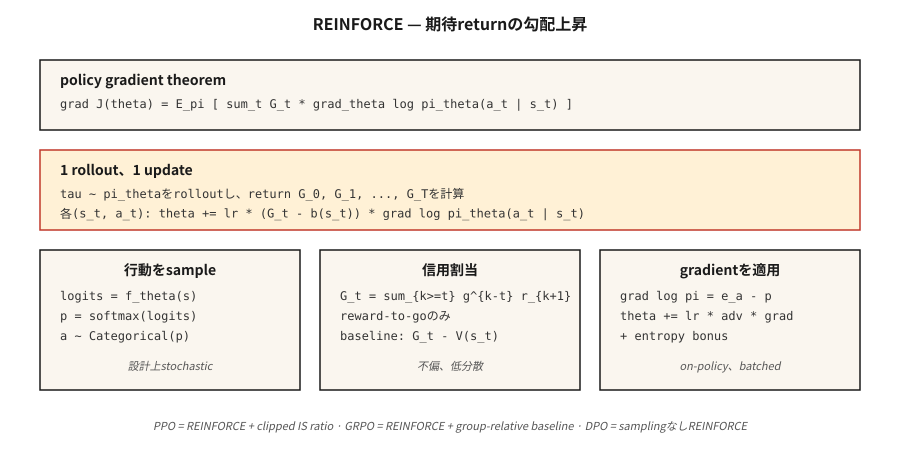

# 策略梯度 —— 從零打造 REINFORCE

> 別再估價值了。直接把策略參數化，算出期望回報的梯度，往上坡走一步。Williams（1992）用一條定理就寫完了。PPO、GRPO 以及每一個 LLM 強化學習迴圈之所以存在，都是因為它。

**類型：** 實作
**程式語言：** Python
**先修單元：** 階段 3 · 03（反向傳播）、階段 9 · 03（蒙地卡羅）、階段 9 · 04（TD 學習）
**時間：** 約 75 分鐘

## 問題所在

Q-learning 與 DQN 參數化的是*價值*函式。你靠 `argmax Q` 來挑動作。對離散動作、離散狀態來說這沒問題。但當動作是連續的（一個 10 維的力矩要怎麼 `argmax`？），或當你想要一個隨機策略時（`argmax` 就構造上而言是決定性的），它就垮了。

策略梯度改成參數化*策略*本身。$\pi_\theta(a \mid s)$ 是一個吐出動作分布的神經網路。從它取樣來行動。算出期望回報對 $\theta$ 的梯度。往上坡走一步。沒有 `argmax`。沒有貝爾曼遞迴。就只是在 $J(\theta) = \mathbb E_{\pi_\theta}[G]$ 上做梯度上升。

REINFORCE 定理（Williams 1992）告訴你這個梯度是算得出來的：$\nabla J(\theta) = \mathbb E_\pi[ G \cdot \nabla_\theta \log \pi_\theta(a \mid s) ]$。跑一個回合。算出回報。在每一步乘上 $\nabla \log \pi_\theta(a \mid s)$。取平均。梯度上升。完成。

2026 年的每一個 LLM 強化學習演算法——PPO、DPO、GRPO——都是 REINFORCE 的精修版。把它練到手熟，是本階段其餘內容、以及階段 10 · 07（RLHF 實作）與階段 10 · 08（DPO）的先決條件。

## 核心概念



**策略梯度定理。** 對任何以 $\theta$ 參數化的策略 $\pi_\theta$：

```math
\nabla J(\theta) = \mathbb{E}_{\tau \sim \pi_\theta}[ \sum_{t=0}^{T} G_t \cdot \nabla_\theta \log \pi_\theta(a_t \mid s_t) ]
```

其中 $G_t = \sum_{k=t}^{T} \gamma^{k-t} r_{k+1}$ 是從第 $t$ 步起算的折扣回報。期望值是對從 $\pi_\theta$ 取樣出來的完整軌跡 $\tau$ 取的。

**證明很短。** 把 $J(\theta) = \sum_\tau P(\tau; \theta) G(\tau)$ 在期望值底下微分。用上 $\nabla P(\tau; \theta) = P(\tau; \theta) \nabla \log P(\tau; \theta)$（對數導數技巧）。再把 $\log P(\tau; \theta) = \sum \log \pi_\theta(a_t \mid s_t) + \text{不依賴 } \theta \text{ 的環境項}$ 拆開。環境項會消掉。兩行代數就把定理推出來了。

**變異數縮減技巧。** 原味 REINFORCE 的變異數大得要命——回報有雜訊，$\nabla \log \pi$ 有雜訊，兩者相乘雜訊更大。兩個標準解法：

1. **減去基線。** 把 $G_t$ 換成 $G_t - b(s_t)$，其中 $b(s_t)$ 可以是任何不依賴 $a_t$ 的基線。這是無偏的，因為 $\mathbb{E}[b(s_t) \cdot \nabla \log \pi(a_t \mid s_t)] = 0$。典型選擇：由評論家學出來的 $b(s_t) = \hat{V}(s_t)$ → 演員—評論家（單元 07）。
2. **未來回報（reward-to-go）。** 把 $\sum_t G_t \cdot \nabla \log \pi_\theta(a_t \mid s_t)$ 換成 $\sum_t G_t^{\text{from } t} \cdot \nabla \log \pi_\theta(a_t \mid s_t)$。對某個動作而言只有未來的回報有意義——過去的獎勵只貢獻零均值的雜訊。

兩者合起來，你會得到：

```math
\nabla J \approx (1/N) \sum_{i=1}^{N} \sum_{t=0}^{T_i} [ G_t^{(i)} - \hat{V}(s_t^{(i)}) ] \cdot \nabla_\theta \log \pi_\theta(a_t^{(i)} \mid s_t^{(i)})
```

這就是帶基線的 REINFORCE——A2C（單元 07）與 PPO（單元 08）的直系祖先。

**Softmax 策略參數化。** 對離散動作，標準選擇是：

```math
\pi_\theta(a \mid s) = \exp(f_\theta(s, a)) / \sum_{a'} \exp(f_\theta(s, a'))
```

其中 $f_\theta$ 可以是任何替每個動作吐出一個分數的神經網路。梯度有很乾淨的形式：

```math
\nabla_\theta \log \pi_\theta(a \mid s) = \nabla_\theta f_\theta(s, a) - \sum_{a'} \pi_\theta(a' \mid s) \nabla_\theta f_\theta(s, a')
```

也就是：所採取動作的分數，減去它在策略之下的期望值。

**連續動作用高斯策略。** $\pi_\theta(a \mid s) = N(\mu_\theta(s), \sigma_\theta(s))$。$\nabla \log N(a; \mu, \sigma)$ 有閉式解。階段 9 · 07 的 SAC 需要的就只有這些。

```figure
policy-gradient-landscape
```

## 動手實作

### 步驟 1：softmax 策略網路

```python
def policy_logits(theta, state_features):
    return [dot(theta[a], state_features) for a in range(N_ACTIONS)]

def softmax(logits):
    m = max(logits)
    exps = [exp(l - m) for l in logits]
    Z = sum(exps)
    return [e / Z for e in exps]
```

表格式環境用線性策略（每個動作一個權重向量）就好。要跑 Atari，就換成 CNN，softmax 頭保留。

### 步驟 2：取樣與對數機率

```python
def sample_action(probs, rng):
    x = rng.random()
    cum = 0
    for a, p in enumerate(probs):
        cum += p
        if x <= cum:
            return a
    return len(probs) - 1

def log_prob(probs, a):
    return log(probs[a] + 1e-12)
```

### 步驟 3：把對數機率一併記下的 rollout

```python
def rollout(theta, env, rng, gamma):
    trajectory = []
    s = env.reset()
    while not done:
        logits = policy_logits(theta, s)
        probs = softmax(logits)
        a = sample_action(probs, rng)
        s_next, r, done = env.step(s, a)
        trajectory.append((s, a, r, probs))
        s = s_next
    return trajectory
```

### 步驟 4：REINFORCE 更新

```python
def reinforce_step(theta, trajectory, gamma, lr, baseline=0.0):
    returns = compute_returns(trajectory, gamma)
    for (s, a, _, probs), G in zip(trajectory, returns):
        advantage = G - baseline
        grad_log_pi_a = [-p for p in probs]
        grad_log_pi_a[a] += 1.0
        for i in range(N_ACTIONS):
            for j in range(len(s)):
                theta[i][j] += lr * advantage * grad_log_pi_a[i] * s[j]
```

梯度 $\nabla \log \pi(a \mid s) = e_a - \pi(\cdot \mid s)$（$a$ 的 one-hot 減去機率向量）是 softmax 策略梯度的核心。把它刻進肌肉記憶裡。

### 步驟 5：基線

拿最近幾個回合 $G$ 的移動平均當基線，變異數就縮得夠小，足以讓 4×4 GridWorld 跑起來；大約 500 個回合會收斂。把基線升級成學出來的 $\hat{V}(s)$，你就得到了演員—評論家。

## 常見陷阱

- **梯度爆炸。** 回報可能非常大。在乘上 $\nabla \log \pi$ 之前，一定要把整批的 $G$ 正規化到 `~N(0, 1)`。
- **熵塌陷。** 策略太早收斂到某個幾乎決定性的動作，停止探索，然後卡死。解法：在目標函式裡加上熵獎勵 $\beta \cdot H(\pi(\cdot \mid s))$。
- **高變異數。** 原味 REINFORCE 需要好幾千個回合。標準解法是評論家基線（單元 07），或 TRPO/PPO 的信賴區域（單元 08）。
- **樣本效率差。** 同策略意味著每筆轉移用過一次更新就得丟掉。透過重要性取樣做異策略修正可以把資料撿回來，代價是變異數（PPO 的比率就是一個裁剪過的重要性取樣權重）。
- **非穩態的梯度。** 100 個回合之前算出來的同一個梯度，用的是舊的 $\pi$。同策略方法之所以每跑幾次 rollout 就更新，原因就在這裡。
- **信用分配。** 沒有未來回報的話，過去的獎勵只會貢獻雜訊。永遠用未來回報。

## 框架應用

到了 2026 年，REINFORCE 很少被直接拿來跑，但它的梯度公式無所不在：

| 使用情境 | 衍生方法 |
|----------|---------------|
| 連續控制 | 配高斯策略的 PPO / SAC |
| LLM 的 RLHF | 帶 KL 懲罰的 PPO，跑在詞元層級的策略上 |
| LLM 推論能力（DeepSeek） | GRPO —— 用群組相對基線的 REINFORCE，不需要評論家 |
| 多代理程式 | 中央化評論家的 REINFORCE（MADDPG、COMA） |
| 離散動作機器人 | A2C、A3C、PPO |
| 只有偏好資料的情境 | DPO —— 把 REINFORCE 改寫成偏好似然損失，不需要取樣 |

當你在 2026 年的訓練腳本裡讀到 `loss = -advantage * log_prob`，那就是帶基線的 REINFORCE。一整篇一整篇的論文（DPO、GRPO、RLOO）都只是疊在這一行上的變異數縮減技巧。

## 產出交付

存成 `outputs/skill-policy-gradient-trainer.md`：

```markdown
---
name: policy-gradient-trainer
description: Produce a REINFORCE / actor-critic / PPO training config for a given task and diagnose variance issues.
version: 1.0.0
phase: 9
lesson: 6
tags: [rl, policy-gradient, reinforce]
---

Given an environment (discrete / continuous actions, horizon, reward stats), output:

1. Policy head. Softmax (discrete) or Gaussian (continuous) with parameter counts.
2. Baseline. None (vanilla), running mean, learned `V̂(s)`, or A2C critic.
3. Variance controls. Reward-to-go on by default, return normalization, gradient clip value.
4. Entropy bonus. Coefficient β and decay schedule.
5. Batch size. Episodes per update; on-policy data freshness contract.

Refuse REINFORCE-no-baseline on horizons > 500 steps. Refuse continuous-action control with a softmax head. Flag any run with `β = 0` and observed policy entropy < 0.1 as entropy-collapsed.
```

## 練習

1. **簡單。** 在 4×4 GridWorld 上用線性 softmax 策略實作 REINFORCE。不帶基線訓練 1,000 個回合。畫出學習曲線；量一下變異數（回報的標準差）。
2. **中等。** 加上移動平均基線。再訓練一次。比較樣本效率與變異數跟原味版本的差別。基線把收斂所需的步數減少了多少？
3. **困難。** 加上熵獎勵 $\beta \cdot H(\pi)$。掃 $\beta \in \lbrace 0, 0.01, 0.1, 1.0 \rbrace$。畫出最終回報與策略的熵。在這個任務上甜蜜點落在哪裡？

## 關鍵術語

| 術語 | 大家怎麼說 | 實際上是什麼 |
|------|-----------------|-----------------------|
| 策略梯度 | 「直接訓練策略」 | $\nabla J(\theta) = \mathbb{E}[G \cdot \nabla \log \pi_\theta(a \mid s)]$；由對數導數技巧推導而來。 |
| REINFORCE | 「最早的策略梯度演算法」 | Williams（1992）；蒙地卡羅回報乘上對數策略的梯度。 |
| 對數導數技巧 | 「分數函式估計量」 | $\nabla P(\tau;\theta) = P(\tau;\theta) \cdot \nabla \log P(\tau;\theta)$；讓期望值的梯度變得可算。 |
| 基線 | 「變異數縮減」 | 任何從 $G$ 裡減掉的 $b(s)$；因為 $\mathbb{E}[b \cdot \nabla \log \pi] = 0$ 所以無偏。 |
| 未來回報 | 「只有未來的回報算數」 | 用 $G_t^{\text{from } t}$ 取代完整的 $G_0$；既正確，變異數又更低。 |
| 熵獎勵 | 「鼓勵探索」 | $+\beta \cdot H(\pi(\cdot \mid s))$ 這一項讓策略不會塌陷。 |
| 同策略 | 「拿剛看到的資料來訓練」 | 梯度的期望值是對當前策略取的——舊資料不能直接重複使用。 |
| 優勢 | 「比平均好多少」 | $A(s, a) = G(s, a) - V(s)$；帶基線的 REINFORCE 拿來相乘的那個帶正負號的量。 |

## 延伸閱讀

- [Williams (1992). Simple Statistical Gradient-Following Algorithms for Connectionist Reinforcement Learning](https://link.springer.com/article/10.1007/BF00992696) —— REINFORCE 的原始論文。
- [Sutton et al. (2000). Policy Gradient Methods for Reinforcement Learning with Function Approximation](https://papers.nips.cc/paper_files/paper/1999/hash/464d828b85b0bed98e80ade0a5c43b0f-Abstract.html) —— 帶函數近似的現代版策略梯度定理。
- [Sutton & Barto (2018). Ch. 13 — Policy Gradient Methods](http://incompleteideas.net/book/RLbook2020.pdf) —— 教科書式的介紹。
- [OpenAI Spinning Up — VPG / REINFORCE](https://spinningup.openai.com/en/latest/algorithms/vpg.html) —— 清楚的教學式說明，附 PyTorch 程式碼。
- [Peters & Schaal (2008). Reinforcement Learning of Motor Skills with Policy Gradients](https://homes.cs.washington.edu/~todorov/courses/amath579/reading/PolicyGradient.pdf) —— 變異數縮減，以及把 REINFORCE 連到信賴區域家族（TRPO、PPO）的自然梯度觀點。
