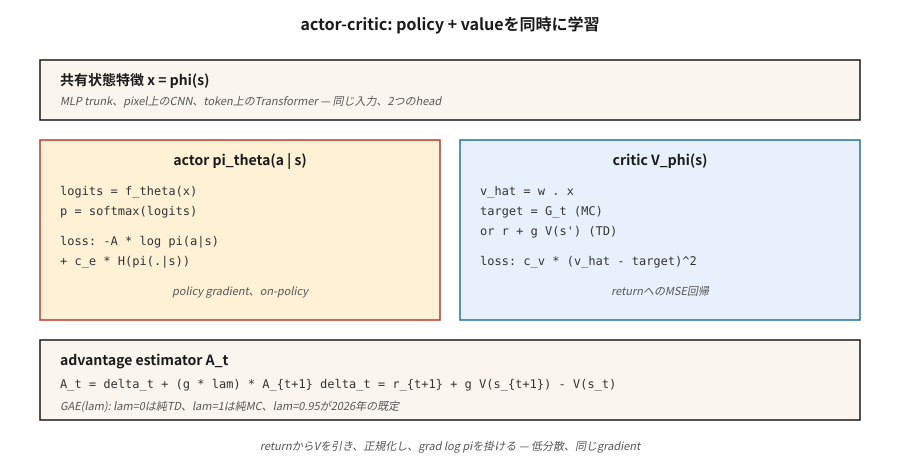

# 演員—評論家 —— A2C 與 A3C

> REINFORCE 太吵了。加上一個學 $\hat{V}(s)$ 的評論家，把它從回報裡減掉，你就得到一個期望值相同、但變異數低得多的優勢。這就是演員—評論家。A2C 同步地跑它；A3C 跨執行緒跑它。兩者都是每一種現代深度強化學習方法的心智模型。

**類型：** 實作
**程式語言：** Python
**先修單元：** 階段 9 · 04（TD 學習）、階段 9 · 06（REINFORCE）
**時間：** 約 75 分鐘

## 問題所在

原味 REINFORCE 行得通，但它的變異數糟糕透頂。蒙地卡羅回報 $G_t$ 在回合之間可以擺盪十倍。把那個雜訊乘上 $\nabla \log \pi$ 再取平均，得到的梯度估計量得跑上幾千個回合，才能把策略推到用少得多的 DQN 更新就能到達的位置。

變異數來自直接使用原始回報。如果你減掉一個基線 $b(s_t)$——任何狀態的函式都行，包含一個學出來的價值——期望值不變，變異數會下降。實務上最好的基線就是 $\hat{V}(s_t)$。這時乘在 $\nabla \log \pi$ 上的量就變成了*優勢*：

```math
A(s, a) = G - \hat{V}(s)
```

一個動作若帶來高於平均的回報就是好的；低於平均就是壞的。帶學習型評論家的 REINFORCE 就是*演員—評論家*。評論家給了演員一位低變異數的老師。2015 年之後的每一種深度策略方法（A2C、A3C、PPO、SAC、IMPALA）都是這個。

## 核心概念



**兩個網路，一個共同的損失：**

- **演員** $\pi_\theta(a \mid s)$：策略本身。取樣用來行動。用策略梯度訓練。
- **評論家** $V_\phi(s)$：估計從某狀態出發的期望回報。訓練目標是最小化 $(V_\phi(s) - \text{target})^2$。

**優勢。** 兩種標準形式：

- *MC 優勢：* $A_t = G_t - V_\phi(s_t)$。無偏，變異數較高。
- *TD 優勢：* $A_t = r_{t+1} + \gamma V_\phi(s_{t+1}) - V_\phi(s_t)$。有偏（用了 $V_\phi$），但變異數低得多。也叫 *TD 殘差* $\delta_t$。

**n 步優勢。** 在兩者之間做內插：

```math
A_t^{(n)} = r_{t+1} + \gamma r_{t+2} + \ldots + \gamma^{n-1} r_{t+n} + \gamma^n V_\phi(s_{t+n}) - V_\phi(s_t)
```

$n = 1$ 是純 TD。$n = \infty$ 是 MC。多數實作在 Atari 上用 $n = 5$，PPO 跑 MuJoCo 時用 $n = 2048$。

**廣義優勢估計（GAE）。** Schulman et al.（2016）提出對所有 n 步優勢取指數加權平均：

```math
A_t^{\text{GAE}} = \sum_{l=0}^{\infty} (\gamma \lambda)^l \delta_{t+l}
```

其中 $\lambda \in [0, 1]$。$\lambda = 0$ 是 TD（低變異數、高偏差）。$\lambda = 1$ 是 MC（高變異數、無偏）。$\lambda = 0.95$ 是 2026 年的預設值——一路調到偏差／變異數的旋鈕落在你要的位置為止。

**A2C：同步的優勢演員—評論家。** 在 $N$ 個並行環境上各收集 $T$ 步。替每一步算出優勢。在合併起來的批次上更新演員與評論家。重複。它是 A3C 比較簡單、也比較好擴展的兄弟。

**A3C：非同步的優勢演員—評論家。** Mnih et al.（2016）。開 $N$ 個工作執行緒，每個跑一個環境。每個工作者在自己的 rollout 上本地算出梯度，然後非同步地套用到一台共享的參數伺服器上。不需要回放緩衝區——工作者靠跑不同的軌跡來達成去相關。A3C 證明了你可以在 CPU 上做大規模訓練。到了 2026 年，以 GPU 為主的 A2C（批次化的並行環境）佔了上風，因為 GPU 想要大批次。

**合併後的損失。**

```math
L(\theta, \phi) = -\mathbb{E}[ A_t \cdot \log \pi_\theta(a_t \mid s_t) ] + c_v \cdot \mathbb{E}[(V_\phi(s_t) - G_t)^2] - c_e \cdot \mathbb{E}[H(\pi_\theta(\cdot \mid s_t))]
```

三項：策略梯度損失、價值回歸、熵獎勵。`c_v ~ 0.5`、`c_e ~ 0.01` 是慣用的起手值。

```figure
actor-critic
```

## 動手實作

### 步驟 1：一個評論家

用 MSE 更新的線性評論家 $V_\phi(s) = w \cdot \text{features}(s)$：

```python
def critic_update(w, x, target, lr):
    v_hat = dot(w, x)
    err = target - v_hat
    for j in range(len(w)):
        w[j] += lr * err * x[j]
    return v_hat
```

在表格式環境上，評論家幾百個回合就會收斂。在 Atari 上，把線性評論家換成共享的 CNN 主幹加一個價值頭。

### 步驟 2：n 步優勢

給定一段長度為 $T$ 的 rollout，以及自助得到的最終 $V(s_T)$：

```python
def compute_advantages(rewards, values, gamma=0.99, lam=0.95, last_value=0.0):
    advantages = [0.0] * len(rewards)
    gae = 0.0
    for t in reversed(range(len(rewards))):
        next_v = values[t + 1] if t + 1 < len(values) else last_value
        delta = rewards[t] + gamma * next_v - values[t]
        gae = delta + gamma * lam * gae
        advantages[t] = gae
    returns = [a + v for a, v in zip(advantages, values)]
    return advantages, returns
```

`returns` 是評論家的目標。`advantages` 則是乘在 $\nabla \log \pi$ 上的東西。

### 步驟 3：合併更新

```python
for step_i, (x, a, _r, probs) in enumerate(traj):
    adv = advantages[step_i]
    target_v = returns[step_i]

    # critic
    critic_update(w, x, target_v, lr_v)

    # actor
    for i in range(N_ACTIONS):
        grad_logpi = (1.0 if i == a else 0.0) - probs[i]
        for j in range(N_FEAT):
            theta[i][j] += lr_a * adv * grad_logpi * x[j]
```

同策略，每次 rollout 更新一次，演員與評論家各用各的學習率。

### 步驟 4：平行化（A3C 對 A2C）

- **A3C：** 開 $N$ 個執行緒。每個跑自己的環境、自己的前向傳遞。週期性地把梯度更新推給一個共享的主節點。主節點不上鎖——競態沒關係，它們只是多添了點雜訊。
- **A2C：** 在單一行程裡跑 $N$ 個環境實例，把觀測疊成一個 `[N, obs_dim]` 的批次，做批次前向、批次反向。GPU 使用率更高、具決定性、也比較好推敲。這是 2026 年的預設做法。

我們的玩具程式碼為求清楚是單執行緒的；改寫成批次化的 A2C 只要三行 numpy。

## 常見陷阱

- **演員梯度之前的評論家偏差。** 如果評論家還是亂數的，它的基線毫無資訊量，你等於在純雜訊上訓練。先把評論家暖機幾百步再打開策略梯度，或者把演員的學習率調慢。
- **優勢正規化。** 把每個批次的優勢正規化到零均值／單位標準差。成本幾乎為零，但對訓練穩定性幫助巨大。
- **共享主幹。** 影像輸入時，讓演員與評論家共用一個特徵抽取器，各自接一個頭。共享的特徵可以搭上兩個損失的便車。
- **同策略的約定。** A2C 每筆資料剛好只用一次更新。用更多次，你的梯度就有偏了（PPO 加上去的，正是重要性取樣的修正）。
- **熵塌陷。** 沒有 $c_e > 0$ 的話，策略幾百次更新內就會變得幾乎決定性，然後停止探索。
- **獎勵尺度。** 優勢的大小取決於獎勵尺度。把獎勵正規化（例如除以移動標準差），讓不同任務之間的梯度大小保持一致。

## 框架應用

到了 2026 年，A2C/A3C 很少是最終選擇，但它們就是後續一切所精修的那個架構：

| 方法 | 與 A2C 的關係 |
|--------|----------------|
| PPO | A2C + 裁剪過的重要性比率，可做多回合數更新 |
| IMPALA | A3C + V-trace 異策略修正 |
| SAC（階段 9 · 07） | 帶軟價值評論家的異策略 A2C（下一單元） |
| GRPO（階段 9 · 12） | 拿掉評論家的 A2C —— 群組相對優勢 |
| DPO | 塌縮成偏好排序損失的 A2C，不需要取樣 |
| AlphaStar / OpenAI Five | A2C 加上聯賽訓練與模仿式預訓練 |

在 2026 年的論文裡看到「優勢」兩個字，就想到演員—評論家。

## 產出交付

存成 `outputs/skill-actor-critic-trainer.md`：

```markdown
---
name: actor-critic-trainer
description: Produce an A2C / A3C / GAE configuration for a given environment, with advantage estimation and loss weights specified.
version: 1.0.0
phase: 9
lesson: 7
tags: [rl, actor-critic, gae]
---

Given an environment and compute budget, output:

1. Parallelism. A2C (GPU batched) vs A3C (CPU async) and the number of workers.
2. Rollout length T. Steps per env per update.
3. Advantage estimator. n-step or GAE(λ); specify λ.
4. Loss weights. `c_v` (value), `c_e` (entropy), gradient clip.
5. Learning rates. Actor and critic (separate if using).

Refuse single-worker A2C on environments with horizon > 1000 (too on-policy, too slow). Refuse to ship without advantage normalization. Flag any run with `c_e = 0` and observed entropy < 0.1 as entropy-collapsed.
```

## 練習

1. **簡單。** 在 4×4 GridWorld 上用 MC 優勢 $(G_t - V(s_t))$訓練演員—評論家。跟單元 06 帶移動平均基線的 REINFORCE 比較樣本效率。
2. **中等。** 換成 TD 殘差優勢 $(r + \gamma V(s') - V(s))$。量一下各批次優勢的變異數。降了多少？
3. **困難。** 實作 GAE(λ)。掃 $\lambda \in \lbrace 0, 0.5, 0.9, 0.95, 1.0 \rbrace$。畫出最終回報對樣本效率的關係。在這個任務上偏差／變異數的甜蜜點在哪裡？

## 關鍵術語

| 術語 | 大家怎麼說 | 實際上是什麼 |
|------|-----------------|-----------------------|
| 演員 | 「策略網路」 | $\pi_\theta(a \mid s)$，由策略梯度更新。 |
| 評論家 | 「價值網路」 | $V_\phi(s)$，用 MSE 回歸到回報／TD 目標來更新。 |
| 優勢 | 「比平均好多少」 | $A(s, a) = Q(s, a) - V(s)$ 或它的各種估計量。乘在 $\nabla \log \pi$ 上的係數。 |
| TD 殘差 | 「δ」 | $\delta_t = r + \gamma V(s') - V(s)$；單步的優勢估計。 |
| GAE | 「那個內插旋鈕」 | 對 n 步優勢做指數加權求和，以 $\lambda$ 參數化。 |
| A2C | 「同步的演員—評論家」 | 跨環境批次化；每次 rollout 走一個梯度步。 |
| A3C | 「非同步的演員—評論家」 | 工作執行緒把梯度推給共享的參數伺服器。原始論文的做法；2026 年比較少見了。 |
| 自助 | 「在期程末端用上 V」 | 把 rollout 截斷，補上 $\gamma^n V(s_{t+n})$ 來把總和收尾。 |

## 延伸閱讀

- [Mnih et al. (2016). Asynchronous Methods for Deep Reinforcement Learning](https://arxiv.org/abs/1602.01783) —— A3C，非同步演員—評論家的原始論文。
- [Schulman et al. (2016). High-Dimensional Continuous Control Using Generalized Advantage Estimation](https://arxiv.org/abs/1506.02438) —— GAE。
- [Sutton & Barto (2018). Ch. 13 — Actor-Critic Methods](http://incompleteideas.net/book/RLbook2020.pdf) —— 基礎；當評論家是神經網路時，搭配第 9 章的函數近似一起讀。
- [Espeholt et al. (2018). IMPALA](https://arxiv.org/abs/1802.01561) —— 可擴展的分散式演員—評論家，帶 V-trace 異策略修正。
- [OpenAI Baselines / Stable-Baselines3](https://stable-baselines3.readthedocs.io/) —— 值得一讀的生產級 A2C/PPO 實作。
- [Konda & Tsitsiklis (2000). Actor-Critic Algorithms](https://papers.nips.cc/paper/1786-actor-critic-algorithms) —— 雙時間尺度演員—評論家分解的奠基性收斂結果。
