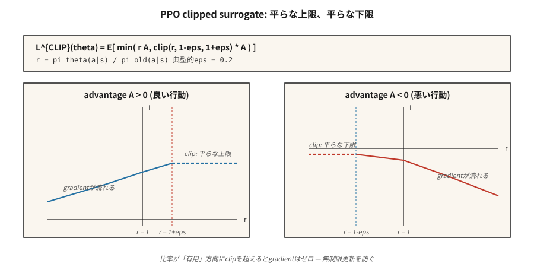

# 近端策略最佳化（PPO）

> A2C 每個 rollout 更新一次就丟掉。PPO 把策略梯度包在一個裁剪過的重要性比率裡，讓你能在同一批資料上跑 10 個以上的回合數，而策略不會炸開。Schulman et al.（2017）。到 2026 年仍然是預設的策略梯度演算法。

**類型：** 實作
**程式語言：** Python
**先修單元：** 階段 9 · 06（REINFORCE）、階段 9 · 07（演員—評論家）
**時間：** 約 75 分鐘

## 問題所在

A2C（單元 07）是同策略的：梯度 $\mathbb E_{\pi_\theta}[A \cdot \nabla \log \pi_\theta]$ 要求資料是從*當前*的 $\pi_\theta$ 取樣來的。走一次更新，$\pi_\theta$ 就變了；你剛用過的資料現在已經變成異策略了。再拿它來用，梯度就有偏。

Rollout 很貴。在 Atari 上，跨 8 個環境各跑 128 步的一次 rollout = 1024 筆轉移，加上十幾秒的環境時間。只走一個梯度步就把它丟掉，太浪費了。

信賴區域策略最佳化（TRPO，Schulman 2015）是第一個解法：限制每次更新，讓新舊策略之間的 KL 散度保持在 $\delta$ 以下。理論上很乾淨，但每次更新都要解一次共軛梯度。2026 年沒人在跑 TRPO 了。

PPO（Schulman et al. 2017）把硬性的信賴區域約束換成一個簡單的裁剪目標。多一行程式碼。每個 rollout 跑十個回合數。不用共軛梯度。理論保證「夠好」。九年過去，從 MuJoCo 到 RLHF，它仍然是預設的策略梯度演算法。

## 核心概念



**重要性比率。**

```math
r_t(\theta) = \frac{\pi_\theta(a_t \mid s_t)}{\pi_{\theta_{\text{old}}}(a_t \mid s_t)}
```

這是新策略相對於收集資料那個策略的似然比。$r_t = 1$ 表示沒有改變。$r_t = 2$ 表示新策略採取 $a_t$ 的機率是舊策略的兩倍。

**裁剪代理目標。**

```math
L^{\text{CLIP}}(\theta) = \mathbb{E}_t \left[ \min\left( r_t(\theta) A_t, \mathop{\mathrm{clip}}(r_t(\theta), 1-\epsilon, 1+\epsilon) A_t \right) \right]
```

兩項：

- 如果優勢 $A_t > 0$ 而比率想長過 $1 + \epsilon$，裁剪會把梯度壓平——別把一個好動作推到比舊機率高出 $+\epsilon$ 以上。
- 如果優勢 $A_t < 0$ 而比率想降到 $1 - \epsilon$ 以下（意思是我們會讓一個壞動作的機率比舊策略低得多），裁剪會把梯度壓平：別把一個壞動作推到比舊機率低出 $-\epsilon$ 以上。

那個 `min` 負責另一個方向：如果比率是往*有利*的方向移動的，你仍然拿得到梯度（會傷到你的那一側才裁）。

典型取 $\epsilon = 0.2$。把目標畫成 $r_t$ 的函數看看：一個分段線性函數，在「好的那側」有個平屋頂，在「壞的那側」有個平地板。

**完整的 PPO 損失。**

```math
L(\theta, \phi) = L^{\text{CLIP}}(\theta) - c_v \cdot (V_\phi(s_t) - V_t^{\text{target}})^2 + c_e \cdot H(\pi_\theta(\cdot \mid s_t))
```

跟 A2C 一樣的演員—評論家結構。三個係數，通常是 $c_v = 0.5$、$c_e = 0.01$、$\epsilon = 0.2$。

**訓練迴圈。**

1. 在 $N$ 個並行環境上各跑 $T$ 步，收集 $N \times T$ 筆轉移。
2. 算出優勢（GAE），並把它們凍結成常數。
3. 把 $\pi_{\theta_{\text{old}}}$ 凍結成當前 $\pi_\theta$ 的一份快照。
4. 跑 $K$ 個回合數，對每個由 `(s, a, A, V_target, log π_old(a|s))` 組成的小批次：
   - 計算 $r_t(\theta) = \exp(\log \pi_\theta(a \mid s) - \log \pi_{\text{old}}(a \mid s))$。
   - 套用 $L^{\text{CLIP}}$ + 價值損失 + 熵。
   - 走一個梯度步。
5. 丟掉這個 rollout。回到步驟 1。

$K = 10$ 搭配大小為 64 的小批次是標準的一組超參數。PPO 很耐操：這些數字在 ±50% 的範圍內通常無關緊要。

**KL 懲罰變體。** 原始論文另外提了一個用自適應 KL 懲罰的做法：$L = L^{\text{PG}} - \beta \cdot \mathrm{KL}(\pi_\theta \Vert \pi_{\text{old}})$，$\beta$ 依觀測到的 KL 動態調整。裁剪版本後來成了主流；KL 變體則在 RLHF 裡活了下來（在那裡，對參考策略的 KL 本來就是你一直想要的一個獨立約束）。

```figure
ppo-clip
```

## 動手實作

### 步驟 1：在 rollout 時把 `log π_old(a | s)` 記下來

```python
for step in range(T):
    probs = softmax(logits(theta, state_features(s)))
    a = sample(probs, rng)
    s_next, r, done = env.step(s, a)
    buffer.append({
        "s": s, "a": a, "r": r, "done": done,
        "v_old": value(w, state_features(s)),
        "log_pi_old": log(probs[a] + 1e-12),
    })
    s = s_next
```

這份快照只在 rollout 當下拍一次。在後續的更新回合數裡它不會改變。

### 步驟 2：算出 GAE 優勢（單元 07）

跟 A2C 一樣。整批一起正規化。

### 步驟 3：裁剪代理目標的更新

```python
for _ in range(K_EPOCHS):
    for mb in minibatches(buffer, size=64):
        for rec in mb:
            x = state_features(rec["s"])
            probs = softmax(logits(theta, x))
            logp = log(probs[rec["a"]] + 1e-12)
            ratio = exp(logp - rec["log_pi_old"])
            adv = rec["advantage"]
            surrogate = min(
                ratio * adv,
                clamp(ratio, 1 - EPS, 1 + EPS) * adv,
            )
            # backprop -surrogate, add value loss, subtract entropy
            grad_logpi = onehot(rec["a"]) - probs
            if (adv > 0 and ratio >= 1 + EPS) or (adv < 0 and ratio <= 1 - EPS):
                pg_grad = 0.0  # clipped
            else:
                pg_grad = ratio * adv
            for i in range(N_ACTIONS):
                for j in range(N_FEAT):
                    theta[i][j] += LR * pg_grad * grad_logpi[i] * x[j]
```

「被裁剪 → 梯度歸零」這個模式就是 PPO 的核心。如果新策略已經往有利方向漂太遠了，更新就停下來。

### 步驟 4：價值與熵

跟 A2C 一樣，對評論家目標加上標準的 MSE，對演員加上熵獎勵。

### 步驟 5：診斷指標

每次更新都要盯三件事：

- **平均 KL** $\mathbb{E}[\log \pi_{\text{old}} - \log \pi_\theta]$。應該待在 `[0, 0.02]`。如果衝過 `0.1`，就調降 `K_EPOCHS` 或 `LR`。
- **裁剪比例**——比率落在 $[1-\epsilon, 1+\epsilon]$ 之外的樣本佔比。應該在 `~0.1-0.3`。如果接近 `0`，代表裁剪從來沒觸發 → 調高 `LR` 或 `K_EPOCHS`。如果到 `~0.5+`，代表你在對這個 rollout 過度擬合 → 把它們調低。
- **解釋變異量** $1 - \text{Var}(V_{\text{target}} - V_{\text{pred}}) / \text{Var}(V_{\text{target}})$。評論家的品質指標。隨著評論家學起來，它應該往 1 爬。

## 常見陷阱

- **裁剪係數沒調好。** $\epsilon = 0.2$ 是事實上的標準。降到 `0.1` 會讓更新太保守；`0.3` 以上則招來不穩定。
- **回合數太多。** $K > 20$ 常常會不穩，因為策略會漂離 $\pi_{\text{old}}$ 太遠。把回合數設上限，網路越大越要。
- **沒有做獎勵正規化。** 太大的獎勵尺度會侵蝕掉裁剪範圍。在算優勢之前先把獎勵正規化（用移動標準差）。
- **忘了做優勢正規化。** 每批次做零均值／單位標準差正規化是標配。省掉它會讓 PPO 在多數基準上崩掉。
- **學習率沒有衰減。** PPO 會受惠於線性衰減到零的學習率。固定學習率往往比較差。
- **重要性比率的算式寫錯。** 為了數值穩定，永遠用 `exp(log_new - log_old)`，不要用 `new / old`。
- **梯度符號寫反。** 最大化代理目標 = *最小化* $-L^{\text{CLIP}}$。符號寫反是最常見的 PPO bug。

## 框架應用

在多到令人意外的領域裡，PPO 都是 2026 年的預設強化學習演算法：

| 使用情境 | PPO 變體 |
|----------|-------------|
| MuJoCo／機器人控制 | 配高斯策略的 PPO，GAE(0.95) |
| Atari／離散遊戲 | 配類別分布策略的 PPO，滾動式 128 步 rollout |
| LLM 的 RLHF | 帶對參考模型 KL 懲罰的 PPO，獎勵由 RM 在回應結尾給出 |
| 大規模遊戲代理程式 | IMPALA + PPO（AlphaStar、OpenAI Five） |
| 推論型 LLM | GRPO（單元 12）—— 不帶評論家的 PPO 變體 |
| 只有偏好資料 | DPO —— 把 PPO+KL 收成閉式解，不需要線上取樣 |

PPO 的*損失形狀*——裁剪代理目標 + 價值 + 熵——是 DPO、GRPO 以及幾乎每一條 RLHF 流水線的骨架。

## 產出交付

存成 `outputs/skill-ppo-trainer.md`：

```markdown
---
name: ppo-trainer
description: Produce a PPO training config and a diagnostic plan for a given environment.
version: 1.0.0
phase: 9
lesson: 8
tags: [rl, ppo, policy-gradient]
---

Given an environment and training budget, output:

1. Rollout size. `N` envs × `T` steps.
2. Update schedule. `K` epochs, minibatch size, LR schedule.
3. Surrogate params. `ε` (clip), `c_v`, `c_e`, advantage normalization on.
4. Advantage. GAE(`λ`) with explicit `γ` and `λ`.
5. Diagnostics plan. KL, clip fraction, explained variance thresholds with alerts.

Refuse `K > 30` or `ε > 0.3` (unsafe trust region). Refuse any PPO run without advantage normalization or KL/clip monitoring. Flag clip fraction sustained above 0.4 as drift.
```

## 練習

1. **簡單。** 用 $\epsilon=0.2, K=4$ 在 4×4 GridWorld 上跑 PPO。在環境步數相同的條件下，跟 A2C（每個 rollout 只跑一個回合數）比較樣本效率。
2. **中等。** 掃 $K \in \lbrace 1, 4, 10, 30 \rbrace$。畫出回報對環境步數的曲線，並追蹤每次更新的平均 KL。在這個任務上，$K$ 到多少 KL 會爆掉？
3. **困難。** 把裁剪代理目標換成自適應 KL 懲罰（$\mathrm{KL} > 2 \cdot \text{target}$ 時把 $\beta$ 加倍，$\mathrm{KL} < \text{target}/2$ 時減半）。比較最終回報、穩定性，以及不用裁剪這件事本身的效果。

## 關鍵術語

| 術語 | 大家怎麼說 | 實際上是什麼 |
|------|-----------------|-----------------------|
| 重要性比率 | 「r_t(θ)」 | $\pi_\theta(a \mid s) / \pi_{\text{old}}(a \mid s)$；相對於收集資料那個策略偏離了多少。 |
| 裁剪代理目標 | 「PPO 的主要技巧」 | $\min(r \cdot A, \mathop{\mathrm{clip}}(r, 1-\epsilon, 1+\epsilon) \cdot A)$；在有利側超過裁剪點後梯度變平。 |
| 信賴區域 | 「TRPO / PPO 的意圖」 | 限制每次更新的 KL，以保證單調改進。 |
| KL 懲罰 | 「軟性的信賴區域」 | PPO 的另一種寫法：$L - \beta \cdot \mathrm{KL}(\pi_\theta \Vert \pi_{\text{old}})$。$\beta$ 是自適應的。 |
| 裁剪比例 | 「裁剪多常觸發」 | 診斷指標——應該落在 0.1-0.3；超出範圍代表沒調好。 |
| 多回合數訓練 | 「資料重複使用」 | 每個 rollout 上跑 K 個回合數；以變異數為代價換取樣本效率。 |
| 近似同策略 | 「大致上是同策略」 | PPO 名義上是同策略，但 K>1 個回合數會安全地用上略微異策略的資料。 |
| PPO-KL | 「另一種 PPO」 | KL 懲罰變體；用在 RLHF，因為那裡對參考模型的 KL 本來就是個約束。 |

## 延伸閱讀

- [Schulman et al. (2017). Proximal Policy Optimization Algorithms](https://arxiv.org/abs/1707.06347) —— 就是那篇論文。
- [Schulman et al. (2015). Trust Region Policy Optimization](https://arxiv.org/abs/1502.05477) —— TRPO，PPO 的前身。
- [Andrychowicz et al. (2021). What Matters In On-Policy RL? A Large-Scale Empirical Study](https://arxiv.org/abs/2006.05990) —— 把每一個 PPO 超參數都做了消融。
- [Ouyang et al. (2022). Training language models to follow instructions with human feedback](https://arxiv.org/abs/2203.02155) —— InstructGPT；PPO 用在 RLHF 上的配方。
- [OpenAI Spinning Up — PPO](https://spinningup.openai.com/en/latest/algorithms/ppo.html) —— 乾淨的現代版說明，附 PyTorch。
- [CleanRL PPO implementation](https://github.com/vwxyzjn/cleanrl) —— 許多論文採用的單檔 PPO 參考實作。
- [Hugging Face TRL — PPOTrainer](https://huggingface.co/docs/trl/main/en/ppo_trainer) —— 在語言模型上跑 PPO 的生產級配方；搭配單元 09（RLHF）一起讀。
- [Engstrom et al. (2020). Implementation Matters in Deep Policy Gradients](https://arxiv.org/abs/2005.12729) —— 那篇「37 個程式碼層級最佳化」的論文；哪些 PPO 技巧是承重的，哪些只是民間傳說。
