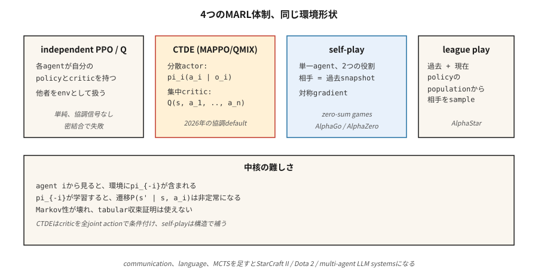

# 多代理強化學習

> 單代理強化學習假設環境是平穩的。把兩個會學習的代理程式放進同一個世界，這個假設就破了：每個代理程式都是對方環境的一部分，而兩邊都在變。多代理強化學習就是一整套讓學習在 Markov 假設不再成立時仍能收斂的技巧。

**類型：** 實作
**程式語言：** Python
**先修單元：** 階段 9 · 04（Q-learning）、階段 9 · 06（REINFORCE）、階段 9 · 07（演員—評論家）
**時間：** 約 45 分鐘

## 問題所在

一個學著在房間裡導航的機器人是單代理強化學習問題。一支足球隊不是。AlphaStar 對上星海爭霸的對手不是。一個由競標代理程式組成的市場不是。兩台車在四向停車路口互相禮讓不是。現實世界裡多對多的問題都不是。

在每一種多代理設定裡，從任何一個代理程式的視角看，其他代理程式*就是*環境的一部分。當它們學習、改變行為，環境就變得非平穩。Markov 性質——「下一個狀態只取決於當前狀態與我的動作」——被違反了，因為下一個狀態還取決於*其他*代理程式選了什麼，而它們的策略是會動的目標。

這會讓表格式的收斂證明失效（Q-learning 的保證假設環境是平穩的）。它也會讓天真的深度強化學習失效：代理程式互相追著跑，永遠收斂不到一個穩定的策略。你需要多代理專屬的技術：集中訓練分散執行、反事實基準、聯賽式對戰、自我對弈。

2026 年的應用場景：機器人群、交通路徑規劃、自駕車隊、市場模擬器、多代理 LLM 系統（階段 16），以及任何不只有一個智慧玩家的遊戲。

## 核心概念



**形式化：Markov 賽局。** MDP 的推廣：狀態 $S$、聯合動作 $a = (a_1, \ldots, a_n)$、轉移 $P(s' \mid s, a)$，以及各代理程式各自的獎勵 $R_i(s, a, s')$。每個代理程式 $i$ 依自己的策略 $\pi_i$ 最大化自己的回報。如果獎勵完全相同，就是**完全合作**。如果是零和，就是**對抗**。如果混合，就是**一般和**。

**核心挑戰：**

- **非平穩性。** 從代理程式 $i$ 的角度看，$P(s' \mid s, a_i)$ 取決於 $\pi_{-i}$，而它一直在變。
- **功勞分配。** 獎勵是共享的，那到底是哪個代理程式造成的？
- **探索的協調。** 代理程式應該探索互補的策略，而不是重複探索同一個狀態。
- **可擴展性。** 聯合動作空間隨 $n$ 指數成長。
- **部分可觀測性。** 每個代理程式只看得到自己的觀測；全域狀態是隱藏的。

**四種主流型態：**

**1. 獨立 Q-learning／獨立 PPO（IQL、IPPO）。** 每個代理程式學自己的 Q 或策略，把其他代理程式當成環境的一部分。簡單，有時候真的行得通（尤其是經驗回放剛好扮演了一種平滑化的對手建模技巧）。理論收斂性：沒有。實務上：鬆耦合的任務沒問題，緊耦合的就很糟。

**2. 集中訓練分散執行（CTDE）。** 現代最常見的範式。每個代理程式有自己的*策略* $\pi_i$，只以區域觀測 $o_i$ 為條件——部署時就是標準的分散執行。而在*訓練*期間，一個集中式評論家 $Q(s, a_1, \ldots, a_n)$ 以完整的全域狀態與聯合動作為條件。例子：
- **MADDPG**（Lowe et al. 2017）：每個代理程式配一個集中式評論家的 DDPG。
- **COMA**（Foerster et al. 2017）：反事實基準——問「如果我當時改採動作 $a'$，我的獎勵會是多少？」——藉此把我的貢獻隔離出來。
- 配共享評論家的 **MAPPO**／**IPPO**（Yu et al. 2022）：帶集中式價值函式的 PPO。2026 年合作型多代理強化學習的主流。
- **QMIX**（Rashid et al. 2018）：價值分解——$Q_{\text{tot}}(s, a) = f(Q_1(s, a_1), \ldots, Q_n(s, a_n))$，混合函式具單調性。

**3. 自我對弈。** 同一個代理程式的兩份拷貝互相對打。對手的策略*就是*我過去某個快照的策略。AlphaGo／AlphaZero／MuZero。OpenAI Five。在零和賽局上效果最好；訓練訊號是對稱的。

**4. 聯賽式對戰。** 把自我對弈延伸到一般和／對抗環境：保留一群過去與當前的策略，從聯賽裡取樣一個對手來對打。再加上剋星（專門打贏當前最強者）與主剋星（專門打贏剋星）。AlphaStar（星海爭霸 II）。當賽局存在「剪刀石頭布」式的策略循環時就會需要它。

**通訊。** 讓代理程式彼此發送學習得來的訊息 $m_i$。在合作情境下有效。Foerster et al.（2016）證明了可微分的代理程式間通訊可以端到端訓練。今天基於 LLM 的多代理系統（階段 16）本質上就是用自然語言在通訊。

```figure
f3-marl-orbit
```

## 動手實作

這個單元用一個 6×6 的 GridWorld，裡面有兩個合作的代理程式。它們從對角出發，必須抵達同一個共享目標。共享獎勵：只要還有任一代理程式在移動，每步 `-1`；兩個都抵達時 `+10`。見 `code/main.py`。

### 步驟 1：多代理環境

```python
class CoopGridWorld:
    def __init__(self):
        self.size = 6
        self.goal = (5, 5)

    def reset(self):
        return ((0, 0), (5, 0))  # two agents

    def step(self, state, actions):
        a1, a2 = state
        new1 = move(a1, actions[0])
        new2 = move(a2, actions[1])
        done = (new1 == self.goal) and (new2 == self.goal)
        reward = 10.0 if done else -1.0
        return (new1, new2), reward, done
```

*聯合*動作空間是 `|A|² = 16`。全域狀態是兩個位置。

### 步驟 2：獨立 Q-learning

每個代理程式跑自己的 Q 表，以聯合狀態為鍵。每一步：兩邊各挑一個 ε-greedy 動作，收集聯合轉移，各自用共享獎勵更新自己的 Q。

```python
def independent_q(env, episodes, alpha, gamma, epsilon):
    Q1, Q2 = defaultdict(default_q), defaultdict(default_q)
    for _ in range(episodes):
        s = env.reset()
        done = False
        while not done:
            a1 = epsilon_greedy(Q1, s, epsilon)
            a2 = epsilon_greedy(Q2, s, epsilon)
            s_next, r, done = env.step(s, (a1, a2))
            if done:
                Q1[s][a1] += alpha * (r - Q1[s][a1])
                Q2[s][a2] += alpha * (r - Q2[s][a2])
                break
            target1 = r + gamma * max(Q1[s_next].values())
            target2 = r + gamma * max(Q2[s_next].values())
            Q1[s][a1] += alpha * (target1 - Q1[s][a1])
            Q2[s][a2] += alpha * (target2 - Q2[s][a2])
            s = s_next
```

在這個任務上行得通，因為獎勵密集又一致。在緊耦合的任務上會失敗（例如其中一個代理程式必須*等*另一個的情況）。

### 步驟 3：帶分解價值更新的集中式 Q

用單一個定義在聯合動作上的 Q：$Q(s, a_1, a_2)$。以共享獎勵更新。執行時透過邊際化來分散化：$\pi_i(s) = \arg\max_{a_i} \max_{a_{-i}} Q(s, a_1, a_2)$。用指數大的聯合動作空間，換一個*正確*的全域視角。

### 步驟 4：簡單的自我對弈（對抗式雙代理）

同一個代理程式，兩個角色。訓練代理程式 A 對抗代理程式 B；跑完 $K$ 個回合後，把 A 的權重複製到 B。對稱訓練，進步一致。這就是 AlphaZero 配方的迷你版。

## 常見陷阱

- **非平穩的回放。** 獨立代理程式配經驗回放，比單代理的情況更糟，因為舊的轉移是由現在早已過時的對手產生的。解法：重新標註，或依時間新舊加權。
- **功勞分配有歧義。** 長回合結束後給一份共享獎勵，沒有明確方法說是哪個代理程式的貢獻。解法：反事實基準（COMA），或針對個別代理程式做獎勵塑形。
- **策略漂移／互相追逐。** 每個代理程式的最佳回應會隨對方的更新而改變。解法：集中式評論家、放慢學習率，或一次只解凍一個。
- **靠協調做出的獎勵駭入。** 代理程式會找到設計者沒預料到的協同漏洞。拍賣代理程式最後全都收斂到出價零。解法：仔細設計獎勵、加上行為約束。
- **探索重複。** 兩個代理程式探索同一批狀態—動作對。解法：對個別代理程式加熵獎勵，或做角色條件化。
- **聯賽循環。** 純自我對弈可能卡在支配循環裡。解法：用對手多樣的聯賽式對戰。
- **樣本量爆炸。** `n` 個代理程式 × 狀態空間 × 聯合動作。用函式逼近去近似；把動作空間因式分解（每個代理程式一個策略輸出頭）。

## 框架應用

2026 年的多代理強化學習應用地圖：

| 領域 | 方法 | 備註 |
|--------|--------|-------|
| 合作式導航／操作 | MAPPO／QMIX | CTDE；共享評論家 + 分散式演員。 |
| 雙人賽局（西洋棋、圍棋、撲克） | 配 MCTS 的自我對弈（AlphaZero） | 零和；對稱訓練。 |
| 複雜多人遊戲（Dota、星海爭霸） | 聯賽式對戰 + 模仿式預訓練 | OpenAI Five、AlphaStar。 |
| 自駕車隊 | 配注意力機制的 CTDE MAPPO／PPO | 部分可觀測；隊伍規模可變。 |
| 拍賣市場 | 賽局理論均衡 + 強化學習 | `n` → ∞ 時用平均場強化學習。 |
| LLM 多代理系統（階段 16） | 自然語言通訊 + 角色條件化 | 強化學習迴圈落在代理程式的規劃層。 |

2026 年，多代理強化學習成長最快的領域是基於 LLM 的：一群語言模型代理程式在協商、辯論、寫軟體。強化學習在這裡的形式是對*軌跡層級*輸出做偏好最佳化，而不是詞元層級（階段 16 · 03）。

## 產出交付

存成 `outputs/skill-marl-architect.md`：

```markdown
---
name: marl-architect
description: Pick the right multi-agent RL regime (IPPO, CTDE, self-play, league) for a given task.
version: 1.0.0
phase: 9
lesson: 10
tags: [rl, multi-agent, marl, self-play]
---

Given a task with `n` agents, output:

1. Regime classification. Cooperative / adversarial / general-sum. Justify.
2. Algorithm. IPPO / MAPPO / QMIX / self-play / league. Reason tied to coupling tightness and reward structure.
3. Information access. Centralized training (what global info goes to the critic)? Decentralized execution?
4. Credit assignment. Counterfactual baseline, value decomposition, or reward shaping.
5. Exploration plan. Per-agent entropy, population-based training, or league.

Refuse independent Q-learning on tightly-coupled cooperative tasks. Refuse to recommend self-play for general-sum with cycle risks. Flag any MARL pipeline without a fixed-opponent eval (cherry-picked self-play numbers are common).
```

## 練習

1. **簡單。** 在雙代理合作式 GridWorld 上訓練獨立 Q-learning。要跑多少回合平均回報才會大於 0？畫出聯合學習曲線。
2. **中等。** 加一個「協調」任務：只有當兩個代理程式在同一回合同時踏上目標，目標才算達成。獨立 Q 還收斂得了嗎？是哪裡壞掉了？
3. **困難。** 為 MAPPO 式的訓練實作一個集中式評論家，並在協調任務上跟獨立 PPO 比較收斂速度。

## 關鍵術語

| 術語 | 大家怎麼說 | 實際上是什麼 |
|------|-----------------|-----------------------|
| Markov 賽局 | 「多代理 MDP」 | $(S, A_1, \ldots, A_n, P, R_1, \ldots, R_n)$；每個代理程式有自己的獎勵。 |
| CTDE | 「集中訓練分散執行」 | 訓練時用聯合評論家；每個代理程式的策略只用區域觀測。 |
| IPPO | 「獨立 PPO」 | 每個代理程式各跑各的 PPO。簡單的基準線；常被低估。 |
| MAPPO | 「多代理 PPO」 | 以全域狀態為條件、帶集中式價值函式的 PPO。 |
| QMIX | 「單調價值分解」 | $Q_{\text{tot}} = f_{\text{monotone}}(Q_1, \ldots, Q_n)$，讓分散式的 argmax 成立。 |
| COMA | 「反事實多代理」 | 優勢 = 我的 Q 減去對我的動作做邊際化後的期望 Q。 |
| 自我對弈 | 「代理程式對上過去的自己」 | 單一代理程式扮兩個角色；零和賽局的標準做法。 |
| 聯賽式對戰 | 「族群式訓練」 | 快取過去的策略，從池子裡取樣對手；能處理策略循環。 |

## 延伸閱讀

- [Lowe et al. (2017). Multi-Agent Actor-Critic for Mixed Cooperative-Competitive Environments (MADDPG)](https://arxiv.org/abs/1706.02275) —— 配集中式評論家的 CTDE。
- [Foerster et al. (2017). Counterfactual Multi-Agent Policy Gradients (COMA)](https://arxiv.org/abs/1705.08926) —— 用反事實基準做功勞分配。
- [Rashid et al. (2018). QMIX: Monotonic Value Function Factorisation](https://arxiv.org/abs/1803.11485) —— 帶單調性的價值分解。
- [Yu et al. (2022). The Surprising Effectiveness of PPO in Cooperative Multi-Agent Games (MAPPO)](https://arxiv.org/abs/2103.01955) —— PPO 用在多代理強化學習上強得出人意料。
- [Vinyals et al. (2019). Grandmaster level in StarCraft II using multi-agent reinforcement learning (AlphaStar)](https://www.nature.com/articles/s41586-019-1724-z) —— 大規模的聯賽式對戰。
- [Silver et al. (2017). Mastering the game of Go without human knowledge (AlphaGo Zero)](https://www.nature.com/articles/nature24270) —— 零和賽局裡的純自我對弈。
- [Sutton & Barto (2018). Ch. 15 — Neuroscience & Ch. 17 — Frontiers](http://incompleteideas.net/book/RLbook2020.pdf) —— 包含教科書對多代理設定的簡短處理，以及 CTDE 想解決的那個非平穩性問題。
- [Zhang, Yang & Başar (2021). Multi-Agent Reinforcement Learning: A Selective Overview](https://arxiv.org/abs/1911.10635) —— 涵蓋合作、競爭與混合型多代理強化學習的綜述，附收斂性結果。
