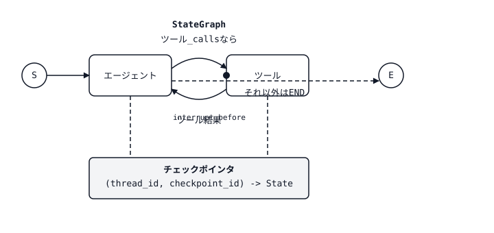

# 代理狀態機 —— 圖、節點、檢查點

> 手寫的 ReAct 迴圈就是一個 `while True`。同樣的迴圈寫成一張明確的圖，就變成你能設檢查點、能中斷、能分支、能時光回溯的東西。代理本身沒變，變的是包在它外面的框架。

**類型：** 實作
**程式語言：** Python
**先修單元：** 階段 11 · 09（函數呼叫）、階段 11 · 14（Model Context Protocol）
**時間：** 約 75 分鐘

## 問題所在

你上線一個函數呼叫代理。它撐了三輪，然後出事了：模型呼叫的工具回 500、使用者在任務中途改變主意，或者代理決定在沒有人簽核的情況下退款。那個 `while True:` 迴圈沒有任何掛鉤。你沒法暫停它、沒法回捲它，也沒法分支去看「如果模型當時挑了另一個工具會怎樣」。一旦你把這東西推出示範階段，代理就成了一個黑盒子：不是成功就是失敗。

看懂之後，下一步就很明顯了。代理本來就是一個狀態機 —— 系統提示詞加訊息歷史加待處理的工具呼叫加下一個動作。把這個狀態機顯式化：為「模型思考」、「工具執行」、「人類核准」各設一個節點，再用邊來表達它們之間的條件轉移。圖一旦顯式，框架就免費得到四樣東西：檢查點（在步驟之間存下狀態）、中斷（為人類暫停）、串流（串流詞元與中間事件），以及時光回溯（回捲到先前狀態去試另一條分支）。

這個抽象的參考實作是 LangGraph。它不是 LangChain 意義上的代理框架（「這是一個 AgentExecutor，祝你好運」），而是一個帶一級狀態、一級持久化與一級中斷的圖執行環境。代理迴圈是你畫出來的，不是手寫出來的。

## 核心概念



一個 `StateGraph` 有三樣東西。

1. **狀態（State）。** 一個帶型別的字典（TypedDict 或 Pydantic 模型），在圖裡流動。每個節點收到完整狀態，回傳一份部分更新，LangGraph 再用每個欄位各自的 *reducer* 把它合併進去 —— 該累積的串列用 `operator.add`，預設則是覆寫。
2. **節點（Nodes）。** Python 函數 `state -> partial_state`。每一個都是一個離散步驟：「呼叫模型」、「執行工具」、「做摘要」。
3. **邊（Edges）。** 節點之間的轉移。靜態邊只通往一處。條件邊接受一個路由函數 `state -> next_node_name`，讓圖能依模型輸出分支。

然後你編譯這張圖。編譯會綁定拓撲、掛上一個 checkpointer（選用，但對生產環境是必要的），並回傳一個可執行物件。你用一份初始狀態和一個 `thread_id` 去調用它。執行的每一步都會持久化一個以 `(thread_id, checkpoint_id)` 為鍵的檢查點。

### 四種超能力

**檢查點。** 每一次節點轉移都把新狀態寫進一個儲存（測試用記憶體，生產用 Postgres/Redis/SQLite）。要恢復就用同一個 `thread_id` 再呼叫這張圖一次，它會從暫停的地方接下去。

**中斷。** 用 `interrupt_before=["human_review"]` 標記某個節點，執行就會在該節點跑之前停住。狀態被持久化。你的 API 回覆使用者「等待核准中」。之後用同一個 `thread_id` 搭配 `Command(resume=...)` 發一次請求，執行就繼續。

**串流。** `graph.stream(state, mode="updates")` 會在事情發生時吐出狀態增量。`mode="messages"` 串流模型節點內部的 LLM 詞元。`mode="values"` 吐出完整快照。你自己挑要在介面上呈現什麼。

**時光回溯。** `graph.get_state_history(thread_id)` 回傳完整的檢查點日誌。把任何一個先前的 `checkpoint_id` 傳給 `graph.invoke`，你就從那個點分岔出去。這對除錯（「如果模型當時挑了工具 B 呢？」）以及重播生產軌跡的回歸測試都很好用。

### Reducer 才是重點

每個狀態欄位都有一個 reducer。多數預設值就夠用 —— 新值覆寫舊值。但訊息串列需要 `operator.add`，好讓新訊息是附加而不是取代。並行的邊會透過 reducer 合併它們的更新。如果兩個節點都更新 `messages`，而你忘了寫 `Annotated[list, add_messages]`，第二個會靜默地勝出，你就丟掉半輪對話。reducer 是這個函式庫裡唯一微妙的東西；把它弄對，其餘的都能自然組合。

### 四個節點就是一個 ReAct 圖

一個生產級 ReAct 代理是四個節點加兩條邊：

1. `agent` —— 用當前訊息歷史呼叫 LLM。回傳助理訊息（裡面可能含 tool_calls）。
2. `tools` —— 執行最後那則助理訊息裡的所有 tool_calls，把工具結果以工具訊息附加上去。
3. 一條從 `agent` 出發的條件邊：若最後一則訊息帶 tool_calls 就走向 `tools`，否則走向 `END`。
4. 一條從 `tools` 回到 `agent` 的靜態邊。

就這樣。你得到完整的 ReAct 迴圈（思考 → 行動 → 觀察 → 思考 → …），連帶檢查點、中斷與串流，大約 40 行程式碼。

### StateGraph 對 Send（扇出）

`Send(node_name, state)` 讓一個節點派送並行子圖。例如：代理決定同時查詢三個檢索器。每一個 `Send` 都會展開目標節點的一次並行執行；它們的輸出透過狀態 reducer 合併。這就是 LangGraph 在不動用執行緒原語的情況下，表達「協調者－工作者」模式的方式。

### 子圖

一張已編譯的圖可以當成另一張圖裡的一個節點。外層圖只看到一個節點；內層圖有自己的狀態與自己的檢查點。這就是團隊怎麼建「監督者－工作者」代理：監督者圖把使用者意圖路由到各領域的工作者子圖。

```figure
l5-state-graph-ledger
```

## 動手實作

### 步驟 1：狀態與節點

```python
from typing import Annotated, TypedDict
from langchain_core.messages import AnyMessage, HumanMessage, AIMessage
from langgraph.graph import StateGraph, END
from langgraph.graph.message import add_messages
from langgraph.prebuilt import ToolNode
from langgraph.checkpoint.memory import MemorySaver

class State(TypedDict):
    messages: Annotated[list[AnyMessage], add_messages]

def agent_node(state: State) -> dict:
    response = llm.invoke(state["messages"])
    return {"messages": [response]}

def should_continue(state: State) -> str:
    last = state["messages"][-1]
    return "tools" if getattr(last, "tool_calls", None) else END

tool_node = ToolNode(tools=[search_web, read_file])

graph = StateGraph(State)
graph.add_node("agent", agent_node)
graph.add_node("tools", tool_node)
graph.set_entry_point("agent")
graph.add_conditional_edges("agent", should_continue, {"tools": "tools", END: END})
graph.add_edge("tools", "agent")

app = graph.compile(checkpointer=MemorySaver())
```

`add_messages` 就是那個讓訊息串列累積而不是覆寫的 reducer。忘了它是最常見的 LangGraph bug。

### 步驟 2：帶一個 thread 執行

```python
config = {"configurable": {"thread_id": "user-42"}}
for event in app.stream(
    {"messages": [HumanMessage("find the Anthropic headquarters address")]},
    config,
    stream_mode="updates",
):
    print(event)
```

每一次更新都是一個字典 `{node_name: state_delta}`。你的前端可以把這些串流到介面上，讓使用者看到「代理正在思考…呼叫 search_web…拿到結果…正在回答」。

### 步驟 3：加上人類介入的中斷

標記某個節點，讓執行在它跑之前暫停。

```python
app = graph.compile(
    checkpointer=MemorySaver(),
    interrupt_before=["tools"],  # pause before every tool call
)

state = app.invoke({"messages": [HumanMessage("delete the production database")]}, config)
# state["__interrupt__"] is set. Inspect proposed tool calls.
# If approved:
from langgraph.types import Command
app.invoke(Command(resume=True), config)
# If denied: write a rejection message and resume
app.update_state(config, {"messages": [AIMessage("Blocked by human reviewer.")]})
```

狀態、檢查點與 thread 在中斷期間全都持久存在。除了執行當下，沒有任何東西只活在記憶體裡。

### 步驟 4：用時光回溯除錯

```python
history = list(app.get_state_history(config))
for snapshot in history:
    print(snapshot.values["messages"][-1].content[:80], snapshot.config)

# Fork from a prior checkpoint
target = history[3].config  # three steps back
for event in app.stream(None, target, stream_mode="values"):
    pass  # replay from that point forward
```

輸入傳 `None` 就是從給定的檢查點重播；傳一個值則是在恢復之前，把它當成對該檢查點狀態的一次更新附加上去。這就是你怎麼在不重跑整段對話的情況下，重現一次糟糕的代理執行。

### 步驟 5：為生產環境換掉 checkpointer

```python
from langgraph.checkpoint.postgres import PostgresSaver

with PostgresSaver.from_conn_string("postgresql://...") as checkpointer:
    checkpointer.setup()
    app = graph.compile(checkpointer=checkpointer)
```

SQLite、Redis 和 Postgres 都已內建。`MemorySaver` 是給測試用的。任何需要跨重啟存活的場景，都該用一個真正的儲存。

## 這項技能

> 你把代理當成圖來建，而不是當成 `while True` 迴圈。

在你動手用 LangGraph 之前，先花 60 秒做一次設計：

1. **給節點命名。** 每一個離散的決策或有副作用的動作都是一個節點。「代理思考」、「工具執行」、「審核者核准」、「回應串流」。如果你列不出來，這個任務還沒長成代理的形狀。
2. **宣告狀態。** 一個最小的 TypedDict，每個串列欄位都配一個 reducer。不要把所有東西都塞進 `messages`；把任務專屬的欄位（一份進行中的 `plan`、一個 `budget` 計數器、一份 `retrieved_docs` 串列）提到頂層。
3. **畫出邊。** 除非下一步取決於模型輸出，否則都用靜態邊。每條條件邊都需要一個帶具名分支的路由函數。
4. **一開始就選好 checkpointer。** 測試用 `MemorySaver`，其他一律用 Postgres/Redis/SQLite。沒有它不要上線 —— 沒有 checkpointer 就沒有恢復、沒有中斷、沒有時光回溯。
5. **中斷要放在工具執行之前，不是之後。** 核准放在通往有副作用節點的那條邊上，這樣你能在傷害發生前取消；驗證放在離開模型的那條邊上，這樣你能便宜地擋掉爛呼叫。
6. **預設就串流。** 介面用 `mode="updates"`，模型節點內部的詞元層級串流用 `mode="messages"`，評估期間的完整快照用 `mode="values"`。

沒有 checkpointer 的 LangGraph 代理，拒絕上線。在副作用**之後**才中斷的，拒絕上線。`messages` 欄位沒有以 `add_messages` 當 reducer 的，拒絕上線。

## 練習

1. **簡單。** 用一個計算器工具和一個網頁搜尋工具，實作上面那個四節點 ReAct 圖。驗證兩輪對話下 `list(app.get_state_history(config))` 至少回傳四個檢查點。
2. **中等。** 加一個跑在 `agent` 之前的 `planner` 節點，把一份結構化的 `plan: list[str]` 寫進狀態。讓 `agent` 把計畫步驟標記為完成。如果 `plan` 在檢查點恢復後遺失（reducer 用錯），就讓測試失敗。
3. **困難。** 用 `Send` 建一個監督者圖，在三個子圖（`researcher`、`writer`、`reviewer`）之間路由。每個子圖有自己的狀態與 checkpointer。在外層圖上加 `interrupt_before=["writer"]`，讓人類可以核准研究摘要。確認從先前檢查點做時光回溯時，只有分岔出去的那條分支被重跑。

## 關鍵術語

| 術語 | 大家怎麼說 | 它實際上是什麼 |
|------|-----------------|-----------------------|
| StateGraph | 「LangGraph 的那張圖」 | 你在編譯之前用來加節點與邊的建構器物件。 |
| Reducer | 「欄位怎麼合併」 | 當某節點回傳該欄位的更新時套用的函數 `(old, new) -> merged`；預設是覆寫，`add_messages` 則是附加。 |
| Thread | 「一個對話 ID」 | 一個 `thread_id` 字串，界定某段工作階段所有檢查點的範圍。 |
| 檢查點（Checkpoint） | 「一個暫停的狀態」 | 節點轉移後對完整圖狀態的持久化快照，以 `(thread_id, checkpoint_id)` 為鍵。 |
| 中斷（Interrupt） | 「為人類暫停」 | `interrupt_before` / `interrupt_after` 在節點邊界停止執行；用 `Command(resume=...)` 恢復。 |
| 時光回溯（Time-travel） | 「從先前的步驟分岔」 | `graph.invoke(None, config_with_old_checkpoint_id)` 從那個檢查點往前重播。 |
| Send | 「並行子圖派送」 | 一個節點可以回傳的建構子，用來展開目標節點的 N 次並行執行。 |
| 子圖（Subgraph） | 「把已編譯的圖當節點」 | 一張已編譯的 StateGraph 被當成另一張圖裡的節點；保留自己的狀態範圍。 |

## 延伸閱讀

- [LangGraph documentation](https://langchain-ai.github.io/langgraph/) —— StateGraph、reducer、checkpointer 與中斷的權威參考。
- [LangGraph concepts: state, reducers, checkpointers](https://langchain-ai.github.io/langgraph/concepts/low_level/) —— 本課採用的心智模型，直接來自源頭。
- [LangGraph Persistence and Checkpoints](https://langchain-ai.github.io/langgraph/concepts/persistence/) —— Postgres/SQLite/Redis 儲存、檢查點命名空間與 thread ID 的細節。
- [LangGraph Human-in-the-loop](https://langchain-ai.github.io/langgraph/concepts/human_in_the_loop/) —— `interrupt_before`、`interrupt_after`、`Command(resume=...)` 與編輯狀態的模式。
- [Yao et al., "ReAct: Synergizing Reasoning and Acting in Language Models" (ICLR 2023)](https://arxiv.org/abs/2210.03629) —— 每一個 LangGraph 代理都在實作的那個模式；讀它了解推理軌跡的理由。
- [Anthropic — Building effective agents (Dec 2024)](https://www.anthropic.com/research/building-effective-agents) —— 該偏好哪些圖形狀（鏈、路由器、協調者－工作者、評估者－最佳化者），以及什麼時候用。
- 階段 11 · 09（函數呼叫）—— 每個 LangGraph 代理節點都在重用的那個工具呼叫原語。
- 階段 11 · 14（Model Context Protocol）—— 透過 MCP 轉接器插進 LangGraph `ToolNode` 的外部工具發現機制。
- 階段 11 · 17（代理框架的取捨）—— 什麼時候該選 LangGraph 而不是 CrewAI、AutoGen 或 Agno。
