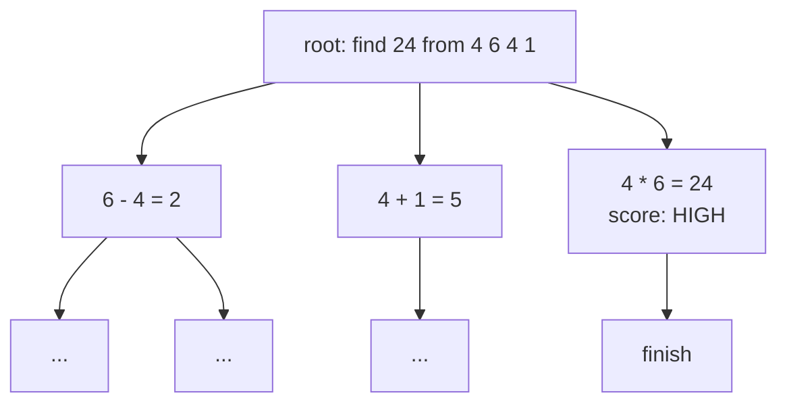

# Tree of Thoughts and LATS: Deliberate Search

> A single chain-of-thought trajectory has no room to backtrack. ToT (Yao et al., 2023) turns reasoning into a tree with self-evaluation on each node. LATS (Zhou et al., 2024) unifies ToT with ReAct and Reflexion under Monte Carlo Tree Search. Game of 24 goes from 4% (CoT) to 74% (ToT); LATS hits 92.7% pass@1 on HumanEval.

**Type:** Build
**Languages:** Python (stdlib), TypeScript
**Prerequisites:** Phase 14 · 01 (Agent Loop), Phase 14 · 03 (Reflexion)
**Time:** ~75 minutes

## Learning Objectives

- Frame reasoning as search: nodes are "thoughts," edges are "expansions," value is "how promising."
- Implement a stdlib ToT-style BFS tree search with self-evaluation scoring.
- Extend to a toy LATS MCTS loop with select / expand / simulate / backpropagate.
- Decide when search is worth the token multiplier (Game of 24, code generation) and when a single trajectory is enough (simple Q&A).

## The Problem

Chain-of-thought is a linear walk. If the first step is wrong, every subsequent step works on a bad premise. On Game of 24 (use four digits with + − × ÷ to make 24), GPT-4 CoT hits 4% accuracy. The model picks the wrong subexpression early and cannot recover.

What reasoning needs is the ability to propose multiple candidates, evaluate them, pick the promising ones, and backtrack when dead ends appear. That is search. Tree of Thoughts and LATS are the two canonical formulations.

## The Concept

### Tree of Thoughts (Yao et al., NeurIPS 2023)

Each node is a coherent intermediate step ("a thought"). Each node can expand to K child thoughts. The LLM self-evaluates each node with a scoring prompt. Search explores the tree — BFS, DFS, or beam.



Self-evaluation is the load-bearing piece. The paper shows three variants: `sure / likely / impossible` classification, `1..10` numeric score, and vote among candidates. All three beat CoT substantially on Game of 24 (4% -> 74% with GPT-4).

### LATS (Zhou et al., ICML 2024)

LATS unifies ToT, ReAct, and Reflexion under MCTS. The LLM plays three roles:

- **Policy**: propose candidate next actions (ReAct-style).
- **Value function**: score a partial trajectory (ToT-style self-eval).
- **Self-reflector**: on failure, write a natural-language reflection (Reflexion-style) and use it to reseed future rollouts.

Environment feedback (observations) mixes into the value function so the search is informed by real tool results, not just model opinions. Results at paper time: HumanEval pass@1 92.7% with GPT-4 (SOTA), WebShop average 75.9 with GPT-3.5 (approaching gradient-based fine-tuning).

### MCTS, minimally

Four phases per iteration:

1. **Select** — walk from root to a leaf using UCT (upper confidence bound for trees).
2. **Expand** — generate K children via the policy.
3. **Simulate** — rollout from a child using the policy, score the leaf with the value function (or environment reward).
4. **Backpropagate** — update visit counts and value estimates up the path.

UCT formula: `Q(s, a) + c * sqrt(ln N(s) / N(s, a))`. First term is exploitation; second is exploration. Tune `c` per task.

### The cost reality

Search explodes tokens. ToT on Game of 24 uses 100–1000x the tokens of CoT. LATS is similar. This is not free; reserve search for:

- Tasks where a single trajectory is demonstrably insufficient (Game of 24, complex code).
- Tasks where wall-clock is less important than correctness.
- Tasks with a cheap, reliable value function (unit tests for code, explicit target for math).

If your task has a single right answer and a noisy evaluator, search often makes things worse — it finds a "good-scoring" wrong answer.

### 2026 positioning

Most production agents do not run LATS. They run ReAct with tool-grounded verification (CRITIC, Lesson 05). Search shows up in specialized niches:

- Coding agents that run tests as the value function (HumanEval-style).
- Deep-research agents that explore multiple query paths.
- Planning-heavy workflows inside LangGraph subgraphs.

AlphaEvolve (Lesson 11) is the 2025 extreme: evolutionary search over code, machine-checkable fitness, frontier gains (first 4x4 matmul improvement in 56 years).

```figure
tree-of-thoughts
```

## Build It

`code/main.py` implements:

- A tiny ToT BFS on a stylized "pick arithmetic ops" task.
- A toy LATS MCTS loop on the same task (Select / Expand / Simulate / Backpropagate) with UCT selection.
- A value function that composes a symbolic score plus a self-eval score.

Run it:

```bash
python3 code/main.py
npx tsx code/main.ts
```

The trace shows ToT expanding three candidates per node with BFS, compared to LATS converging on the best rollout via MCTS. Token counts printed for both.

### Exercises 1-3: UCT, noisy values, beam ToT

`main.py` also sweeps three knobs on the same toy search (seeds averaged). Exercise 1, UCT `c`:

```text
c      root-visit entropy (bits)   top child share
0.1                         4.26             15.0%
0.5                         4.54              6.1%
1.4                         4.57              5.3%
2.0                         4.57              5.1%
```

The best trace barely changes; where visits go does. A low `c` commits to one branch, and `c >= 1.4` spreads visits almost evenly over the 24 root children. Compare visit counts, not only the final trace.

Exercise 2, jitter added to the value function (400 iterations, 30 seeds):

```text
noise sigma    signal/noise    solve rate
0.0                     inf         96.7%
0.1                     1.7         93.3%
0.3                     0.55        90.0%
1.0                     0.17         6.7%
```

The spread of leaf values is about 0.165, so MCTS holds up to a signal-to-noise ratio near 0.5 and collapses below it.

Exercise 3, ToT under an expansion budget (one expansion = one scored child):

```text
strategy   solved at 460 expansions   expansions used
bfs                             yes              460
beam-8                           no              152
beam-32                          no              438
beam-64                         yes              460
```

The value function rewards states near 24, which can be a dead end, so narrow beams prune the winning branch. Below 460 expansions nothing solves it; widen the beam before cutting the budget.

### Exercise 5: when to use which search

Use plain ReAct or Reflexion when the task is short, one attempt usually works, or tokens and latency are tight, because LATS costs far more compute. Use LATS only when all three hold: the task has several plausible routes and a wrong early step is costly; you can score partial progress with a test, a verifier or a reliable judge; and the environment lets you return to an earlier state and retry. The last condition rules out actions that cannot be undone, such as sending an email or making a payment. If you can score and reset but cannot afford MCTS, use beam search with a wide enough beam, because a narrow beam drops good branches when the scorer is misleading. LATS helps less when the scorer is unreliable or the task cannot be reset, and it is not worth the cost when one pass already solves the task.

## Use It

LangGraph ships ToT-style exploration as subgraph patterns; the LangChain team's blog on LATS (May 2024) is the reference tutorial. LlamaIndex ships a `TreeOfThoughts` agent. For most 2026 production agents this pattern lives behind an `if task_complexity > threshold: use_search()` gate — see the evaluator-optimizer pattern in Lesson 05.

## Ship It

`outputs/skill-search-policy.md` selects between linear ReAct, ToT, LATS, and evolutionary search given task shape, budget, and evaluator fidelity.

## Exercises

1. Run the toy LATS with UCT c=0.1 vs c=2.0. What changes in the trace?
2. Swap the value function for a noisier scorer (add random jitter). Does MCTS still find the best leaf? What is the minimum signal-to-noise it tolerates?
3. Implement beam-search ToT (keep top-k at each level) and compare to BFS. Which is better on a tight token budget?
4. Read LATS Section 5.1. Reproduce the HumanEval trajectory count: how many rollouts does it take to hit the reported pass@1?
5. Read the LATS paper's discussion on "when LATS helps less." Write a one-paragraph decision rule mapping task shape to search strategy.

## Key Terms

| Term | What people say | What it actually means |
|------|----------------|------------------------|
| Tree of Thoughts | "Branching CoT" | Yao et al. — tree of thought nodes with self-evaluation |
| LATS | "MCTS for LLMs" | Zhou et al. — unifies ToT + ReAct + Reflexion under MCTS |
| UCT | "Upper confidence bound" | Select formula balancing exploitation (Q) and exploration (ln N / n) |
| Value function | "How good is this state" | Prompted LLM score or environment reward; feeds backprop |
| Policy | "Action proposer" | ReAct-style generator; emits candidate next thoughts/actions |
| Rollout | "Simulated trajectory" | Walk from a node to a leaf using policy, score with value |
| Backpropagate | "Update ancestors" | Push the leaf's reward up the path, updating visit counts and Q |
| Search cost | "Token explosion" | 100-1000x CoT on Game of 24; budget before you adopt |

## Further Reading

- [Yao et al., Tree of Thoughts (arXiv:2305.10601)](https://arxiv.org/abs/2305.10601) — the canonical paper
- [Zhou et al., LATS (arXiv:2310.04406)](https://arxiv.org/abs/2310.04406) — MCTS with Reflexion feedback
- [LangGraph overview](https://docs.langchain.com/oss/python/langgraph/overview) — subgraph patterns for search
- [AlphaEvolve (arXiv:2506.13131)](https://arxiv.org/abs/2506.13131) — evolutionary search with programmatic evaluators
