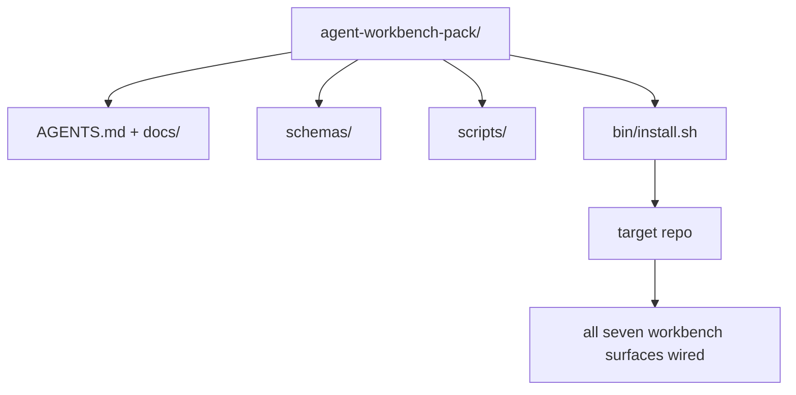

# 總結專案：出貨一份可重用的代理工作台套件

> 這條小支線以一份你可以丟進任何儲存庫的套件收尾。十一課的表面壓縮成一個你可以 `cp -r` 的目錄，隔天早上代理就能可靠地工作。這份總結專案就是本課程賴以立足的那份產物。

**類型：** 建構
**程式語言：** Python (stdlib)
**先修單元：** 階段 14 · 31 到 14 · 41
**時間：** 約 75 分鐘

## 學習目標

- 把七個工作台表面打包成一個可直接丟進去的目錄。
- 把 schema、腳本與樣板釘住，好讓新儲存庫拿到一份已知良好的基線。
- 加上單一支安裝腳本，冪等地把這份套件鋪下去。
- 決定什麼留在套件裡、什麼留在外面，並替每一項取捨辯護。
- 示範一次由代理程式協助完成的儲存庫變更，附上審查者能重現的證據。

## 問題所在

一個住在 Google Doc、聊天歷史，加三支只記得一半的腳本裡的工作台，就是一個每季都要重蓋一次的工作台。解藥是一份有版本的套件：一個帶著那些表面、schema、腳本，以及一鍵安裝器的儲存庫或目錄。

這一課結束時，你會在磁碟上有一份出貨好的 `outputs/agent-workbench-pack/`，以及一支能把它丟進任何目標儲存庫的 `bin/install.sh`。

## 核心概念



### 套件的版面

```
outputs/agent-workbench-pack/
├── AGENTS.md
├── docs/
│   ├── agent-rules.md
│   ├── reliability-policy.md
│   ├── handoff-protocol.md
│   └── reviewer-rubric.md
├── schemas/
│   ├── agent_state.schema.json
│   ├── task_board.schema.json
│   └── scope_contract.schema.json
├── scripts/
│   ├── init_agent.py
│   ├── run_with_feedback.py
│   ├── verify_agent.py
│   └── generate_handoff.py
├── bin/
│   └── install.sh
└── README.md
```

### 什麼留在裡面、什麼留在外面

裡面：

- 各表面的 schema。它們就是契約。
- 上面那四支腳本。它們就是執行環境。
- 那四份文件。它們就是規則與評分準則。

外面：

- 專案專屬的任務。任務屬於目標儲存庫的板子，不屬於套件。
- 廠商 SDK 的呼叫。這份套件與框架無關。
- 新人上手的散文。套件住在團隊既有的上手文件旁邊，不住在它裡面。

### 那個安裝器

一支簡短的 `bin/install.sh`（或 `bin/install.py`）：

1. 若已存在套件，沒有 `--force` 就拒絕覆蓋安裝。
2. 把套件複製到目標儲存庫。
3. 若存在 `.github/workflows/` 就把 CI 接起來。
4. 印出後續步驟：填板子、設驗收指令、跑初始化腳本。

### 版本控管

套件帶一個 `VERSION` 檔。需要遷移的 schema 進位與腳本變更會提升主版號。只改文件的變更提升修訂號。目標儲存庫的 `agent_state.json` 會記下它是對著哪個套件版本初始化的。

```figure
wb-pack-install
```

## 建構它

`code/main.py` 會把套件組裝到課程旁邊的 `outputs/agent-workbench-pack/`，並以這條小支線先前各課的 schema 與腳本、加上你已經寫好的那些文件來播種。

跑它：

```
python3 code/main.py
```

這支腳本會複製並釘住那些表面、寫出 README、印出套件的目錄樹，然後以零離開。重跑是冪等的。

## 野地裡的生產模式

一份套件只有在撐得過 fork、更新，以及不友善的上游時才有價值。有四種模式讓這件事成立。

**`VERSION` 是契約，不是行銷。** 主版號進位需要一次狀態遷移。次版號進位需要重跑檢查器。修訂號進位只改文件。安裝器每次安裝都會把 `.workbench-version` 寫進目標儲存庫；若目標的 lock 與套件的 `VERSION` 不一致，`lint_pack.py` 就拒絕出貨。`npm`、`Cargo` 與 `pyproject.toml` 就是這樣撐過十年動盪的；代理這件事沒有改變任何規則。

**跨工具散布用單一來源。** Nx 出貨一支 `nx ai-setup`，從單一設定檔鋪下 `AGENTS.md`、`CLAUDE.md`、`.cursor/rules/`、`.github/copilot-instructions.md` 與一台 MCP 伺服器。套件也該這麼做；安裝器產出那些符號連結（`ln -s AGENTS.md CLAUDE.md`），好讓單一真值來源扇出到每個寫程式代理。為了偏袒某個工具而 fork 套件，是一種失敗模式。

**`uninstall.sh` 遇到非瑣碎狀態要拒絕。** 移除套件絕不能刪掉使用者的 `agent_state.json`、`task_board.json` 或 `outputs/`。解除安裝器移除 schema、腳本、文件與 `AGENTS.md`（可用 `--keep-agents-md` 選擇不移除），並在狀態檔有任何未提交變更時拒絕繼續。狀態屬於使用者；套件並不擁有它。

**技能即可發布物。SkillKit 式的散布。** 這份套件以 SkillKit 技能出貨：`skillkit install agent-workbench-pack` 就能從單一來源把它鋪到 32 種 AI 代理上。套件儲存庫是真值來源；SkillKit 是散布通道。廠商綁定塌掉；那七個表面維持不變。

## 框架應用

套件出貨的三個地方：

- **當成一個你丟進儲存庫的目錄。** `cp -r outputs/agent-workbench-pack /path/to/repo`。
- **當成一個公開的樣板儲存庫。** fork 之後客製，由 `VERSION` 控管漂移。
- **當成一項 SkillKit 技能。** 接進你的代理產品，讓單一指令就把它鋪好。

套件是那份食譜。每次安裝是一客成品。

## 產出交付

`outputs/skill-workbench-pack.md` 會產出一份依專案調校過的套件：規則依團隊的歷史磨利、範圍 glob 與該儲存庫對齊、評分準則的維度多加一條領域專屬的條目。

## 練習

1. 決定哪一份選配的第五份文件值得升格進正典套件。替你的取捨辯護。
2. 把安裝器改寫成帶 `--dry-run` 旗標的 Python。跟 bash 版比較人體工學。
3. 加一支 `bin/uninstall.sh`，安全地移除套件，並在狀態檔有非瑣碎歷史時拒絕。什麼算非瑣碎？
4. 加一支 `lint_pack.py`，當套件與 `VERSION` 漂移時就失敗。把它接進套件自己那個儲存庫的 CI。
5. 撰寫從手搓工作台遷移到這份套件的維運手冊。什麼樣的操作順序能把停機時間壓到最低？

## 職涯實戰：證明一次儲存庫變更

打包示範證明的是組裝器能跑、能產出檔案。它證明不了你的代理程式能完成一項新任務、證明不了產生出來的檢查真能證明那項任務，也證明不了部署後的系統能運作。把這幾種主張分開。

在你擁有、或獲准修改的儲存庫裡，挑一項小而真實的任務。使用一個你已經能用的程式代理程式。一個錯誤修正、一個範圍有界的功能，或一項維運上的改進就夠了；安裝好幾個代理程式不是這個練習的一部分。

在打包實驗之外，另外撥出一段工作時段。把下方連結的證據樣板複製到你自己的 `learning-artifacts/` 目錄。保留簽入的樣板與套件，當作參考資料。

### 1. 框定任務並選擇自主程度

使用第 43 課的任務框架與第 44 課的證據計畫。記下起始版本、可觀察的目標、非目標、允許的路徑，以及驗收證據。指出真正需要這個行為的使用者或維運人員。

選一種工作模式：逐步引導、設檢查點的實作，或一次有界的自主執行。說明不確定性、後果與可逆性為什麼足以支持這個選擇。一個小型的本地重構，需要的檢查點可能比一次存取控制的變更少。

設定牆鐘時間預算，若代理程式有提供，也設定詞元或成本上限。如實記錄無法取得的量測值。為反覆失敗、需要新權限、預算耗盡，或一個懸而未決的契約決定定義停止條件；並指名由誰來解決。

### 2. 準備最小且有用的環境

取回相關的實作、呼叫端、測試與本地指示。記下每個來源為什麼該放進脈絡，以及哪一項當前證據會推翻一則過時的筆記。預設不要把整個儲存庫載入。

對每個相關的擴充功能各做一個明確的選擇：skill 提供可重複的程序；MCP 工具提供存取；hook 執行確定性的檢查；plugin 把能力打包。只有任務需要時才保留某個擴充功能，並給它剛好夠用的最小權限。

記下你拒絕的一項提議新增所帶來的脈絡或維護成本。重新檢查一則過時的記憶或指示，當證據支持時，在你自己擁有的設定中把它淘汰或取代。重跑受影響的檢查，確認這次移除沒有丟掉一條必要的限制。

### 3. 擷取基線並實作

動手修改之前，先跑最接近的既有檢查，並示範所要求行為的當前狀態。保留指令、版本、結果與證據位置。一個還不存在的功能也有基線：記下觀察到的回應，或不支援的操作。

讓代理程式在契約之內實作。維護一份介入紀錄，寫下每次修正、權限變更或計畫修訂的理由。委派是選擇性的；如果有幫助，在加入另一個工作者之前，先套用第 45 課的所有權與整合契約。

### 4. 質疑證據

選擇能觀察到被變更表面的證明方式。對 UI，重新建置並在相關寬度下檢視實際提供的使用流程。對 API，檢視請求與序列化後的回應。對 CLI，執行建置出來的指令，檢查它的結束碼與輸出。挑出你的任務需要的檢查，並說明它們的極限。

獨立於代理程式的實作，根據任務契約寫出預期結果。在一份可拋棄的複本裡，引入一個具體的錯誤結果，例如接受一個無效值，或漏掉一個必要的回應欄位。跑同一個驗收檢查：它必須因為這個原因而失敗。

如果它仍然是綠的，先強化那個斷言或觀察，再去信任它。還原正確的實作，再跑一次並成功。兩份收據都留著。語法錯誤或壞掉的測試設定，不算偵測到回歸。

對照原始目標與允許的路徑，審查最終的 diff，包括被修改的測試。請一位同儕或另一個獨立的審查者工作階段，在不修改實作的前提下質疑最弱的那項證明。最終的判斷仍由你負責；另一個代理程式的同意不是執行證據。

### 5. 演練維運與復原

在一個可拋棄的本地或 staging 環境中執行變更後的成品。每一項觀察都標上 `local`、`staging` 或 `live`，並附上確切的版本或成品識別。本地演練支撐的是本地的主張；這個練習不要求部署到正式環境。

選一個與任務相關的失敗訊號、一個門檻、一個觀察時間窗，以及一位負責人。說明門檻被跨越時要如何應對。在演練中安全地觸發這個訊號，並保留觀察到的日誌、指標或回應。

演練回滾到一個已知良好的成品，並確認先前的行為已恢復。若有持久化資料，要一併考慮；只換掉二進位檔未必能逆轉資料的變更。記下任何你無法驗證的復原步驟。

### 6. 改進下一次執行並交接

把結果與基線比較，包括經過的時間、可取得的用量資料，以及人工介入。一項任務只說明那項任務上發生了什麼；它不能證明某個代理程式普遍更快或更可靠。

使用第 46 課，把一次觀察到的修正提升為一個測試、一個更小的權限邊界、一項自動化，或一個更清楚的範例。重跑受影響的檢查。移除暫時性的變動，並把最終分支、變更的檔案、未解的風險與下一步行動明確留給下一個工作階段。

### 人工審查評分表

請審查者檢視證據檔案，並至少重現最弱的那項驗收檢查。每一列都用 `demonstrated`、`needs revision` 或 `unverified` 標示，並附上證據指標與理由。填滿的欄位與通過的打包腳本，都不能取代這些觀察。

| 面向 | 審查者應該質疑的證據 |
|---|---|
| 任務與自主程度 | 起始行為、有界的目標、有理由的權限、預算，以及可用的停止規則 |
| 脈絡與環境 | 相關的來源、有理由的工具存取，以及經過重新檢查的淘汰決定 |
| 驗證 | 實際的前後行為，以及一個會被同一項檢查拒絕的刻意錯誤結果 |
| 審查與維運 | 檢視過的 diff、獨立的質疑、有標籤的執行期觀察，以及演練過的復原 |
| 迭代與交接 | 一項經過驗證的改進、誠實的極限、乾淨的最終狀態，以及可重現的下一步行動 |

在宣稱任務完成之前，先解決 `needs revision` 的發現。無法取得的證據就留在 `unverified`，並相應地縮小主張範圍。這份作品集展示的是你在一項有界任務上的工程判斷；它不是錄取或部署的保證。

## 交付成品

保留可重複使用的套件，以及你填完的 [career-agent-evidence.md](https://github.com/rohitg00/ai-engineering-from-scratch/blob/main/phases/14-agent-engineering/42-agent-workbench-capstone/outputs/career-agent-evidence.md)。這份樣板把任務框架、執行計畫、執行期收據、審查、復原演練與交接串成一份可供審查的案例研究。

## 關鍵術語

| 術語 | 大家怎麼說 | 實際是什麼意思 |
|------|----------------|------------------------|
| 工作台套件 | 「入門套組」 | 一個帶齊七個表面、有版本的目錄 |
| 安裝器 | 「設定腳本」 | 冪等地把套件鋪下去的 `bin/install.sh` |
| 套件版本 | 「VERSION」 | schema／腳本變更提主版號，只改文件提修訂號 |
| 可直接丟入的套件 | 「cp -r 就走」 | 第一天就不需要逐儲存庫客製就能運作 |
| 可 fork 的樣板 | 「GitHub 樣板」 | GitHub 的「Use this template」複製得了的公開儲存庫 |

## 延伸閱讀

- 階段 14 · 31 到 14 · 41 —— 這份套件打包的每一個表面
- [SkillKit](https://github.com/rohitg00/skillkit) —— 把這項技能安裝到 32 種 AI 代理上
- [Nx Blog, Teach Your AI Agent How to Work in a Monorepo](https://nx.dev/blog/nx-ai-agent-skills) —— 橫跨六種工具的單一來源產生器
- [agents.md — the open spec](https://agents.md/) —— 你套件裡的路由器必須實作什麼
- [HKUDS/OpenHarness](https://github.com/HKUDS/OpenHarness) —— 等同於套件的參考實作
- [Augment Code, A good AGENTS.md is a model upgrade](https://www.augmentcode.com/blog/how-to-write-good-agents-dot-md-files) —— 套件文件的品質門檻
- [Anthropic, Effective harnesses for long-running agents](https://www.anthropic.com/engineering/effective-harnesses-for-long-running-agents)
- [Anthropic, Harness design for long-running application development](https://www.anthropic.com/engineering/harness-design-long-running-apps)
- 階段 14 · 30 —— 消費這份套件查證閘門的評測驅動代理開發
- 階段 14 · 41 —— 這份套件所改善的那份前後對照基準
