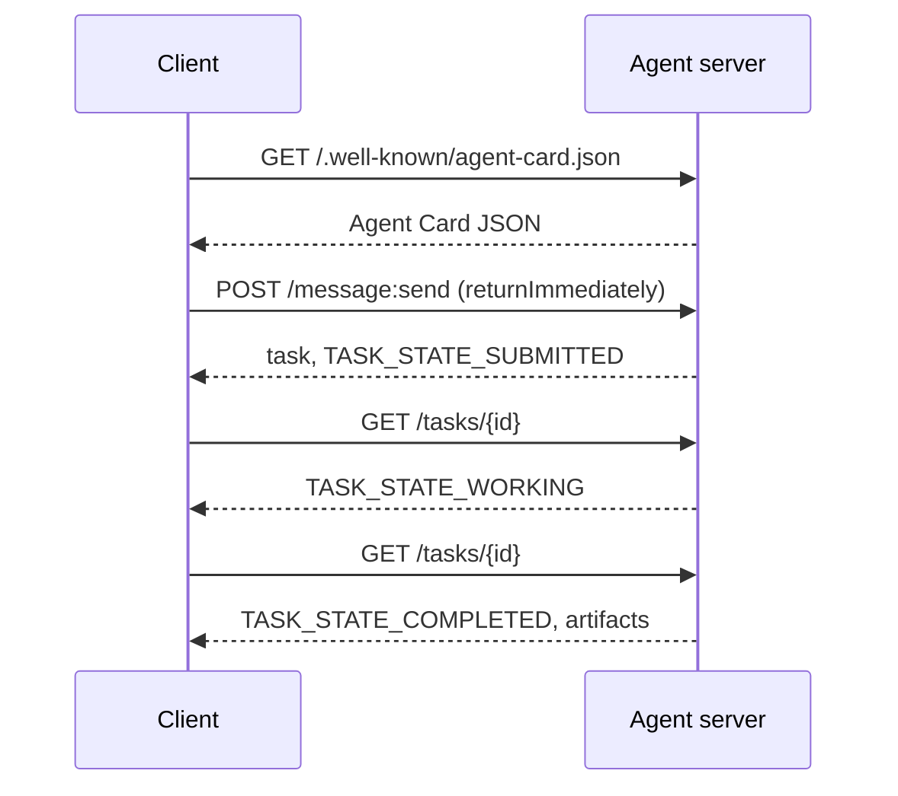

# A2A —— 代理對代理協定

> Google 在 2025 年 4 月宣布 A2A；到 2026 年 4 月，規格在 https://a2a-protocol.org/latest/specification/，並有 150 個以上的組織支持它。A2A 是 MCP（第 13 課）的水平互補品：MCP 是垂直的（代理 ↔ 工具），A2A 則是點對點的（代理 ↔ 代理）。它定義了 Agent Card（發現）、帶產物的 task（文字、結構化資料、影片）、不透明的任務生命週期，以及認證。生產系統愈來愈常把 MCP 與 A2A 配在一起。Google Cloud 在 2025-2026 年間把 A2A 支援導入了 Vertex AI Agent Builder。

**類型：** 學習 + 建構
**程式語言：** Python (stdlib, `http.server`, `json`)
**先修單元：** 階段 16 · 04（原語模型）
**時間：** 約 75 分鐘

## 問題

你的代理需要呼叫另一個系統上的另一個代理。怎麼做？你可以暴露一個 HTTP 端點、定義一份自訂的 JSON schema，然後祈禱另一邊聽得懂。每一對代理都變成一次客製整合。

A2A 就是那次呼叫的通用線上協定。標準的發現、標準的任務模型、標準的傳輸、標準的產物。像 HTTP+REST，只是把代理當成一等公民。

## 概念

### 四個元素

**Agent Card。** 一份放在 `/.well-known/agent-card.json` 的 JSON 文件，描述該代理：名稱、技能、`supportedInterfaces`（端點 URL、協定綁定、協定版本）、預設的輸入與輸出媒體型別，以及認證需求（`securitySchemes` 加上 `securityRequirements`）。發現就是去讀那張卡片。

```http
GET /.well-known/agent-card.json HTTP/1.1
Host: agent.example.com
```

```json
{
  "name": "code-review-agent",
  "description": "Reviews Python and TypeScript code.",
  "version": "1.0.0",
  "supportedInterfaces": [
    {
      "url": "https://agent.example.com",
      "protocolBinding": "HTTP+JSON",
      "protocolVersion": "1.0"
    }
  ],
  "capabilities": {"streaming": false, "pushNotifications": false},
  "securitySchemes": {
    "bearer": {"httpAuthSecurityScheme": {"scheme": "Bearer"}}
  },
  "securityRequirements": [{"schemes": {"bearer": {"list": []}}}],
  "defaultInputModes": ["text/plain", "application/json"],
  "defaultOutputModes": ["application/json"],
  "skills": [
    {
      "id": "review-python",
      "name": "Review Python",
      "description": "Reviews Python code.",
      "tags": ["code-review", "python"]
    },
    {
      "id": "review-typescript",
      "name": "Review TypeScript",
      "description": "Reviews TypeScript code.",
      "tags": ["code-review", "typescript"]
    }
  ]
}
```

**Task。** 工作的單位。一個非同步、有狀態的物件，帶生命週期：`TASK_STATE_SUBMITTED` → `TASK_STATE_WORKING` → `TASK_STATE_COMPLETED` / `TASK_STATE_FAILED` / `TASK_STATE_CANCELED`。客戶端送出一則訊息，伺服器建立任務，客戶端再輪詢或訂閱更新。

**Artifact。** 任務產出的結果型別。文字、結構化 JSON、影像、影片、音訊。產物是具型別的：每個部分帶有 `text`、`raw`、`url` 或 `data` 其中之一，並可標明它的 `mediaType`，所以不同模態都是一等公民。

**不透明的生命週期。** A2A 不規定遠端代理*怎麼*解那項任務。客戶端看到的是狀態轉移與產物；實作可以自由使用任何框架。

### MCP 與 A2A 的分工

- **MCP**（第 13 課）：代理 ↔ 工具。代理透過 JSON-RPC 對一台工具伺服器讀寫。預設無狀態。
- **A2A**：代理 ↔ 代理。同儕協定；兩邊都是有自己推理能力的代理。

生產級的多代理系統兩者都用。一個 A2A 同儕在自己那一側呼叫 MCP 工具。這個分工讓兩種關注點保持乾淨。

### 發現流程



這些是 HTTP+JSON 綁定的路由，每個請求都帶著 `A2A-Version: 1.0`。預設情況下，`SendMessage` 會一直阻塞到任務進入終止或中斷狀態，所以輪詢型的客戶端要設定 `configuration.returnImmediately`，才能立刻拿回任務。

或者用串流：`POST /message:stream` 回傳 Server-Sent Events（先是一個 `task`，接著是 `statusUpdate` 與 `artifactUpdate` 事件），而 `/tasks/{id}:subscribe` 可以重新接上一個執行中的任務。任務進入終止狀態時串流就會關閉；沒有 `final` 旗標。

### 認證

A2A 支援三種常見模式：

- **Bearer token**：OAuth2 或不透明權杖（`httpAuthSecurityScheme` 或 `oauth2SecurityScheme`）。
- **mTLS**：雙向 TLS；組織之間彼此證明身分（`mtlsSecurityScheme`）。
- **API key**：放在標頭、查詢參數或 cookie 裡的金鑰（`apiKeySecurityScheme`）。

認證在 Agent Card 中宣告：`securitySchemes` 為每種方案命名，`securityRequirements` 說明客戶端必須滿足哪些方案。客戶端據以發現並遵守。

### 到 2026 年 4 月有 150 個以上的組織

企業採用推動了 A2A 的規模。頭條是：A2A 成了企業代理系統跨越信任邊界的方式。Google Cloud 出貨了 Vertex AI Agent Builder 的 A2A 支援；Microsoft Agent Framework 支援它；多數主要框架（LangGraph、CrewAI、AutoGen）都出貨了 A2A 轉接器。

### A2A 贏在哪

- **跨組織呼叫。** A 公司的代理呼叫 B 公司的代理。沒有 A2A，每一對都是一份客製合約。
- **異質框架。** LangGraph 代理呼叫 CrewAI 代理呼叫自製 Python 代理。A2A 把它們正規化。
- **具型別的產物。** 影片結果、結構化 JSON、音訊 —— 全都是一等公民。
- **長時間執行的任務。** 不透明生命週期 + 輪詢，讓數小時的任務變得直白。

### A2A 吃力的地方

- **對延遲敏感的微呼叫。** A2A 的生命週期是非同步的。次毫秒級的代理對代理不適合；用直接 RPC。
- **緊耦合的行程內代理。** 若兩個代理都跑在同一個 Python 行程裡，A2A 的 HTTP 往返是殺雞用牛刀。
- **小團隊。** 規格的開銷是真的；只在內部用的代理可能不需要那份形式化。

### A2A 對上 ACP、ANP、NLIP

2024-2026 年間冒出好幾份相關規格：

- **ACP**（IBM／Linux Foundation）—— A2A 的前身，範圍較窄。
- **ANP**（Agent Network Protocol）—— 重同儕發現、以去中心化為先。
- **NLIP**（Ecma 的 Natural Language Interaction Protocol，2025 年 12 月標準化）—— 自然語言的內容型別。

截至 2026 年 4 月，A2A 是採用度最高的同儕協定。比較請見 arXiv:2505.02279（Liu 等人，〈A Survey of Agent Interoperability Protocols〉）。

```figure
sw-agent-card-discovery
```

## 建構它

`code/main.py` 用 `http.server` 與 JSON 實作一個最小的 A2A 伺服器與客戶端，採用 1.0 的 HTTP+JSON 綁定。伺服器：

- 暴露 `/.well-known/agent-card.json`，
- 接受 `POST /message:send`，
- 管理任務狀態，
- 在 `GET /tasks/{id}` 回傳產物。

客戶端：

- 抓取 Agent Card，
- 帶著 `returnImmediately` 送出一則訊息，
- 輪詢到完成，
- 讀取那份產物。

跑：

```
python3 code/main.py
```

這支腳本在背景執行緒中啟動伺服器，然後對它跑客戶端。你會看到完整流程：發現、送出、輪詢、產物。

## 框架應用

`outputs/skill-a2a-integrator.md` 設計一次 A2A 整合：Agent Card 的內容、任務 schema、認證選擇、串流或輪詢。

## 產出交付

檢查清單：

- **釘住規格版本。** A2A 仍在演進；每個 `supportedInterfaces` 項目都宣告它的 `protocolVersion`，客戶端則送出 `A2A-Version: 1.0`。
- **冪等的任務建立。** 重複送出（網路重試）應該只產生一項任務。以客戶端的 `messageId` 去重。
- **產物 schema。** 宣告該代理回傳哪些形狀；消費者應該做驗證。
- **速率限制 + 認證。** A2A 是對外的；套用標準的網頁安全做法。
- **失敗任務的死信。** 隨時間檢視樣式，找出反覆出現的失敗型別。

## 練習

1. 跑 `code/main.py`。確認客戶端發現得了伺服器，並收到正確的產物。
2. 替伺服器加上第二項技能（例如「summarize」）。更新 Agent Card。寫一個依任務型別挑技能的客戶端。1.0 的請求沒有技能欄位，所以伺服器要依訊息的各個部分來路由。
3. 實作 `POST /message:stream`：以 Server-Sent Events 回應（先是一個 `task`，接著是 `statusUpdate` 事件），並在終止狀態時關閉串流。客戶端需要做哪些不一樣的事？
4. 讀 A2A 規格（https://a2a-protocol.org/latest/specification/）。指認出三項規格要求、而這個示範沒有實作的東西。
5. 把 A2A（Agent Card 式的發現）跟 MCP（透過 `listTools` 的伺服器端能力列舉）做比較。自我描述的代理與能力探測之間的取捨是什麼？

## 關鍵術語

| 術語 | 大家怎麼說 | 實際是什麼意思 |
|------|----------------|------------------------|
| A2A | 「代理對代理」 | 讓代理跨系統呼叫其他代理的同儕協定。Google 2025 年推出。 |
| Agent Card | 「代理的名片」 | 放在 `/.well-known/agent-card.json` 的 JSON，描述技能、`supportedInterfaces`、認證。 |
| Task | 「工作的單位」 | 帶生命週期的非同步有狀態物件；完成時產出產物。 |
| Artifact | 「那個結果」 | 具型別的輸出：文字、結構化 JSON、影像、影片、音訊。媒體是一等公民。 |
| 不透明生命週期 | 「怎麼解是代理自己的事」 | 客戶端看到狀態轉移；伺服器可自由選擇框架／工具。 |
| 發現 | 「找到那個代理」 | `GET /.well-known/agent-card.json` 回傳那張卡片。 |
| MCP vs A2A | 「工具對上同儕」 | MCP：垂直的代理 ↔ 工具。A2A：水平的代理 ↔ 代理。 |
| ACP／ANP／NLIP | 「手足協定」 | 相鄰的規格；2026 年 A2A 採用度最高。 |

## 延伸閱讀

- [A2A specification](https://a2a-protocol.org/latest/specification/) —— 那份正典規格
- [A2A v1.0.1 release](https://github.com/a2aproject/A2A/tree/v1.0.1)：本課依循的、已打標籤的 `docs/specification.md` 與 `specification/a2a.proto`
- [Google Developers Blog — A2A announcement](https://developers.googleblog.com/en/a2a-a-new-era-of-agent-interoperability/) —— 2025 年 4 月的發布貼文
- [A2A GitHub repo](https://github.com/a2aproject/A2A) —— 參考實作與 SDK
- [Liu et al. — A Survey of Agent Interoperability Protocols](https://arxiv.org/html/2505.02279v1) —— MCP、ACP、A2A、ANP 的比較
